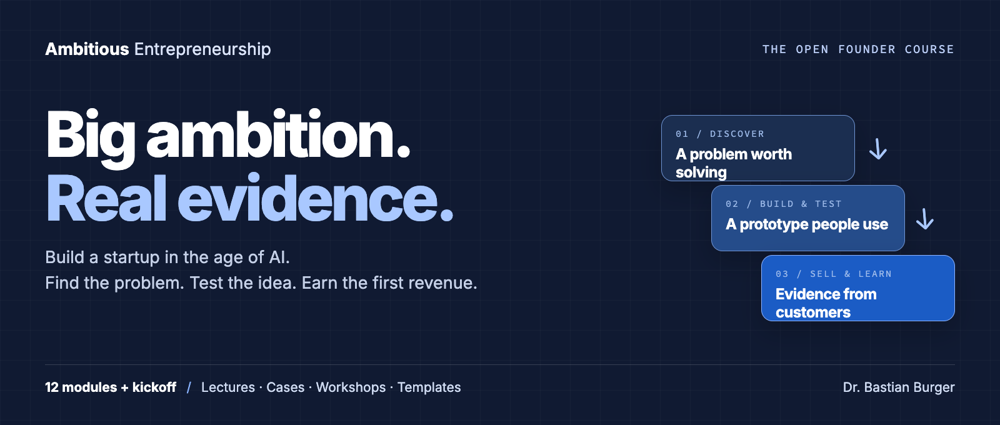
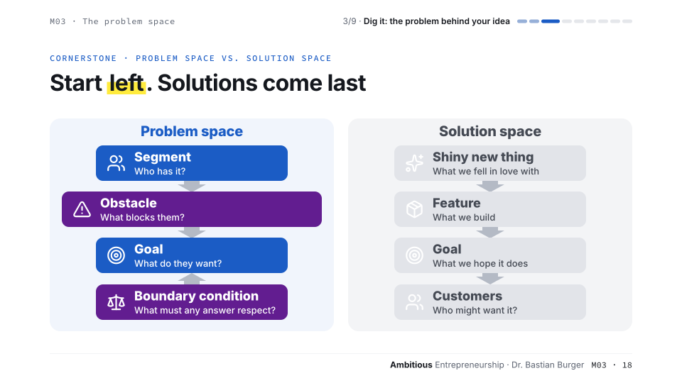
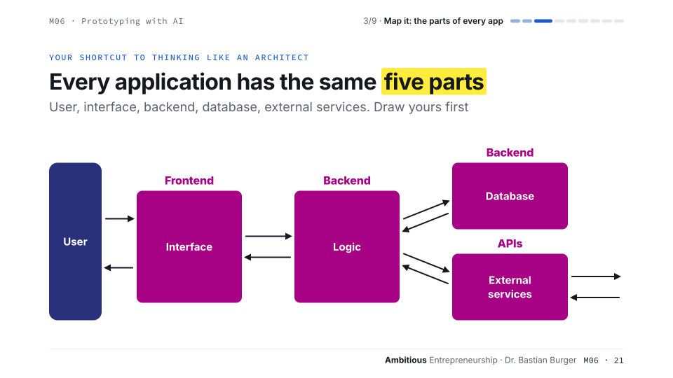
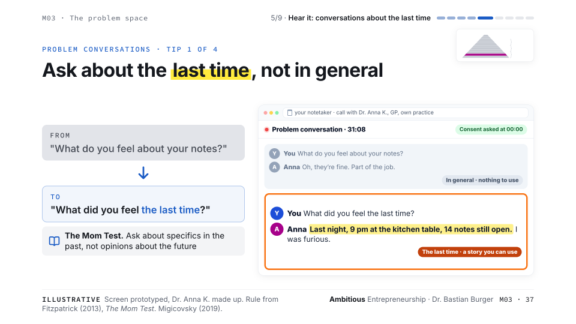
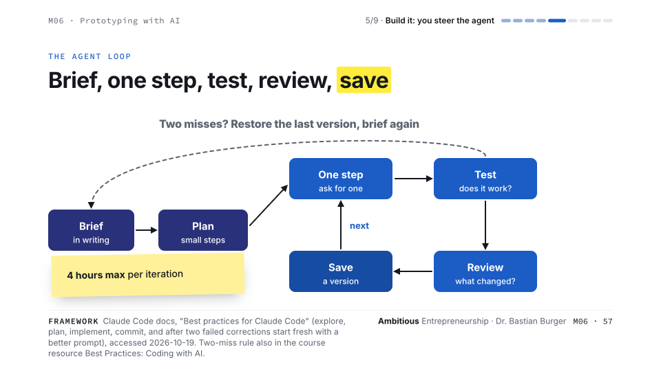
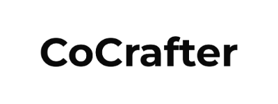
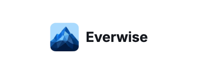

<!-- Updated: 2026-11-04 -->



# Ambitious Entrepreneurship

**The free, open course for founders who want to build a big company in the age of AI.**

AI made building cheap. Finding out what to build, and who will pay for it, is still the hard part. Go from an idea to real users, real evidence and first revenue — or a well-argued decision to stop.

**[Start the course →](modules/00-kickoff/)** &nbsp; · &nbsp; **[Download everything ↓](https://github.com/BaNburger/AmbitiousEntrepreneurship/archive/refs/heads/main.zip)** &nbsp; · &nbsp; **[⭐ Star on GitHub](https://github.com/BaNburger/AmbitiousEntrepreneurship)**

12 modules + kickoff · 7 decision tools · Editable templates · [CC BY-NC-SA 4.0](LICENSE.md)

**Useful for your next venture?** Click **Star** at the top of this GitHub page to save the course and help other founders discover it. You need a free GitHub account to star; you can read and download without one.

[What you will learn](#what-you-will-learn) · [Look inside](#look-inside) · [Get the materials](#get-the-materials) · [Alumni ventures](#founders-who-have-taken-the-course) · [All modules](#the-12-modules--kickoff) · [Teach with it](#teach-with-it)

## Taught at Universities and Founder Programs

<p>
<a href="https://www.tum.de/en/"></a>
<a href="https://www.lmu.de/en/"></a>
<a href="https://www.hhl.de/"></a>
<a href="https://ethz.ch/en.html"></a>
<a href="https://www.whu.edu/en/"></a>
<a href="https://www.cdtm.com/"></a>
<a href="https://www.startglobal.org/"></a>
<a href="https://yeti-leipzig.org/"></a>
<a href="https://www.tum-ai.com/"></a>
</p>

Created and taught by [Dr. Bastian Burger](https://burgerconsult.com).

## What You Will Learn

| | You will learn to… | You leave with… |
|---|---|---|
|  | **Build a team that can commit.** Find co-founders and make expectations explicit. | A team agreement and a way to hold each other accountable. |
|  | **Find a problem worth solving.** Ask about real behaviour, hear the cost and choose a customer segment. | An interview log and a problem backed by evidence. |
|  | **Test demand before you build.** Turn assumptions into experiments that can prove you wrong. | Evidence from tests with real people. |
|  | **Build the smallest useful prototype with AI.** Brief an agent, work in small steps and test the result. | A working slice that users can try. |
|  | **Win your first customers.** Sell by hand, learn from use and decide what to build next. | First-user outreach and a path to revenue. |
|  | **Make the hard calls.** Go, pivot or kill; protect your health; tell a credible funding story. | A decision you can defend with evidence. |

**The outcome:** a venture you have tested, a repeatable way to test the next idea, and the judgment to tell traction from noise.

## Look Inside

Real slides from the course. Click a preview to open its module and get the lecture PDF, workshop, case and homework.

On a phone? Open the slides at full size: [Problem space](media/front-page/preview-problem.png) · [Prototyping](media/front-page/preview-prototype.png).

| Discover the problem | Build with AI |
|---|---|
| [](modules/03-problem-space/) | [](modules/06-prototyping/) |
| **Start with the problem.** [The Problem Space →](modules/03-problem-space/) | **Understand what you are building.** [Prototyping with AI →](modules/06-prototyping/) |

<details>
<summary>Two more examples: better interviews and working with a coding agent</summary>





</details>

## Get the Materials

**New to GitHub?** Think of this page as a shared folder. You can read it online or download the course. No coding, terminal or installation needed.

| What you want | What to do |
|---|---|
| **Read online** | Open [Module 00](modules/00-kickoff/). Its guide links to the lecture, workshop, case and homework. Click a `.md` file to read it on GitHub or a `.pdf` to preview it. |
| **Download the whole course** | Click **[Download everything (.zip)](https://github.com/BaNburger/AmbitiousEntrepreneurship/archive/refs/heads/main.zip)**. Open your Downloads folder, then unzip the file: double-click on Mac, or right-click → **Extract All…** on Windows. Open the `modules` folder and begin with `00-kickoff`. |
| **Save one PDF or spreadsheet** | Open the file from a module guide, then click **Download raw file** (the downward arrow near the top right of the file view). PDFs open in your usual reader; `.xlsx` templates open in Excel or can be imported into Google Sheets. |
| **Present the slides** | Download and unzip the whole course, then open a lecture’s `.html` file in your browser. Keep the downloaded folders together. For reading, use the lecture PDF. |

You can also download the ZIP from the green **Code** button near the top of the repository → **Download ZIP**. Re-download when you want the latest materials; saved copies do not update automatically.

## Founders Who Have Taken the Course

Founders from Bastian’s teaching have gone on to build these companies. Explore their work:

<table>
<tr>
<td align="center" width="33%"><a href="https://interaction.co/"><br><strong>The Interaction Company</strong></a></td>
<td align="center" width="33%"><a href="https://www.trail-ml.com/"><br><strong>trail ML</strong></a></td>
<td align="center" width="33%"><a href="https://leapingai.com/"><br><strong>Leaping AI</strong></a></td>
</tr>
<tr>
<td align="center" width="33%"><a href="https://www.manex.ai/"><br><strong>Manex AI</strong></a></td>
<td align="center" width="33%"><a href="https://dryft.ai/"><br><strong>Dryft</strong></a></td>
<td align="center" width="33%"><a href="https://www.cocrafter.com/"><br><strong>CoCrafter</strong></a></td>
</tr>
<tr>
<td align="center" width="33%"><a href="https://www.spherecast.ai/"><br><strong>Spherecast</strong></a></td>
<td align="center" width="33%"><a href="https://heytenor.com/"><br><strong>Tenor</strong></a></td>
<td align="center" width="33%"><a href="https://nemox.ai/"><br><strong>nemox</strong></a></td>
</tr>
<tr>
<td align="center" width="33%"><a href="https://erntezait.de/"><br><strong>ERNTEZAIT</strong></a></td>
<td align="center" width="33%"><a href="https://www.linkedin.com/posts/hhl-leipzig-graduate-school-of-management_hhl-startup-entrepreneurship-activity-7404474973618405376-xmU7"><br><strong>RefuelU</strong></a></td>
<td align="center" width="33%"><a href="https://everwise.ai/"><br><strong>Everwise</strong></a></td>
</tr>
</table>

<sub>Logos are trademarks of their owners. Institutional logos identify where the course has been taught; company logos identify alumni ventures. Names are used where an official logo was unavailable. [Image credits](media/front-page/CREDITS.md).</sub>

---

## Pick Your Starting Point

| You are | Start here | Then |
|---|---|---|
| **In a course that uses it** | [Module 00](modules/00-kickoff/) | Your lecturer tells you which blocks your course runs. Hit the homework bar every week. |
| **A founder on your own** | [Module 00](modules/00-kickoff/), its lecture and its homework | Find co-founders, then join a few other teams and take one module a week together. See [Work Self-Paced](#work-self-paced). |
| **Stuck on one decision right now** | [The frameworks](#the-frameworks) | Each one-pager changes one decision, such as what to ask in an interview or whether to kill. |
| **A lecturer** | [Teach With It](#teach-with-it) | Use everything for free. Teaching instructions on request. |

**Already further along?** Jump in where your venture is.

- **No team yet, or not the right one** → [01 Team & Foundations](modules/01-team-foundations/)
- **An idea, but no evidence that anyone has the problem** → [03 The Problem Space](modules/03-problem-space/)
- **Evidence of the problem, but no solution yet** → [05 The Solution Space](modules/05-solution-space/)
- **A prototype, but no paying users** → [08 Finding First Users](modules/08-first-users/)
- **Paying users, and the question what to build next** → [10 Product Management & Growth](modules/10-product-management/)

---

## How Every Module Works

One module is one week, and every module is built from the same six parts:

1. **Intro & recap** — where your team stands, and what last week's work taught you
2. **Your ideas** — every team shows where its venture is at, in 3 minutes or less
3. **Input session** — the lecture, with the few ideas that change how you decide
4. **Case** — a real company, the decision it faced and the evidence it had, read before class
5. **Workshop** — 90 minutes of doing, not listening, on your own venture
6. **Homework** — this week's bar, the result to reach with real people before the next module

Which parts you use depends on the format. In class they run as up to three blocks of about 90 minutes. The input session holds the intro, recap, read-out, lecture and homework, and the case discussion and the workshop are the other two. Your lecturer picks the blocks, for example the input session and the workshop as a seminar, or the cases alone. Each block works without the others.

### Work Self-Paced

On your own, the input session and the homework push you furthest toward a real company. Read the lecture, then go out and hit the bar. If you do everything, cases and workshops included, plan for at least 12 weeks of full-time work.

Don't do it alone. Form an accountability group of 3 to 7 teams at your pace, the way Y Combinator groups its batches. Share your numbers every week, 3 minutes per team or a short written post. Every two weeks, meet for 45 minutes at most. Each team reports its last goal against the actual and says candidly why. Then it sets one goal for the next two weeks, and the group tests it: does it teach you something about customers, bring revenue closer, build a lasting business? Hit every goal, and your goals were too small. Run the group from the [Accountability Group Tracker](resources/Accountability_Group_Tracker.xlsx) and run the workshops together. A room of peers who see your numbers is the cheapest accountability you will ever get.

Every module folder holds exactly what you need: `README` (start here) · lecture slides · workshop · case study · homework.

---

## The 12 Modules (+ Kickoff)

| # | Module | Core question | Case | Workshop |
|---|--------|---------------|------|----------|
| 00 | [Kickoff — No-Bullshit Entrepreneurship](modules/00-kickoff/) | What kills startups — and what will this course demand from you? | Juicero | Startup Autopsy |
| 01 | [Team & Foundations](modules/01-team-foundations/) | Why do the best teams beat the best ideas? | ProGlove | Find Your Team |
| 02 | [Finding Ideas](modules/02-finding-ideas/) | Where do startup ideas actually come from? | Flixbus | Idea Stress Test |
| 03 | [The Problem Space](modules/03-problem-space/) | Is this a real problem — or just an interesting one? | Konux | Pain Mining |
| 04 | [Validating Problems](modules/04-validating-problems/) | What evidence would change your mind? | Fairphone | Landing Page Sprint |
| 05 | [The Solution Space](modules/05-solution-space/) | Of all the ways to solve this problem, why this one? | Freeletics | Click Dummy Sprint |
| 06 | [Prototyping with AI](modules/06-prototyping/) | What's the fastest thing you can build to learn? | Langfuse | Show & Build |
| 07 | [The Kill Decision](modules/07-rapid-validation/) | Why should this startup die? | 6Wunderkinder | Kill Your Darlings |
| 08 | [Finding First Users](modules/08-first-users/) | Who are your first ten customers — by name? | Tacto | Sell by Hand |
| 09 | [From Prototype to Product](modules/09-prototype-to-product/) | How do you turn users into revenue? | tado° | Revenue Sprint |
| 10 | [Product Management & Growth](modules/10-product-management/) | What do you build next — and what do you refuse to build? | Tally | Feature Graveyard |
| 11 | [Founder Health](modules/11-founder-health/) | How do you build a company without breaking yourself? | Pitch | The Energy Audit |
| 12 | [Fundraising & Demo Day](modules/12-fundraising-demo-day/) | Can you tell the story — and show the money? | Personio | Demo Day |

---

## The Frameworks

Standalone one-pagers in [`frameworks/`](frameworks/) — each one exists to change a decision, not to decorate a slide:

- [**Mom Test Cheatsheet**](frameworks/01_Mom_Test_Cheatsheet.md) — interview questions that produce signal instead of polite lies
- [**Validation Hierarchy of Evidence**](frameworks/02_Validation_Hierarchy.md) — the course pyramid, from anecdotes and interviews through quantitative evidence and prototypes to a payment
- [**Go / Pivot / Kill Framework**](frameworks/03_GPK_Decision_Framework.md) — structured decisions when the data is ambiguous
- [**Default Alive Calculator**](frameworks/04_Default_Alive_Calculator.md) — are you on track to survive, or burning toward zero?
- [**AI Startup Playbook**](frameworks/05_AI_Startup_Playbook.md) — patterns and anti-patterns specific to AI ventures
- [**PMF Measurement Engine**](frameworks/06_PMF_Measurement_Engine.md) — quantitative signals of product-market fit
- [**10x Value Prop Test**](frameworks/07_10x_Value_Prop_Test.md) — is your solution 10x better than the status quo?

## For Students

Before week 1, read three short pieces in [`resources/`](resources/). The [Exemplar Pack](resources/exemplars/) shows what an A-grade artifact looks like, including the A-grade kill. [Just Enough to Keep You Out of Jail](resources/LEGAL_BASICS.md) covers the practical minimum on recording, landing pages and taking money. The [Team Stack](resources/TEAM_STACK.md) is 30 minutes of setup, then go sell. Not building B2B SaaS? The [archetype guides](resources/archetypes/) translate every weekly bar for B2C, marketplace, deep tech, and hardware.

1. **Start at [Module 00](modules/00-kickoff/)** and work forward — modules build on each other
2. **The [Student Toolkit](resources/Student_Toolkit.xlsx) is your weekly companion** — interview log, experiment tracker, KPI dashboard
3. **Read the [reading list](resources/READING_LIST.md) early** — few pieces, each carefully chosen
4. **Do the homework.** Every module's deliverable feeds the next one. Skip a week and you're behind — the decks won't save you, the work will.
5. **Learn the vocabulary** in the [Glossary](resources/GLOSSARY.md). Validation means a wallet opened, and a prototype is something people pay for. You'll be corrected in check-ins, kindly, every time.
6. **Know how you're graded** with [Grading & the Revenue Ladder](resources/GRADING_RUBRIC.md). Evidence quality and decision discipline weigh as much as revenue. A rigorously argued kill can be an A. A zombie project cannot.

## Find Your Files

```
modules/        One folder per module: README, lecture, workshop, case, homework
frameworks/     7 one-page decision tools you'll use all semester
resources/      Reading list, tools & links, Student Toolkit, bonus cases
```

Every part is plain text an AI agent can read. Workshops, homework, cases and frameworks are Markdown, and rebuilt modules also ship their lecture as HTML next to the PDF. Point your agent at this repo to turn a module into a skill. To present an HTML lecture, download and unzip the whole course first, then open the lecture in your browser. Keep the `design/` folder in place so the slides load their fonts and styles.

---

## Teach With It

Teaching entrepreneurship? Take it. Everything here is free to use, adapt and teach under [CC BY-NC-SA 4.0](LICENSE.md). Credit the course, keep it non-commercial and share your changes under the same license. Each block runs on its own, so you can teach a single module, a seminar or a full semester.

Want the teaching instructions behind it? [Get in touch](https://burgerconsult.com) and I'll share what fits the modules you teach.

## About the Author

I'm Bastian Burger. I founded the industrial-logistics startup blik and led it as CEO, researched founder well-being for my PhD at HHL Leipzig, and today coach founders and CEOs and speak about AI and entrepreneurship. More about me, and how to reach me, at [burgerconsult.com](https://burgerconsult.com).

---

## License

Course materials © Bastian Burger, licensed under [CC BY-NC-SA 4.0](LICENSE.md). You may share and adapt them for non-commercial use with attribution, under the same license. Third-party logos, trademarks, screenshots and quoted material remain with their owners.

<p align="center">
  <strong>Build something people want. Help another founder do the same.</strong><br>
  If this course is useful to you, <a href="https://github.com/BaNburger/AmbitiousEntrepreneurship"><strong>give it a Star on GitHub ⭐</strong></a> and share it with your team.<br>
  <sub>Ambitious Entrepreneurship · Dr. Bastian Burger</sub>
</p>
