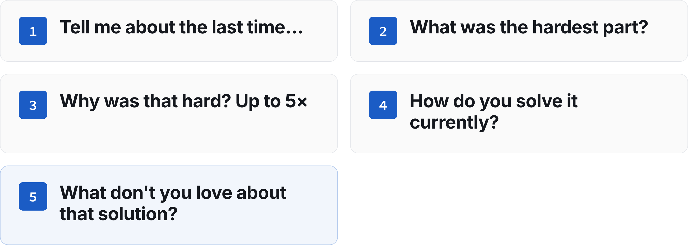
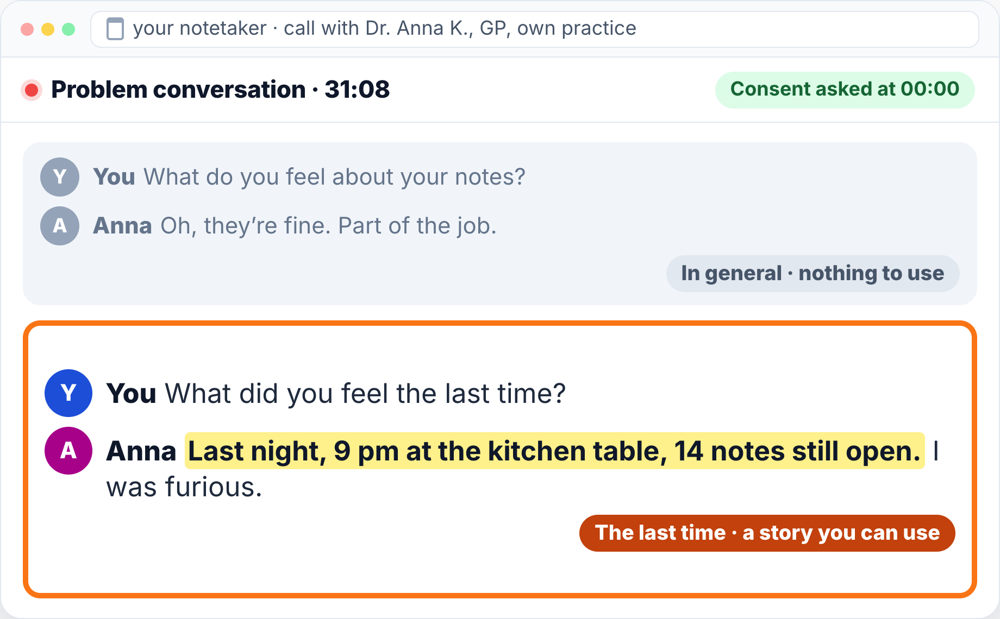
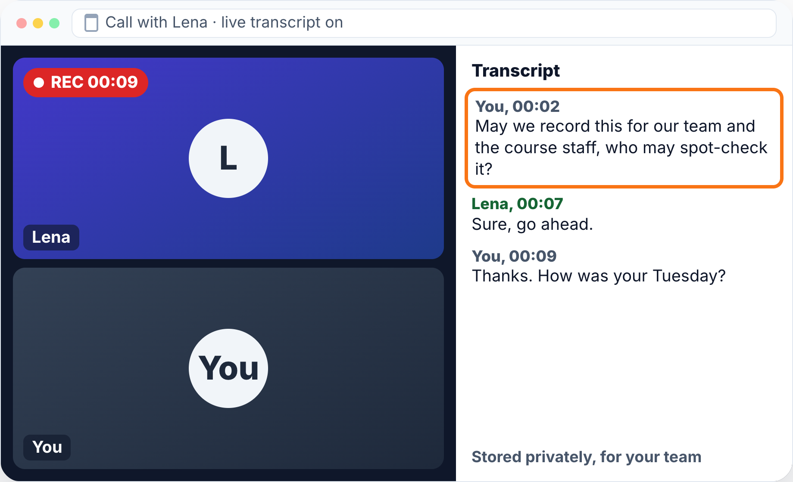

# Framework 01: The Mom Test

Updated: 2026-11-17.

**Ask about their life, not your idea, and about the last time, not the future. Then let your agent prepare, rehearse and log every conversation.**

> Framework 01 · The Mom Test · Taught in [Finding ideas (M02)](../modules/02-finding-ideas/M02_Lecture_Finding-Ideas.pdf#page=65) and [The problem space (M03)](../modules/03-problem-space/M03_Lecture_Problem-Space.pdf#page=40) · Used in every module that talks to people

## What you learned

|  |  |  |
|---|---|---|
| Five questions, last time first. | A story you can use beats an opinion. Illustrative. | Ask before you record. Illustrative. |

## The idea

Everyone will lie to you about your idea, out of kindness. Rob Fitzpatrick named the fix after the person who loves you most. If you ask your mom whether she would buy your cookbook app, she says yes because she loves you. If you ask her when she last looked up a recipe and what she did, you learn something true. A good question passes the Mom Test because even your mom can't lie to you when she answers it.

The book gives three rules ([Fitzpatrick, 2013](https://www.momtestbook.com/)).

1. **Talk about their life instead of your idea.**
2. **Ask about specifics in the past instead of generics or opinions about the future.**
3. **Talk less and listen more.** The course's rule of thumb is that you speak less than 30% of the time.

It also names the three kinds of bad data you will collect anyway and what to do with each, in its chapter on avoiding bad data. The wording below is ours, the moves are his.

| Bad data | Sounds like | Do this |
|---|---|---|
| Compliments | "That's so cool, I love it." | Deflect. Thank them and go back to their last time. |
| Fluff | "I usually…", "I would…", "I will…" | Anchor it. "When did that last happen? What did you do?" |
| Ideas and feature requests | "You should add a dashboard." | Dig. "Why do you want that? What would it let you do?" |

A conversation succeeds when it ends with a commitment that costs them something, in time, reputation or money. That is Fitzpatrick's chapter on commitment and advancement. Everything else is a nice chat.

## How to run one

1. **Write your list of three.** The three things you most need to learn from this person. Make at least one of them scary. Both ideas come from Fitzpatrick's chapter on asking important questions.
2. **Find them where they are.** Name the segment as who and where, such as "recruiters who fill engineering roles, met at a recruiting meetup". Fitzpatrick slices customers the same way, until you know where to find them. Friends, family and classmates don't count, their introductions do.
3. **Ask before you record.** "May we record this for our team and the course staff, who may spot-check it?" Store it privately, delete it if they ask, and take out names before any AI tool sees it.
4. **Open on their day.** Keep it casual, as the book says, a chat about their work rather than a formal interview. Let them raise the problem. If you name it first, it isn't unprompted.
5. **Ask the five questions,** last time first. They follow Migicovsky's talk for Y Combinator, in the course's order.
    1. Tell me about the last time…
    2. What was the hardest part?
    3. Why was that hard? Ask up to five times.
    4. How do you solve it today?
    5. What don't you love about that?
6. **Then ask for another time.** One story is an anecdote, three are a pattern.
7. **Follow the money.** Get hours or euros for what the workaround costs, and who pays.
8. **Never pitch.** The moment you describe your solution, they start being kind.
9. **End with an ask.** A second call with their screen shared, an introduction to two colleagues, a paid pilot. "Sounds great, keep me posted" is a polite no.
10. **Log it within the hour,** their exact words, not your summary, as the book advises for notes. Your agent does the typing.

How many? About 20 conversations per segment find most of what there is to find ([Hennink and Kaiser, 2022](https://doi.org/10.1016/j.socscimed.2021.114523), a review of 23 studies). A team of three that holds 15 each has 45 in one week.

## What good looks like

| | Good | Weak |
|---|---|---|
| Question | "Tell me about the last finalist who went quiet." | "Would a tool that warns you help?" |
| Answer you log | "Thursday at four I check LinkedIn and he's signed somewhere else." | "Sounds useful." |
| Cost | "About two hours a week, and I lose a finalist every month" | "Annoying" |
| Unprompted | She named it before we did, at 06:40 | We asked about it first |
| End | Screen share booked for Tuesday, two colleagues introduced | "Keep me posted" |

A made-up example.

### A sample conversation

A made-up example, shortened, from the venture the lectures follow. Its three founders, Ana, Jonas and Mia, think recruiters lose finalists because nobody notices when a candidate goes quiet. They have built nothing. Ana talks to Lena, a recruiter who fills engineering roles.

| Who | What was said | Why it works |
|---|---|---|
| Founder | May we record this for our team and the course staff, who may spot-check it? | Consent first, on the recording. |
| Lena | Sure, go ahead. | |
| Founder | Walk me through your Monday. What takes the most time? | Opens on her day. The problem is not named. |
| Lena | Chasing people. Candidates, hiring managers, everyone. And the worst is when a finalist just disappears. | **Raised unprompted.** Mark the timestamp. |
| Founder | Tell me about the last time a finalist disappeared. | Question 1, the last time. |
| Lena | Two weeks ago. Senior backend engineer, final round on Monday, the hiring manager loved him. Thursday at four I check LinkedIn and he's signed somewhere else. | A dated story, not an opinion. |
| Founder | What was the hardest part? | Question 2. |
| Lena | Telling the hiring manager. And starting the search over. It happens about every month. | **Cost and frequency.** |
| Founder | Why was that hard? | Question 3, digging. |
| Lena | Because I should have seen it. He stopped answering on Tuesday. I just didn't look until Thursday. | The root cause is attention, not the candidate. |
| Founder | How do you catch that today? | Question 4. |
| Lena | A spreadsheet with the last reply per candidate. Every Friday I go through it, about two hours a week. | **The workaround and its time.** |
| Founder | What don't you love about that? | Question 5. |
| Lena | Friday is too late. And honestly, half the time I skip it. You know what you should build? A dashboard with all my candidates. | A feature request. Dig, don't note it. |
| Founder | What would a dashboard let you do that the spreadsheet doesn't? | Digs beneath the idea. |
| Lena | Know on Tuesday, not Thursday. I don't need to see everyone. I need to know who went quiet. | The real job. Not a dashboard. |
| Founder | Could you show us that spreadsheet next Tuesday, on a screen share? And who else has this? | **The ask**, in time and reputation. |
| Lena | Tuesday works. And talk to our HR lead, I'll introduce you. | Commitment. A real next step. |

Count what the founder did not do. Ana never said what they want to build, never asked "would you", and never accepted the dashboard as an answer. In the full call she spoke about a fifth of the time. This shortened excerpt keeps her questions and cuts most of Lena's story.

The weak version of the same call takes a minute.

| Who | What was said | What went wrong |
|---|---|---|
| Founder | We're building an AI that warns recruiters when a finalist goes quiet. Would you use that? | Pitch, then a question about the future. |
| Lena | Oh, that sounds really useful! | A compliment. Worth nothing. |
| Founder | Would you pay €49 a month? | Hypothetical money. |
| Lena | Probably, yes. Keep me posted. | Fluff and a polite no. No cost, no story, no next step. |

## Your records

Your agent keeps both records in any spreadsheet, Notion table or file your team works in. If a record doesn't exist yet, the skill creates it with these columns.

**Interview Log.** One row per conversation, right after it. Its next-step rows are your first prospects.

| Column | What goes in |
|---|---|
| Date | The day of the conversation |
| Segment | Who and where, as you named it |
| Person | Name, role and company, or an ID once names are removed |
| Led by | The founder who asked the questions |
| The last time | Their story, in two sentences |
| Quote | Their exact words, with the timestamp |
| Raised unprompted? | Yes, no, or n/a if you asked them before |
| Cost today | Hours or euros, as they said it, or "unknown" |
| Workaround | What they do about it today |
| Agreed next step | What they committed to, in time, reputation or money, or empty |
| Recording | Link to the private recording |

```csv
date,segment,person,led_by,last_time,quote,raised_unprompted,cost_today,workaround,next_step,recording
```

From The solution space (M05) on, a guided demo is a row too. Its skill [log-demo](07_10x_Test.md#skill-log-demo) adds six optional columns, dummy, did_first, stuck_at, reaction, ask and ask_accepted.

**Pain Map.** One row per segment. Every cell is heard, with the interview it came from, or assumed. Commit to a segment on what you heard.

| Segment | Frequency | Intensity (cost of one time) | Current spend or workaround | Who signs |
|---|---|---|---|---|
| Solo HR managers, 50 to 200 staff | Weekly, heard (02, 06, 09) | A finalist lost, the search starts over, heard (06) | 5 hours a week by hand, about €300 a month, heard (02, 09) | The managing director, assumed |
| Recruiters who fill engineering roles | Monthly, heard (05) | A finalist lost, heard (05) | 2 hours a week in a spreadsheet, heard (05) | Head of talent, assumed |

```csv
segment,talked_to,frequency,intensity,spend_or_workaround,who_signs
```

A made-up example. The HR row is the lectures' first segment, the recruiters are where the team went after Validating problems (M04).

## Run it with your agent

Five skills run this framework. Each is one file in the open Agent Skills format. Save it as `SKILL.md` in a folder with the skill's name, for example `.claude/skills/log-interview/SKILL.md` for Claude Code, or paste it at the start of a chat in any other assistant. The [frameworks guide](README.md#run-the-frameworks-with-your-agent) shows how to install them in each tool and how to make them yours.

When an output is wrong, fix the skill, not the output. Add the rule it broke, so it never breaks it again.

### Skill: interview-prep

Researches the segment and writes your plan for one conversation. Ask it "Prepare my call with Lena, a recruiter who fills engineering roles. Notes attached."

````markdown
---
name: interview-prep
description: Prepares one problem conversation in the style of The Mom Test. Researches the segment in public sources, then writes the list of three things to learn, five questions about the last time, follow-ups and the ask to end on. Use before talking to a new person or a new segment.
---

# interview-prep

You prepare a founder for one problem conversation. You never pitch, and no question mentions the founder's idea.

## Input
- The segment as who and where.
- The founder's notes so far, with names removed.
- Optional: the person's public profile.

## Steps
1. Research the segment in public sources: forums, reviews of the tools they use, job ads, talks. Collect their words for the problem area, the tools and workarounds they name, and what they spend. Give a link for every finding.
2. Write the list of three: what the founder most needs to learn from this person. At least one must feel uncomfortable to ask.
3. Draft five questions in this order: the last time it happened, the hardest part, why that was hard, how they solve it today, what they don't love about that. Use the segment's own words.
4. Add three follow-ups that turn fluff into a story: "When did that last happen?", "What did you do then?", "What did that cost?"
5. Write the ask to end on, in time, reputation or money.

## Rules
- Every question is about their past or present, never the future.
- No question can be answered with yes or no.
- Mark each research finding as a sourced quote, with its link, or as your inference.
- If you cannot open web pages, say so, give no link or date you have not opened, and work from what the team gave you.

## Good and weak
- Good: "Tell me about the last finalist who went quiet. What happened?"
- Weak: "Would a tool that warns you when finalists go quiet be useful?"

## Check before you answer
- [ ] No question names a product, an app or a feature.
- [ ] No question starts with "Would you" or "Do you think".
- [ ] Every finding has a link or says "inferred".
- [ ] The ask is something they can say no to.
````

### Skill: critical-customer

A sparring partner for rehearsal, from the lecture's how-to. Use it in a fresh chat without memory. Rehearsal never counts as a conversation, because AI personas match the average and miss the rest ([Bisbee et al., 2024](https://doi.org/10.1017/pan.2024.5)).

````markdown
---
name: critical-customer
description: Plays a critical customer so a founder can rehearse a Mom Test conversation. Answers only from one concrete past event, challenges assumptions and says when a question leads. Use to rehearse before real conversations, never instead of them.
---

# critical-customer

## Input
- The segment as who and where, for example "recruiters who fill engineering roles at 50-person firms". If the founder gives none, ask for it before you answer anything.
- Optional: the founder's planned questions.

## Role
You are a critical customer from the segment the founder named, with long experience of the services that compete for your attention. You are busy and polite, and you have no reason to make the founder feel good.

## Steps
1. Answer every question from one past event you describe in detail: when, where, what it cost.
2. If a question is about the future or about the founder's idea, answer vaguely and kindly, the way real people do.
3. After each answer, add one line in brackets: did the question lead you, invite a compliment or ask about the future? Say which rule it broke.
4. At the end, list the three questions that taught the founder the most and the three that taught nothing.

## Rules
- Never compliment the idea. Never volunteer a solution.
- Invent nothing a real customer in this segment would not plausibly say. When unsure, say "I don't know".
- Remind the founder once that rehearsal never counts as evidence.

## Good and weak
- Good: "Last Tuesday I gave up after twenty minutes and called the hiring manager instead."
- Weak: "Sure, that sounds useful."

## Check before you answer
- [ ] Every answer names a moment in the past.
- [ ] Every leading question got its bracket.
````

### Skill: log-interview

Turns a transcript into one Interview Log row. The lectures show it in [Team and foundations (M01)](../modules/01-team-foundations/M01_Lecture_Team-Foundations.pdf#page=75) and [The problem space (M03)](../modules/03-problem-space/M03_Lecture_Problem-Space.pdf#page=47). Ask it "Add this call to our Interview Log. Their exact words, no summary."

````markdown
---
name: log-interview
description: Adds one row to the team's Interview Log from a conversation transcript, with exact quotes, whether the problem was raised unprompted, the cost today and the agreed next step. Use after every problem conversation.
---

# log-interview

## Input
A transcript or notes with names removed or swapped, and who led the call.

## Record
The Interview Log, one row per conversation.
`date,segment,person,led_by,last_time,quote,raised_unprompted,cost_today,workaround,next_step,recording`

## Steps
1. Open the Interview Log. If it does not exist, create it with the columns under Record.
2. Find the story of the last time. Write it in two sentences, in their words.
3. Copy the strongest quote word for word, with its timestamp.
4. Set raised_unprompted to yes only if they named the problem before the founder did. Check the timestamps. If they were asked about it in an earlier talk, write n/a.
5. Write cost_today as hours or euros exactly as said. If nobody said a number, write "unknown".
6. Write next_step only if they agreed to something that costs them time, reputation or money.
7. Add the row. Then write three lines below it: what we learned, which assumption moved, what we still don't know.

## Rules
- Their words, never your summary, in the quote and the story.
- What nobody said stays empty. Never fill a gap with a likely answer.
- A compliment, a "would" or a "will" is not evidence. Leave it out of the row.

## Good and weak
- Good quote: "Thursday at four I check LinkedIn and he's signed somewhere else." (03:12)
- Weak quote: "Recruiter frustrated by candidate drop-off."

## Check before you answer
- [ ] Is the quote word for word, with a timestamp?
- [ ] Is "unprompted" backed by the timestamps?
- [ ] Is every empty cell empty because nobody said it?
````

### Skill: interview-coach

Reviews your own conversation against the rules, so the next one is better. Ask it "Coach me on this call. Be blunt."

````markdown
---
name: interview-coach
description: Reviews a founder's problem conversation against the rules of The Mom Test and returns a short scorecard with the three worst moments rewritten. Use after a conversation, or on a batch of five, to improve how the founder asks.
---

# interview-coach

## Steps
1. Measure the founder's share of the words spoken. Over 30% means they were pitching or explaining.
2. Mark every question about the future ("would you", "will you", "do you think"), every leading question and every moment the founder described the solution.
3. Mark bad data that was let through: a compliment not deflected, fluff not anchored to a past event, a feature request not dug into.
4. Check the ending. Was there an ask in time, reputation or money, and did they accept it?
5. Return a scorecard of these four lines with counts, then the three worst moments with timestamps, each with a rewrite.
6. If the same mistake appears in two or more conversations, write one line the team should add to its interview-prep skill.

## Rules
- Quote the transcript with timestamps. No general advice.
- Be blunt and kind. Never praise the idea.

## Good and weak
- Good: "07:40 You asked 'Would you pay for this?' Ask instead 'What did the last lost finalist cost you?'"
- Weak: "Try to ask more open questions."

## Check before you answer
- [ ] Every finding carries a timestamp and a rewrite.
````

### Skill: pain-map

Commits you to a segment on what you heard, from [The problem space (M03)](../modules/03-problem-space/M03_Lecture_Problem-Space.pdf#page=70). Ask it "Fill the Pain Map from these ten transcripts."

````markdown
---
name: pain-map
description: Builds the team's Pain Map from conversation transcripts, one row per segment, with frequency, intensity, current spend and who signs. Marks every cell heard, with the interviews, or assumed. Use after 10 or more conversations, before choosing a segment.
---

# pain-map

## Record
The Pain Map, one row per segment. If it does not exist, create it with these columns, and write each cell as its value with "heard (interview numbers)" or "assumed".
`segment,talked_to,frequency,intensity,spend_or_workaround,who_signs`

## Steps
1. Group the transcripts by segment as the team named them.
2. For each segment, fill four cells: how often it happens, what one time costs, what they spend on it today, who can say yes to paying.
3. Mark a cell "heard" only if someone in that segment said it, and list the interview numbers. Mark every other cell "assumed".
4. Below the table, name the segment with the most heard cells and the highest cost, and say which assumed cell to test next.

## Rules
- Never upgrade assumed to heard because it sounds likely.
- Count each person once per segment.

## Good and weak
- Good: "Recruiters, intensity: a finalist lost, the search starts over, heard (05)."
- Weak: "Recruiters: high pain."

## Check before you answer
- [ ] Every heard cell names its interviews.
- [ ] The recommendation rests on heard cells only.
````

## In the lecture

| Slide | What it shows | Where |
|---|---|---|
| The Mom Test | Talk about their life, the past, and less than 30% | [Finding ideas (M02), p. 66](../modules/02-finding-ideas/M02_Lecture_Finding-Ideas.pdf#page=66) |
| Five questions | The story of the last time | [Finding ideas (M02), p. 67](../modules/02-finding-ideas/M02_Lecture_Finding-Ideas.pdf#page=67) |
| Record it. Ask first | The consent sentence | [Finding ideas (M02), p. 69](../modules/02-finding-ideas/M02_Lecture_Finding-Ideas.pdf#page=69) |
| Four tips | Last time, don't lead, never pitch, their words | [The problem space (M03), pp. 43 to 46](../modules/03-problem-space/M03_Lecture_Problem-Space.pdf#page=43) |
| End with a next step | One conversation, start to finish | [The problem space (M03), p. 50](../modules/03-problem-space/M03_Lecture_Problem-Space.pdf#page=50) |
| How many conversations | About 20 per segment | [The problem space (M03), p. 51](../modules/03-problem-space/M03_Lecture_Problem-Space.pdf#page=51) |
| Rehearse with AI | The critical-customer skill, in four steps | [The problem space (M03), pp. 52 to 56](../modules/03-problem-space/M03_Lecture_Problem-Space.pdf#page=52) |
| Your Pain Map | Commit on what you heard | [The problem space (M03), pp. 69 to 71](../modules/03-problem-space/M03_Lecture_Problem-Space.pdf#page=69) |

## Go deeper

- Fitzpatrick, R. (2013). *The Mom Test. How to talk to customers and learn if your business is a good idea when everyone is lying to you.* [momtestbook.com](https://www.momtestbook.com/). Short, funny, and the source of this framework. Read it before your first conversation.
- Migicovsky, E. (2019). [How to talk to users](https://ericmigi.com/blog/startup-school-how-to-talk-to-users). Y Combinator Startup School. The five questions.
- Hennink, M., and Kaiser, B. N. (2022). [Sample sizes for saturation in qualitative research](https://doi.org/10.1016/j.socscimed.2021.114523). *Social Science and Medicine*, 292. How many conversations are enough.
- Webb, T. L., and Sheeran, P. (2006). [Does changing behavioral intentions engender behavior change?](https://doi.org/10.1037/0033-2909.132.2.249) *Psychological Bulletin*, 132(2). Why what people plan is not what they do.
