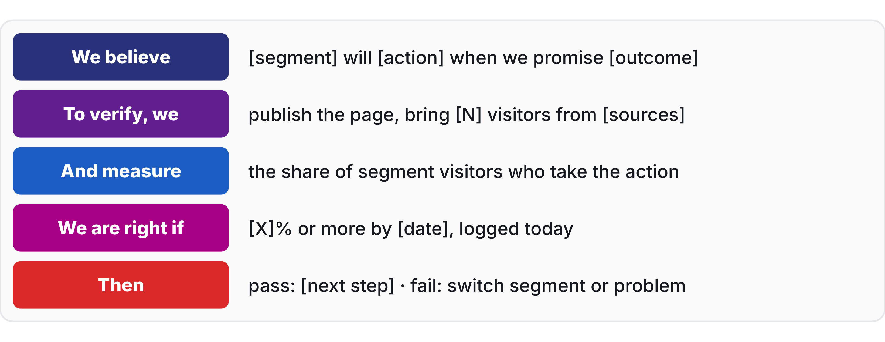
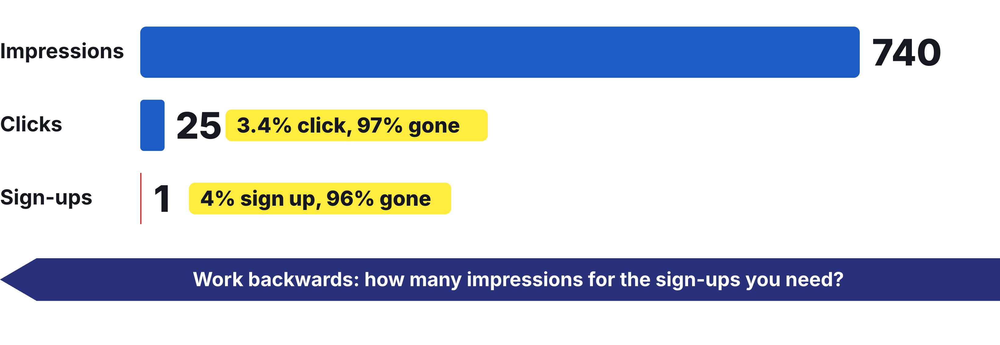
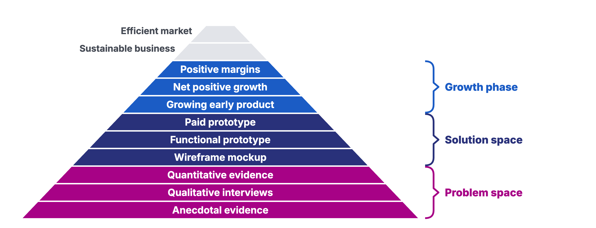

# Framework 02: The Validation Hierarchy

Updated: 2026-11-17.

**Know what your evidence is worth. Climb from what people say to what they do to what they pay, one rung at a time, and let your agent place every result on the pyramid.**

> Framework 02 · The validation hierarchy · Taught in [Validating problems (M04)](../modules/04-validating-problems/M04_Lecture_Validating-Problems.pdf#page=14) · The cornerstone of every module, from [Kickoff (M00)](../modules/00-kickoff/M00_Lecture_No-Bullshit-Entrepreneurship.pdf#page=51) to [Finding first users (M08)](../modules/08-first-users/M08_Lecture_Finding-First-Users.pdf#page=93)

## What you learned





## The pyramid



Not all evidence is equal. What people say is weaker than what they do, and what they do is weaker than what they pay. **Validation means a wallet opened**, rung 6. Everything below it is **signal**. Signal is worth collecting, because it earns you the right to run the next, more expensive test. It never proves that anyone will pay.

Three things are not on the pyramid at all. Your own opinion, an AI persona or AI critic, however convincing, and anything that buys time without testing demand, such as a grant, followers or an award.

The lecture puts the first three rungs in one line. Anecdotes diagnose. Interviews theorize. Numbers verify.

Each rung below says what it is, what counts, how to build the test and how long it takes. The examples follow the recruiting venture the later lectures use. The venture and its numbers are made up.

### Problem space, rungs 1 to 3

Is the problem real, who has it, and how many?

**1. Anecdotal evidence.** One person tells you something, or you lived it yourself. Enough to start looking, never enough to decide.

- **Counts.** A story you heard or lived, written down as a hypothesis a stranger could prove wrong.
- **Build it.** Minutes. Your agent turns your notes into one hypothesis with the [write-hypothesis skill](03_Build_Measure_Learn.md#skill-write-hypothesis).
- **In the recruiting venture.** Ana lost a hire at her last job because nobody noticed the finalist had gone quiet.

**2. Qualitative interviews.** Conversations about the last time the problem happened. They build your theory of who has the problem, what it costs and what they do today.

- **Counts.** A held conversation with a named person from your segment, about the past, with one exact quote in your log. Whether they raised the problem before you named it.
- **Doesn't count.** Friends, family and classmates. Questions about the future or your idea. AI personas, which are rehearsal.
- **Build it.** A week. The [Mom Test](01_Mom_Test.md) and its skills, 15 conversations per student, about 20 per segment.
- **In the recruiting venture.** 4 of 10 HR managers at firms of 50 to 200 staff raised lost finalists before the founders named it. They tracked it by hand, about €300 a month.

**3. Quantitative evidence.** Tests how strong the effect is that your interviews suggested, how many people in your segment act on it. A landing page that counts what people do, or a survey about past behaviour.

- **Counts.** Visitors from your segment who take the page's one action, counted per tagged link, against a line written before the first visitor.
- **Doesn't count.** Visitors from ads you can't place in your segment, friends and classmates, likes. A survey about the future or about your solution.
- **Build it.** A page in a day, with any builder, and a week to bring 100 visitors per student from your segment. A survey form takes ten minutes.
- **In the recruiting venture.** 9 of 140 tagged visitors from two recruiter groups signed up, under the 10% line. The team switched from HR managers to recruiters.

**When a survey counts.** A survey earns rung 3 only when it tests what your interviews suggested, with closed questions about what people did, sent to people who already acted, such as your sign-ups. A survey about the future or about your solution counts as opinion, however many people answer it. People overstate what they would do and pay when nothing is at stake ([Murphy et al., 2005](https://doi.org/10.1007/s10640-004-3332-z), 28 studies, [Schmidt and Bijmolt, 2020](https://doi.org/10.1007/s11747-019-00666-6), 77 studies).

### Solution space, rungs 4 to 6

Does your solution solve it, and will someone pay?

**4. Wireframe mockup.** A quick thing that only shows how the solution could look. People react to it, nothing works yet.

- **Counts.** A guided demo with a person from your segment that ends in an ask that costs them something, accepted or not.
- **Build it.** A click dummy per founder in about four hours, three of them thinking. 7 demos per dummy.
- **In the recruiting venture.** For the morning-alert dummy, 3 of the first 7 recruiters accepted the ask, a two-week trial, and 6 of 15 in all.

**5. Functional prototype.** It works. A slice of the product solves the problem for real users, even if you run parts of it by hand.

- **Counts.** A user from your segment who uses it without your help, reaches the outcome and comes back without being asked, dated in your use records.
- **Build it.** One feature, the one that makes you 10 times better, built with a coding agent in small tested steps. 10 users per student.
- **In the recruiting venture.** 31 recruiters used it without help, 14 got their first nudge, and 6 came back unprompted.

**6. Paid prototype.** Somebody opens their wallet for it. The first rung that counts as validation, everything below is signal.

- **Counts.** Money from someone outside your social graph, any amount, a paid deposit or a paid pre-order included, shown in your payment dashboard or on a numbered invoice.
- **Doesn't count.** An unpaid pre-order, a letter of intent, "I'd pay for that". They are signal.
- **Build it.** Ask named people from your segment to pay at your price. Three paying users is the first bar.
- **In the recruiting venture.** Lena paid €49 for the first month, by payment link.

### Growth phase, rungs 7 to 9

Does it work as a business, again and again? The course ends at first revenue. These rungs are where you go next.

**7. Growing early product.** Customers pay again and new ones arrive. Count it from your product's records, with a retention line written before you look, such as "half of the customers who paid 14 or more days ago used it again or paid again".

**8. Net positive growth.** You win more customers than you lose, month after month.

**9. Positive margins.** Each sale earns more than it costs to deliver.

Above the pyramid sit a **sustainable business**, which carries itself without your next funding round, and an **efficient market**, where others copy you and prices settle.

## How to climb

1. **Place what you have.** Put every piece of evidence on its rung and name your top rung honestly.
2. **Say what it can't prove.** 4 of 10 people raising a problem proves they have it. It doesn't prove how many others do, or that anyone pays.
3. **Pick the cheapest test on the next rung.** One test for one hypothesis, as [Build, measure, learn](03_Build_Measure_Learn.md) runs it. A test that takes more than a week is rarely the cheapest.
4. **Write the test card before the test.** The line, the date and what you do on a pass and a miss, logged today.
5. **Bring people from your segment.** Tag every link, so you know who brought whom.
6. **Read the result against the line,** your segment only, source by source.
7. **Climb or move.** A pass earns the next rung. A miss moves you inside the problem space, to the next segment or a neighbouring problem.

**Skip a rung when the higher test is just as cheap.** The rule is that each test earns the right to run a more expensive one, not that every rung must be climbed. Zappos started in 1999 with photos of shoes from a local shop on a website, and bought each pair at full price when someone ordered ([Swinmurn, as told to Eng, 2012](https://fortune.com/2012/09/05/nick-swinmurn-zappos-silent-founder/)). A real order cost him less than a survey would have.

If you leave Validating problems (M04) still without a number, something is wrong. Either the problem isn't real, or you are avoiding the scary tests.

## The kill question

At every rung, ask what result would make you stop, and write it down before the test runs. That is your kill line, a result you count, a date, and what you do if you cross it.

> If fewer than 3 of the first 10 new people we talk to raise this problem before we name it, we drop it and test the next one.

Written after the data, a line is commentary. How to write one, and what to do when you cross it, is in [Build, measure, learn](03_Build_Measure_Learn.md#measure-with-a-line-before-the-data).

## What good looks like

| | Good | Weak |
|---|---|---|
| Claim | "4 of 10 HR managers raised it unprompted" | "HR loves it" |
| Number | "9 of 140 tagged visitors from our segment signed up, under our line" | "400 visitors!", mostly friends |
| Top rung | "Rung 3. Nobody has paid yet." | "Validated", after a survey about the future |
| Limit | "Shows they act on the promise, not that they pay €49" | Not stated |
| Line | 10%, logged before launch | Written after the first numbers |

A made-up example.

### Example: a landing page test

A made-up example, the one the lecture shows. Team TurbineTrack thinks owner-led companies that service wind turbines will want their inspection report done the day of the job.

**The test card, logged the day before launch.** We believe owner-led turbine-service companies will request a demo when we promise "report done when the harness comes off". To verify, we publish the page and bring visitors through tagged links. We are right if at least 8% of visitors from our segment leave a work email by the end of the week. On a miss we change the promise, not the segment, because the segment evidence is strong.

**The page.** The headline is a customer's own words, "Never match photos to turbine IDs on a Friday again." One button, "Get the 3-minute demo". Impressum and a privacy line.

| Source | Visitors | From the segment? | Sign-ups | Share |
|---|---|---|---|---|
| Posts in 2 wind-industry LinkedIn groups | 61 | Yes | 7 | 11.5% |
| Direct outreach links, 30 emails | 24 | Yes | 4 | 16.7% |
| €50 of search ads | 87 | Mixed | 2 | 2.3% |
| Friends and university | 33 | No, left out | 5 | |

**The read-out.** From the segment only, 11 of 85 visitors signed up, 12.9%, over the 8% line, so the test passed. The team reported the blended share too, 8.8% of all visitors, and said which one its line was written on. The ads converted at 2.3%, because the keyword brought operators searching for software plugins, so the team stopped them and doubled the outreach. It went on to the solution space with the same promise, and the 11 sign-ups became its first list of people to sell to.

Why it is good. The line predates the data and is quoted word for word. Friends are left out without anyone asking. The blended and the segment number are both on the table.

## Your records

Your agent keeps both records in any spreadsheet, Notion table or file your team works in. If a record doesn't exist yet, the skill creates it with these columns.

**Test card.** One per test, written before the test runs. Its line goes into your [Kill Criteria Log](03_Build_Measure_Learn.md#your-records) the same day.

| Column | What goes in |
|---|---|
| Logged on | The date you wrote the card, before the first result |
| Rung | The rung the test climbs to |
| We believe | Segment, the action they will take, the promise |
| To verify, we | What you publish or do, how many people, from which sources |
| And measure | The share or count of people from your segment who take the action |
| We are right if | The line and its date, set by the founders |
| Then | What you do on a pass and on a miss |
| Result | The count against the line, filled in after the date |

```csv
logged_on,rung,segment,action,promise,method,people,sources,metric,line,by_date,if_pass,if_miss,result
```

**Traffic Sources.** One row per source and tagged link. Only visitors and sign-ups from your segment count toward a bar or a line. Ads you can't place in your segment and friends never count.

| Column | What goes in |
|---|---|
| Date | When the link went out |
| Test | The test card it belongs to |
| Source | Channel and place, such as "LinkedIn, group Wind Service Pros" |
| Tagged link | The link with its utm tags |
| Brought by | The founder whose link it is |
| From the segment? | Yes, mixed or no |
| Visitors | From the analytics, for this link |
| Sign-ups from the segment | Only people from your segment |
| Share | Sign-ups divided by visitors. Under 20 visitors, write the counts |
| Notes | What you changed, and when |

```csv
date,test,source,tagged_link,brought_by,from_segment,visitors,segment_signups,share,notes
```

## Run it with your agent

Five skills run this framework. Each is one file in the open Agent Skills format. Save it as `SKILL.md` in a folder with the skill's name, for example `.claude/skills/test-card/SKILL.md` for Claude Code, or paste it at the start of a chat in any other assistant. The [frameworks guide](README.md#run-the-frameworks-with-your-agent) shows how to install them in each tool and how to make them yours.

When an output is wrong, fix the skill, not the output. Add the rule it broke, so it never breaks it again.

### Skill: test-card

Drafts the test card from your evidence and leaves the line to you, from [Validating problems (M04)](../modules/04-validating-problems/M04_Lecture_Validating-Problems.pdf#page=37). Ask it "Fill a test card from my Pain Map and notes. Leave the line empty, we set it."

````markdown
---
name: test-card
description: Drafts a test card for one experiment from the team's Pain Map, interview notes or earlier results, and leaves the pass line for the founders to set. Logs the card with today's date before the first result. Use before any test, a landing page, a survey, a click dummy, a price ask.
---

# test-card

## Input
The Pain Map, notes or earlier results, with names removed, and the test the team wants to run.

## Record
The Test card record, one row per card, and the Kill Criteria Log, one row per test. If either does not exist, create it with these columns.
`logged_on,rung,segment,action,promise,method,people,sources,metric,line,by_date,if_pass,if_miss,result`
`logged_on,hypothesis,test,rung,line,committed_before,actual_result,line_crossed,decision,next_hypothesis`

## Steps
1. Write "We believe" as one sentence: the segment, the action they will take, the promise, in the segment's own words from the notes.
2. Write "To verify, we": what the team publishes or does, how many people, from which named sources.
3. Write "And measure": the share or count of people from the segment who take the action. One number.
4. Leave "We are right if" empty. Ask the founders for the line and the date. Never suggest a number that makes a pass likely.
5. Write "Then": the next step on a pass, and on a miss the move the team named (next segment, next problem, next solution).
6. Once the founders set the line, add the card to the Test card record and one row to the Kill Criteria Log, both dated today.

## Rules
- One card, one test, one number.
- The action must cost the person something: an email, a booked call, a payment. A like or a view is not an action.
- Only people from the segment are counted.

## Good and weak
- Good: "We believe recruiters will book a 15-minute call when we promise to know within a day when a finalist goes quiet."
- Weak: "We believe there is strong interest in AI for recruiting."

## Check before you answer
- [ ] Is the line empty until the founders set it?
- [ ] Is the card dated before the first result?
- [ ] Does the metric count only the segment?
````

### Skill: hero-copy

Writes the top of your landing page from your customers' words, not from scratch. The lecture shows it as a prompt in [Validating problems (M04)](../modules/04-validating-problems/M04_Lecture_Validating-Problems.pdf#page=58). As a skill it keeps the seven page tips every time. Ask it "Write five hero sections from these interview notes."

````markdown
---
name: hero-copy
description: Writes five variations of a landing page hero section (headline, subheadline, one button) from interview notes, each built on a quote from the segment. Follows the course's landing page tips. Use when building or rewriting a page that tests a problem.
---

# hero-copy

## Role
You are a senior copywriter who never writes a line the customers didn't give you.

## Steps
1. Read the notes. Pull the five strongest quotes about the problem and what it costs.
2. For each variation, write a headline in the customers' words, a subheadline that says what it is, for whom and which change, and one button.
3. Lead with the outcome they want, not with a feature or the technology.
4. Make the button the action that proves demand: apply, book a call, buy. Never "learn more" or "follow us".
5. Under each variation, name the quote it rests on.

## Rules
- No made-up proof. No "trusted by 10,000 teams", no invented logos or numbers.
- No "AI-powered", "platform" or "solution" in the headline.
- Ask only for what the test needs, such as a work email and a role.

## Good and weak
- Good: "Know within a day when a finalist goes quiet." Button: "Book a 15-minute call"
- Weak: "AI-powered recruiting platform." Button: "Learn more"

## Check before you answer
- [ ] Does every headline trace back to a quote?
- [ ] Does every button ask for an action that costs something?
````

### Skill: tag-links

Gives every founder and channel its own link, so you can tell who converts, from [Validating problems (M04)](../modules/04-validating-problems/M04_Lecture_Validating-Problems.pdf#page=86). Ask it "One tagged link per student and channel. Campaign m04. We are Anna and Ben."

````markdown
---
name: tag-links
description: Creates one tagged link (utm parameters) per founder and channel for a test and adds one row per link to the team's Traffic Sources record. Use before any link to a landing page, survey or product goes out.
---

# tag-links

## Input
The page address, the campaign name, the founders, and the channels each will use.

## Record
The Traffic Sources record, one row per link.
`date,test,source,tagged_link,brought_by,from_segment,visitors,segment_signups,share,notes`

## Steps
1. For each founder and each channel, build one link with four tags: utm_source (where, such as linkedin), utm_medium (how, such as post or email), utm_campaign (which test), utm_content (who sent it).
2. Open the Traffic Sources record. If it does not exist, create it with the columns under Record.
3. Add one row per link with the date, the test, the source, the link and the founder. Leave the counts empty.
4. Return the links as a list, one per founder and channel.

## Rules
- Lowercase, no spaces, no personal data beyond a first name or initials in utm_content.
- One link per founder and channel. Never reuse a link in a second channel.

## Good and weak
- Good: yourpage.de/?utm_source=linkedin&utm_medium=post&utm_campaign=m04&utm_content=anna
- Weak: yourpage.de, the same link everywhere

## Check before you answer
- [ ] Does every founder and channel have its own link and row?
````

### Skill: traffic-sources

Counts your segment, source by source, from your analytics export, from [Validating problems (M04)](../modules/04-validating-problems/M04_Lecture_Validating-Problems.pdf#page=93). Ask it "Fill the Traffic Sources sheet from these exports, names removed. Count my segment only."

````markdown
---
name: traffic-sources
description: Fills the team's Traffic Sources record from an analytics export and a sign-up export with names removed. Counts visitors and sign-ups per tagged link, keeps people outside the segment in their own row, and reads the segment-only result against the test's line. Use when a test's date arrives, and once midweek.
---

# traffic-sources

## Input
An analytics export by source, the sign-ups with role or segment but without names, and the test card with its line.

## Record
The Traffic Sources record, one row per link. If it does not exist, create it with these columns.
`date,test,source,tagged_link,brought_by,from_segment,visitors,segment_signups,share,notes`

## Steps
1. Match visitors to rows by the utm tags. Visitors without tags go into one row "untagged".
2. For each row, set from_segment to yes, mixed or no from where the link was posted and from the sign-ups' roles.
3. Count sign-ups from the segment per row. Friends, classmates and people outside the segment go into their own row and never into the total.
4. Write the share per row. Under 20 visitors in a row, write the counts instead.
5. Below the table, give the segment-only total ("11 of 85") next to the line, the blended total beside it, and say which one the line was written on.
6. Name the source that converts best and the one to stop.

## Rules
- Never move the line. If the copy changed during the test, note the date in the row.
- A sign-up is signal, not validation. Say so if anyone calls it validated.

## Good and weak
- Good: "Segment only, 11 of 85, 12.9%, over the 8% line. Blended 8.8%. Stop the ads, 2 of 87."
- Weak: "Great traction, 18 sign-ups!"

## Check before you answer
- [ ] Is every person outside the segment out of the total?
- [ ] Is the result read against the line written before the test?
````

### Skill: climb-the-pyramid

Places all your evidence on the pyramid, names your top rung honestly and plans the cheapest test on the next one. Use it before every read-out. Ask it "Where are we on the pyramid, and what is our cheapest next test?"

````markdown
---
name: climb-the-pyramid
description: Places a team's evidence on the course's hierarchy of evidence, names the highest rung it genuinely reached and what that cannot prove, then plans the cheapest test on the next rung, researching how other founders ran it. Use before a read-out, a pivot decision or a pitch.
---

# climb-the-pyramid

## The rungs
1 Anecdotal evidence (one person, or your own experience). 2 Qualitative interviews (conversations about the last time). 3 Quantitative evidence (a landing page that counts what people do, or a survey about past behaviour). 4 Wireframe mockup (people react, nothing works). 5 Functional prototype (it works for real users). 6 Paid prototype (a wallet opened, the first rung that validates). 7 Growing early product. 8 Net positive growth. 9 Positive margins.

## Input
The team's records with names removed: interview log, pain map, test cards, traffic sources, use records, pipeline. And the claims the team makes in its pitch or read-out.

## Steps
1. List every claim the team makes.
2. For each claim, find the evidence in the records and place it on its rung. A claim without evidence is opinion.
3. Name the highest rung the team genuinely reached, with the record that shows it, and say in one sentence what it cannot prove.
4. List three tests on the next rung, cheapest first, with the time and the number of people each needs.
5. Research how other founders ran the cheapest one, in public write-ups. Give the link for each finding.
6. Recommend one test and draft its test card, with the line left empty for the founders.

## Rules
- If you cannot open web pages, say so, give no link or date you have not opened, and work from what the team gave you.
- Not on the pyramid: opinion, AI personas and AI critics, grants, followers, likes, awards.
- A survey is rung 3 only with closed questions about the past, sent to people who acted. Otherwise it is opinion.
- A sign-up, a letter of intent or an unpaid pre-order is signal. Only money validates.
- Never round up. When in doubt, the lower rung.

## Good and weak
- Good: "Top rung 4: 6 of 15 recruiters accepted a trial of the morning alert. It cannot show that anyone pays €49 a month. Cheapest next test: ask the 6 to pre-order at €49 by hand."
- Weak: "You have validated demand."

## Check before you answer
- [ ] Does every rung named point to a record?
- [ ] Is the limit of the top rung stated?
- [ ] Is the line of the next test left empty?
````

## In the lecture

| Slide | What it shows | Where |
|---|---|---|
| It's a signal until somebody pays | The pyramid as the course's cornerstone | [Kickoff (M00), p. 51](../modules/00-kickoff/M00_Lecture_No-Bullshit-Entrepreneurship.pdf#page=51) |
| AI critics are not on the pyramid | What doesn't count | [Finding ideas (M02), p. 59](../modules/02-finding-ideas/M02_Lecture_Finding-Ideas.pdf#page=59) |
| From today you stand on rung two | Interviews | [The problem space (M03), p. 41](../modules/03-problem-space/M03_Lecture_Problem-Space.pdf#page=41) |
| Climb from what they say to what they pay | Every rung, explained | [Validating problems (M04), pp. 16 to 18](../modules/04-validating-problems/M04_Lecture_Validating-Problems.pdf#page=16) |
| A survey counts only when it asks about the past | The survey rule and a four-step how-to | [Validating problems (M04), pp. 19 to 23](../modules/04-validating-problems/M04_Lecture_Validating-Problems.pdf#page=19) |
| Real validation comes through the credit card | Sign-ups and users are signal | [Validating problems (M04), p. 24](../modules/04-validating-problems/M04_Lecture_Validating-Problems.pdf#page=24) |
| Write the test before the page exists | The test card and the test-card skill | [Validating problems (M04), pp. 35 to 37](../modules/04-validating-problems/M04_Lecture_Validating-Problems.pdf#page=35) |
| Missed the line? Move inside the problem space | The next segment or problem | [Validating problems (M04), p. 38](../modules/04-validating-problems/M04_Lecture_Validating-Problems.pdf#page=38) |
| A page in their words, one button | Anatomy, seven tips and the hero-copy skill | [Validating problems (M04), pp. 48 to 58](../modules/04-validating-problems/M04_Lecture_Validating-Problems.pdf#page=48) |
| A sign-up is only a signal | 59 of 64 never pay | [Validating problems (M04), p. 76](../modules/04-validating-problems/M04_Lecture_Validating-Problems.pdf#page=76) |
| Tag every link | Tagged links and the tag-links skill | [Validating problems (M04), pp. 85 and 86](../modules/04-validating-problems/M04_Lecture_Validating-Problems.pdf#page=85) |
| Find where your segment converts | The TurbineTrack example and the traffic-sources skill | [Validating problems (M04), pp. 92 and 93](../modules/04-validating-problems/M04_Lecture_Validating-Problems.pdf#page=92) |
| Every prototype answers one question | Rungs 3 to 6, module by module | [Prototyping (M06), p. 20](../modules/06-prototyping/M06_Lecture_Prototyping.pdf#page=20) |
| Will they pay? Then ask for money | Rung six | [The kill decision (M07), p. 38](../modules/07-rapid-validation/M07_Lecture_Rapid-Validation.pdf#page=38) |
| From today you climb to the wallet | Rung six, in practice | [Finding first users (M08), p. 93](../modules/08-first-users/M08_Lecture_Finding-First-Users.pdf#page=93) |

## Go deeper

- Bland, D. J., and Osterwalder, A. (2019). [*Testing Business Ideas*](https://www.wiley.com/en-us/Testing+Business+Ideas-p-9781119551447). Wiley. The test card, and a library of experiments rated by the strength of their evidence.
- Camuffo, A., Cordova, A., Gambardella, A., and Spina, C. (2020). [A scientific approach to entrepreneurial decision making](https://doi.org/10.1287/mnsc.2018.3249). *Management Science*, 66(2). In a randomized trial with 116 Italian startups, founders trained to test hypotheses pivoted more, 32% against 19%.
- Murphy, J. J., Allen, P. G., Stevens, T. H., and Weatherhead, D. (2005). [A meta-analysis of hypothetical bias in stated preference valuation](https://doi.org/10.1007/s10640-004-3332-z). *Environmental and Resource Economics*, 30(3). Why what people say they would pay is not what they pay.
- Schmidt, J., and Bijmolt, T. H. A. (2020). [Accurately measuring willingness to pay for consumer goods](https://doi.org/10.1007/s11747-019-00666-6). *Journal of the Academy of Marketing Science*, 48(3). The same bias, across 77 studies.
- Swinmurn, N., as told to Eng, D. (2012). [Nick Swinmurn, Zappos' silent founder](https://fortune.com/2012/09/05/nick-swinmurn-zappos-silent-founder/). *Fortune*. Selling shoes before owning them.
