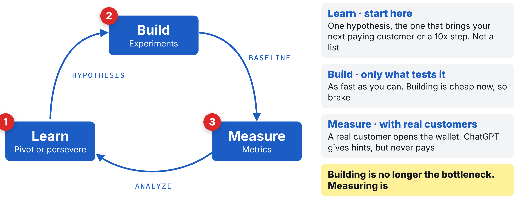
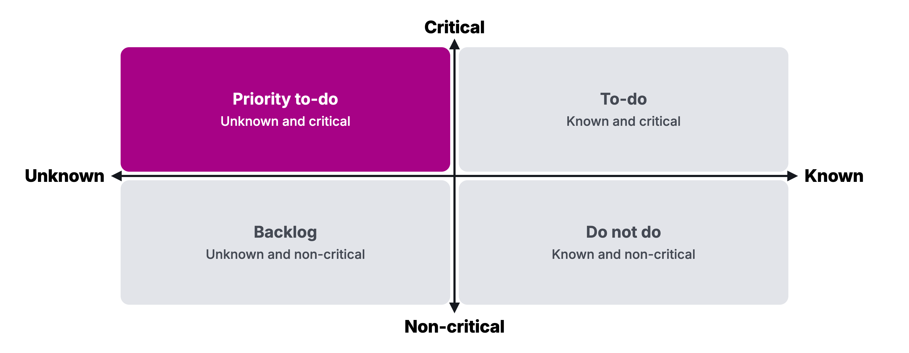
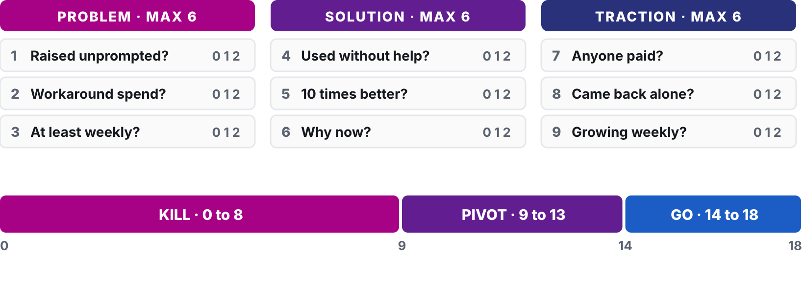

# Framework 03: Build, Measure, Learn

Updated: 2026-11-17.

**One hypothesis, the smallest build, a line before the data, then a decision. Run the loop in a day, because speed is the only edge you have over a big company.**

> Framework 03 · Build, measure, learn · Taught in [Kickoff (M00)](../modules/00-kickoff/M00_Lecture_No-Bullshit-Entrepreneurship.pdf#page=38), [Validating problems (M04)](../modules/04-validating-problems/M04_Lecture_Validating-Problems.pdf#page=31) and [The kill decision (M07)](../modules/07-rapid-validation/M07_Lecture_Rapid-Validation.pdf#page=14) · Every module runs the loop

## What you learned



## The loop today

Eric Ries wrote the loop as Build, Measure, Learn, because the work happens in that order. He planned it the other way round, from what he needed to learn (Ries, 2011). AI has moved the hard part.

- **Build got cheap.** An agent builds a prototype in an afternoon. The skill now is braking.
- **Measure is the bottleneck.** Only real customers measure, and they take time to find, to watch and to ask for money. A real customer opens the wallet. ChatGPT can give you a hint, but it never pays, so it is never your customer.
- **Learn is where you win.** Read the result against the line you wrote before, decide, and write the next hypothesis the same day.

Ries learned it the expensive way. At IMVU his team spent six months and tens of thousands of lines of code on an add-on for existing messengers. The first teenagers they showed it to didn't want to invite their friends to it, and the team threw the code away. Ries says a link to a page that didn't exist yet would have taught them as much.

Testing like this pays. In four randomized trials with 759 early-stage firms, founders trained to state hypotheses and test them stopped bad ideas 9.8 percentage points more often and about 2.7 weeks sooner. They also earned about €7,000 more on average over up to 16 months, though many earned nothing ([Camuffo et al., 2024](https://doi.org/10.1002/smj.3580)).

## Learn: one hypothesis

Start here, with your own insight. Nobody learns for you.

**One hypothesis, never a list.** A list of ten hypotheses means ten half tests and no decision. Pick the one you believe brings your next paying customer. Once you have first revenue, pick the one that brings a 10x step. If two compete, take the one that kills the venture if it is false and that you don't know yet. Astro Teller calls it the monkey. If your plan is to teach a monkey to recite Shakespeare on a pedestal, build no pedestal before the monkey talks ([Teller, 2016](https://x.company/blog/posts/tackle-the-monkey-first/)).

**Write it so a stranger could prove it wrong.** Early on, that is a problem hypothesis with five parts.

| | Good | Weak |
|---|---|---|
| Who | Recruiters who fill engineering roles | "Recruiters" |
| Problem and situation | Lose finalists who go quiet between the final round and the offer | "Hiring is broken" |
| Workaround | A spreadsheet of last replies, checked every Friday | "They need an AI assistant" |
| Cost | About 2 hours a week, and a finalist lost every month, heard from Lena | "A lot of time" |

A made-up example. The weak column names a solution, so nobody can prove it wrong.

Later the hypothesis is a test card ([Bland and Osterwalder, 2019](https://www.strategyzer.com/library/testing-business-ideas-book), as taught in Validating problems (M04)).

> **We believe that** recruiters who used the alert pay €49 a month for it, every month. **To verify, we will** each ask 10 of them to sign a €49-a-month pre-order. **We are right if** at least 3 of the first 10 sign by the next check-in. **If not,** our verdict drops one step.

A made-up example, from The kill decision (M07).

**Find the monkey with a pre-mortem** ([Klein, 2007](https://hbr.org/2007/09/performing-a-project-premortem)). It works for the venture and, with the end of the test as the horizon, for a single experiment.

1. **Imagine** the venture is dead one year from now.
2. **Write alone** why it died, every founder silently.
3. **Translate** each cause into an assumption about the customer, the solution or the business. "Nobody pays" becomes "recruiters pay €49 a month for the alert".
4. **Check** each against your records and keep only what they have not ruled out.
5. **Map** what is left as critical or not, and known (an artifact shows it) or assumed. The critical unknown is your monkey. Test it first.



## Build: the smallest thing

Build only what tests your one hypothesis, as fast as you can.

- **One theme, one feature,** the one that makes you [10 times better](07_10x_Test.md) for one segment. Whatever else you build gets measured too and blurs what you learn.
- **Often you build nothing.** A conversation, a button for something that doesn't exist yet, or the outcome delivered by hand can kill a hypothesis before any code.
- **Build to throw away.** Your first dummies are made to be binned. In The solution space (M05), every founder builds one dummy in 4 hours and shows it 7 times before the line picks the winner.
- **Ask four questions before every build** (Prototyping, M06). Does it match the problem you confirmed? For whom is it 10x better? Can you build it in 4 hours? How does it reach their hands, today, without you? Answer the ones you can't answer first.

## Measure with a line before the data

**Ask the kill question first.** "What would make us drop this?" Write the answer down before the first result, as a line. A kill line names what you count, from whom, by which date, and what you do if you miss it. A line written after the data is commentary, not a line.

Decide after the data, and everything says yes. Of 152 standard psychology papers, 96% found support for their first hypothesis. Of 71 papers whose authors filed the hypothesis before collecting data, 44% did ([Scheel, Schijen and Lakens, 2021](https://doi.org/10.1177/25152459211007467)). Founders are no different.

**The default line** when you have none yet.

> If fewer than 3 of the first 10 people from our segment do what our hypothesis assumes by [date], it is false, and we [switch segment, drop the feature, take the verdict one step down].

### The measurement ladder

Start with the fastest measurement that could still come back with a no. Climb only when a faster one can't kill the hypothesis. Each rung is a rung of the [validation hierarchy](02_Validation_Hierarchy.md#the-pyramid).

| Measurement | How fast | What it can show | Rung |
|---|---|---|---|
| **Ask** about the last time ([Mom Test](01_Mom_Test.md)) | Today, 3 talks | Who has the problem and what it costs | 2, qualitative interviews |
| **Count** what people do on a page or a fake door | A day | How many from your segment act | 3, quantitative evidence |
| **Show** a click dummy in a guided demo | Hours to build, a day to show | Whether they get it and want it | 4, wireframe mockup |
| **Watch** them use a working slice without your help | A day | Whether it solves the problem | 5, functional prototype |
| **Ask for money**, a pre-order, a deposit or a concierge offer with a price | A day | Whether they pay. A signed pre-order is signal, a payment validates | 6, paid prototype |

**As precise as possible, as approximate as necessary.** You need enough touchpoints to decide, not a study. The first 10 people from your segment usually settle a line. Write counts, "4 of 10", not percentages, until you have 20 or more.

**Who counts.** Real people from your segment, and for money only people outside your social graph. Co-founders and classmates are test users for a dry run, so test with them today rather than nobody tomorrow. They never count toward a bar. AI personas are rehearsal and never count.

### The clock

Speed is the only thing a small team has that a big company doesn't. While BMW runs one loop through its sign-offs, you can run twenty. That ratio is an illustration, not a measurement, but the logic holds. Your startup runs while cash is above zero, and every week without learning burns runway.

- **No step over 4 hours.** If it takes longer, it was too big. Cut it.
- **Think three of the four hours,** build one. Most wasted builds answer the wrong question.
- **One loop a day where you can, never longer than a week.** Ship weekly and talk to at least 15 people from your segment a week, 3 a day.

| Time | Step | What happens |
|---|---|---|
| 09:00 | Learn | Yesterday's result next to its line. Decide. Write today's one hypothesis and its line |
| 10:00 | Build | The smallest thing that tests it. Think three hours, build one |
| 14:00 | Measure | 10 people from your segment, by call, demo, link or ask |
| 18:00 | Learn | Count against the line. Log it. The next hypothesis is tomorrow's 09:00 |

A made-up day.

## Go, pivot or kill

Every loop ends in a decision. After a single test the decision is small, persevere and take the next step, or change the one thing the line says. For the venture as a whole, decide in three moves, in this order. The course runs them in The kill decision (M07), and you run them again whenever your records cross a line.

1. **Your Kill Criteria Log decides first.** A line you crossed decides, and you do what it said. Overriding a line needs an artifact and a plain sentence in your read-out that you overrode your own line.
2. **The scorecard scores the rest.** Nine questions, each scored on an artifact, never on an opinion.
3. **Announce the verdict** out loud, with the line or the score behind it. It stays provisional until the test of your monkey has run. Then you confirm it or change it.

### Score nine questions on artifacts



Score each question 0, 1 or 2. Every score names its artifact, a record and its row, a recording or a dashboard. No artifact scores 0, and that is a finding, not a missed week. 0 means no evidence or the evidence says no, 1 weak or mixed, 2 strong evidence a stranger could check.

| # | Question | 2 | 1 | 0 |
|---|---|---|---|---|
| | **Problem, max 6** | | | |
| 1 | Do people in one named segment raise the problem unprompted? | 3 or more of 10, across 10 or more conversations in that segment | 3 of 10, but fewer talks or mixed segments | Fewer than 3 of 10, or not logged |
| 2 | Do they spend time or money on a workaround today? | Money, named by the people who spend it | Time only | Nothing logged |
| 3 | Does it happen at least weekly? | Weekly or more, heard from named people | Less often, or from only some | Rare, or assumed |
| | **Solution, max 6** | | | |
| 4 | Did people from your segment use your prototype without help? | They reached the outcome without you steering | They needed help or stopped short | Nobody outside the team tried it |
| 5 | Is it [10 times better](07_10x_Test.md) on one thing, with proof? | One dimension, 10 times, heard or measured | Better, but not 10 times, or from only a few | Assumed |
| 6 | Is it possible now and wasn't two years ago? | A named change with a source, and you need it | Named, but not sourced or not needed | None |
| | **Traction, max 6** | | | |
| 7 | Has anyone paid? | Money from outside your social graph, any amount, a deposit or pre-order included | An unpaid pre-order, a letter of intent or another ask that cost them something | Interest only |
| 8 | Do users come back without being pushed? | More than one, or more than once, dated in your Use Log | Once, or only after a reminder | Nobody, or no records |
| 9 | Is a count of people from your segment growing week over week? | In each of the last two weeks or more | Once, or only views and likes | Flat, falling or not tracked |

| Total | Default verdict | What it means |
|---|---|---|
| 14 to 18 | **Go** | Real signal on all three. Stop exploring, sell the thing |
| 9 to 13 | **Pivot** | Something works, something doesn't. Change the weakest part, one thing at a time |
| 0 to 8 | **Kill** | The evidence doesn't carry the venture. Write the kill page and restart |

You may leave the zone only with evidence you name. "We have a good feeling" isn't evidence. A Go also needs one honest answer beyond the score. Will this be your office in 3 to 5 years?

**Which pivot.** Read the three sections, not only the total.

- **Problem strong, solution or traction weak.** A **type 1 pivot**, another solution to the same problem. Another form, another segment within the problem, another price model. Usually faster, often hard to cut cleanly.
- **Problem weak.** A **type 2 pivot**, back to the problem space, whether a small hop to the next segment or a long jump to another problem. It takes longer and needs a clean cut. Your interviews, Pain Map and sign-ups are where the next problem hides.

Change one thing at a time. Change everything and you aren't pivoting, you're starting over, which is fine after a kill.

### Example: a scored verdict

The made-up recruiting venture of the course, scored in The kill decision (M07). No open line was crossed, so the score decides.

| # | Score | Artifact |
|---|---|---|
| 1 | 1 | 4 of 10 raised it unprompted, but the team switched segment since, so the segments are mixed |
| 2 | 2 | About €300 a month on a workaround, Interview Log of the earlier segment |
| 3 | 2 | Weekly, heard in the interviews and named again in 9 demos |
| 4 | 2 | 14 of 31 reached the outcome alone, Use Log |
| 5 | 2 | "An hour, not a week", heard in 9 demos |
| 6 | 1 | Why now is named, not sourced |
| 7 | 2 | One paid deposit from a demo |
| 8 | 2 | 6 came back unprompted, dated in the Use Log |
| 9 | 0 | No weekly count tracked |

**14 of 18, a Go at the edge.** The weakest questions, 1, 6 and 9, say where to look next. Read strictly, questions 2 and 3 rest on an earlier segment's records. Recruiters named the same weekly hunt in the demos, which is the team's reading. Without it the total falls into the Pivot zone. One deposit is not yet a business, so the monkey is "recruiters pay €49 a month, every month", and its line went into the log before the first ask.

> If fewer than 3 of the first 10 recruiters we ask sign a €49-a-month pre-order by the next check-in, the monkey is false. A Go becomes a Pivot.

### The kill ritual

The more a decision is yours, the harder you hold on. In a classic experiment with 240 business students, those who had made the first, failed investment themselves put more money back into it than those who inherited it ([Staw, 1976](https://doi.org/10.1016/0030-5073%2876%2990005-2)). So make killing a routine. At X, Teller gives a bonus to every team that ends its own project ([Teller, 2016](https://www.ted.com/talks/astro_teller_the_unexpected_benefit_of_celebrating_failure)).

When you kill a venture, a solution or a feature nobody used, write one page with four lines.

1. **Evidence.** What it said, with the artifacts. Never "it didn't work".
2. **Line crossed.** The line from your Kill Criteria Log, with its date.
3. **Surprise.** What nobody expected. The next idea often grows from it.
4. **Next founder.** What you'd tell the next founder, in three sentences.

A well-argued kill is a result, not a failure. A project that limps on past its line is the failure.

### Example: a kill page

The made-up recruiting venture killed one of its click dummies in The solution space (M05).

> **Kill page · click dummy B, the dashboard**
>
> 1. **Evidence.** 0 of the first 7 accepted the dashboard's ask, 1 of 15 in all. Three asked for the alert without it.
> 2. **Line crossed.** Solution space (M05), "fewer than 2 of the first 7 accept the ask, drop it", logged before the first demo.
> 3. **Surprise.** Recruiters wanted to forward the alert to their hiring managers.
> 4. **Next founder.** Show the one outcome first. A dashboard is where you hide from the question. Watch what people forward.

### Restart after a kill

The course doesn't stop when your venture does. Restart from your own records, not from a blank page.

1. **Read what your records produced.** Problems people raised unprompted, segments that answered, channels that brought people.
2. **Pick the strongest asset,** often a channel or a segment rather than the product.
3. **Make a concierge offer.** No product. You deliver the outcome by hand, for a price. It is the fastest paid test there is.
4. **Name 10 people** from your records you will offer it to. Finding first users (M08) sells it, like every other team's offer.

### Example: a restart

A made-up team, Klausurly, as The kill decision (M07) shows it. It sold AI exam prep built from professors' old exams. 0 of the 9 students it asked paid €4.99 per exam, against a line of 3 of the first 10, so it killed the product. Its strongest asset was a channel, the student council's group, where 12.9% of the people who saw the link clicked. Its concierge restart was a 4-week exam sprint run by hand, €29 a seat, 30 seats, sold through the same channel. By Demo Day 23 seats had sold, €667 from people outside the founders' social graph.

## Your records

Your agent keeps all three records in any spreadsheet, Notion table or file your team works in. If a record doesn't exist yet, the skill creates it with these columns.

**Kill Criteria Log.** One row per loop, the line written before the first result. It replaces the old Experiment Tracker.

| Column | What goes in |
|---|---|
| Logged on | The date you wrote the line, before the first result |
| Hypothesis | The one hypothesis, so a stranger could prove it wrong |
| Test | The smallest build and how you measure it |
| Rung | The rung of the validation hierarchy this test can reach |
| Line | What you count, from whom, by which date, and what you do if you miss it |
| Committed before? | Yes, if the line is dated before the first result |
| Actual result | The count, with the record it comes from |
| Line crossed? | Yes, no, or running |
| Decision | Persevere, pivot or kill. Yours, never your agent's |
| Next hypothesis | The one the result points to |

```csv
logged_on,hypothesis,test,rung,line,committed_before,actual_result,line_crossed,decision,next_hypothesis
```

**Assumptions.** One row per assumption your venture still rests on. The monkey is critical and unknown.

| Column | What goes in |
|---|---|
| Date | When you wrote it |
| Assumption | One sentence about the customer, the solution or the business |
| Area | Customer, solution or business |
| Critical? | Yes if the venture dies when it is false |
| Known or assumed | Known names the artifact that shows it, otherwise assumed |
| Monkey? | Yes for the one critical unknown you test first |
| Test | The row in the Kill Criteria Log that tests it |

```csv
date,assumption,area,critical,known_or_assumed,monkey,test
```

**Verdict.** One row per verdict on the venture.

| Column | What goes in |
|---|---|
| Date | The day you decided |
| Crossed lines | The Kill Criteria Log rows that crossed their line |
| Scores | Questions 1 to 9, each 0 to 2, each with its artifact |
| Total | Out of 18 |
| Verdict | Go, pivot or kill, and for a pivot type 1 or 2 |
| Status | Provisional or confirmed, with the date |
| Next | The offer and price you sell next, and the 10 people you offer it to |
| Kill page | A link, if you killed something |

```csv
date,crossed_lines,scores,total,verdict,status,next,kill_page
```

## Run it with your agent

Six skills run this framework. Each is one file in the open Agent Skills format. Save it as `SKILL.md` in a folder with the skill's name, for example `.claude/skills/next-loop/SKILL.md` for Claude Code, or paste it at the start of a chat in any other assistant. The [frameworks guide](README.md#run-the-frameworks-with-your-agent) shows how to install them in each tool and how to make them yours.

Your agent drafts, counts and checks. It never writes the line and never makes the decision. Every number it proposes is your bet until you set it. When an output is wrong, fix the skill, not the output.

### Skill: write-hypothesis

Turns your notes into one hypothesis a stranger could prove wrong, as in [Kickoff (M00)](../modules/00-kickoff/M00_Lecture_No-Bullshit-Entrepreneurship.pdf#page=48). Ask it "Turn my notes into one row. Flag anything that names a solution."

````markdown
---
name: write-hypothesis
description: Turns a founder's notes into one problem hypothesis with five parts (who, problem, situation, workaround, cost) that a stranger could prove wrong, and flags every word that names a solution. Use when a team writes or rewrites the hypothesis it tests next.
---

# write-hypothesis

## Input
Notes from conversations or observations, with names removed.

## Steps
1. Find who has the problem. Name a segment narrow enough to find ten of them by Friday.
2. Write the problem and the situation it happens in, in their words.
3. Write the workaround they use today.
4. Write the cost in hours or euros, only as a named person said it. Otherwise write "cost: our guess".
5. Return one sentence: "[Who] struggle to [problem] when [situation]. Today they [workaround], which costs them [cost]."
6. List every word in the notes that names a solution (an app, a platform, AI, a feature) and say you left it out.

## Rules
- One hypothesis. If the notes hold several, return the one with the strongest heard cost and name the others in one line.
- No solution in the hypothesis. A solution can't be proven wrong by asking about the past.

## Good and weak
- Good: "Recruiters who fill engineering roles lose finalists who go quiet before the offer. Today they check a spreadsheet every Friday, which costs them about 2 hours a week (heard from Lena)."
- Weak: "Recruiters need an AI assistant for candidate engagement."

## Check before you answer
- [ ] Could ten people from this segment prove it wrong in one conversation each?
- [ ] Is every cost either quoted or marked as a guess?
````

### Skill: next-loop

The skill that keeps the loop short. It reads your last result and plans the next turn, one hypothesis, the smallest build, the fastest measurement and a day of 4-hour steps. Ask it "Plan our next loop from yesterday's result."

````markdown
---
name: next-loop
description: Plans the team's next turn of Build-Measure-Learn from its latest result. Writes the one next hypothesis (toward the next paying customer, or toward a 10x step once the team has revenue), the smallest build that tests it, the fastest measurement that could still say no, a proposed line, and a plan in steps of 4 hours or less. Use after every result, ideally every day.
---

# next-loop

## Input
- The Kill Criteria Log, and the newest result next to its line.
- The team's other records (Interview Log, Use Log, Pipeline, Assumptions), names removed.
- Whether the team has first revenue yet.

## Record
The Kill Criteria Log, one row per loop. If it does not exist, create it with these columns.
`logged_on,hypothesis,test,rung,line,committed_before,actual_result,line_crossed,decision,next_hypothesis`

## Steps
1. Read the newest result against its line. Say in one sentence what it taught: persevere, or which one thing to change. If the line was crossed, remind the team that its log says what to do.
2. Set the goal. No revenue yet: the next paying customer. Revenue: the next 10x step.
3. Choose ONE hypothesis. Among the open assumptions, take the one that brings the goal closest and that would kill the venture if false while nobody knows yet. Write it so a stranger could prove it wrong. Give one sentence on why this one.
4. Define the smallest build: one feature, the one that makes the product 10 times better for one segment, or no build at all (a conversation, a fake door, the outcome by hand). Name one thing the team must NOT build this loop.
5. Pick the measurement: the fastest one that could still come back with a no (ask, count, show, watch, ask for money). Say who counts: people from the segment, money only from outside the founders' social graph. About 10 touchpoints usually settle it.
6. Propose a line: what is counted, from whom, by which date, and what the team does if it misses. Mark every number "your bet". The team sets the line.
7. Plan the loop in steps of 4 hours or less, ideally within one day, never more than a week. If a step needs more, cut the build.

## Rules
- One hypothesis. Never return a list of hypotheses to test.
- Never decide go, pivot or kill. Never fill the Decision column.
- ChatGPT, AI personas, friends and classmates are never customers. Co-founders and classmates may be a dry run, never a count toward the line.
- Use only facts from the records. Write "assumed" where they are silent.

## Good and weak
- Good: "Hypothesis: recruiters who used the alert pay €49 a month. Build: nothing new, a pre-order form. Measure: each founder asks 10 users. Line (your bet): fewer than 3 of the first 10 sign by Friday and the verdict drops a step. Plan: 09:00 to 10:00 form and message, 10:00 to 14:00 calls, 14:00 to 18:00 calls and log."
- Weak: "Next, test pricing, onboarding, the dashboard and a WhatsApp channel, and survey 200 recruiters."

## Check before you answer
- [ ] Exactly one hypothesis, written so it can fail.
- [ ] One thing named that the team must not build.
- [ ] No step longer than 4 hours.
- [ ] Every number marked as the team's bet.
````

### Skill: check-assumptions

Keeps only the assumptions your records have not ruled out, as in [The kill decision (M07)](../modules/07-rapid-validation/M07_Lecture_Rapid-Validation.pdf#page=23). Ask it "Check our open assumptions against every record."

````markdown
---
name: check-assumptions
description: Checks the team's open assumptions against all of its records and marks each as ruled out, supported (with the record and row) or still assumed, then marks critical unknowns as monkey candidates. Use after a pre-mortem, before a verdict, or when a batch of new results comes in.
---

# check-assumptions

## Record
The Assumptions record, one row per assumption.
`date,assumption,area,critical,known_or_assumed,monkey,test`

## Steps
1. Open the Assumptions record. If it does not exist, create it with the columns under Record.
2. For each open assumption, search every record (Interview Log, Pain Map, Traffic Sources, Use Log, Pipeline, Kill Criteria Log) for evidence for or against it.
3. Mark it known only if an artifact shows it, and name the record and row. Mark it ruled out if the records contradict it, with the row. Otherwise leave it assumed.
4. List the assumptions that are critical and still assumed. These are the monkey candidates.

## Rules
- Known means an artifact a stranger could check, never "we think".
- Never choose the monkey. The team does.

## Good and weak
- Good: "They use the alert without help: known, Use Log rows 1 to 31, 14 of 31 reached the outcome alone."
- Weak: "They seem to like the alert."

## Check before you answer
- [ ] Every known or ruled-out mark names its record and row.
````

### Skill: feedback-to-hypotheses

Turns raw demo or interview notes into assumptions with a count and a date, as in [The kill decision (M07)](../modules/07-rapid-validation/M07_Lecture_Rapid-Validation.pdf#page=36). AI is good at turning a fuzzy quote into a statement that can fail. It is bad at telling you which one matters, so its output goes onto your assumption map, and the team picks one.

````markdown
---
name: feedback-to-hypotheses
description: Turns raw feedback notes into testable statements, each with who said it, a count and a date, and adds them to the team's Assumptions record. Use after a round of demos or conversations, before the team maps its assumptions and picks the one to test.
---

# feedback-to-hypotheses

## Record
The Assumptions record, one row per assumption. If it does not exist, create it with these columns.
`date,assumption,area,critical,known_or_assumed,monkey,test`

## Steps
1. List each assumption hidden in the raw notes, one per line.
2. Quote who said what it rests on, word for word.
3. Rewrite each as a statement that can fail, with a count and a date, for example "3 of the first 10 sign a €49 pre-order by Friday".
4. Add each to the Assumptions record as assumed.

## Rules
- Mark every number as "our bet". AI invents numbers, and the team owns them.
- Never rank them. The team maps them as critical or not, known or assumed, and picks one.

## Good and weak
- Good: "3 of the first 10 recruiters name a finalist they lost this quarter (our bet). Rests on Lena: 'It happens about every month.'"
- Weak: "Users want better engagement features."

## Check before you answer
- [ ] Every statement has a count, a date and a quote behind it.
````

### Skill: read-the-log

Puts each result next to its line, as in [The kill decision (M07)](../modules/07-rapid-validation/M07_Lecture_Rapid-Validation.pdf#page=47). Ask it "Fill Actual result, flag every crossed line, leave Decision empty."

````markdown
---
name: read-the-log
description: Fills the Actual result column of the team's Kill Criteria Log from raw results, flags every row whose line was crossed and leaves the Decision column empty for the team. Use whenever results come in and before every verdict.
---

# read-the-log

## Record
The Kill Criteria Log, one row per loop. Fill actual_result, line_crossed and, only once the founders decide, decision.
`logged_on,hypothesis,test,rung,line,committed_before,actual_result,line_crossed,decision,next_hypothesis`

## Steps
1. Match each raw result to its row in the Kill Criteria Log.
2. Write the actual result as a count with its source, for example "1 of 15, demo notes 02 to 16".
3. Compare it to the line. Set line_crossed to yes, no, or running.
4. Check committed_before: was the line dated before the first result? If not, flag the row as commentary, not a line.
5. Return the rows that crossed their line, and what each line said the team would do.

## Rules
- Never fill the Decision column. The team decides, out loud.
- Never reinterpret a line after the data. Read it as written.

## Good and weak
- Good: "Row 3, click dummy B: 0 of the first 7 accepted, line was fewer than 2 of 7. Crossed. The line says drop it."
- Weak: "Dummy B underperformed, consider iterating."

## Check before you answer
- [ ] Every result has a count and a source.
- [ ] The Decision column is untouched.
````

### Skill: kill-page

Drafts the one page that turns a kill into an asset, as in [The kill decision (M07)](../modules/07-rapid-validation/M07_Lecture_Rapid-Validation.pdf#page=68). Ask it "Draft the kill page for dummy B from this row and our demo notes."

````markdown
---
name: kill-page
description: Drafts a one-page kill write-up with four lines (evidence, line crossed, surprise, next founder) from the crossed Kill Criteria Log row and the team's notes, marking every claim it cannot back with a record. Use when the team kills a venture, a solution or a feature.
---

# kill-page

## Record
Reads the crossed row of the Kill Criteria Log and links the page in the Verdict record. If either does not exist, create it with these columns.
`logged_on,hypothesis,test,rung,line,committed_before,actual_result,line_crossed,decision,next_hypothesis`
`date,crossed_lines,scores,total,verdict,status,next,kill_page`

## Steps
1. Evidence: write what the results said, with counts and the records they come from.
2. Line crossed: quote the line from the Kill Criteria Log with the date it was logged.
3. Surprise: propose what surprised the team, mark it "my guess" and ask the team to confirm or replace it.
4. Next founder: draft three sentences of advice that follow from the evidence.
5. Link the page in the Verdict record.

## Rules
- Keep the four lines and nothing else. One page.
- Mark every sentence you can't back with a record as "unbacked".
- Never write "it didn't work".

## Good and weak
- Good: "Evidence. 0 of the first 7 accepted the dashboard's ask, 1 of 15 in all. Three asked for the alert without it."
- Weak: "The dashboard didn't resonate with users."

## Check before you answer
- [ ] Each of the four lines is there, and the surprise was confirmed by the team.
````

## In the lecture

| Slide | What it shows | Where |
|---|---|---|
| The cash constraint | Your startup runs while cash is above zero | [Kickoff (M00), p. 40](../modules/00-kickoff/M00_Lecture_No-Bullshit-Entrepreneurship.pdf#page=40) |
| While BMW runs one loop | Speed is your edge | [Kickoff (M00), p. 41](../modules/00-kickoff/M00_Lecture_No-Bullshit-Entrepreneurship.pdf#page=41) |
| Start at Learn | The loop today, and its details | [Kickoff (M00), pp. 42 and 43](../modules/00-kickoff/M00_Lecture_No-Bullshit-Entrepreneurship.pdf#page=42) |
| IMVU and the trials | Ries's six months, and what testing pays | [Kickoff (M00), pp. 44 to 46](../modules/00-kickoff/M00_Lecture_No-Bullshit-Entrepreneurship.pdf#page=44) |
| The problem hypothesis | Write it so a stranger could prove it wrong, the write-hypothesis skill | [Kickoff (M00), pp. 47 and 48](../modules/00-kickoff/M00_Lecture_No-Bullshit-Entrepreneurship.pdf#page=47) |
| Speed matters | Ship weekly, 15 people a week, no step over 4 hours | [Kickoff (M00), pp. 54 to 56](../modules/00-kickoff/M00_Lecture_No-Bullshit-Entrepreneurship.pdf#page=54) |
| Draw it | The line before the data, the test card | [Validating problems (M04), pp. 31 to 38](../modules/04-validating-problems/M04_Lecture_Validating-Problems.pdf#page=31) |
| Build to throw away | One dummy per founder, 4 hours, 7 demos | [The solution space (M05), pp. 26 and 27](../modules/05-solution-space/M05_Lecture_Solution-Space.pdf#page=26) |
| Four hours, three thinking | Think first | [The solution space (M05), p. 61](../modules/05-solution-space/M05_Lecture_Solution-Space.pdf#page=61) |
| Four questions before you build | One iteration, 4 hours | [Prototyping (M06), pp. 77 and 93](../modules/06-prototyping/M06_Lecture_Prototyping.pdf#page=93) |
| List it | The pre-mortem and the check-assumptions skill | [The kill decision (M07), pp. 18 to 23](../modules/07-rapid-validation/M07_Lecture_Rapid-Validation.pdf#page=18) |
| Rank it | Monkey first, the map, the feedback-to-hypotheses skill, test cheaply | [The kill decision (M07), pp. 31 to 39](../modules/07-rapid-validation/M07_Lecture_Rapid-Validation.pdf#page=31) |
| Judge it | The log first, then nine questions, the read-the-log skill | [The kill decision (M07), pp. 46 to 56](../modules/07-rapid-validation/M07_Lecture_Rapid-Validation.pdf#page=46) |
| Close it | The kill ritual, the kill-page skill, restart | [The kill decision (M07), pp. 63 to 72](../modules/07-rapid-validation/M07_Lecture_Rapid-Validation.pdf#page=63) |

## Go deeper

- Ries, E. (2011). *The Lean Startup.* Crown Business. The loop, the IMVU story and pivot or persevere.
- Camuffo, A., Gambardella, A., Messinese, D., Novelli, E., Paolucci, E., and Spina, C. (2024). [A scientific approach to entrepreneurial decision-making. Large-scale replication and extension](https://doi.org/10.1002/smj.3580). *Strategic Management Journal*, 45(6). The first trial is [Camuffo et al. (2020)](https://doi.org/10.1287/mnsc.2018.3249), *Management Science*, 66(2).
- Teller, A. (2016). [Tackle the monkey first](https://x.company/blog/posts/tackle-the-monkey-first/). X blog. Why the hardest part goes first.
- Klein, G. (2007). [Performing a project premortem](https://hbr.org/2007/09/performing-a-project-premortem). *Harvard Business Review.*
- Bland, D. J., and Osterwalder, A. (2019). [*Testing Business Ideas*](https://www.strategyzer.com/library/testing-business-ideas-book). Wiley. The test card and a library of experiments.
- Staw, B. M. (1976). [Knee-deep in the big muddy](https://doi.org/10.1016/0030-5073%2876%2990005-2). *Organizational Behavior and Human Performance*, 16(1). Why killing your own project is hard.
