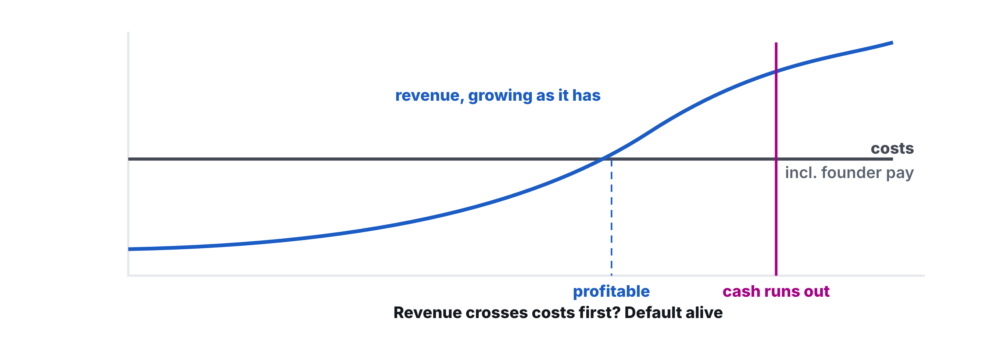
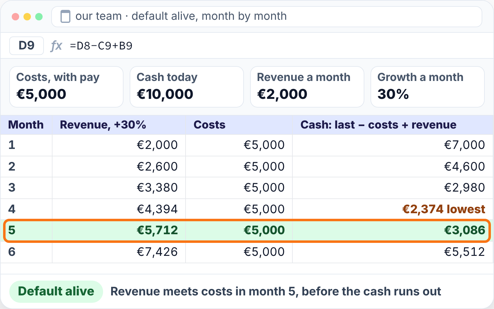

# Framework 04: Default Alive or Default Dead?

Updated: 2026-11-17.

**Will revenue cover your costs before the cash runs out? Work it out month by month, with the pay each founder needs, and look at the answer every month.**

> Framework 04 · Default alive · Taught in [Fundraising and Demo Day (M12)](../modules/12-fundraising-demo-day/M12_Lecture_Fundraising-Demo-Day.pdf#page=35) · Read every month from your first revenue on

## What you learned

{: style="max-height: 51mm" }

{: style="max-height: 72mm" }

## The idea

Paul Graham asks every startup that has run for more than 8 or 9 months the same first question ([Graham, 2015](https://paulgraham.com/aord.html)).

> "Assuming their expenses remain constant and their revenue growth is what it has been over the last several months, do they make it to profitability on the money they have left?"

**Default alive** means yes. You make it even if nothing else goes right. **Default dead** means no. You die unless something changes.

Graham writes that half the founders he talks to don't know the answer. The rest of every conversation about money depends on it, whether to raise, how much to spend and what to build next.

For a student team, costs include the pay each founder needs to work on the venture full time. Leave it out and nearly every team looks alive on paper.

## How to work it out

1. **Write your costs a month,** with the pay each founder needs, even if nobody is paid today.
2. **Take your cash today** from the bank account. A grant or an investment is cash, never revenue.
3. **Take your revenue a month** from customer payments, and its growth over the last three months.
4. **Run it month by month.** Each month, cash is last month's cash minus costs plus revenue. Then revenue grows by its rate. Costs stay flat.
5. **Read the answer.** Default alive if revenue reaches costs before cash reaches zero.
6. **Write it down** in the burn, cash and runway rows of your [KPI Tracker](06_PMF_Measurement_Engine.md#your-records), and read it again every month.

```text
Each month:  cash    = cash - costs + revenue
             revenue = revenue × (1 + growth rate)

Default alive if revenue reaches costs before cash reaches 0.
```

**Never divide cash by burn.** A flat runway holds revenue still and can call a growing team dead. The lecture's example has €10,000 cash, €5,000 costs and €2,000 revenue growing 30% a month. Revenue passes costs in month 5, and the cash never falls below €2,374. The team is default alive, although cash divided by burn says three and a third months.

**Quick lookup.** Months until revenue covers costs, rounded, when growth stays at its rate.

| Growth a month | Revenue is 10% of costs | Revenue is 25% of costs | Revenue is 50% of costs |
|---|---|---|---|
| 5% | 47 months | 28 months | 14 months |
| 10% | 24 months | 15 months | 7 months |
| 15% | 16 months | 10 months | 5 months |
| 20% | 13 months | 8 months | 4 months |
| 30% | 9 months | 5 months | 3 months |

The table tells you when revenue meets costs, not whether your cash lasts that long. Only the month-by-month run answers that.

## What to do about it

**If you are default dead, you have three options.**

1. **Cut costs.** The fastest lever. Tools, travel, anything that isn't founder pay or the product your customers pay for.
2. **Grow revenue faster.** Sell by hand, charge more, or move to the segment that pays fastest.
3. **Raise money.** From strength, never to survive. An investor can tell when you raise because you have to, so fix the first two first.

Until you are alive, stop everything that is none of the three. No hires, no features nobody pays for, no conferences, no new logo.

**If you are default alive,** you have time. Spend it on what speeds up growth, not on what feels productive. Default alive at 5% growth a month is fragile. Every time you raise or spend more, work it out again.

Graham names what kills founders who don't ask. "The fatal pinch is default dead + slow growth + not enough time to fix it." The founders who make it check every month and correct at once.

## What good looks like

| | Good | Weak |
|---|---|---|
| Costs | €6,400 a month, with the €2,000 each of three founders needs | "Almost nothing, we don't pay ourselves" |
| Revenue | €1,300 a month from 13 paid seats, up 25% a month over three months | "Growing fast" |
| Method | Month by month, revenue growing at its rate | Cash ÷ burn, revenue held flat |
| Answer | Default dead. Revenue meets costs in month 9, cash runs out in month 5 | "About 4 months of runway" |
| Next step | €10,000 more cash before month 5, or revenue growing 40% a month instead of 25%, makes us alive | "We'll raise" |

A made-up example from the recruiter tool, with €20,000 cash today.

## Run it with your agent

One skill runs this framework. Save it as `SKILL.md` in a folder named `default-alive`, for example `.claude/skills/default-alive/SKILL.md` for Claude Code, or paste it at the start of a chat in any other assistant. The [frameworks guide](README.md#run-the-frameworks-with-your-agent) shows how to install it in each tool and how to make it yours.

When an output is wrong, fix the skill, not the output. Add the rule it broke, so it never breaks it again.

### Skill: default-alive

Works out default alive from your bank export, as in [Fundraising and Demo Day (M12)](../modules/12-fundraising-demo-day/M12_Lecture_Fundraising-Demo-Day.pdf#page=37). Ask it "Work out default alive from these, names removed. Costs with the pay we need, cash today, revenue and its growth."

````markdown
---
name: default-alive
description: Works out whether the startup is default alive or default dead, month by month, as Paul Graham defines it, from a bank or payment export. Asks for the pay each founder needs, then reports the month revenue meets costs, the lowest cash and the month cash runs out. Use every month from the first revenue, and before any decision about raising money.
---

# default-alive

## Input
A bank or payment export with names removed, and the pay each founder needs to work on the venture full time.

## Record
The KPI Tracker from framework 06, one row per metric and one column per date. This skill writes the burn, cash and runway rows. If it does not exist, create it with these columns.
`metric,owner,lever,<date>,<date>,…`

## Steps
1. Average the monthly costs of the last three months. Add the pay each founder needs that the export does not already show, even if nobody is paid today. If the pay is missing, ask for it and stop.
2. Take cash today from the latest balance.
3. Take revenue for each of the last three months from customer payments only. Grants, loans and investments are cash, never revenue.
4. Work out the average monthly growth of that revenue.
5. Run the months. Each month, cash = cash − costs + revenue, then revenue grows by the rate. Stop when revenue covers costs or after 36 months.
6. Answer with one word, alive or dead, then three numbers: the month revenue meets costs, the lowest cash, the month cash runs out or "never".
7. If dead, say what makes it alive: the costs it needs, or the extra cash it needs before the month it runs out.

## Rules
- Costs stay flat and growth stays at its recent rate. No hockey stick.
- Never divide cash by burn with revenue held flat.
- Show the month-by-month table.
- Write costs, cash and the answer into the burn, cash and runway rows of the KPI Tracker.

## Good and weak
- Good: "Default dead. Revenue meets costs in month 9, cash runs out in month 5. €10,000 more before month 5, or 40% growth a month instead of 25%, makes you alive."
- Weak: "Runway 4 months."

## Check before you answer
- [ ] Founder pay is in the costs.
- [ ] Only customer payments count as revenue.
- [ ] The table runs month by month, with growth.
````

## In the lecture

| Slide | What it shows | Where |
|---|---|---|
| The cash constraint | Your startup is a loop that runs while cash is above zero | [Kickoff (M00), p. 40](../modules/00-kickoff/M00_Lecture_No-Bullshit-Entrepreneurship.pdf#page=40) |
| The first question | Default alive or default dead? | [Fundraising and Demo Day (M12), p. 35](../modules/12-fundraising-demo-day/M12_Lecture_Fundraising-Demo-Day.pdf#page=35) |
| Work out yours | Three numbers, one answer, month by month | [Fundraising and Demo Day (M12), pp. 36 to 37](../modules/12-fundraising-demo-day/M12_Lecture_Fundraising-Demo-Day.pdf#page=36) |
| Unit economics | A customer who pays back three times what they cost | [Fundraising and Demo Day (M12), p. 38](../modules/12-fundraising-demo-day/M12_Lecture_Fundraising-Demo-Day.pdf#page=38) |
| Sources of money | Raise from strength, never to survive | [Fundraising and Demo Day (M12), p. 39](../modules/12-fundraising-demo-day/M12_Lecture_Fundraising-Demo-Day.pdf#page=39) |
| Transfer question | Profitable in month six, out of cash in month four | [Fundraising and Demo Day (M12), pp. 47 to 48](../modules/12-fundraising-demo-day/M12_Lecture_Fundraising-Demo-Day.pdf#page=47) |

## Go deeper

- Graham, P. (2015, October). [Default alive or default dead?](https://paulgraham.com/aord.html) paulgraham.com. Short, and the source of this framework.
- Blackwell, T. [Startup growth calculator](http://growth.tlb.org/). The calculator Graham's essay links, to find out where you stand.
