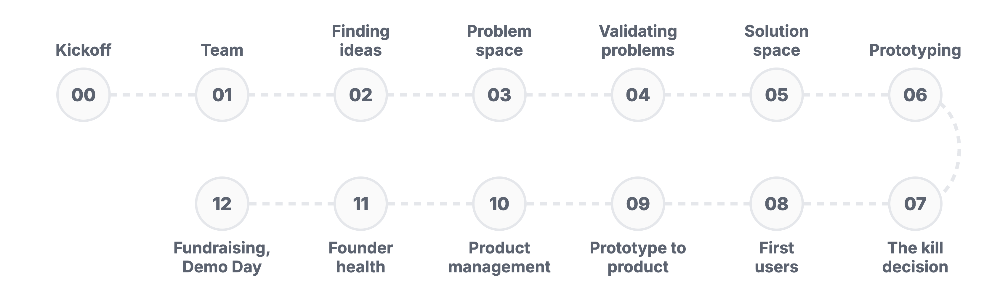
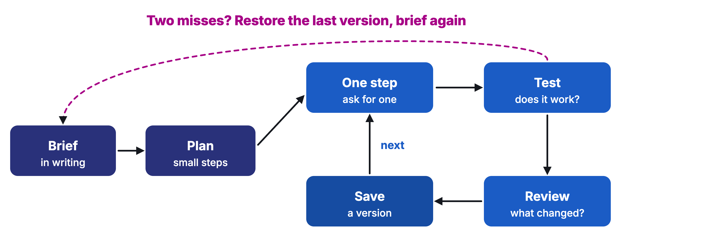
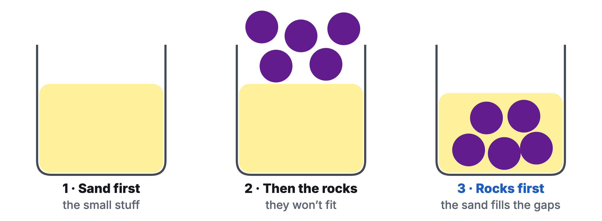
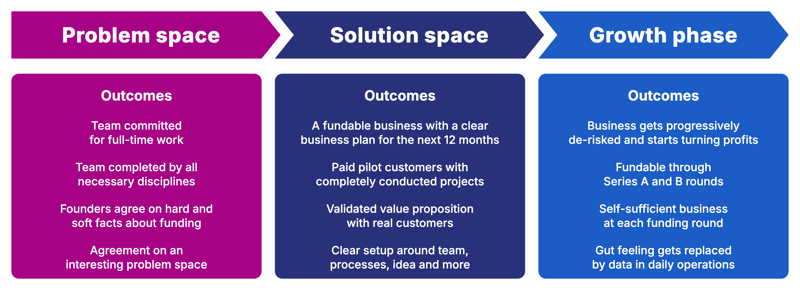

# Framework 05: The Playbook

Updated: 2026-11-17.

**Run the course as one loop after another, toward first revenue and then toward 10x. Each step says what you do, what your agent does and how to split your time so that somebody sells every day.**

> Framework 05 · The playbook · Runs through every module, from [Kickoff (M00)](../modules/00-kickoff/README.md) to [Fundraising and Demo Day (M12)](../modules/12-fundraising-demo-day/README.md)

## What you learned



## The idea

A startup is a loop. It runs while there is cash, and every week without learning burns runway ([Kickoff (M00), p. 40](../modules/00-kickoff/M00_Lecture_No-Bullshit-Entrepreneurship.pdf#page=40)). Your only edge over a big company is speed. While BMW runs one loop, you can run twenty, because you have no legacy, no politics and no sign-offs ([p. 41](../modules/00-kickoff/M00_Lecture_No-Bullshit-Entrepreneurship.pdf#page=41)).

AI made building cheap, so the bottleneck moved to measuring and learning. Every step below is one loop of [build, measure, learn](03_Build_Measure_Learn.md). Start at Learn, with the one hypothesis that brings your next paying customer closer, or after first revenue a 10x step. Build only what tests it. Measure with real customers. Decide, then take the next step.

The steps climb the [validation hierarchy](02_Validation_Hierarchy.md) through its three phases, problem space, solution space and growth phase. Each step ends on its homework's bar, a number you reach with real people. Missing it means you decide to pivot or persevere. That is a result, not a failure. A team that arrives without the last step's results still does the next one. Nothing repeats missed work.

## How to split your time

The lectures teach the same few rules again and again. Here they are in one place.

1. **Run one loop a week, at least.** Start at Learn. The smallest test that reaches a real person, by name, by Friday ([Kickoff (M00), pp. 42 to 57](../modules/00-kickoff/M00_Lecture_No-Bullshit-Entrepreneurship.pdf#page=42)).
2. **Keep every step under 4 hours.** A step that takes longer was too big. Steps inside it take minutes ([Kickoff (M00), p. 56](../modules/00-kickoff/M00_Lecture_No-Bullshit-Entrepreneurship.pdf#page=56), [Prototyping (M06), p. 77](../modules/06-prototyping/M06_Lecture_Prototyping.pdf#page=77)).
3. **Think three hours, build one.** Of four hours for a prototype, spend three on what to build ([The solution space (M05), p. 61](../modules/05-solution-space/M05_Lecture_Solution-Space.pdf#page=61)).
4. **Talk to people every day.** Fifteen a week is three a day ([Kickoff (M00), p. 55](../modules/00-kickoff/M00_Lecture_No-Bullshit-Entrepreneurship.pdf#page=55)). Test your prototype every day, with co-founders today, classmates tomorrow and your segment's canteen the day after. Only your segment counts toward the bar ([Prototyping (M06), p. 88](../modules/06-prototyping/M06_Lecture_Prototyping.pdf#page=88)).
5. **Split the work.** One founder leads the build, everyone brings users ([Prototyping (M06), p. 108](../modules/06-prototyping/M06_Lecture_Prototyping.pdf#page=108)).
6. **Sell every single day.** At least one founder, named on the pipeline. Building never pauses selling ([Product management and growth (M10), p. 82](../modules/10-product-management/M10_Lecture_Product-Management.pdf#page=82)). During a raise, one founder raises and the others keep selling ([Fundraising and Demo Day (M12), p. 40](../modules/12-fundraising-demo-day/M12_Lecture_Fundraising-Demo-Day.pdf#page=40)).
7. **Let your numbers pick build or grow.** They find you but don't stay? Build. They love it but can't find you? Grow ([Product management and growth (M10), p. 72](../modules/10-product-management/M10_Lecture_Product-Management.pdf#page=72)).
8. **Put the rocks in first.** What must happen next and keeps slipping goes into the week first, each with an owner and a day ([Founder health (M11), p. 129](../modules/11-founder-health/M11_Lecture_Founder-Health.pdf#page=129)).
9. **Keep the process light.** One board with one thing in progress per person, one meeting every Monday that reads your numbers, and a plan hung on a date the world sets, such as a trade fair or Demo Day ([Product management and growth (M10), pp. 74 to 76](../modules/10-product-management/M10_Lecture_Product-Management.pdf#page=74)). At five people, Scrum and OKRs are overkill.
10. **Zoom out every quarter.** Does your kill line still hold? ([The kill decision (M07), p. 77](../modules/07-rapid-validation/M07_Lecture_Rapid-Validation.pdf#page=77))
11. **Hand the typing to your agent.** If you do it twice, write it down, then turn it into a skill. Founders talk, decide and sell. Agents fill the records.





## The path, step by step



Each step names the module's core question, what you do, the bar its homework sets, and the skills your agent runs. The bar is copied from the homework, which owns it.

### Problem space

**00 · Kickoff (M00).** What kills startups, and what will this course demand from you?

- **Do.** Aim at something big, ground it in a problem rather than a solution, and test it with one loop a week. Write problem hypotheses a stranger could prove wrong, then talk to the people who have the problem. Start your [accountability group](10_Accountability_Groups.md).
- **Bar.** "Write 3 problem hypotheses and hold 15 problem conversations with named people, learning what the problem costs each of them today, and come back with 3 people who agreed to a next step. The learning floor is 3 hypotheses and 5 conversations with 1 next step." ([Homework 00](../modules/00-kickoff/M00_Homework.md))
- **Your agent.** [write-hypothesis](03_Build_Measure_Learn.md#skill-write-hypothesis), [log-interview](01_Mom_Test.md#skill-log-interview), [group-tracker](10_Accountability_Groups.md#skill-group-tracker).

**01 · Team and foundations (M01).** Why do the best teams beat the best ideas?

- **Do.** Decide whether you build a startup or a small business, staff the team you need, and commit to it. Ask the hard questions before they get hard, alone first, then side by side. Use the week as your trial, because fit shows under load, not over coffee.
- **Bar.** "Hold 10 conversations per student in your team's shared problem space, each with a named person and one verbatim quote, and end the week with a team agreement every founder confirmed after your end-of-week feedback round. The learning floor is 5 conversations per student and the confirmed agreement." ([Homework 01](../modules/01-team-foundations/M01_Homework.md))
- **Your agent.** [team-sheet](09_Co-Founder_Fit.md#skill-team-sheet), [log-interview](01_Mom_Test.md#skill-log-interview).

**02 · Finding ideas (M02).** Where do startup ideas actually come from?

- **Do.** Spot ideas where they are noticed, sort them by thinking big and testing small, and pick a problem you want to have. Test it with the Mom Test quickstart.
- **Bar.** "Hold 15 problem conversations per student about the problem behind your chosen idea. The learning floor is 5 conversations per student." ([Homework 02](../modules/02-finding-ideas/M02_Homework.md))
- **Your agent.** [score-ideas](#skill-score-ideas), [interview-prep](01_Mom_Test.md#skill-interview-prep), [log-interview](01_Mom_Test.md#skill-log-interview), and for a shift in your field, [incumbent-scan](08_Innovators_Dilemma.md#skill-incumbent-scan).

**03 · The problem space (M03).** Is this a real problem, or just an interesting one?

- **Do.** Dig to the problem behind your idea, price the job and its workaround, hear about the last time, and pick the segment with its hair on fire.
- **Bar.** "Hold 15 problem conversations per student in your hair-on-fire segment and come back with 5 named people per student who agreed to a next step. The learning floor is 5 conversations and 2 next steps per student." ([Homework 03](../modules/03-problem-space/M03_Homework.md))
- **Your agent.** [interview-prep](01_Mom_Test.md#skill-interview-prep), [critical-customer](01_Mom_Test.md#skill-critical-customer), [log-interview](01_Mom_Test.md#skill-log-interview), [interview-coach](01_Mom_Test.md#skill-interview-coach), [pain-map](01_Mom_Test.md#skill-pain-map).

**04 · Validating problems (M04).** What evidence would change your mind?

- **Do.** Rank what your evidence proves, draw the line before the data, launch a page that tests your problem, and count visitors from your segment by source.
- **Bar.** "Publish one landing page per team, log its pass or fail line before the first visitor arrives, and bring 100 visitors per student from your segment to it. The learning floor is the live page, the logged line and 30 visitors per student from your segment." ([Homework 04](../modules/04-validating-problems/M04_Homework.md))
- **Your agent.** [test-card](02_Validation_Hierarchy.md#skill-test-card), [hero-copy](02_Validation_Hierarchy.md#skill-hero-copy), [tag-links](02_Validation_Hierarchy.md#skill-tag-links), [traffic-sources](02_Validation_Hierarchy.md#skill-traffic-sources).

### Solution space

**05 · The solution space (M05).** Of all the ways to solve this problem, why this one?

- **Do.** Widen to many solutions, sharpen to ten times better on one thing, cut to the killer use case and do the rest by hand. Every founder builds one click dummy in 4 hours, sets the line first and shows it 7 times ([p. 26](../modules/05-solution-space/M05_Lecture_Solution-Space.pdf#page=26)).
- **Bar.** "Build one click dummy per founder and show the dummies in 15 guided demos per student with people from your segment, at least 7 per dummy, each ending in an ask that costs them something. The learning floor is one click dummy per team and 5 such demos per student." ([Homework 05](../modules/05-solution-space/M05_Homework.md))
- **Your agent.** [go-wide](07_10x_Test.md#skill-go-wide), [fill-canvas](07_10x_Test.md#skill-fill-canvas), [log-demo](07_10x_Test.md#skill-log-demo), [ten-x-check](07_10x_Test.md#skill-ten-x-check).

**06 · Prototyping (M06).** What is the fastest thing you can build to learn?

- **Do.** Map the parts of every app, shrink to the cheapest version, build it by steering an agent in iterations of 4 hours at most, and ship it into users' hands. Watch without steering, then fix what stopped them.
- **Bar.** "Put your MVP live, let 10 people per student from your segment use it without your help, and ship 2 fixes for what stopped them. The learning floor is a live MVP per team, 5 such users per student and 1 fix." ([Homework 06](../modules/06-prototyping/M06_Homework.md))
- **Your agent.** [project-brief](#skill-project-brief), [review-before-users](#skill-review-before-users), [log-session](06_PMF_Measurement_Engine.md#skill-log-session).

**07 · The kill decision (M07).** Why should this startup die?

- **Do.** List every way it could die, test the monkey first, let your past self decide through the lines you logged, and if it dies, kill it well and restart from your records.
- **Bar.** "Test your monkey with 10 people per student from your segment against a line logged first, decide Go, Pivot or Kill on your Kill Criteria Log and scorecard, and bring the verdict and your next offer to the Module 08 check-in. The learning floor is the scored verdict and the offer per team and 5 such people per student." ([Homework 07](../modules/07-rapid-validation/M07_Homework.md))
- **Your agent.** [check-assumptions](03_Build_Measure_Learn.md#skill-check-assumptions), [feedback-to-hypotheses](03_Build_Measure_Learn.md#skill-feedback-to-hypotheses), [read-the-log](03_Build_Measure_Learn.md#skill-read-the-log), [kill-page](03_Build_Measure_Learn.md#skill-kill-page), [next-loop](03_Build_Measure_Learn.md#skill-next-loop).

**08 · Finding first users (M08).** Who are your first ten customers, by name?

- **Do.** Do things that don't scale, sell like a founder in your customers' words, count every step per channel, and ask for money today.
- **Bar.** "Ask named people from your segment to pay for your offer at its price, and win 3 paying users from outside your social graph, shown in your payment dashboard or on a numbered invoice. The learning floor is your first € from outside your social graph." ([Homework 08](../modules/08-first-users/M08_Homework.md))
- **Your agent.** [write-outreach](#skill-write-outreach), [update-pipeline](#skill-update-pipeline), [count-funnel](#skill-count-funnel), [log-objections](#skill-log-objections).

**09 · From prototype to product (M09).** How do you turn users into revenue?

- **Do.** Set a price from value and test it, put the ask inside the product, run checkout, webhook and deploy, and keep the money legal from the first euro.
- **Bar.** "Run your price test, let customers pay inside your live product without a founder in the sale, and reach €1,000 cumulative revenue from outside your social graph, with the same offer bought by more than one customer. The learning floor is €500 cumulative, with at least one payment made inside your product." ([Homework 09](../modules/09-prototype-to-product/M09_Homework.md))
- **Your agent.** [log-price-test](#skill-log-price-test), [follow-up-sequence](#skill-follow-up-sequence), [test-agent](#skill-test-agent), [file-receipts](#skill-file-receipts).

### Growth phase

**10 · Product management and growth (M10).** What do you build next, and what do you refuse to build?

- **Do.** Count who stays and who leaves, focus on one number and its drivers, write every request as a bet, and run the week on build or grow.
- **Bar.** "Reach €3,000 cumulative revenue from outside your social graph, shown in your payment dashboard or on paid numbered invoices. The learning floor is €1,000 cumulative." ([Homework 10](../modules/10-product-management/M10_Homework.md))
- **Your agent.** [count-keepers](06_PMF_Measurement_Engine.md#skill-count-keepers), [fill-tracker](06_PMF_Measurement_Engine.md#skill-fill-tracker), [write-bet](06_PMF_Measurement_Engine.md#skill-write-bet), [score-bets](06_PMF_Measurement_Engine.md#skill-score-bets), [kind-no](06_PMF_Measurement_Engine.md#skill-kind-no), [monday-review](06_PMF_Measurement_Engine.md#skill-monday-review).

**11 · Founder health (M11).** How do you build a company without breaking yourself?

- **Do.** Know what drains you and what gives you energy, say how you really are, agree on a pace your team can hold, and keep selling. If it is over, close the company in the right order.
- **Bar.** "Reach €5,000 cumulative revenue from outside your social graph, keep the private maps you chose, of what drains and energises you, for seven days, and hold one honest co-founder conversation that ends in one agreed change in your Team sheet, with a revisit date. The learning floor is €2,000 cumulative and the conversation with its written change." ([Homework 11](../modules/11-founder-health/M11_Homework.md))
- **Your agent.** [team-sheet](09_Co-Founder_Fit.md#skill-team-sheet), and if you close, [wind-down-plan](#skill-wind-down-plan) and [investor-update](#skill-investor-update). Your private map never goes into an AI tool.

**12 · Fundraising and Demo Day (M12).** Can you tell the story, and show the money?

- **Do.** Size who funds the tail, ask how big it can get, decide whether to raise at all, pitch proof instead of promises, and steer the company after Demo Day.
- **Bar.** "Reach €10,000 cumulative revenue from outside your social graph by Demo Day, rehearse your pitch with three outsiders who can repeat your problem and your one number, and within seven days of Demo Day write your verdict on the company with what it needs. The learning floor is the Demo Day minimum of €2,000 verified with your evidence pack, one such outsider and your written verdict." ([Homework 12](../modules/12-fundraising-demo-day/M12_Homework.md))
- **Your agent.** [default-alive](04_Default_Alive_Calculator.md#skill-default-alive), [investor-update](#skill-investor-update), [team-sheet](09_Co-Founder_Fit.md#skill-team-sheet).

After Demo Day the loop keeps running. Keep your [accountability group](10_Accountability_Groups.md), keep one founder selling every day, and test the one hypothesis that brings the next 10x step.

## Your records

Your agent keeps both records in any spreadsheet, Notion table or file your team works in. If a record doesn't exist yet, the skill creates it with these columns.

**Ideas.** One row per idea, written as a problem someone has, not as a product. Mark every score heard, with the person's name, or assumed. Above the rows, write your early-stage pitch in one to three sentences, your unique insight, why the problem is worth solving and what your team can execute.

| Column | What goes in |
|---|---|
| Idea | [Who] struggles with [what] |
| Source | Own itch, expertise or technology, a shift in a field, or something missing |
| Tier | S to F |
| Desirable | 1 to 5, heard (name) or assumed |
| Viable | 1 to 5, the money or time spent on it today, heard (name) or assumed |
| Feasible | 1 to 5, heard (name) or assumed |
| Kept or dropped | With the reason |

```csv
idea,source,tier,desirable,desirable_heard,viable,viable_heard,feasible,feasible_heard,kept,reason
```

**Pipeline.** One row per named person you ask, then per payment. Only payments from outside your social graph count toward the bar. Proof is a dashboard screenshot or a paid numbered invoice, with names and bank details cropped before you show it. The objections in it are your objection log.

| Part | Columns |
|---|---|
| Who | Date, person (name), role, segment, source (sign-up, interviewee, Use Log user, referral, new), channel, brought by (founder), outside your social graph (yes, no) |
| Reaching | Touches (dates), next follow-up (date), reply (yes, no, none), call held (date), activated (yes, no) |
| Asking | Offer and price asked, sent to the price (date), answer (paid, yes, no, later), objection word for word, objection category |
| Paying | Paid on, amount (€), through the product or by hand, proof (screenshot link or invoice number), same offer bought again by another customer (yes, no) |
| After | Back on (used or paid, date), Lost, reason in their words |

```csv
date,person,role,segment,source,channel,brought_by,outside_social_graph,touches,next_follow_up,reply,call_held,activated,offer_and_price,sent_to_price,answer,objection,objection_category,paid_on,amount_eur,through_product,proof,bought_again,back_on,lost
```

### Example: an objection log

A made-up example from the recruiting venture the course follows, "Finalist Alert". It flags by WhatsApp when a finalist goes quiet, at €49 a month. The rows are the Pipeline's objection columns after the first two days of asks.

| # | Who | Word for word | Category |
|---|---|---|---|
| 1 | Lena, recruiter | "Who types in our candidates?" | Setup |
| 2 | Owner, agency, 8 recruiters | "We only hire in spring and autumn. Why pay in August?" | Price structure |
| 3 | Tom, in-house recruiter, 40 staff | "Our applicant tracking system already sends reminders." | Status quo |
| 4 | Recruiter, Hamburg | "Who types them in? I don't have the time." | Setup |
| 5 | HR lead, 120 staff | "Send an invoice. Finance doesn't do cards." | Payment |
| 6 | Agency recruiter, Berlin | "You message candidates on WhatsApp? Is that allowed?" | Trust |
| 7 | Agency owner, 5 recruiters | "We have 300 candidates in a spreadsheet. Who moves them over?" | Setup |

**The pattern.** Setup is heard three times (1, 4 and 7). That is a product problem, not a price problem, so the team acts. Nobody objected to the amount.

**The change.** The founders import a team's spreadsheet in one step, by hand on the first call, and offer an invoice as the default for companies. Seasonal hiring (2), the status quo (3) and trust (6) stay logged and wait until someone says them a third time.

**The result.** Of the next 6 asks, 3 paid, against 1 of the first 7.

## Run it with your agent

Thirteen skills on the path live here. The others live in the framework they belong to, linked from each step above. Each is one file in the open Agent Skills format. Save it as `SKILL.md` in a folder with the skill's name, for example `.claude/skills/write-outreach/SKILL.md` for Claude Code, or paste it at the start of a chat in any other assistant. The [frameworks guide](README.md#run-the-frameworks-with-your-agent) shows how to install them in each tool and how to make them yours.

When an output is wrong, fix the skill, not the output. Add the rule it broke, so it never breaks it again.

### Skill: score-ideas

Step 02, from [Finding ideas (M02), p. 40](../modules/02-finding-ideas/M02_Lecture_Finding-Ideas.pdf#page=40). Ask it "Three new talks, names swapped. Fill the Ideas sheet. Name who told us. Whatever nobody said stays assumed."

````markdown
---
name: score-ideas
description: Scores the team's ideas from conversation notes into the Ideas record, desirable, viable and feasible from 1 to 5, each marked heard with the person's name or assumed. Use after every few problem conversations while the team picks an idea.
---

# score-ideas

## Record
The Ideas record, one row per idea.
`idea,source,tier,desirable,desirable_heard,viable,viable_heard,feasible,feasible_heard,kept,reason`

## Steps
1. Open the Ideas record. If it does not exist, create it with the columns under Record.
2. Write every idea as a problem: [who] struggles with [what]. Never as a product.
3. For each idea the notes touch, score desirable (they want it fixed), viable (they spend money or time on it today) and feasible (the team can build it), from 1 to 5.
4. Next to each score, name who told you, or write "assumed".
5. End with the one question that would move the weakest assumed score, and whom to ask.

## Rules
- A score is heard only if a named person said it. Never upgrade assumed to heard.
- Change a score only with new evidence, and say which.

## Good and weak
- Good: "Row 5, viable 3, heard: Lena, 2 hours a week."
- Weak: "Row 5, viable 4. Recruiters clearly care."

## Check before you answer
- [ ] Every heard score names a person.
- [ ] No idea is written as a product.
````

### Skill: project-brief

Step 06, from [Prototyping (M06), pp. 64 to 65](../modules/06-prototyping/M06_Lecture_Prototyping.pdf#page=64). Ask it "Draft our project instructions from these files, eight headings. Leave Do not build empty, I write that one."

````markdown
---
name: project-brief
description: Drafts the one-page project instructions a coding agent or app builder works from, under eight headings, from the team's MVP sentence, its map of the app's parts and its Interview Log. Leaves "Do not build" to the founders. Use before the first build and whenever the scope changes.
---

# project-brief

## Input
The MVP sentence, the map of the app's parts, the Interview Log with names removed.

## Steps
1. Ask the two or three questions the files do not answer, before you write.
2. Write PROJECT_INSTRUCTIONS.md, one page, with these headings: Who it is for, The one feature, Input and outcome, The parts, What stays manual, Do not build, Tech, How we work.
3. Quote the segment's own words under Who it is for and Input and outcome.
4. Under How we work, write the loop: a plan before code, one small step, a test, a review, a saved version. Two misses on a step, go back to the last version and brief again.
5. Leave Do not build empty. The founders write it.

## Rules
- One feature. If the files suggest more, list them for the founders to put under Do not build.
- No tech the founders did not choose.

## Good and weak
- Good: "Input and outcome. Type a raw thought into one box."
- Weak: "A platform for capturing, organising and sharing ideas."

## Check before you answer
- [ ] Eight headings on one page.
- [ ] Do not build is empty.
````

### Skill: review-before-users

Step 06, from [Prototyping (M06), p. 70](../modules/06-prototyping/M06_Lecture_Prototyping.pdf#page=70). A second agent, in a fresh session. Ask it "New version, before anyone else uses it. Attack it. Check every finding against the code before you report it."

````markdown
---
name: review-before-users
description: Attacks a new version of the team's product before anyone else uses it, as a second agent in a fresh session, and reports only findings it has checked against the code. Use before every release to users.
---

# review-before-users

## Input
The repository or its last five versions, and what changed.

## Steps
1. Work in a fresh session, without the build chat's history.
2. Attack the new version: who can reach what, which secrets the browser can read, what an outsider could make it do or spend, what breaks with empty, long or strange input.
3. Check every finding against the code. Reproduce it, or mark it not real, with your proof.
4. Report each real finding as one small step to fix, the worst first.
5. After a fix, review the fix too. A fix can leave a hole.

## Rules
- Never fix anything yourself. Each fix goes back through the build loop as one step.
- A finding without proof from the code is never reported as real.

## Good and weak
- Good: "Any website can post through the browser to the save endpoint. Proof: no origin check in save.ts, line 14."
- Weak: "Security could be improved."

## Check before you answer
- [ ] Every finding has its proof or says not real.
````

### Skill: write-outreach

Step 08, from [Finding first users (M08), pp. 42 to 43](../modules/08-first-users/M08_Lecture_Finding-First-Users.pdf#page=42). Ask it "Lena's first message, from her interview. Her words, our price, one next step, under 75 words."

````markdown
---
name: write-outreach
description: Writes a first message to a named person from their interview notes, in their words, with the team's price and one next step, under 75 words. Use for every first ask in a sale. The founder reads it out loud and sends it.
---

# write-outreach

## Input
The person's interview notes or Interview Log row, the offer and its price.

## Steps
1. Open with their own words from the conversation, quoted, and when they said them.
2. Say in one sentence what the team now does about it, and the price.
3. End with one next step that has a day and a time.
4. Count the words. Over 75, cut.

## Rules
- Never send. The founder reads it out loud, then sends it.
- No "we're building", no "AI platform", no "would you be interested".
- One ask only.

## Good and weak
- Good: "Hi Lena, in March you said 'I lose a finalist every month and find out too late.' We now flag that by WhatsApp, €49 a month. Can I set it up with you Thursday at 10:30? 15 minutes."
- Weak: "Hi! We're building an AI platform that revolutionises recruiting. Would you be interested?"

## Check before you answer
- [ ] Their words, the price and one next step are in it.
- [ ] Under 75 words.
````

### Skill: update-pipeline

Step 08, from [Finding first users (M08), pp. 47 to 48](../modules/08-first-users/M08_Lecture_Finding-First-Users.pdf#page=47). Never drop the thread. Ask it "Call with Lena just ended, recorded with her consent. Update her row. When do I follow up?"

````markdown
---
name: update-pipeline
description: Updates one person's row in the team's Pipeline after a call or message, with the reply, the offer and price asked, the answer, any objection word for word and the date of the next follow-up. Use after every sales touch so that no thread drops.
---

# update-pipeline

## Record
The Pipeline, one row per person asked, then per payment.
`date,person,role,segment,source,channel,brought_by,outside_social_graph,touches,next_follow_up,reply,call_held,activated,offer_and_price,sent_to_price,answer,objection,objection_category,paid_on,amount_eur,through_product,proof,bought_again,back_on,lost`

## Steps
1. Open the Pipeline. If it does not exist, create it with the columns under Record.
2. Find the person's row, or add one with source and channel.
3. Add the touch with its date. Fill reply, call held, offer and price asked, and answer (paid, yes, no, later) only from what was said.
4. Log every objection word for word, with its category.
5. Set the next follow-up date. Follow up three or four times, until yes or no. Offer to draft the follow-up from what they said.

## Rules
- Use a recording only if they consented. Otherwise work from notes.
- "Later" is not "no". It gets a date.
- Paid only with proof, a payment in the dashboard or a numbered invoice.

## Good and weak
- Good: "Row 8. Reply yes, €49 a month asked, answer later. Objection: 'Who types in our candidates?' Next follow-up Monday."
- Weak: "Lena seemed positive, follow up soon."

## Check before you answer
- [ ] Every open row has a follow-up date.
````

### Skill: count-funnel

Step 08, from [Finding first users (M08), pp. 60 to 61](../modules/08-first-users/M08_Lecture_Finding-First-Users.pdf#page=60). Ask it "Count the Pipeline sheet per channel, reached to paid. Where do most people drop? Where do we double down?"

````markdown
---
name: count-funnel
description: Counts the Pipeline per channel at every step from reached to paid, finds where most people drop and says where to double down. Use every week while selling, and before dropping a channel.
---

# count-funnel

## Record
Reads the Pipeline. Reached is every row, replied is reply yes or no, talked is call_held, activated is activated yes, paid is paid_on filled.
`date,person,role,segment,source,channel,brought_by,outside_social_graph,touches,next_follow_up,reply,call_held,activated,offer_and_price,sent_to_price,answer,objection,objection_category,paid_on,amount_eur,through_product,proof,bought_again,back_on,lost`

## Steps
1. Read the Pipeline and group the rows by channel.
2. Count people per step: reached, replied, talked, activated, paid.
3. For each channel, find the step with the biggest drop, as a count.
4. Name the channel that brought the most payments and the one with the worst drop.
5. Recommend one move. Double down on the best channel, with one ask that brings more of it, such as two names from each payer.

## Rules
- Counts first. A share only next to its count.
- Only people from the segment and outside the team's social graph count toward the bar.

## Good and weak
- Good: "Cold LinkedIn: 40 reached, 4 replied, down 90%. Demo users: 3 of your 4 payments. Double down on demo users and ask each for two names."
- Weak: "Conversion is low. Try more channels."

## Check before you answer
- [ ] Every number traces back to rows in the Pipeline.
````

### Skill: log-objections

Step 08, from [Finding first users (M08), pp. 82 to 83](../modules/08-first-users/M08_Lecture_Finding-First-Users.pdf#page=82). Heard three times? Change the offer or the product. Ask it "Today's calls. Log every no word for word, with its category. Count the repeats."

````markdown
---
name: log-objections
description: Logs every no and every hesitation from sales calls word for word, with a category, and counts the repeats. Flags an objection heard three times as a reason to change the offer or the product. Use after every day of asks.
---

# log-objections

## Record
The Pipeline. This skill writes objection and objection_category. If the Pipeline does not exist, create it with these columns.
`date,person,role,segment,source,channel,brought_by,outside_social_graph,touches,next_follow_up,reply,call_held,activated,offer_and_price,sent_to_price,answer,objection,objection_category,paid_on,amount_eur,through_product,proof,bought_again,back_on,lost`

## Steps
1. Read the transcripts or notes of the day's calls.
2. Log each objection in the person's Pipeline row, word for word, with its category: price amount, price structure, setup, payment, trust, timing, status quo or scope.
3. Count how many people have raised each objection, across all rows.
4. Flag every objection heard three times. Say whether it is about the offer (price, structure, payment) or the product.

## Rules
- Their words, never a summary. A paraphrase hides what to change.
- Count people, not mentions.
- Never answer the objection in the log. The log records, the founders decide.

## Good and weak
- Good: "'Who types in our candidates?' is now heard 3 times, a product problem, not a price problem."
- Weak: "Some users find onboarding hard."

## Check before you answer
- [ ] Every objection is a quote with a category.
````

### Skill: log-price-test

Step 09, from [From prototype to product (M09), pp. 22 to 23](../modules/09-prototype-to-product/M09_Lecture_Prototype-to-Product.pdf#page=22). Your price is a guess. Write the line first. Ask it "Log this test before anyone sees the price. Per recruiter seat, €99 a month, two months free on annual."

````markdown
---
name: log-price-test
description: Logs a price test before anyone sees the price, with unit, amount, structure and the line, as a row in the Kill Criteria Log with the time. Counts the payments against the line on the date the line names. Use before every price you send.
---

# log-price-test

## Record
The Kill Criteria Log, one row per test. If it does not exist, create it with these columns.
`logged_on,hypothesis,test,rung,line,committed_before,actual_result,line_crossed,decision,next_hypothesis`

## Steps
1. Write the test as unit (what one price buys), amount, structure (monthly, annual, discount) and the line: what you count, by when, and what you change if you miss it.
2. Log it as a row in the Kill Criteria Log with the date and time, before the first person sees the price.
3. On the date the line names, count the payments from the named people against the line. Write the result next to the line.

## Rules
- A line written after the first answer is commentary, not a line.
- Change one thing per test: the unit, the amount or the structure.

## Good and weak
- Good: "Per recruiter seat, €99 a month, two months free on annual. Line: if none of the first 10 named people we send to €99 pays by Thursday, we change the structure, not the amount. Logged Tuesday, 10:31."
- Weak: "Let's try €99 and see how it goes."

## Check before you answer
- [ ] Logged with its time, before anyone saw the price.
````

### Skill: follow-up-sequence

Step 09, from [From prototype to product (M09), pp. 39 to 40](../modules/09-prototype-to-product/M09_Lecture_Prototype-to-Product.pdf#page=39). Write the follow-up once, then let it run. Ask it "Turn the follow-ups that worked with our first customers into this sequence. Keep our words. A reply goes to a founder."

````markdown
---
name: follow-up-sequence
description: Turns the follow-ups that worked with the first customers into a sequence the product sends after a user reaches the outcome, in the team's own words. Drafts only. Use when the product, not a founder, should make the ask.
---

# follow-up-sequence

## Input
The follow-ups that worked with the first customers, and the events the product records.

## Steps
1. Find the moments that worked by hand: after the first outcome, when they came back, before the trial ended.
2. Draft one message per moment, each triggered by an event: day 0 the outcome is reached, day 3 they are back or not, day 12 the trial ends in two days, with the price and the link.
3. Keep the team's words from the messages that worked.
4. Send every reply to a founder.

## Rules
- Nothing sends until a founder says yes.
- One ask per message. The price and the link only in the message before the trial ends.

## Good and weak
- Good: "Day 0, after the first nudge: 'Your first nudge went out.'"
- Weak: "Day 1: Welcome to our newsletter!"

## Check before you answer
- [ ] Every message has its trigger, and a founder gets every reply.
````

### Skill: test-agent

Step 09, from [From prototype to product (M09), pp. 67 to 68](../modules/09-prototype-to-product/M09_Lecture_Prototype-to-Product.pdf#page=67). Hand one chore to an agent you tested. Ask it "Run the trial-end agent on these 10 past cases, names removed. The expected answers are in the sheet. Log passes and cost."

````markdown
---
name: test-agent
description: Tests an AI agent that should take over one chore on ten real past cases with known answers, before it touches a customer. Logs passes and cost per run and proposes the missing instructions. Use before handing any chore to an agent, and after every change to it.
---

# test-agent

## Input
The agent's instructions, ten past cases from the team's records with names removed, and the expected answer for each.

## Steps
1. Run the agent on each case as it would run live.
2. Compare each answer with the expected one. Mark pass or fail, with a reason.
3. Log the passes out of 10 and the cost per run.
4. For each failure, name the instruction that is missing or wrong, and propose the line to add.
5. After a change, run all ten again.

## Rules
- Never change an expected answer to fit the agent.
- Many fails? Fix the instructions, not the cases.
- Money, refunds and angry customers go to a founder.

## Good and weak
- Good: "8 of 10 pass, €0.04 a run. Case 7 answered a refund itself, it should hand over. Add: 'Every refund goes to a founder.'"
- Weak: "The agent works well in most cases."

## Check before you answer
- [ ] Ten cases, each with pass or fail and a reason.
````

### Skill: file-receipts

Step 09, from [From prototype to product (M09), pp. 83 to 84](../modules/09-prototype-to-product/M09_Lecture_Prototype-to-Product.pdf#page=83). One team account, receipts from euro one. Ask it "File this month's invoices and the provider's fee statement in Receipts 2026. What is missing?"

````markdown
---
name: file-receipts
description: Files the month's invoices, receipts and the payment provider's fee statement into the team's receipts folder, matches them to the transfers and lists what is missing. Use once a month from the first euro.
---

# file-receipts

## Steps
1. Collect every invoice in and out from the team inbox, and the provider's fee statement.
2. Name each file by date, counterpart and amount, and file it in the year's receipts folder.
3. Match each outgoing invoice to its payment by the invoice number in the reference.
4. List every payment without a receipt and every receipt without a payment, with date and amount.
5. Offer to draft a request for each missing receipt. Send nothing.

## Rules
- The team's account only. Flag any payment to a founder's private account.
- Delete nothing. In Germany receipts are kept 8 years.

## Good and weak
- Good: "16 files. Invoice 014 matched to the transfer, reference 014. One gap: no receipt for the domain renewal on 12 November."
- Weak: "Receipts look complete."

## Check before you answer
- [ ] Every gap is listed with its date and amount.
````

### Skill: wind-down-plan

Step 11, if you close, from [Founder health (M11), pp. 87 to 88](../modules/11-founder-health/M11_Lecture_Founder-Health.pdf#page=87). Ask it "We decided to close. Turn our wind-down checklist into a task board. Investors first, an owner and a date on every card."

````markdown
---
name: wind-down-plan
description: Turns the team's wind-down checklist, contracts and invoices into a task board once the founders have decided to close, investors first, with an owner and a date on every card. Flags memberships and subscriptions. Sends nothing. Use on the day the decision is made.
---

# wind-down-plan

## Input
The decision, the wind-down checklist, the contracts and invoices.

## Steps
1. Put day one first, in this order: investors, the plan, a lawyer, the team.
2. Make one card per checklist item, each with an owner and a date.
3. Read the contracts and invoices. Add a card for every membership, subscription and notice period, and flag it. Those are the nasty ones.
4. Add a card to check the legal deadlines with the lawyer on day one.

## Rules
- Send nothing. Telling the investors and the team stays with the founders.
- Orientation only, never legal advice.

## Good and weak
- Good: "12 cards. Investors first, Ana, today. Three subscriptions flagged, notice periods of 1 to 3 months."
- Weak: "Close the company and notify everyone."

## Check before you answer
- [ ] Every card has an owner and a date.
````

### Skill: investor-update

Step 11 if you close, and every month once you have raised, from [Founder health (M11), pp. 90 to 91](../modules/11-founder-health/M11_Lecture_Founder-Health.pdf#page=90). Ask it "Draft this month's update from the tracker and our notes. Bad news first, three options, our pick."

````markdown
---
name: investor-update
description: Drafts the monthly investor update from the team's KPI Tracker and notes, bad news first, with numbers, three options and the team's pick. Leaves the line on the founders' own mistake to them. Use every month, most of all when it gets bad.
---

# investor-update

## Steps
1. Read the KPI Tracker and the month's notes.
2. Open with the bad news, in numbers, in writing. No surprises.
3. Give three options, such as a bridge, a pivot, a sale or acqui-hire, or an orderly wind-down, and the team's pick with its reason.
4. Leave a line "My mistake" empty for the founder to write.
5. If the company closes, draft the final update: what happened, what is left and who gets it, where the team landed, and thank you.

## Rules
- No blame, no spin.
- Every number comes from the tracker, with its date.

## Good and weak
- Good: "Revenue fell from €4,100 to €2,900 in October. Two agencies left over the missing ATS sync. Three options follow, our pick is the third."
- Weak: "A challenging month, but we remain excited about the future."

## Check before you answer
- [ ] Bad news first, three options, one pick.
- [ ] "My mistake" is empty.
````

## Your stack

Tools are examples, not endorsements. Fees and tools as checked in October 2026, on 19 October for payments and on 26 October for the rest. Tools rot, the pattern doesn't. Pick the tool your team already knows.

| Job | Tools | The pattern |
|---|---|---|
| Landing page | [Lovable](https://lovable.dev), [Framer](https://www.framer.com), [Webflow](https://webflow.com), [Notion](https://www.notion.so) | One promise, one button, the headline in your segment's words |
| Analytics | [Microsoft Clarity](https://clarity.microsoft.com), [Plausible](https://plausible.io) | Installed before the first visitor. Every link you share is tagged with `utm_source` and `utm_content`. EU visitors consent first to anything that sets cookies |
| Building | [Lovable](https://lovable.dev), [Replit](https://replit.com), [Claude Code](https://code.claude.com/docs/en/best-practices), [Cursor](https://cursor.com) | Brief in writing, one small step, a test, a saved version |
| First database | [Google Sheets](https://sheets.google.com) | One row per thing, one column per field, fixable by hand |
| Conversations | Your call tool's recording, a [Whisper](https://github.com/openai/whisper)-based transcriber | Ask before you record, store it privately, take names out before any AI sees it |
| Taking money | [Stripe Payment Links](https://docs.stripe.com/payment-links), 1.5% + €0.25 for standard EEA cards. [PayPal Business](https://www.paypal.com/business), 2.99% + €0.39. A numbered invoice from 001 with [Lexware Office](https://office.lexware.de) or [sevdesk](https://sevdesk.de) | One team account, never a private one. Send the link while you are still talking |
| Checkout in the product | The provider's hosted checkout. Deploys from [Vercel](https://vercel.com), [Netlify](https://www.netlify.com) or [Cloudflare Pages](https://pages.cloudflare.com) | Count a payment when the provider's webhook says so, never from the success page. Secret keys live only on the server |
| Team operations | Any sheet, any board | One North Star with an owner per driver, one board, one thing in progress per person |

**Before you trust an agent with real work,** read these four.

- Mollick, E. (2026, July). [An opinionated guide to which AI to use](https://www.oneusefulthing.org/p/an-opinionated-guide-to-which-ai-b22). Which tool for which job. About ten minutes.
- Dell'Acqua, F., et al. (2026). [Navigating the jagged technological frontier](https://doi.org/10.1287/orsc.2025.21838). *Organization Science*. 758 BCG consultants with and without GPT-4. On one task just outside what the AI could do, 84.5% got it right without AI and only 60% to 70.6% with it. Test AI on tasks whose answer you know.
- METR (2025, March). [Measuring AI ability to complete long tasks](https://metr.org/blog/2025-03-19-measuring-ai-ability-to-complete-long-tasks/). The length of task an agent finishes on its own has doubled about every seven months since 2019.
- European Commission. [AI literacy, questions and answers](https://digital-strategy.ec.europa.eu/en/faqs/ai-literacy-questions-answers). What Article 4 of the EU AI Act asks of every company that uses AI.

## In the lecture

| Slide | What it shows | Where |
|---|---|---|
| Your startup is a loop | Every week without learning burns runway | [Kickoff (M00), p. 40](../modules/00-kickoff/M00_Lecture_No-Bullshit-Entrepreneurship.pdf#page=40) |
| While BMW runs one loop, you can run twenty | Speed is the small team's edge | [Kickoff (M00), p. 41](../modules/00-kickoff/M00_Lecture_No-Bullshit-Entrepreneurship.pdf#page=41) |
| Start at Learn | One hypothesis, then build only what tests it | [Kickoff (M00), pp. 42 to 43](../modules/00-kickoff/M00_Lecture_No-Bullshit-Entrepreneurship.pdf#page=42) |
| Speed matters | Ship weekly, 15 users a week, 4 hours per step | [Kickoff (M00), pp. 54 to 56](../modules/00-kickoff/M00_Lecture_No-Bullshit-Entrepreneurship.pdf#page=54) |
| One dummy per founder | Every founder builds one in 4 hours | [The solution space (M05), p. 26](../modules/05-solution-space/M05_Lecture_Solution-Space.pdf#page=26) |
| Spend three hours thinking | Of four hours for a prototype | [The solution space (M05), p. 61](../modules/05-solution-space/M05_Lecture_Solution-Space.pdf#page=61) |
| The agent loop | Brief, one step, test, review, save | [Prototyping (M06), p. 63](../modules/06-prototyping/M06_Lecture_Prototyping.pdf#page=63) |
| Test every day | Fast and approximate today, slow and accurate later | [Prototyping (M06), p. 88](../modules/06-prototyping/M06_Lecture_Prototyping.pdf#page=88) |
| Zoom out every quarter | Does your kill line still hold? | [The kill decision (M07), p. 77](../modules/07-rapid-validation/M07_Lecture_Rapid-Validation.pdf#page=77) |
| The three stages | Problem space, solution space, growth phase | [Product management and growth (M10), p. 71](../modules/10-product-management/M10_Lecture_Product-Management.pdf#page=71) |
| Build or grow | Your numbers decide | [Product management and growth (M10), p. 72](../modules/10-product-management/M10_Lecture_Product-Management.pdf#page=72) |
| Heartbeats, one board, the weekly meeting | Light process for a small team | [Product management and growth (M10), pp. 74 to 76](../modules/10-product-management/M10_Lecture_Product-Management.pdf#page=74) |
| The standing rule | Every day, at least one founder sells | [Product management and growth (M10), p. 82](../modules/10-product-management/M10_Lecture_Product-Management.pdf#page=82) |
| Pack the scary bits first | A week your team can hold that still sells | [Founder health (M11), p. 129](../modules/11-founder-health/M11_Lecture_Founder-Health.pdf#page=129) |
| During a raise | One founder raises, the others keep selling | [Fundraising and Demo Day (M12), p. 40](../modules/12-fundraising-demo-day/M12_Lecture_Fundraising-Demo-Day.pdf#page=40) |

The skill slides are linked at each skill above.

## Go deeper

Ten pieces, each one tied to a step. Read the one for the step you are on, then come back to it after your next loop.

- Graham, P. (2012). [How to get startup ideas](https://paulgraham.com/startideas.html). Live in the future and build what's missing. For Finding ideas (M02).
- Fitzpatrick, R. (2013). [*The Mom Test*](https://www.momtestbook.com/). How to ask so that nobody can lie to you. For every step with conversations, and [framework 01](01_Mom_Test.md).
- Graham, P. (2013). [Do things that don't scale](https://paulgraham.com/ds.html). Recruit users one by one and deliver by hand. For Finding first users (M08).
- Graham, P. (2012). [Startup = growth](https://paulgraham.com/growth.html). Growth rate is the compass. For From prototype to product (M09).
- Vohra, R. (2018). [How Superhuman built an engine to find product/market fit](https://review.firstround.com/how-superhuman-built-an-engine-to-find-product-market-fit/). First Round Review. For Product management and growth (M10) and [framework 06](06_PMF_Measurement_Engine.md).
- Graham, P. (2013). [How to raise money](https://paulgraham.com/fr.html). For Fundraising and Demo Day (M12).
- Altman, S. (2015). [Startup playbook](https://playbook.samaltman.com). The whole path in one sitting. Read it at the start and again at the end.
- Y Combinator. [Startup School](https://www.startupschool.org) and the [YC Library](https://www.ycombinator.com/library). Pick the lecture that matches the step you are stuck on.
- Blank, S. [Lean LaunchPad slides](https://steveblank.com/slides/). The original customer development course, free.
- Sequoia Capital. [The Arc product-market fit framework](https://sequoiacap.com/article/pmf-framework/). Three kinds of product-market fit. For the growth phase.
