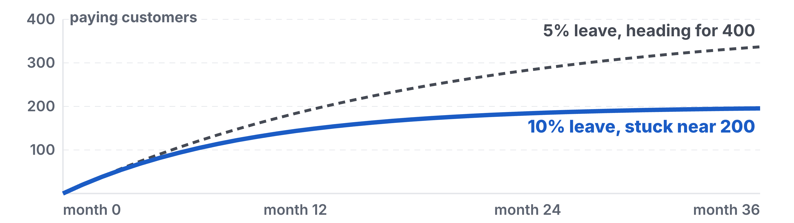
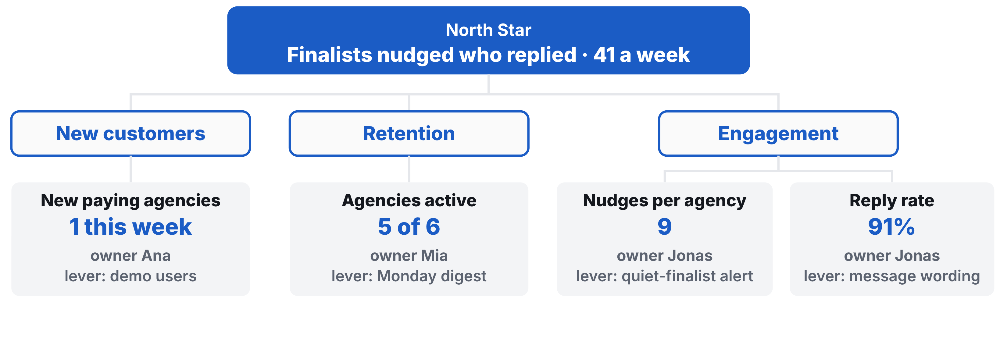
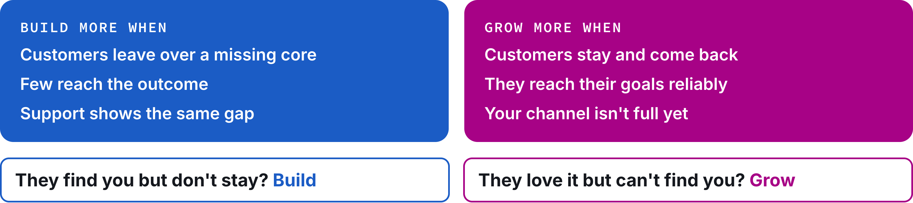
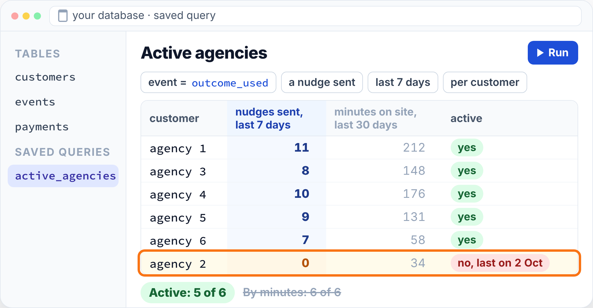

# Framework 06: Product-Market Fit

Updated: 2026-11-17.

**Ask who would miss you, then count who came back. What people say points the way, what they do decides. Build only what makes paying customers stay.**

> Framework 06 · Product-market fit · Taught in [Product management and growth (M10)](../modules/10-product-management/M10_Lecture_Product-Management.pdf#page=16) · Records start in [Prototyping (M06)](../modules/06-prototyping/M06_Lecture_Prototyping.pdf#page=91)

## What you learned

{: style="max-height: 55mm" }

{: style="max-height: 60mm" }

{: style="max-height: 45mm" }

## The idea

Everyone talks about product-market fit and few can measure it. "You'll know it when you feel it" is no help on a Monday morning. This framework gives you a compass, a verdict and a weekly rhythm.

**Churn is your limit.** Win 20 new customers a month and lose 10% of all customers every month, and you settle near 200, because that is where you lose as many as you win. Halve the churn and the same 20 a month carry you toward 400. Before you grow, find out who stays.

**What they say points, what they do decides.** The Sean Ellis question asks people how they would feel without your product. Like the Net Promoter Score, it asks them to predict their own future, which counts as opinion on the [validation hierarchy](02_Validation_Hierarchy.md). A study of 21 firms and more than 15,500 interviews could not replicate the Net Promoter Score as the best predictor of growth ([Keiningham et al., 2007](https://doi.org/10.1509/jmkg.71.3.039)). Use the answers to find who to build for. Decide with retention, counted from your product's records.

## How to measure it

1. **Log every session from your first user.** One row per user in the Use Log. Did they use it without your help? Did they reach the outcome? Did they come back on their own?
2. **Define "came back" before you look.** The outcome again, or a second payment, within a window you set, for example 14 days. Write the retention line into your [Kill Criteria Log](03_Build_Measure_Learn.md#your-records) first.
3. **Count from what your product records,** your database and payment rows. Never your inbox. A kind email is not a row.
4. **Read each cohort on its own.** A cohort is everyone who first paid in the same week. A good new week can hide a bad old one. Leave out the customers too new to have had the chance to come back.
5. **Write counts under 20 people,** "4 of 5", never "80%". With five customers, 80% sounds like science and is one person.
6. **Ask the Sean Ellis question,** "How would you feel if you could no longer use [product]?", with three answers, very disappointed, somewhat disappointed, not disappointed. Ask only people who used the core at least twice in the last two weeks. Everyone else never got the value.
7. **Ask three more.** What type of people would most benefit? What is the main benefit you receive? How can we improve it for you?
8. **Read the share as a compass.** Ellis set the line at 40% "very disappointed" after comparing nearly 100 startups and called it "a bit arbitrary" himself ([Ellis, 2009](https://seanellis.substack.com/p/the-startup-pyramid)). No peer-reviewed study has tested it. At 8 of 20 answers, 40%, the true share could be anywhere from about 22% to 61% (95% Wilson interval).
9. **Build for the ones who would miss you most** and came back. Their words for the main benefit are your positioning. Politely ignore the "not disappointed". The "somewhat disappointed" who name the same main benefit are one fix away.

Superhuman shows the move ([Vohra, 2018](https://review.firstround.com/how-superhuman-built-an-engine-to-find-product-market-fit/)). In summer 2017, 22% said "very disappointed". Counting only the groups the fans came from (founders, managers, executives, business development), it was 33%, without one line of new code. Then half the roadmap went to what the fans loved and half to what held back the somewhat disappointed who also loved speed. Three quarters later, 58%. The first jump came from who they counted, the second from the product. Vohra adds that directionally correct results start at around 40 respondents.

## How to act on it

1. **Pick a North Star** that counts what customers get, not what you get. "Finalists nudged who replied, per week" for the recruiter tool, not revenue, sign-ups or page views. Revenue follows from it.
2. **Draw the KPI tree.** Under the North Star, new customers, retention and engagement, each driver with one owner and one lever.
3. **Count active by the outcome.** "Reached the outcome in the last 7 days", not "5 minutes on the site". Your product already writes a row each time.
4. **Write every request as a bet** before you build it. Who asked, do they pay, which driver it moves, the effect you expect by when. Afterwards, the result.
5. **Keep what payers need, bury the rest.** A bet survives if a paying customer asked and it deepens their outcome, or if it fixes why someone left.
6. **Rank the keepers with RICE,** reach × impact × confidence ÷ effort ([McBride, Intercom](https://www.intercom.com/blog/rice-simple-prioritization-for-product-managers/)). The score sorts the list, it doesn't decide. A fix for why customers leave can jump the queue.
7. **Say no kindly,** even to a customer who pays. Say why, and give them a way to get the job done today.
8. **Read the tree every Monday.** The tree against last week, last week's bets against their expected effect, the coming week's Now list and the no's to send, and who sells.
9. **Build or grow?** They find you but don't stay? Build. They love it but can't find you? Grow. Every quarter, decide go, pivot or kill per initiative on the line you wrote when it started.

{: style="max-height: 70mm" }

Bastian's rule of thumb for growth, month over month, is that more than 10% is a must, more than 20% is good and more than 25% is outstanding.

## Which kind of fit

Sequoia's company-building programme Arc describes three kinds of product-market fit, by how customers see the problem ([Team Sequoia, 2024](https://sequoiacap.com/article/pmf-framework/)).

| Kind | The customer | What it takes |
|---|---|---|
| Hair on fire | Has an urgent, obvious problem and is shopping for a fix | Stand out in a crowded category |
| Hard fact | Has accepted the pain as a fact of life | Show them it is a problem you can solve |
| Future vision | Can't yet imagine what you offer | Make the new reality believable |

Its companion asks four "terrifying questions" in turn ([Team Sequoia, 2025](https://sequoiacap.com/article/pmf-framework-2/)). What is my company's right to exist? Do people care enough about the problem? Does my product actually change behaviour? Will customers pay enough to build a real business?

## What good looks like

| | Good | Weak |
|---|---|---|
| Staying | 5 of 7 back within 14 days, 2 lost, reasons in their words | "Retention 71%" |
| Compass | 8 of 20 "very disappointed", 22% to 61%, and 7 of the 8 came back | "40%, we have PMF" |
| Building | 2 bets shipped, 1 hit its expected effect | 6 features nobody asked for |
| Rhythm | 41 finalists nudged who replied, read every Monday | A dashboard nobody opens |

A made-up example from the recruiter tool.

## Your records

Your agent keeps these records in any spreadsheet, Notion table or file your team works in. If a record doesn't exist yet, the skill creates it with these columns. Retention itself is read from the Back on and Lost columns of your [Pipeline](05_AI_Startup_Playbook.md#your-records), one row per paying customer.

**Use Log.** One row per user of your prototype or product, from [Prototyping (M06)](../modules/06-prototyping/M06_Lecture_Prototyping.pdf#page=91) on. Only people from your segment count toward a bar.

| Column | What goes in |
|---|---|
| Date first used | The day they first used it |
| User | Name, or an ID once names are removed |
| Role and segment | Who they are, and whether they are in your segment (yes, mixed, no) |
| Brought by | The founder who brought them |
| Came from | First buyer, sign-up, interviewee, group, other |
| Used without help? | Yes or no. A guided demo is no |
| Reached the outcome? | Yes or no, the value arrived |
| Came back unprompted | The date, or no |
| What stopped them | In their words, or what you saw in the recording |
| Fix shipped | Version and date |
| Asked to pay? | Their answer |

```csv
date_first_used,user,role_segment,in_segment,brought_by,came_from,without_help,reached_outcome,came_back,what_stopped_them,fix_shipped,asked_to_pay
```

**KPI Tracker.** One row per metric, one column per module or Monday. The North Star and its drivers sit on top.

| Row | What goes in |
|---|---|
| North Star | Your weekly count of what customers get |
| One row per driver | Its number, with the owner and the lever in the row name |
| Activated users | Reached the outcome |
| Came back unprompted | From the Use Log |
| Asks made | Asks for money or a next step |
| Paying customers, repeat customers | From the Pipeline |
| Very disappointed, of n asked | "8 of 20", never a percentage alone |
| Revenue (€) | Customer payments only |
| Burn, cash, runway | From [default alive](04_Default_Alive_Calculator.md) |

```csv
metric,owner,lever,<date>,<date>,…
```

One date column per Monday, or per module if you fill it weekly by module.

**Bets.** One row per request, idea or fix, the expected effect written before anyone builds.

| Column | What goes in |
|---|---|
| Date written | Before the first line of code |
| Bet | The request, idea or fix |
| Who asked | Names, from the Pipeline |
| Pays? | Yes or no |
| Driver | The driver of your tree it should move |
| Expected effect | In numbers, by when, written by a founder |
| Reach, impact, confidence, effort, score | RICE, for the keepers |
| Kept or buried | And why not now, if buried |
| Now, Next or Later | One Now bet per founder |
| Founder | Who owns it |
| Shipped on | The date |
| Result | Against the expected effect |
| Told no on | The date, if buried |

```csv
date_written,bet,who_asked,pays,driver,expected_effect,reach,impact,confidence,effort,score,kept_or_buried,why_not_now,now_next_later,founder,shipped_on,result,told_no_on
```

## Run it with your agent

Seven skills run this framework. Each is one file in the open Agent Skills format. Save it as `SKILL.md` in a folder with the skill's name, for example `.claude/skills/log-session/SKILL.md` for Claude Code, or paste it at the start of a chat in any other assistant. The [frameworks guide](README.md#run-the-frameworks-with-your-agent) shows how to install them in each tool and how to make them yours.

When an output is wrong, fix the skill, not the output. Add the rule it broke, so it never breaks it again. The lecture shows exactly that, a muted call that counts as without help becomes rule 4 of log-session.

### Skill: log-session

Turns a session recording into one Use Log row, from [Prototyping (M06)](../modules/06-prototyping/M06_Lecture_Prototyping.pdf#page=92). Ask it "Three sessions, consent given. One row per user in the Use Log. What you can't see stays open."

````markdown
---
name: log-session
description: Adds one row per user to the team's Use Log from session recordings, analytics exports or notes. Records whether the user worked without help, reached the outcome and came back unprompted, and what stopped them. Use after every session in which someone uses the prototype or product.
---

# log-session

## Input
Session recordings or transcripts with consent, analytics exports, notes. Names removed.

## Record
The Use Log, one row per user.
`date_first_used,user,role_segment,in_segment,brought_by,came_from,without_help,reached_outcome,came_back,what_stopped_them,fix_shipped,asked_to_pay`

## Steps
1. Open the Use Log. If it does not exist, create it with the columns under Record.
2. Add one row per user, or update their row if they used it before.
3. Set without_help to yes only if nobody from the team steered them.
4. A call where the founder stayed muted counts as without help.
5. Set reached_outcome to yes only if the value arrived on screen, not if they said it would.
6. Write what stopped them in their words or as seen in the recording, with the timestamp.

## Rules
- What you can't see stays open. Never guess came_back.
- Only behaviour goes in the row. "I love it" is not a row.

## Good and weak
- Good: "Founder, B2B tool. Without help yes, outcome no, stopped at 04:12, did not find Save."
- Weak: "User liked it, some UX issues."

## Check before you answer
- [ ] Every yes is backed by something seen in the session.
- [ ] Every open cell is open because nothing showed it.
````

### Skill: count-keepers

Reads who came back, per cohort and in counts, from [Product management and growth (M10)](../modules/10-product-management/M10_Lecture_Product-Management.pdf#page=21). Ask it "Fill the Pipeline from these rows and my call with Agency 2. Counts, not percentages."

````markdown
---
name: count-keepers
description: Reads payment and event rows from the product and fills the Back on and Lost columns of the team's Pipeline, one row per paying customer, then reports retention per weekly cohort in counts. Use every week once customers pay.
---

# count-keepers

## Input
Payment rows, outcome events, the team's definition of "came back" and its window, call notes about customers who left.

## Record
The Pipeline, one row per person asked, then per payment. This skill writes back_on and lost. If the Pipeline does not exist, create it with these columns.
`date,person,role,segment,source,channel,brought_by,outside_social_graph,touches,next_follow_up,reply,call_held,activated,offer_and_price,sent_to_price,answer,objection,objection_category,paid_on,amount_eur,through_product,proof,bought_again,back_on,lost`

## Steps
1. Group paying customers into cohorts by the week of their first payment.
2. For each customer, write Back on with the date and the reason (the outcome used again, or a second payment) if it happened within the window.
3. For each customer who left, write Lost with the reason in their own words, from call notes or emails. If nobody asked them, write "not asked".
4. Mark customers whose window has not closed as too new.
5. Report per cohort: back, lost, too new, as counts.

## Rules
- Count from product and payment records only, never from the inbox.
- Under 20 people, write "4 of 5", never a percentage.
- Too-new customers are left out of the count, not counted as lost.

## Good and weak
- Good: "4 of 5 back within 14 days. Agency 2 lost, 'We only hire in spring'. Agency 6 too new."
- Weak: "Retention 80%."

## Check before you answer
- [ ] Every Back on has a date from the records.
- [ ] Every count excludes the too new.
````

### Skill: fill-tracker

Fills the KPI Tracker every Monday, from [Product management and growth (M10)](../modules/10-product-management/M10_Lecture_Product-Management.pdf#page=40). Ask it "Fill today's column from the records. Flag every driver that did not move."

````markdown
---
name: fill-tracker
description: Fills this week's column of the team's KPI Tracker from the product's event and payment records, the Use Log and the Pipeline, and flags every driver that did not move. Use every Monday before the weekly meeting.
---

# fill-tracker

## Record
The KPI Tracker, one row per metric and one column per Monday.
`metric,owner,lever,<date>,<date>,…`

## Steps
1. Open the KPI Tracker. If it does not exist, create it with the columns under Record and one row per metric: the North Star, one row per driver with owner and lever, activated users, came back unprompted, asks made, paying customers, repeat customers, very disappointed of n asked, revenue, burn, cash, runway.
2. Add today's column.
3. Count the North Star and every driver from the event and payment records, the way the team defined them.
4. Fill the other rows from the Use Log, the Pipeline and the bank export.
5. Compare each number with last week's. Flag every driver that did not move, and name its owner.

## Rules
- Revenue counts customer payments only.
- Active means reached the outcome in the window, never minutes on the site.
- A number you cannot count from the records stays empty and is named.

## Good and weak
- Good: "North Star 41, up from 33. Agencies active 5 of 6. Flat: nudges per agency at 9 (Jonas), reply rate at 91% (Jonas)."
- Weak: "Metrics look good this week."

## Check before you answer
- [ ] Every number traces to a record.
- [ ] Every flat driver names its owner.
````

### Skill: write-bet

Turns a request into a bet before anyone builds, from [Product management and growth (M10)](../modules/10-product-management/M10_Lecture_Product-Management.pdf#page=53). Ask it "Turn Lena's message into a bet. Who asked, do they pay, which driver."

````markdown
---
name: write-bet
description: Turns a customer request, an idea or a fix into one row of the team's Bets record, with who asked, whether they pay and the driver it should move, and leaves the expected effect for a founder to write. Use whenever a request or idea arrives, before anyone builds it.
---

# write-bet

## Record
Bets, one row per request, idea or fix.
`date_written,bet,who_asked,pays,driver,expected_effect,reach,impact,confidence,effort,score,kept_or_buried,why_not_now,now_next_later,founder,shipped_on,result,told_no_on`

## Steps
1. Open Bets. If it does not exist, create it with the columns under Record.
2. Write the bet in one line, as the customer would describe the job, not the feature.
3. Fill who asked from the message and the Pipeline. Add everyone else who asked for the same thing.
4. Fill pays with yes or no for each of them.
5. Name the driver of the KPI tree it should move, with its number today.
6. Leave the expected effect empty and ask a founder to write it, in numbers, by a date.
7. Say whether it passes the filter: a paying customer asked and it deepens their outcome, or it fixes why someone left.

## Rules
- Never write the expected effect yourself. It is the guess the founders want to be held to.
- Today's date goes in date_written. Nothing is built before it.

## Good and weak
- Good: "Quiet-finalist alert in Slack. Asked by Lena and 2 more agencies, all paying. Driver: nudges per agency, now 9. Expected effect: for you to write."
- Weak: "Add Slack integration, high priority."

## Check before you answer
- [ ] Who asked and pays come from records.
- [ ] The expected effect is empty, waiting for a founder.
````

### Skill: score-bets

Ranks the keepers with RICE, from [Product management and growth (M10)](../modules/10-product-management/M10_Lecture_Product-Management.pdf#page=57). Ask it "Score these bets with RICE. Reach from the Pipeline. Ask us for impact and confidence."

````markdown
---
name: score-bets
description: Scores the kept bets in the team's Bets record with RICE (reach × impact × confidence ÷ effort), takes reach from the Pipeline and asks the founders for impact, confidence and effort. Use when the Bets record has more keepers than the team can build.
---

# score-bets

## Record
Bets. This skill fills reach and score, and only copies impact, confidence and effort from the founders.
`date_written,bet,who_asked,pays,driver,expected_effect,reach,impact,confidence,effort,score,kept_or_buried,why_not_now,now_next_later,founder,shipped_on,result,told_no_on`

## Steps
1. Take only bets marked kept.
2. Count reach from the Pipeline: how many paying customers the bet touches in the period.
3. Ask the founders for impact (0.25, 0.5, 1, 2 or 3), confidence (a percentage) and effort (in person-weeks). Never fill them yourself.
4. Score each bet: reach × impact × confidence ÷ effort.
5. Sort the list and show the scores.
6. Flag any bet that fixes why customers left, because it can jump the queue.

## Rules
- The score sorts the list. The founders decide.
- Show the arithmetic for every score.

## Good and weak
- Good: "Alert: 6 agencies × 2 × 0.8 ÷ 1 week = 9.6. ATS sync: 1 × 2 × 0.5 ÷ 4 weeks = 0.25. The score sorts. You decide."
- Weak: "Alert is the most important feature."

## Check before you answer
- [ ] Impact, confidence and effort came from the founders.
- [ ] Every score shows its arithmetic.
````

### Skill: kind-no

Drafts the no to a request you buried, from [Product management and growth (M10)](../modules/10-product-management/M10_Lecture_Product-Management.pdf#page=61). Ask it "Draft the no to Lena on the ATS sync. Say why, and give her a way to get the job done today."

````markdown
---
name: kind-no
description: Drafts a short, kind no to a customer whose request the team buried, with the reason and a way to get the job done today. Use for every buried request in the Bets record, before the customer has to ask again.
---

# kind-no

## Record
Bets. This skill fills told_no_on once a founder has sent the no.
`date_written,bet,who_asked,pays,driver,expected_effect,reach,impact,confidence,effort,score,kept_or_buried,why_not_now,now_next_later,founder,shipped_on,result,told_no_on`

## Steps
1. Read the request and the row in Bets, with its reason for burying.
2. Write two to four lines in the founder's voice. Say no plainly, say why, and give a workaround that gets the job done today.
3. If the team will look again, name when. Never promise it.
4. Put the date in the told_no_on column once a founder has sent it.

## Rules
- A founder reads and sends it. The relationship stays theirs.
- Never write "great idea, it's on our roadmap" for something buried.
- The workaround must exist today, in the product or by hand.

## Good and weak
- Good: "No ATS sync this month. The CSV export takes two clicks and does the same job. We look again in December."
- Weak: "Thanks for the great feedback, we'll consider it for our roadmap!"

## Check before you answer
- [ ] The no is in the first sentence.
- [ ] The workaround works today.
````

### Skill: monday-review

Prepares the weekly meeting, from [Product management and growth (M10)](../modules/10-product-management/M10_Lecture_Product-Management.pdf#page=77). Ask it "Prepare the Monday review from the KPI Tracker, the board and the Pipeline."

````markdown
---
name: monday-review
description: Prepares the team's weekly Monday review in four items from the KPI Tracker, the task board, the Bets record and the Pipeline. Reads and summarises, never decides. Use every Monday before the meeting.
---

# monday-review

## Steps
1. The tree. The North Star and every driver against the week before, with owners. Name what did not move.
2. Last week's bets. Each shipped bet against its expected effect, hit or missed, with the number.
3. The coming week. The Now list, one bet per founder, and the no's drafted but not yet sent.
4. Selling. Who is on the pipeline, how many asks were made, who follows up with whom.
5. End with the three questions the team must decide, nothing more.

## Rules
- You read and prepare. The meeting decides.
- Numbers come from the records. Missing data is named, not estimated.
- One page. If it doesn't fit, it is too much.

## Good and weak
- Good: "Mia's checklist hit its effect, 5 of 6 active. Jonas's templates missed, reply rate still 91%. The no to Lena is drafted, not sent."
- Weak: "Great week overall, lots of progress across the board."

## Check before you answer
- [ ] Every shipped bet is read against its expected effect.
- [ ] The review ends with decisions, not a summary.
````

## In the lecture

| Slide | What it shows | Where |
|---|---|---|
| Two questions per user | The Use Log and the log-session skill | [Prototyping (M06), pp. 91 to 92](../modules/06-prototyping/M06_Lecture_Prototyping.pdf#page=91) |
| Churn | Your mathematical limit to growth | [Product management and growth (M10), p. 18](../modules/10-product-management/M10_Lecture_Product-Management.pdf#page=18) |
| Retention and cohorts | Count from records, per cohort, in counts | [Product management and growth (M10), pp. 19 to 21](../modules/10-product-management/M10_Lecture_Product-Management.pdf#page=19) |
| The Sean Ellis question | A compass, with its 95% range | [Product management and growth (M10), p. 22](../modules/10-product-management/M10_Lecture_Product-Management.pdf#page=22) |
| Compass and verdict | What they say points, what they do decides | [Product management and growth (M10), p. 23](../modules/10-product-management/M10_Lecture_Product-Management.pdf#page=23) |
| Ideal customer | Superhuman from 22% to 58% | [Product management and growth (M10), pp. 24 to 25](../modules/10-product-management/M10_Lecture_Product-Management.pdf#page=24) |
| North Star and KPI tree | One number, an owner per driver, active by outcome | [Product management and growth (M10), pp. 34 to 41](../modules/10-product-management/M10_Lecture_Product-Management.pdf#page=34) |
| Bets, the filter, RICE | Build less, refuse more | [Product management and growth (M10), pp. 52 to 59](../modules/10-product-management/M10_Lecture_Product-Management.pdf#page=52) |
| Saying no | A no with a workaround keeps the customer | [Product management and growth (M10), pp. 60 to 61](../modules/10-product-management/M10_Lecture_Product-Management.pdf#page=60) |
| Build or grow and the Monday review | The tree decides, the week runs on one meeting | [Product management and growth (M10), pp. 72 to 78](../modules/10-product-management/M10_Lecture_Product-Management.pdf#page=72) |

## Go deeper

- Vohra, R. (2018). [How Superhuman built an engine to find product/market fit](https://review.firstround.com/how-superhuman-built-an-engine-to-find-product-market-fit/). *First Round Review*. The four questions, the segmenting and the roadmap split, told by the founder.
- Ellis, S. (2009). [The startup pyramid](https://seanellis.substack.com/p/the-startup-pyramid). Where the question and the 40% line come from.
- Keiningham, T., Cooil, B., Andreassen, T., and Aksoy, L. (2007). [A longitudinal examination of Net Promoter and firm revenue growth](https://doi.org/10.1509/jmkg.71.3.039). *Journal of Marketing*, 71(3). Why opinion doesn't decide.
- McBride, S. [RICE: Simple prioritization for product managers](https://www.intercom.com/blog/rice-simple-prioritization-for-product-managers/). Intercom blog.
- Camuffo, A., Cordova, A., Gambardella, A., and Spina, C. (2020). [A scientific approach to entrepreneurial decision making](https://doi.org/10.1287/mnsc.2018.3249). *Management Science*, 66(2). Why writing the expected effect first pays.
- Team Sequoia (2024). [The Arc product-market fit framework](https://sequoiacap.com/article/pmf-framework/), and (2025) [The Arc PMF terrifying questions framework](https://sequoiacap.com/article/pmf-framework-2/).
- Graham, P. (2012). [Startup = growth](http://paulgraham.com/growth.html). Why growth is the number every other number feeds.
