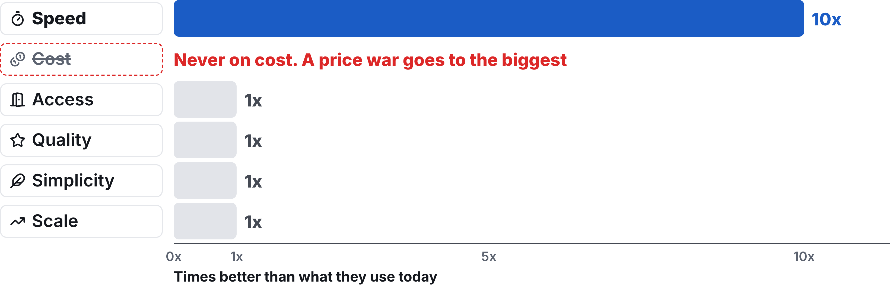
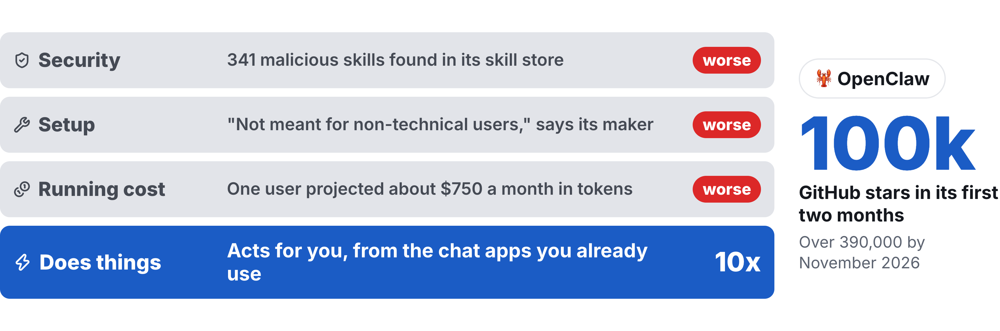
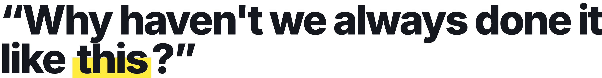
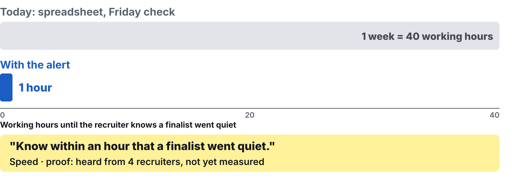

# Framework 07: The 10x Test

Updated: 2026-11-17.

**If your customers won't buy your crappy first version, it isn't 10x. Find the one thing that is ten times better than what they use today, never the price, and let your agent check the claim against what people did.**

> Framework 07 · The 10x test · Taught in [The solution space (M05)](../modules/05-solution-space/M05_Lecture_Solution-Space.pdf#page=35) · Checked again in Prototyping (M06), The kill decision (M07) and From prototype to product (M09)

## What you learned





## The idea

People don't switch for better. They switch for ten times better than what they use today. Reid Hoffman put the rule to Peter Thiel's Stanford class ([Masters, 2012](https://blakemasters.tumblr.com/post/23250566538/peter-thiels-cs183-startup-class-12-notes-essay)), and Thiel tells it with PayPal ([Thiel and Masters, 2014](https://www.penguinrandomhouse.com/books/234730/)). On eBay a check by mail took 7 to 10 days. PayPal paid the seller as soon as the auction ended, and the seller knew the money was good. Same goods, same auction, one dimension.

Ten is a practitioner's number, not a measured threshold. Research gives the reason behind it. Switching means losing a habit, your data and a workaround that works well enough, and a loss weighs about twice as much as a gain of the same size ([Brown et al., 2024](https://doi.org/10.1257/jel.20221698), 607 estimates from 150 articles). Today's solution starts with a head start you have to beat.

This course adds the test that matters most. **If your customers won't buy your crappy first version, it isn't 10x.** Your first version is ugly, slow and missing half of what a real product has. If people still pay for it, book time for it or keep using it, the one thing it does is ten times better, and they forgive everything else. If they politely decline, polish won't save it.

OpenClaw shows what that looks like. In early 2026 this open-source AI agent lost every comparison you would put in a table. Researchers found 341 malicious skills in its skill store, its maker said it was "not meant for non-technical users", and one user projected about $750 a month in tokens. Still, it collected over 100,000 GitHub stars in its first two months ([Heim, 2026](https://techcrunch.com/2026/01/30/openclaws-ai-assistants-are-now-building-their-own-social-network/), [Butts and Chin, 2026](https://www.cnbc.com/2026/02/02/openclaw-open-source-ai-agent-rise-controversy-clawdbot-moltbot-moltbook.html), [Claburn, 2026](https://www.theregister.com/security/2026/02/03/diy-ai-bot-farm-openclaw-is-a-security-dumpster-fire/4136886)). It did one thing nobody else did. It acts for you, from the chat apps you already use. That is a killer use case, the one thing people can't live without once they had it.



You hear 10x before you measure it. People say "Why haven't we always done it like this?", "I don't want to work any other way" or "When can my whole team have it?" They ask for access before the demo is over. "Nice", "interesting" and "that could be useful" mean two times better at best.

**Never on cost.** Cheaper is not a 10x dimension. A price war goes to whoever is biggest, and that is never you. Thiel puts it as competition driving profit to zero ([Thiel, 2014](https://www.wsj.com/articles/peter-thiel-competition-is-for-losers-1410535536)). Cheaper also gives people no reason to love you, only a reason to leave when someone is cheaper still. Pick speed, access, quality, simplicity or scale, and pick one. Ten times on everything is one time on everything.

## How to run it

1. **Name what they use today.** Your real competitor is the spreadsheet, the email, the intern, or nothing. Write down what it costs them, from your [Interview Log](01_Mom_Test.md#your-records).
2. **Go wide before you go deep.** Write three solutions to the same problem that differ in kind, at least one without software. Your agent runs [go-wide](#skill-go-wide).
3. **Say it in under ten words.** One segment, one outcome, against today. "Know within an hour that a finalist went quiet." If it needs more words, you don't understand it yet.
4. **Put a number on one dimension.** Same task, same unit, today against yours. A week of 40 working hours against one hour is 40 times, well past ten. Mark the proof heard, measured or assumed, and claim only what you compared.
5. **Cut to the killer use case.** Build the one feature that delivers the 10x and do the rest by hand. No login, no dashboard, no settings. Offensively ugly and slow is fine.
6. **Show it in 60 seconds.** Let them drive your click dummy or prototype while you stay quiet. If it needs a tutorial, your 10x isn't visible yet.
7. **Ask for something that costs them.** A trial slot, a deposit, a pre-order. This is the crappy-version test. Count what they did, never what they said they would do.
8. **Listen for the sentence.** Log their exact reaction. One "Why haven't we always done it like this?" outweighs ten "nice".
9. **Decide against a line you wrote before the demos.** The Solution space (M05) homework sets it as fewer than 2 of the first 7 people from your segment accepting a dummy's ask, and that dummy goes.

## Read the result

| What you found | What it means | Do this |
|---|---|---|
| They took the ask on the crappy version, and you heard the sentence | 10x on that one thing | Build exactly that one feature and nothing else |
| They took the ask, but nobody said it | Better, not yet 10x | Sharpen the one dimension, cut what dilutes it |
| They liked the demo and declined the ask | Not 10x | Change the solution and keep the problem, a [type 1 pivot](03_Build_Measure_Learn.md#go-pivot-or-kill) |
| Nobody in the segment hurt enough to care | The problem is too small | Go back to the problem space, a [type 2 pivot](03_Build_Measure_Learn.md#go-pivot-or-kill) |
| The proof is about price | Not a 10x | Find what else they would pay for, or drop it |

Run the test again before every build, in your verdict and whenever you feel comfortable. Competitors catch up, and a new AI model can give everyone your one thing overnight. If your 10x is "AI does it", ask whether a smart intern with a search engine could do the same in the time your user is willing to wait. If yes, AI is not your 10x.

## What good looks like

| | Good | Weak |
|---|---|---|
| 10x line | "Know within an hour that a finalist went quiet." | "An AI-powered platform to optimise hiring workflows" |
| Against | A spreadsheet and a Friday check, 2 hours a week | "Other recruiting tools" |
| Dimension | Speed, one hour against one working week | Faster, cheaper and easier |
| Proof | Heard in 9 demos, to be timed in the first trials | "Everyone loved it" |
| The ask | 8 trials booked, 1 deposit | "Keep me posted" |
| Reaction | "Why didn't our ATS ever do this?" (Lena, 12:40) | "Sounds useful" |

A made-up example.



**Three dummies, fifteen demos each.** The recruiting venture from the [Mom Test](01_Mom_Test.md#a-sample-conversation) went wide on one problem, finalists go quiet and recruiters notice too late. Each of its three founders built one click dummy in 4 hours and showed it to 15 recruiters, each demo ending in an ask, a two-week trial. The line was fewer than 2 of the first 7 accepting the ask, and that dummy goes.

| Dummy | Asks accepted | What they did | What they said | Verdict |
|---|---|---|---|---|
| A, the morning alert that flags a finalist who went quiet | 3 of the first 7, 6 of 15 in all, one with a deposit | Clicked the alert first | "Why haven't we always done it like this?" | 10x on speed. Build only the alert |
| B, the dashboard of every candidate | 0 of the first 7, 1 of 15 in all | Scrolled, then asked for the alert | "Nice overview" | Under the line. Killed, with a [kill page](03_Build_Measure_Learn.md#example-a-kill-page) |
| C, a daily check-in sent by message | 1 of the first 7, 1 of 15 in all | Most scrolled past | "Interesting" | Under the line. Dropped |

A made-up example, with the counts the lectures use. 45 demos, 8 trials booked, 1 deposit. The morning alert won on what people did, not on what the team liked.

## Run it with your agent

Four skills run this framework. Each is one file in the open Agent Skills format. Save it as `SKILL.md` in a folder with the skill's name, for example `.claude/skills/ten-x-check/SKILL.md` for Claude Code, or paste it at the start of a chat in any other assistant. The [frameworks guide](README.md#run-the-frameworks-with-your-agent) shows how to install them and make them yours.

Use AI to go wide and to check, never to decide. Your segment decides, by what it does. When an output is wrong, fix the skill, not the output.

### Skill: go-wide

Three solutions that differ in kind, from [The solution space (M05)](../modules/05-solution-space/M05_Lecture_Solution-Space.pdf#page=21). Ask it "Go wide on this problem. Finalists go quiet and recruiters notice too late."

````markdown
---
name: go-wide
description: Generates three solutions to one tested problem that differ in kind, at least one without software, after exploring the painpoint and the solutions that exist. Never ranks them. Use when a tested problem needs solutions, before building anything.
---

# go-wide

## Input
The tested problem in the segment's words, and the conversation notes behind it, names removed.

## Steps
1. Explore the painpoint. Look for counterintuitive problems nobody has paid attention to yet, and for the root cause behind the symptom.
2. Search for existing solutions. Summarize each in one line, with a link, and say what it costs the user today.
3. Brainstorm solutions that differ from all of them and from each other.
4. Return three. For each, one line on who does the work, one line on what the user sees, and one line on what the founders could test in 4 hours.

## Rules
- If you cannot open web pages, say so, give no link or date you have not opened, and work from what the team gave you.
- At least one solution works without software.
- Solutions must differ in who does the work, not only in the screen.
- Never rank them. The segment does that in demos.
- Never pick a solution that only wins on price.

## Good and weak
- Good: an alert app, a recruiter who calls on day 2, a daily check-in sent by message.
- Weak: an alert app, an alert app with a dashboard, an alert app with AI.

## Check before you answer
- [ ] Is one solution free of software?
- [ ] Would the three need three different builds to test?
- [ ] Is every existing solution linked?
````

### Skill: fill-canvas

Fills the value proposition canvas from your calls, from [The solution space (M05)](../modules/05-solution-space/M05_Lecture_Solution-Space.pdf#page=47). Your problem space already fills three of the four boxes. Ask it "Fill the four boxes from these calls. Name who told us. Mark everything nobody said as assumed."

````markdown
---
name: fill-canvas
description: Fills the four boxes of the value proposition canvas (customer segment, painpoint, competition, value proposition) from conversation transcripts and the team's problem-space records. Names who said what and marks everything nobody said as assumed. Use after problem conversations, before writing the 10x line.
---

# fill-canvas

## Input
Transcripts or notes, names swapped, plus the team's Pain Map and Interview Log if they exist.

## Steps
1. Customer segment. Who suffers most and who pays to fix it, from the segment and who signs in the Pain Map. If the sufferer and the payer differ, write both.
2. Painpoint. The obstacle and its root cause, in their words.
3. Competition. What they use today and what it costs them. A spreadsheet, an email, an intern and nothing all count.
4. Value proposition. Draft up to three lines of under ten words, each naming one dimension against today. The team writes the final one.
5. Mark every entry heard, with the people who said it, or assumed. End with the one assumed entry to ask about next, and whom to ask.

## Rules
- Their words, not yours, in the first three boxes.
- Never upgrade assumed to heard because it sounds likely.
- No value proposition on price.

## Good and weak
- Good: "Painpoint. Finalists go quiet, and we notice at the Friday check. Heard from Lena, Sam, Ayla."
- Weak: "Painpoint. Inefficient candidate communication."

## Check before you answer
- [ ] Does every heard entry name who said it?
- [ ] Is every draft line under ten words, with one dimension?
````

### Skill: log-demo

Logs every demo as a row in your [Interview Log](01_Mom_Test.md#your-records), from [The solution space (M05)](../modules/05-solution-space/M05_Lecture_Solution-Space.pdf#page=107). Ask it "Log this demo. Write what she did, not what she said she would do. Mark the ask as accepted or not."

````markdown
---
name: log-demo
description: Adds one row per guided demo to the team's Interview Log, with the dummy shown, what the person did, their exact reaction and whether they accepted the ask, then counts accepted asks per dummy against the team's line. Use after every demo of a click dummy or prototype.
---

# log-demo

## Input
The demo transcript or recording notes, names swapped, which dummy was shown, who led it, and the team's line (for example "fewer than 2 of the first 7 accept the ask, and the dummy goes").

## Record
The Interview Log, one row per demo, with the six optional demo columns at the end, as framework 01 lists them.
`date,segment,person,led_by,last_time,quote,raised_unprompted,cost_today,workaround,next_step,recording,dummy,did_first,stuck_at,reaction,ask,ask_accepted`

## Steps
1. Open the Interview Log. If it does not exist, create it with the columns under Record. If it lacks the six demo columns, add them.
2. Write what the person did, in order. What they clicked first, where they got stuck, whether they reached the outcome.
3. Copy their strongest reaction word for word, with its timestamp.
4. Write the ask and whether they accepted it. Accepted means they committed time, reputation or money, with a date.
5. Count accepted asks for this dummy among its first seven demos and compare with the line. Say whether the dummy stays or goes.

## Rules
- What they did, never what they said they would do. "She loved it" is not a row.
- A "would", a "will" or a compliment never counts as an accepted ask.
- Only people from the segment count toward the line.

## Good and weak
- Good: "Lena R., app dummy. Clicked the alert first. Ask accepted, trial on Wednesday at 14:00. 2 of 7 so far, the line is 2, it stays."
- Weak: "Great demo, Lena was very excited and will probably sign up."

## Check before you answer
- [ ] Is the reaction word for word, with a timestamp?
- [ ] Is "accepted" backed by a date or a payment?
- [ ] Is the count per dummy, against the line?
````

### Skill: ten-x-check

Tests your 10x claim against what people did. Run it after the demos, before every build and before your verdict. Ask it "Check our 10x line against the demo rows and the use records. Be strict."

````markdown
---
name: ten-x-check
description: Tests a startup's 10x claim against the evidence. Checks the 10x line, rejects price as a dimension, finds the number on one dimension against what users have today, runs the crappy-version test on demo and use records, and searches transcripts for killer-use-case reactions. Use after demos, before each build and before a go, pivot or kill decision.
---

# ten-x-check

## Input
The team's 10x line, its Interview Log with demo rows, its Use Log and payment records if they exist, and the transcripts behind them, names swapped.

## Steps
1. Check the line. Under ten words, one segment, one outcome, against what they use today. Rewrite it if it fails, and say why.
2. Check the dimension. Speed, access, quality, simplicity or scale. If the claim rests on price or cost, reject it and ask what else people would pay for.
3. Find the number. The same task in the same unit, today against with the product. Mark it heard, measured or assumed. Flag any comparison with a different task or a different baseline.
4. Run the crappy-version test. Per solution, count accepted asks, deposits and payments, and people who came back without being pushed. Compare with the team's line.
5. Listen for the sentence. Search the transcripts for killer-use-case reactions ("Why haven't we always done it like this?", "I don't want to go back", asking for access before the demo ended) and for two-times reactions ("nice", "interesting", "useful", any "would"). Quote both with timestamps and count them.
6. Give the verdict in one line. 10x, better but not 10x, not 10x, or the problem is too small. Then the one next step.

## Rules
- Actions outweigh words. A payment beats any quote.
- Price is never the 10x.
- Never round heard up to measured.
- Report counts, not percentages, under 20 people.

## Good and weak
- Good: "Speed, 1 hour against 40, heard in 9 demos, not yet measured. Morning alert 6 of 15 asks, 1 deposit, one 'why haven't we'. Verdict: 10x on speed, heard. Next: build only the alert and time the first trials."
- Weak: "Users seem to really like the product. Strong product-market fit potential."

## Check before you answer
- [ ] Is there exactly one dimension, and is it not price?
- [ ] Does every number say heard, measured or assumed?
- [ ] Does every quote carry a timestamp?
````

## In the lecture

| Slide | What it shows | Where |
|---|---|---|
| Go wide before you go deep | Three solutions, the go-wide skill | [The solution space (M05), pp. 18 to 22](../modules/05-solution-space/M05_Lecture_Solution-Space.pdf#page=18) |
| 10 times better | Better than what users have now | [The solution space (M05), p. 38](../modules/05-solution-space/M05_Lecture_Solution-Space.pdf#page=38) |
| PayPal was 10 times better than a check | The author's example | [The solution space (M05), p. 39](../modules/05-solution-space/M05_Lecture_Solution-Space.pdf#page=39) |
| A loss weighs about twice as much as a gain | Why ten times | [The solution space (M05), p. 40](../modules/05-solution-space/M05_Lecture_Solution-Space.pdf#page=40) |
| Value proposition canvas | Four boxes, filled from your problem space and your calls | [The solution space (M05), pp. 41 to 47](../modules/05-solution-space/M05_Lecture_Solution-Space.pdf#page=41) |
| The 10x test | One dimension, never on cost | [The solution space (M05), p. 48](../modules/05-solution-space/M05_Lecture_Solution-Space.pdf#page=48) |
| The killer use case | OpenClaw, and "Why haven't we always done it like this?" | [The solution space (M05), pp. 49 to 51](../modules/05-solution-space/M05_Lecture_Solution-Space.pdf#page=49) |
| Cut it | Your first dummy is smaller than you think | [The solution space (M05), pp. 56 to 59](../modules/05-solution-space/M05_Lecture_Solution-Space.pdf#page=56) |
| Every demo lands in your log | The log-demo skill | [The solution space (M05), p. 107](../modules/05-solution-space/M05_Lecture_Solution-Space.pdf#page=107) |
| Four questions before you build again | For whom is it 10x better? | [Prototyping (M06), p. 93](../modules/06-prototyping/M06_Lecture_Prototyping.pdf#page=93) |
| Score nine questions on artifacts | Question 5, ten times better | [The kill decision (M07), p. 50](../modules/07-rapid-validation/M07_Lecture_Rapid-Validation.pdf#page=50) |
| Price the outcome, not your effort | They get 5 to 10 times what they pay | [From prototype to product (M09), p. 17](../modules/09-prototype-to-product/M09_Lecture_Prototype-to-Product.pdf#page=17) |

## Go deeper

- Thiel, P., and Masters, B. (2014). [*Zero to One*](https://www.penguinrandomhouse.com/books/234730/). Crown Business. The PayPal story and the rule that a new technology must be at least ten times better than its closest substitute.
- Masters, B. (2012). [Peter Thiel's CS183: Startup, class 12 notes](https://blakemasters.tumblr.com/post/23250566538/peter-thiels-cs183-startup-class-12-notes-essay), with Reid Hoffman as guest. Where the 10x rule of thumb comes from.
- Thiel, P. (2014, September 12). [Competition is for losers](https://www.wsj.com/articles/peter-thiel-competition-is-for-losers-1410535536). *The Wall Street Journal*. Why never on cost.
- Brown, A. L., Imai, T., Vieider, F. M., and Camerer, C. F. (2024). [Meta-analysis of empirical estimates of loss aversion](https://doi.org/10.1257/jel.20221698). *Journal of Economic Literature*, 62(2). Losses weigh about twice as much as gains.
- Tversky, A., and Kahneman, D. (1992). [Advances in prospect theory](https://doi.org/10.1007/BF00122574). *Journal of Risk and Uncertainty*, 5(4). The original estimate of loss aversion.
- Gourville, J. T. (2006). [Eager sellers and stony buyers](https://hbr.org/2006/06/eager-sellers-and-stony-buyers-understanding-the-psychology-of-new-product-adoption). *Harvard Business Review*, 84(6). The 9x gap between what sellers and buyers value.
- Osterwalder, A., Pigneur, Y., Bernarda, G., and Smith, A. (2014). [*Value Proposition Design*](https://www.wiley.com/en-us/Value+Proposition+Design%3A+How+to+Create+Products+and+Services+Customers+Want-p-9781118968055). Wiley. The canvas.
- On OpenClaw. Heim, A. (2026, January 30), [TechCrunch](https://techcrunch.com/2026/01/30/openclaws-ai-assistants-are-now-building-their-own-social-network/). Butts, D., and Chin, M. (2026, February 2), [CNBC](https://www.cnbc.com/2026/02/02/openclaw-open-source-ai-agent-rise-controversy-clawdbot-moltbot-moltbook.html). Claburn, T. (2026, February 3), [The Register](https://www.theregister.com/security/2026/02/03/diy-ai-bot-farm-openclaw-is-a-security-dumpster-fire/4136886).
