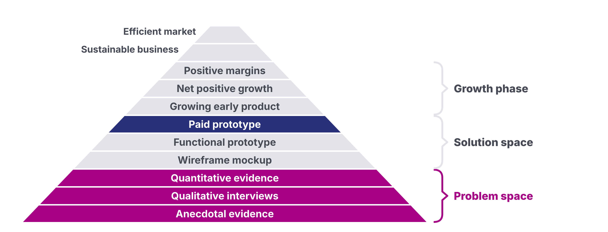

# Sono Motors: 21,000 Reservations and a 50-Day Test

Updated: 2026-10-30.

> Module 00 · Kickoff · Case, read at home this week

Case for Module 00, Kickoff, of Ambitious Entrepreneurship. Prepared by Bastian Burger from public sources as a basis for class discussion. The case does not judge whether any decision was right or wrong. Licensed under CC BY-NC-SA 4.0 except third-party material as marked.
{: .byline }

On 8 December 2022 Laurin Hahn and Jona Christians, co-founders and co-chief executives of Sono Motors in Munich, published a statement on the future of the Sion, the solar-electric passenger car at the centre of their company.[^1] About 21,000 private customers had reserved a Sion, with an average down payment of about EUR 2,000 each.[^2] Raising equity had become harder and more dilutive. "Raising money takes much longer than expected," the founders wrote, "since we failed to explain to investors why the Sion has the potential to become the world's first affordable solar-electric vehicle and that there is a huge demand for it."[^3]

"One view in the investment community," they went on, "is that we should focus on our capital-light, revenue-generating solar business and abandon the Sion program."[^4] Before making any decision to stop the Sion, the founders called on reservation holders and potential new customers[^5] to put up money equal to 3,500 fully paid Sions within 50 days, to be paid only if the campaign succeeded.[^6] "If we cannot complete the campaign," they wrote, "we intend to focus on our attractive solar B2B business, which is significantly less capital intensive."[^7] B2B stands for business-to-business.

The campaign, called #saveSion, was meant to fund most of the Sion program[^8] and, in the company's words, to let customers "prove with their down payments that the Sion is the solution for them".[^9] The decision on the car itself was still to come.

## A Car With Solar Cells

Hahn and Christians started the business in a garage in Munich in 2012. The company was incorporated in 2016 together with Navina Pernsteiner, who by November 2021 was no longer part of its management but remained a shareholder.[^10] Its car, the Sion, had solar cells integrated into the body.[^11] In September 2022 the company gave its expected net price as EUR 25,126 and said the Sion "has the potential to become the world's first Solar Electric Vehicle (SEV) for the masses".[^12]

By December 2022 the founders reported that the company had raised more than EUR 330 million since 2016.[^13] The results presentation of 8 December counted about EUR 44 million of this as paid reservations as of 30 November 2022.[^14] The holding company, Sono Group N.V., had listed its shares on Nasdaq in November 2021.[^15]

Next to the car, Sono Motors built a solar business that integrated its solar technology into other companies' vehicles. The founders wrote that 23 companies were piloting it "on a variety of fleet vehicles such as buses, trailers, and electric transporters".[^16] The results presentation counted "12 non-binding LOIs and 16 purchase orders / contracts signed and/or products delivered" for these customers, LOIs being letters of intent.[^17] Revenue from the solar and digital businesses was EUR 138,000 in the third quarter of 2022.[^18]

## Counting Demand, 2016 to 2022

Sono Motors asked customers for different kinds of commitment over the years (Exhibit 1).

In the summer of 2016 the company ran a crowdfunding campaign on Indiegogo with a goal of EUR 150,000, which it passed. Supporters could put down a EUR 500 refundable deposit on a car or a EUR 2,000 pre-order with a 5 percent discount. First deliveries were then planned for "as soon as 2018".[^19] The totals reported for the early campaigns differ. A company press release of September 2017 said Sono Motors had acquired more than EUR 850,000 through crowdfunding in 2016.[^20] In April 2017 Hahn put the money raised from supporters so far at more than EUR 500,000 "on different channels".[^21]

In the same interview Hahn said, "We now have over 1,000 non-binding pre-orders for the Sion, which clearly shows us that this car addresses a large market."[^22] The company presented the Sion at the Munich Technology Center in July 2017, with a range of 250 kilometres and a price of EUR 16,000 excluding the battery.[^23] In September 2017 its chief financial officer, Martin Sabbione, said, "Our target is to acquire 5,000 reservations, to strengthen Sono Motors' position vis-à-vis system suppliers." By then 2,000 reservations had been acquired, according to the company.[^24]

In June 2018 the company reported more than 5,000 reservations and stated "that down payments have already been made for each of these vehicles and several hundred cars have already been paid in full". Production was then scheduled to start in the second half of 2019.[^25] By October 2018 it reported more than 8,000 "fee-based vehicle reservations" and said it had "comfortably exceeded its original target of 5,000 reservations". Series production was then scheduled for the fourth quarter of 2019.[^26] In May 2019 the count stood at 10,000, and the company said the number of paid preorders had doubled since June 2018. Production was then set for the second half of 2020.[^27]

On 1 December 2019 Sono Motors launched a community funding campaign with a target of EUR 50 million, "2,000 vehicle preorders to be generated in four weeks". The announcement moved the production of the first vehicles to September 2021.[^28] By the end of 2019 about EUR 33 million had come together, which the electric-car site ecomento called too little. After a community vote the company extended the campaign to 20 January 2020, and in the new year existing investors committed EUR 10 million.[^29] In January 2020 the company announced that EUR 53 million had been invested over 50 days, "around 75 percent" from Sion reservation holders, 19 percent from existing and new investors and around 6 percent from loans and donations. It then counted 13,000 reservations.[^30] The results presentation of December 2022 listed "€53m in payment commitments" as the result of the 2019 campaign and "€45m in net payment commitments (w/o VAT)", gave "approx.10,600 reservations with down payments" as a separate highlight, and noted "Challenge: 30 days extended to 50 days".[^31] The company's accounts for 2020 recorded additions of EUR 30.6 million to advance payments received from customers.[^32]

The reported count passed 16,000 in November 2021 and reached about 21,000 by the end of November 2022. The reported average down payment was USD 3,000 in November 2021 and about EUR 2,000 in September 2022, described as net, and in November 2022 (Exhibit 1). The company guaranteed a net price of EUR 21,400 to the first 16,000 reservation holders and set EUR 23,900 net for later ones.[^33] Its registration statement for the Nasdaq listing warned that "In November 2021, we increased the net sales price for the Sion, which may negatively impact demand for the Sion and our reputation."[^34] By June 2022 the purchase price in the company's reservation terms was EUR 29,900, including German VAT.[^35] The expected net price was EUR 25,126 in September 2022, and the results presentation of December 2022 applied a net price of EUR 25,100 to reservations after the 18,500th.[^36] The start of production moved several times (Exhibit 2).

In its filings the company described the reservations as evidence of demand. "The traction we have gained among potential customers is evidenced by a significant number of pre-orders," the registration statement said, "which we believe provides commercial validation of our model and revenue momentum."[^37]

## What a Reservation Was

A reservation was a contract under the company's general terms and conditions for vehicle reservations. In the version of 30 June 2022, "The price paid for the reservation will be credited, in full, to the purchase price of the vehicle", and "Through the reservation-process, there shall be no entitlement to the delivery of a vehicle." A customer could withdraw within 14 days without giving reasons. After that a customer could still rescind, among other cases, if he or she decided not to enter into the sales contract when Sono Motors offered it, or if Sono Motors had not offered a sales contract by 31 December 2023.[^38]

As of 30 November 2022 the company had "approximately 21k Sion reservations with an average down payment of approximately EUR 2k per reservation". It put the potential net sales of these reservations at about EUR 463 million, "assuming all reservations actually result in sales".[^39] Of the advance payments it held on 30 September 2022, measured by nominal value, 24.9 percent could be cancelled at that time, a further 53.2 percent from 1 January 2023, 14.8 percent from 1 July 2023 and 7.0 percent from 1 January 2024.[^40]

No customer had signed a binding purchase agreement. "To date, none of our customers has entered into a binding purchase agreement with us for our vehicles," the company's half-year report filed on 7 December 2022 said, "and we do not expect binding purchase agreements to be signed, at the earliest, until one year prior to the expected delivery date of a vehicle to the relevant customer."[^41] "In the event of a customer's cancellation," the report went on, "we are obligated to refund any advance payments already paid in connection with the reservation."[^42] The annual report for 2021 had stated that "there is no assurance that reservations will ultimately result in the purchase of a vehicle or that we actually realize our revenue expectations."[^43]

Business customers had placed B2B pre-orders of a different kind. As of 1 December 2022 the company counted about 22,000 of them, among them a letter of intent by FINN, a Munich-based car subscription platform, for 12,600 Sions. "Pre-orders are non-binding and no down payments have been made," the results presentation said.[^44] FINN and Sono Motors had signed the letter of intent in September 2022.[^45]

Exhibit 3 sets out the forms of demand evidence side by side.

## December 2022

Sono Group N.V. reported a loss of EUR 104.5 million for the first nine months of 2022. Its third-quarter report listed among its risks that its losses "raise substantial doubt about our ability to continue as a going concern".[^46] The company gave its current and expected liquidity as EUR 55 million, the founders' statement as "$55 million".[^47] On 7 December the company had filed a registration statement for an at-the-market share program of up to USD 135 million and agreed to sell convertible debentures of up to USD 31.1 million.[^48] The founders called #saveSion "our non-dilutive solution for funding the majority of the Sion program and the first part of a broader funding strategy for the next 12 months, which includes of course the capital markets."[^49]

The company's German campaign page of 8 December gave the founders' account of the advice they had received. "Our advisers tell us not to build the car, to restructure the company and to lay off 70% of our employees," it said. "The reservation holders will be compensated, the Sion and the community shunted aside." The founders' answer followed. "But for us, that is simply not an option. Not without giving our community the chance to have a say. That is why we started this campaign."[^50] The English version of the page, as captured on 9 December, attributed the same advice to investors.[^51]

The campaign asked for "an upfront payment equivalent of 3,500 Sion full price payments", which the company expected to bring in EUR 100 million, about EUR 84 million net of VAT.[^52] Early participants were offered a discount of up to EUR 3,000 on the vehicle's final price. "Payments must only be made in the event the campaign is successful," the founders wrote, and supporters could receive a fixed waiting-list number.[^53] On the day, the business newspaper Handelsblatt described the campaign as asking 3,500 customers to prepay "a discounted purchase price of 27,000 euros" in full, without saying whether that figure included VAT.[^54] Existing holders could increase their down payment, and "even if you increase your reservation by EUR 100, it brings us closer to the campaign goal". New customers could place a new booking.[^55] Loans, gifts and social-media posts were also welcome.[^56] "Your down payment represents your trust in us and your demand for the Sion," the German page told supporters.[^57]

The results presentation of the same day had a slide headed "How we tell the story". Under "The simple message we give to our community" it read, "21,000 people have reserved the car. The vast majority of these people plan to pay the full price as soon as they expect to get the vehicle. So now, we ask them to give us some of this money 12-18 months earlier in order to start the production of their car."[^58]

The founders believed that the company's liquidity and resources would allow it "to successfully pivot to 'solar only'" if the campaign could not be completed.[^59]

## Fifty Days

On 8 December 2022 about 21,000 people held a reservation for a Sion, with about EUR 44 million of down payments between them. None of them had signed a binding purchase agreement, and the company did not expect anyone to sign one before a year ahead of delivery. About 22,000 B2B pre-orders carried no money at all. The campaign asked for money equal to 3,500 fully paid cars within 50 days, to be paid only if the campaign succeeded.

Hahn and Christians had said what they intended to do if the campaign could not be completed. What a full success, a narrow miss or a clear miss would say about the demand behind the reservations, and what each should mean for the Sion, remained to be decided.

## Exhibit 1: Sion Reservations as Reported by Sono Motors, 2017 to 2022

| As of | Reservations reported | What the company said about money | Value if all became sales, in the company's term | Note |
|---|---|---|---|---|
| April 2017 | more than 1,000 | "non-binding pre-orders" (translated) | not stated | [^60] |
| September 2017 | 2,000 (target 5,000) | not stated | not stated | [^61] |
| June 2018 | more than 5,000 | down payments made for each, several hundred cars paid in full | turnover of more than EUR 100m | [^62] |
| October 2018 | more than 8,000 | "fee-based vehicle reservations" | order volume of about EUR 140m | [^63] |
| May 2019 | 10,000 | paid preorders doubled since June 2018 | turnover of EUR 214m | [^64] |
| January 2020 | 13,000 | EUR 53m invested in the community campaign | not stated | [^65] |
| January 2021 | more than 12,600 pre-orders | not stated | not stated | [^66] |
| April 2021 | 13,000 private | average down payment EUR 3,000 | total order value EUR 278m | [^67] |
| October 2021 | more than 15,000 | average down payment USD 3,300 | total order value USD 385m (EUR 321m) | [^68] |
| November 2021 | more than 16,000 | average down payment USD 3,000, net cash inflows EUR 40.8m | net sales volume of about EUR 340m | [^69] |
| March 2022 | more than 17,000 | average down payment EUR 2,390 net, net cash inflows EUR 40.9m | net sales volume of EUR 368m | [^70] |
| September 2022 | more than 20,000 | average down payment about EUR 2,000 net, net cash inflows about EUR 43m | net sales volume of about EUR 435m | [^71] |
| November 2022 | about 21,000 | average down payment about EUR 2,000, paid reservations about EUR 44m | net sales volume of about EUR 463m | [^72] |

Source: Sono Motors press releases, an interview and filings, one note per row. All figures as reported by the company and not independently verified. "Net cash inflows" as defined in the company's filings. The counts mix private reservations and pre-orders as each source named them. Where the source does not say, the cell says "not stated".
{: .source }

## Exhibit 2: Start of Production and Price of the Sion as Announced, 2016 to 2022

| Announced | Start of production or first deliveries | Price as announced | Note |
|---|---|---|---|
| September 2016 | first deliveries "as soon as 2018" | not stated | [^73] |
| September 2017 | not stated | EUR 16,000 excluding battery, VAT basis not stated | [^74] |
| June 2018 | production in the second half of 2019 | not stated | [^75] |
| October 2018 | series production in the fourth quarter of 2019 | not stated | [^76] |
| May 2019 | production in the second half of 2020 | not stated | [^77] |
| December 2019 | first vehicles in September 2021 | not stated | [^78] |
| January 2021 | not stated | estimated gross price EUR 25,500 | [^79] |
| October 2021 | not stated | EUR 21,400 net, then EUR 23,900 net after the first 16,000 reservations or from 15 November 2021, whichever came first | [^80] |
| November 2021 | deliveries from the first half of 2023 | not stated | [^81] |
| April 2022 | series production in the second half of 2023 | not stated | [^82] |
| June 2022 | not stated | EUR 29,900 including German VAT in the reservation terms | [^83] |
| December 2022 | pre-series production in 2023, start of production in the first quarter of 2024 | EUR 25,100 net for reservations after the 18,500th | [^84] |

Source: Autoblog (2016), Sono Motors press releases (2017 to 2022), Sono Group N.V. filings, the founders' statement and the results presentation of 8 December 2022, and the reservation terms of 30 June 2022, one note per row.
{: .source }

## Exhibit 3: Sono Motors' Demand Evidence as Reported by 8 December 2022

| Evidence | As of | Number | Money | Binding | Refundable | Note |
|---|---|---|---|---|---|---|
| B2B pre-orders | 1 December 2022 | about 22,000, including a non-binding letter of intent by FINN for 12,600 | "no down payments have been made" | "non-binding" | nothing paid | [^85] |
| Private reservations | 30 November 2022 | about 21,000 | average down payment about EUR 2,000, paid reservations about EUR 44m | no entitlement to a vehicle (terms of 30 June 2022) | on withdrawal within 14 days or on rescission (terms of 30 June 2022) | [^86] |
| #saveSion | 8 December 2022 | the equivalent of 3,500 fully paid Sions, about EUR 100m gross | to be paid only if the campaign succeeds | not stated in the company's documents | not stated in the company's documents | [^87] |
| Binding purchase agreements | 7 December 2022 | none signed, none expected until one year before delivery | not applicable | yes | not applicable | [^88] |

On 30 September 2022, 24.9 percent of the advance payments by nominal value could be cancelled at that time, a further 53.2 percent from 1 January 2023, 14.8 percent from 1 July 2023 and 7.0 percent from 1 January 2024.[^89]

Source: Compiled by the case writer from the company documents in the notes.
{: .source }

## From the Lecture

The hierarchy of evidence shown in the Module 00 lecture, with the problem space and the paid prototype highlighted.

[^1]: Sono Motors, "Most important strategic decision in Sono Motor's history: Community to decide about the future of the Sion", statement by Jona Christians and Laurin Hahn, 8 December 2022, company website, live page, <https://website.sonomotors.com/en/press/press-releases/ceos-and-co-founders-of-sono-motors-make-statement-regarding-the-savesion-campaign/>, accessed 2026-10-19. Paragraphs counted from "Sono Motors has achieved", paragraph 1.
[^2]: Sono Group N.V., third-quarter 2022 report, Exhibit 99.1 to Form 6-K, 8 December 2022, <https://web.archive.org/web/20250622005530id_/https://www.sec.gov/Archives/edgar/data/1840416/000117184322007931/exh_991.htm>, accessed 2026-10-19, corporate update.
[^3]: Sono Motors, founders' statement, 8 December 2022, paragraph 1.
[^4]: Sono Motors, founders' statement, 8 December 2022, paragraph 2.
[^5]: Sono Motors, founders' statement, 8 December 2022, paragraph 3. Sono Group N.V., "Third Quarter 2022: Increase in Reservations and Multiple International Partnerships Signed", press release, Exhibit 99.1 to Form 6-K, 8 December 2022, <https://web.archive.org/web/20250213055238id_/https://www.sec.gov/Archives/edgar/data/1840416/000117184322007901/exh_991.htm>, accessed 2026-10-19, recent financial developments.
[^6]: Sono Motors, founders' statement, 8 December 2022, paragraph 5. Sono Group N.V., "Q3 2022 Results", results presentation, 8 December 2022, <https://web.archive.org/web/20230225075646id_/https://ir.sonomotors.com/static-files/34d9c451-f045-4ed8-8c0f-fe68fc3f5b83>, accessed 2026-10-19, slide 32.
[^7]: Sono Motors, founders' statement, 8 December 2022, paragraph 11.
[^8]: Sono Motors, founders' statement, 8 December 2022, paragraph 10.
[^9]: Sono Group N.V., third-quarter 2022 press release, 8 December 2022, recent financial developments.
[^10]: Sono Group N.V., Form F-1/A registration statement, 8 November 2021, <https://web.archive.org/web/20240113001021id_/https://www.sec.gov/Archives/edgar/data/1840416/000110465921135375/tm212911-10_f1a.htm>, accessed 2026-10-19, "Corporate History, Reorganization and Recent Financing Transactions".
[^11]: Sono Motors, "Sono Motors is a great crowdinvesting success", press release, Munich, 12 September 2017, <https://www.electrive.com/media/2017/09/170912_Press-Sono-Motors-1M-Crowdinvesting_ENG.pdf>, accessed 2026-10-19.
[^12]: Sono Motors, "Sono Motors Reaches 20,000 Reservations for Its 'Sion' Solar-Electric Passenger Car", press release, 1 September 2022, live page, <https://website.sonomotors.com/en/press/press-releases/sono-motors-reaches-20-000-reservations-for-its-sion-solar-electric-passenger-car/>, accessed 2026-10-19.
[^13]: Sono Motors, founders' statement, 8 December 2022, paragraph 8.
[^14]: Sono Group N.V., results presentation, 8 December 2022, slide 26 and its note 1.
[^15]: Sono Group N.V., results presentation, 8 December 2022, slide 8. Sono Motors, press release, 1 September 2022, "NASDAQ: SEV".
[^16]: Sono Motors, founders' statement, 8 December 2022, paragraph 7.
[^17]: Sono Group N.V., results presentation, 8 December 2022, slide 8, note 2.
[^18]: Sono Group N.V., third-quarter 2022 press release, 8 December 2022, financial highlights.
[^19]: Danny King, "Sono Motors crowdfunds $200k for its out-there solar-powered EV", Autoblog, 7 September 2016, <https://web.archive.org/web/20200215153821id_/https://www.autoblog.com/2016/09/07/sono-motors-crowdfunds-200k-solar-powered-ev/>, accessed 2026-10-19.
[^20]: Sono Motors, press release, 12 September 2017.
[^21]: Regina Bruckschlögl, "Rollt der Sion bald auf unseren Straßen? Update von Sono Motors", interview with Laurin Hahn, Munich Startup, 17 April 2017, <https://munich-startup.de/news/update-von-sono-motors>, accessed 2026-10-19, translated from German by the case writer.
[^22]: Bruckschlögl, interview with Laurin Hahn, Munich Startup, 17 April 2017, translated from German by the case writer.
[^23]: Sono Motors, press release, 12 September 2017.
[^24]: Sono Motors, press release, 12 September 2017.
[^25]: Sono Motors, "More than a year before the start of production, Sono Motors has already registered more than 5,000 reservations", press release, 14 June 2018, <https://www.electrive.com/media/2018/06/Sono-Motors-reaches-5.000-preorders.pdf>, accessed 2026-10-19.
[^26]: Sono Motors, "Sono Motors Announces New Round of Financing", press release, 18 October 2018, <https://www.presseportal.de/en/pdf.htx?nr=4091074>, accessed 2026-10-19.
[^27]: Sono Motors, "Sono Motors Hits 10,000 Mark for Preorders of First Series Production SEV Sion", press release, 8 May 2019, live page, <https://website.sonomotors.com/en/press/press-releases/sono-motors-hits-10000-mark-for-preorders-of-first-series-production-sev-sion/>, accessed 2026-10-19.
[^28]: Sono Motors, "Sono Motors Launches Community Funding Campaign with Target of 50 Million Euros", press release, 2 December 2019, live page, <https://website.sonomotors.com/en/press/press-releases/sono-motors-launches-community-funding-campaign-with-target-of-50-million-euros/>, accessed 2026-10-19.
[^29]: Thomas Langenbucher, "Sono Motors: 'Wir gehen einen neuen Weg bei der Finanzierung eines Unternehmens'", ecomento, 10 January 2020, reporting an interview in the magazine Edison, <https://ecomento.de/2020/01/10/sono-motors-neuer-weg-bei-finanzierung-eines-unternehmens/>, accessed 2026-10-19, translated from German by the case writer.
[^30]: Sono Motors, "Community Funding Successfully Completed: Sono Motors Campaign Reaches 53 Million Euros", press release, 21 January 2020, live page, <https://website.sonomotors.com/en/press/press-releases/sono-motors-community-funding-campaign-reaches-53-million-euros/>, accessed 2026-10-19.
[^31]: Sono Group N.V., results presentation, 8 December 2022, slides 35 and 37.
[^32]: Sono Group N.V., Form F-1/A, 8 November 2021, notes to the financial statements, advance payments received from customers.
[^33]: Sono Motors, "Sono Motors Reaches 15,000 Reservations", press release, 28 October 2021, live page, <https://website.sonomotors.com/en/press/press-releases/sono-motors-reaches-15000-reservations/>, accessed 2026-10-19. Sono Group N.V., Form F-1/A, 8 November 2021, risk factors.
[^34]: Sono Group N.V., Form F-1/A, 8 November 2021, risk factors.
[^35]: Sono Motors GmbH, "General Terms and Conditions for Vehicle-Reservations and Right of Withdrawal", version of 30 June 2022, as captured on 8 December 2022, <https://web.archive.org/web/20221208192349id_/https://sonomotors.com/site/assets/files/1629/220630_sonomotors_-_agb_nr__12_eng.pdf>, accessed 2026-10-19, clauses 4b and 5a.
[^36]: Sono Motors, press release, 1 September 2022. Sono Group N.V., results presentation, 8 December 2022, slide 32, note 2.
[^37]: Sono Group N.V., Form F-1/A, 8 November 2021, "Our Strengths".
[^38]: Sono Motors GmbH, reservation terms of 30 June 2022, clauses 2, 7 and 8.
[^39]: Sono Group N.V., third-quarter 2022 report, 8 December 2022, corporate update.
[^40]: Sono Group N.V., third-quarter 2022 report, 8 December 2022, note 6.5.
[^41]: Sono Group N.V., half-year 2022 report, Exhibit 99.1 to Form 6-K, filed 7 December 2022, <https://web.archive.org/web/20250211043046id_/https://www.sec.gov/Archives/edgar/data/1840416/000110465922125227/sev-20220630xex99d1.htm>, accessed 2026-10-19.
[^42]: Sono Group N.V., half-year 2022 report, 7 December 2022.
[^43]: Sono Group N.V., Form 20-F for fiscal 2021, 19 April 2022, <https://web.archive.org/web/20250424085617id_/https://www.sec.gov/Archives/edgar/data/1840416/000117184322002652/0001171843-22-002652.txt>, accessed 2026-10-19, risk factors.
[^44]: Sono Group N.V., results presentation, 8 December 2022, slide 6, notes 1 and 4.
[^45]: Sono Motors, "FINN Intends to Purchase 12,600 Sion from Sono Motors to Be Used in a Sustainable Fleet", press release, 7 September 2022, live page, <https://website.sonomotors.com/en/press/press-releases/finn-intends-to-purchase-12-600-sion/>, accessed 2026-10-19.
[^46]: Sono Group N.V., third-quarter 2022 report, 8 December 2022, income statement and risk factors.
[^47]: Sono Group N.V., third-quarter 2022 press release, 8 December 2022, financial highlights. Sono Motors, founders' statement, 8 December 2022, paragraph 11.
[^48]: Sono Group N.V., third-quarter 2022 press release, 8 December 2022, recent financial developments.
[^49]: Sono Motors, founders' statement, 8 December 2022, paragraph 10.
[^50]: Sono Motors, "Was ist hier los?", German campaign page, as captured on 8 December 2022, <https://web.archive.org/web/20221208175757id_/https://sonomotors.com/de/what-is-going-on/>, accessed 2026-10-19, translated from German by the case writer.
[^51]: Sono Motors, "Wait, what is going on?", English campaign page, as captured on 9 December 2022, <https://web.archive.org/web/20221209152614id_/https://sonomotors.com/en/what-is-going-on/>, accessed 2026-10-19.
[^52]: Sono Group N.V., results presentation, 8 December 2022, slide 32.
[^53]: Sono Motors, founders' statement, 8 December 2022, paragraph 5.
[^54]: "Sono Motors: Solarauto Sion steht erneut vor dem Aus - Vorauszahlung von Käufern notwendig", Handelsblatt, 8 December 2022, <https://www.handelsblatt.com/technik/it-internet/sono-motors-solarauto-sion-steht-erneut-vor-dem-aus-vorauszahlung-von-kaeufern-notwendig/28856918.html>, accessed 2026-10-19, translated from German by the case writer.
[^55]: Sono Motors, German campaign page, captured 8 December 2022, "Wie kann ich helfen?", translated from German by the case writer.
[^56]: Sono Motors, German campaign page, captured 8 December 2022, "Warum 3.500?", translated from German by the case writer.
[^57]: Sono Motors, German campaign page, captured 8 December 2022, "Was passiert jetzt?", translated from German by the case writer.
[^58]: Sono Group N.V., results presentation, 8 December 2022, slide 33.
[^59]: Sono Motors, founders' statement, 8 December 2022, paragraph 11.
[^60]: Bruckschlögl, interview with Laurin Hahn, Munich Startup, 17 April 2017.
[^61]: Sono Motors, press release, 12 September 2017.
[^62]: Sono Motors, press release, 14 June 2018.
[^63]: Sono Motors, press release, 18 October 2018.
[^64]: Sono Motors, press release, 8 May 2019.
[^65]: Sono Motors, press release, 21 January 2020.
[^66]: Sono Motors, "Sono Motors Reaches New Landmark in Journey to First Solar EV for the Masses", press release, 4 January 2021, live page, <https://website.sonomotors.com/en/press/press-releases/sono-motors-reaches-new-landmark-in-journey-to-first-solar-ev-for-the-masses/>, accessed 2026-10-19.
[^67]: Sono Motors, "13,000 International Reservations for the SEV Sion", press release, 15 April 2021, live page, <https://website.sonomotors.com/en/press/press-releases/13-000-international-reservations-for-the-sev-sion/>, accessed 2026-10-19.
[^68]: Sono Motors, press release, 28 October 2021.
[^69]: Sono Group N.V., Form F-1/A, 8 November 2021, "Letter from our Founders" and "Our Strengths".
[^70]: Sono Group N.V., Form 20-F for fiscal 2021, 19 April 2022. Sono Motors, "Full Year 2021 Corporate Update", press release, 19 April 2022, live page, <https://website.sonomotors.com/en/press/press-releases/full-year-2021-corporate-update-sono-motors/>, accessed 2026-10-19.
[^71]: Sono Motors, press release, 1 September 2022. Sono Group N.V., half-year 2022 report, 7 December 2022.
[^72]: Sono Group N.V., third-quarter 2022 report, 8 December 2022, corporate update. Sono Group N.V., results presentation, 8 December 2022, slide 26.
[^73]: King, Autoblog, 7 September 2016.
[^74]: Sono Motors, press release, 12 September 2017.
[^75]: Sono Motors, press release, 14 June 2018.
[^76]: Sono Motors, press release, 18 October 2018.
[^77]: Sono Motors, press release, 8 May 2019.
[^78]: Sono Motors, press release, 2 December 2019.
[^79]: Sono Motors, press release, 4 January 2021.
[^80]: Sono Motors, press release, 28 October 2021.
[^81]: Sono Group N.V., Form F-1/A, 8 November 2021, risk factors.
[^82]: Sono Group N.V., Form 20-F for fiscal 2021, 19 April 2022, risk factors.
[^83]: Sono Motors GmbH, reservation terms of 30 June 2022, clauses 4b and 5a.
[^84]: Sono Motors, founders' statement, 8 December 2022, paragraph 10. Sono Group N.V., results presentation, 8 December 2022, slide 32, note 2.
[^85]: Sono Group N.V., results presentation, 8 December 2022, slide 6, notes 1 and 4.
[^86]: Sono Group N.V., third-quarter 2022 report, 8 December 2022, corporate update. Sono Group N.V., results presentation, 8 December 2022, slide 26. Sono Motors GmbH, reservation terms of 30 June 2022, clauses 2, 7 and 8.
[^87]: Sono Motors, founders' statement, 8 December 2022, paragraph 5. Sono Group N.V., results presentation, 8 December 2022, slide 32.
[^88]: Sono Group N.V., half-year 2022 report, 7 December 2022.
[^89]: Sono Group N.V., third-quarter 2022 report, 8 December 2022, note 6.5.
