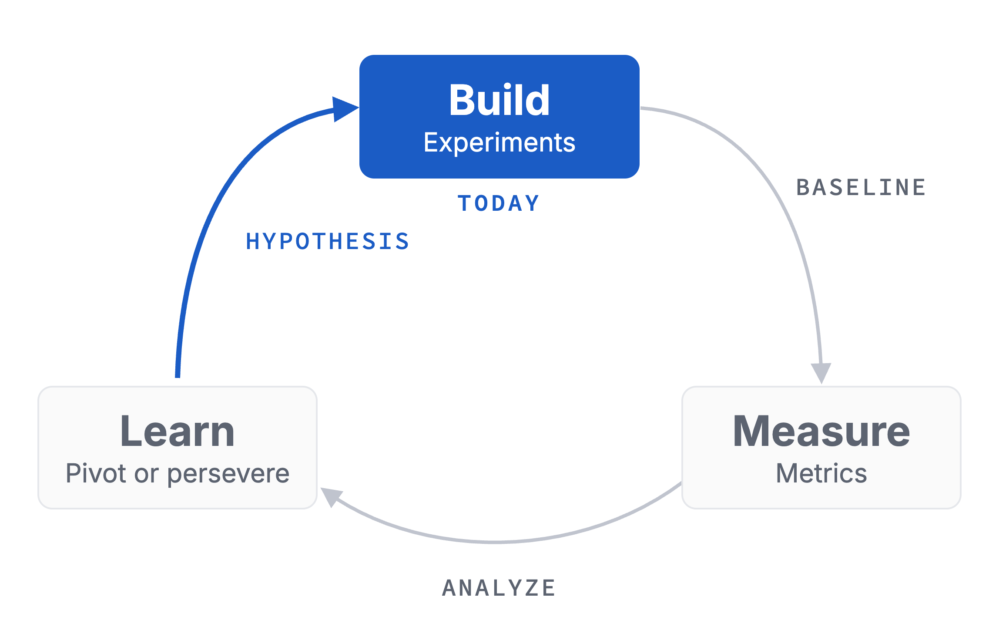

# Homework 00: Kickoff

Updated: 2026-10-19.

**Write 3 problem hypotheses and hold 15 problem conversations with named people, learning what the problem costs each of them today, and come back with 3 people who agreed to a next step.** The learning floor is 3 hypotheses and 5 conversations with 1 next step.

> Module 00 · Kickoff · Homework · [Goals M00-LG1 to LG4](README.md)

## What you learned

|  |  |
|---|---|
| You started the loop. Close it by Module 01. | You start at the bottom. It's a signal until somebody pays. |

## What you come back with

Look for a problem, not a solution. Come back with one worth digging into, and with your first sales leads. Solutions come in Module 05.

Paul Graham calls a good problem a [narrow, deep well](https://paulgraham.com/startupideas.html). A few people want it fixed badly, not many a little.

| | Dig deeper | Move on |
|---|---|---|
| Who | Lab managers in biotech start-ups | "Researchers" |
| Raised | 4 of 10, before I named it | Only once I named it |
| Cost | 4 hours a week, 2 built Excel trackers | "Annoying, but we live with it" |
| How many | 6 of 10, in 4 labs | Me and my flatmate |

A made-up example. Yours belongs in the left column.

## The bar

| Per student | Floor | Full bar |
|---|---|---|
| Problem hypotheses written | 3 | 3 |
| Conversations held | 5 | 15 |
| With an agreed next step | 1 | 3 |

Give your riskiest hypothesis the first 10 conversations. One counts once held, with a [named person, one exact quote](../../resources/GRADING_RUBRIC.md) and the cost logged, even when it's zero. It counts for the student who led it, each person once. Friends, family and classmates don't count, but their intros do.

## Your kill line

A kill line is a result you count, a date, and what you do if you cross it. Log yours before your first conversation, or use this one from the [Validation Hierarchy](../../frameworks/02_Validation_Hierarchy.md).

> If, by the start of Module 01, fewer than 3 of the first 10 people I talk to about a hypothesis describe the problem before I name it, I drop that hypothesis and test the next one.

Under 10 conversations by then? It stays open.

## How to do it

1. **Find your people where they already are.**
    - Ask people you see every day at work or in your lab what bugs them, and whom they know.
    - Be a fly on the wall in a shift or a support queue. Note what people curse at.
    - Read 1- to 3-star reviews of a product you like or want to change, on Trustpilot, G2 or Capterra. Repeated complaints are problems. On G2 and Capterra, the reviewer's role tells you whom to call.
    - Ask AI deep research where your "who" complains online.
2. **Open on their day.** Let them raise the problem. If they don't, name it and log a no. Then ask about the [last time](../../frameworks/01_Mom_Test_Cheatsheet.md). "What did you do? What did it cost you?" Get hours or euros.
    - Watch out. Pitch, or ask "Would you use it?", and you get a polite yes.
3. **End with an ask,** like a second call or an intro.
4. **Record with the consent sentence** in [Legal Basics](../../resources/LEGAL_BASICS.md).
5. **Get a blind second opinion.** Give an AI your raw notes, minus hypothesis and personal data. Note where its reading differs from yours.
    - Watch out. AI personas are rehearsal and never count.

## Midweek check

15 a week is 3 a day. Behind? Change the channel, who you ask or your first message, not just the volume.

## Keep your records

In your [Student Toolkit](../../resources/Student_Toolkit.xlsx).

- **Interview Log.** One row per conversation, right after it. Quote, cost, raised unprompted, next step.
- **Experiment Tracker.** Ranked hypotheses and their evidence.
- **Kill Criteria Log.** Your line and result.
- **Weekly Reflection.** Riskiest assumption, learnings, help you need.
- **Read-out.** One slide for Module 01, roles not names. Target against actual, Facts, Numbers, Quotes, Images, what you learned and need, who you'd build with.

## By archetype

| [Archetype](../../resources/archetypes/README.md) | What changes |
|---|---|
| B2C | Short named, quoted intercepts count. Floor 10, full bar 30. |
| Marketplace | One hypothesis per side at least. The first 10 talks go to supply. |
| Deep tech | Test who pays for the outcome, technical risk or not. |

## This week's case: Sono Motors

Read the [Sono Motors case](M00_Case_SonoMotors.md) at home this week with these three questions in mind.

1. On 8 December 2022 Sono Motors pointed to reservations, pre-orders and its 2019 campaign as proof that people wanted the Sion. Rank this evidence from weakest to strongest. Which of it is a signal, and where does somebody actually pay?
2. Which belief about its customers did the Sion plan rest on, and what in the case tells you whether that belief had been tested by December 2022?
3. You are Hahn and Christians on 8 December 2022. Is a 50-day call to prepay the equivalent of 3,500 Sions the right test of the demand you claim? What result, by what date, should end the Sion?

## What Module 01 needs

Module 01 forms teams, so meet people who share your problem space now. Bring a one-minute pitch with who has your problem, its cost, one quote and the skill you miss.

## Pre-read for Module 01: ProGlove

A second case, for next week. Read the [ProGlove case](../01-team-foundations/M01_Case_ProGlove.md) before Module 01 and prepare these questions.

1. **(M01-LG1)** Draw the skill bars and the appetite of ProGlove's four founders and Manuel Bönisch across tech, product and sales, as they stood in autumn 2018. Use only what the case and Exhibits 2 and 4 show, and mark each entry as documented or your guess. Which gap would stop ProGlove from growing the way its founders and investors said they wanted?
2. **(M01-LG1, M01-LG2)** The founders could close that gap by learning, by recruiting or by paying for help. Pick one route for autumn 2018 and argue it against the strongest alternative. Then say who would decide what at ProGlove the day after, and what each founder would do. "A bit of everything" is not a route.
3. **(M01-LG4)** How far did ProGlove's founders and investors want to take the company, judging by what they said and did up to October 2018? Does that ambition change your answer to question 2?
