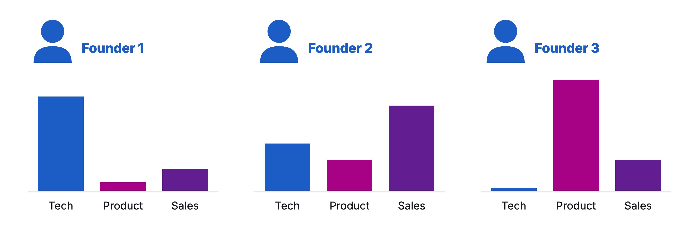
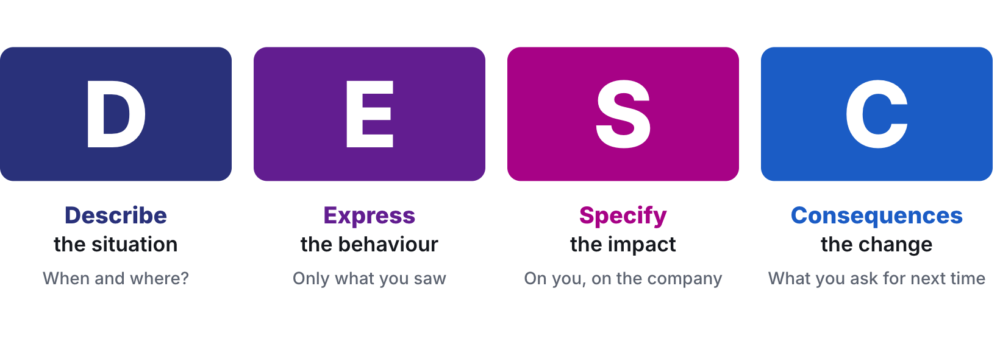

# Workshop 01: Find Your Team

Updated: 2026-10-19.

> Module 01 · Team & Foundations · Workshop · [Goals M01-LG1 to LG4](README.md)

By the start of Module 02, your team has a written agreement on roles, time, money, ambition and one shared problem space, tested in a week of conversations, so selling has an owner and the team survives its first fight. The examples follow one made-up team.

## The 90 minutes

| Time | Step | You leave with |
|---|---|---|
| 30′ | 1 · Pitch your problem, find your people | Bars, answers, a team |
| 35′ | 2 · Test the fit before you commit | Dealbreakers, a draft agreement |
| 25′ | 3 · First feedback, then commit | Feedback held, targets, talks booked |

### Step 1 · Pitch your problem, find your people (30′)

**Goal.** Know your own answers, then meet your people.

1. **Rate yourself (10′, alone)** 1 to 10 in tech, product and sales, and how much you enjoy each.
2. **Answer six questions** before you hear anyone else.
    1. How many hours a week can you give, now and in six months?
    2. How many months can you live on your savings?
    3. Startup, growing customers fast, or small business, growing profit? How big should this get?
    4. Which role do you want, and what will you never do?
    5. Which problem would you work on for five years?
    6. When should a co-founder leave, and what happens to their shares?
3. **Pitch (10′).** No team yet? One minute on who has your problem, its cost, one quote and the skill you miss. Teams pitch only their gap.
4. **Talk (10′).** Compare answers 1 to 3 first. Form a team of 2 to 4 around one problem space.
    - Watch out. Built around a cool technology, not a problem someone has? Start again.

| Good | Weak |
|---|---|
| "Lab managers lose 4 hours a week on reagent orders. I can build and need someone who sells." | "Something with AI agents. Who's in?" |

**Output.** Skill bars, six answers, a team.

### Step 2 · Test the fit before you commit (35′)

**Goal.** Find the dealbreakers now, while they are cheap.

1. **Compare answers (10′).** Mark each agree, talk it through, or dealbreaker.
2. **Lay your skill bars side by side (5′).** Who builds, who sells, which gap stops you? Learn, recruit or pay to close it.
3. **Decide what you build (10′).** Startup or small business, how far, and why.
4. **Draft the agreement (10′)** in the Team sheet of your [Student Toolkit](../../resources/Student_Toolkit.xlsx), one line per topic.

| Good | Weak |
|---|---|
| "Hours: engineer 40, designer 20 until March. Equity: decided at the review date." | "Hours: as much as needed. Equity: a third each, sorted." |

**Output.** Dealbreakers named, a draft agreement.

### Step 3 · First feedback, then commit (25′)

**Goal.** Give feedback while it is cheap, then start the week.

1. **Give feedback (10′),** one piece each, round the circle. Name the situation, the behaviour, its impact and the change you ask for. The receiver says "thank you" and asks one question.
2. **Commit to the bar (10′).** "Hold 10 conversations per student in your team's shared problem space, each with a named person and one verbatim quote, and end the week with a team agreement every founder confirmed after your end-of-week feedback round. The learning floor is 5 conversations per student and the confirmed agreement." Pick floor or full bar and a midweek day.
3. **Book first talks (5′)** before you leave, from Module 00 contacts, co-founders' networks and intros.

| Good | Weak |
|---|---|
| "In the pitch you spoke four of our five minutes, so I couldn't show our numbers. Next time, can we split it?" | "You were a bit dominant today." |

**Output.** Feedback held, targets, first talks booked.

## Arrived empty-handed?

No problem space from Module 00? Pitch one from your own life or work. Still alone at the end? Book talks with people whose pitch you liked.

## Bring and use

More questions are in the [Co-Founder Matchmaking Assessment](../../resources/Co-Founder_Matchmaking_Assessment.xlsx). The [lecture](M01_Lecture_Team-Foundations.pdf) is background.
