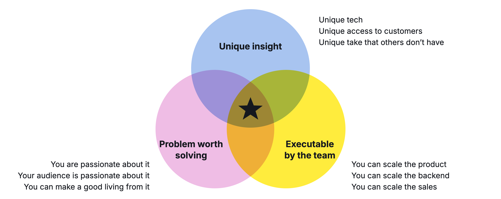
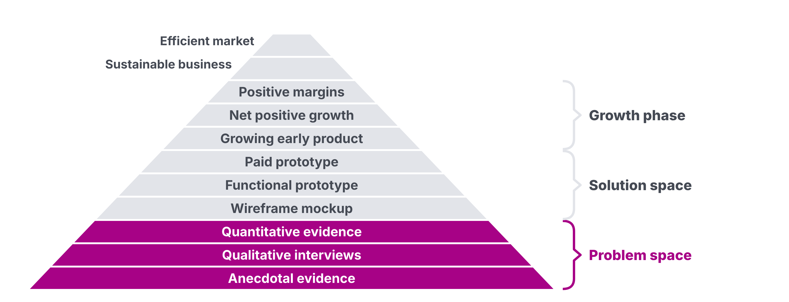

# Homework 02: Finding Ideas

Updated: 2026-10-30.

**Hold 15 problem conversations per student about the problem behind your chosen idea.** The learning floor is 5 conversations per student.

> Module 02 · Finding Ideas · Homework · [Goals M02-LG1 to LG4](README.md)

## What you learned

## What you come back with

By the start of Module 03, your team has picked one idea, knows why you are the team for its problem, and has heard named people describe the last time it hit them, the first names on your prospect list. Pick on evidence now, not after months of building for nobody.

| | Good | Weak |
|---|---|---|
| Idea | "Recruiters at 50-person firms struggle to book interviews across three calendars." | "AI for HR." |
| Pitch | One of us booked 40 interviews a month by hand, and recruiters told us what a lost candidate costs. | A market size and a technology. |
| Log | 15 named rows, each quoting someone's last time. | 15 rows of "interesting, I'd use it". |

The examples follow the made-up team from the workshop.

## The bar

| Per student | Floor | Full bar |
|---|---|---|
| Problem conversations held about your idea's problem | 5 | 15 |

A conversation counts once held, with a named person and one exact quote in your log, for whoever led it, each person once per team this week. Talks about a dropped idea count. Friends, family and classmates don't count, but their intros do.

## Your kill line

A [kill line](../../frameworks/02_Validation_Hierarchy.md#the-kill-question) is a result you count, a date, and what you do if you cross it, written down before the data comes in. No line yet? Log this one today, to check midweek.

> If fewer than 3 of the first 10 new people we talk to raise this problem before we name it and tell us about the last time it hit them, we drop the idea and test the next one on our list.

Count it across the team. New means they never discussed this problem with you. Check it midweek, or at the 10th new person if later. Switched? Log a new line first.

## How to do it

1. **Start close.** Your Interview Log, intros, people you see every day. AI deep research and review sites like G2 show where the rest talk.
2. **Open on their day,** let them raise it, then ask about the [last time](M02_Workshop_Idea-Stress-Test.md). Never pitch.
    - Watch out. Name the problem first, and it isn't unprompted.
3. **Change the idea on what you hear.** Rescore every 3 talks, and switch the day your kill line is crossed.
4. **End with an ask,** a second call or an intro. Each yes is a first prospect.
5. **Record with the consent sentence** in [Legal Basics](../../resources/LEGAL_BASICS.md).
6. **Get a blind second opinion.** Give an AI your raw notes, minus your idea and personal data. Ask what people raised on their own, and note where it disagrees.
    - Watch out. AI critics and personas are practice and never count.

## Midweek check

Check your kill line first, then your pace. The full bar is about 3 talks a day. Behind? Change the channel, the people or your opener, not just the volume.

## Keep your records

It all lives in your [Student Toolkit](../../resources/Student_Toolkit.xlsx).

- **Interview Log.** One row per talk, recording linked, unprompted yes (quote their last time), no, or n/a if not new.
- **Ideas.** Every idea, its scores heard or assumed, kept or dropped and why. Your pitch on top.
- **Kill Criteria Log.** Your result next to your line.
- **Read-out.** One slide from these, roles not names, doubling as your weekly update. Facts, Numbers, Quotes, Images, your verdict and pitch, then what you did, learned and need.

## By archetype

| [Archetype](../../resources/archetypes/README.md) | What changes |
|---|---|
| B2C | Named, quoted intercepts count, the Mensa queue too, so the bar is 10 and 30. |
| Marketplace | Two sides. Talk to both, supply first, with a kill line per side. |
| Deep tech | Write the problem your technology solves. Talk to people who'd pay for that outcome. |

## What Module 03 needs

One idea, its problem and your Interview Log. Module 03 turns them into a segment and a Pain Map.

## Pre-read for Module 03

Read the [Konux case](../03-problem-space/M03_Case_Konux.md) and prepare these questions.

1. **(M03-LG4)** Compare railway switches with the other industries Konux worked on in October 2016. For each, note how often the problem occurs, what one occurrence costs, what customers already spend on it and who would sign the order. Mark each entry as heard from a customer or assumed by Konux.
2. **(M03-LG1, M03-LG2)** Describe Deutsche Bahn's switch problem without mentioning Konux or any sensor. Who has it, what do they want, what stands in the way, and which constraints must any solution respect? What did DB do about it before Konux, and what does the case tell you, and not tell you, about what that cost?
3. **(M03-LG3)** Before deciding, Kunze could still talk to one DB maintenance planner and one industrial pump operator. Write three questions for each that would show past behaviour and spend rather than opinions, and say which answer would change your decision.
