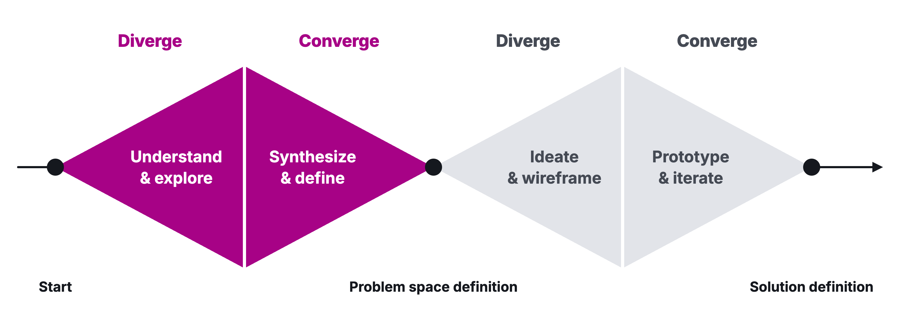

# Workshop 02: Idea Stress Test

Updated: 2026-10-20.

> Module 02 · Finding Ideas · Workshop · [Goals M02-LG1 to LG4](README.md)

By the start of Module 03, your team has picked one idea, knows why you are the team for its problem, and has heard named people describe the last time it hit them, the first names on your prospect list. They are who you sell to first. Today you pick it and meet the first.

## The 90 minutes

| Time | Step | You leave with |
|---|---|---|
| 25′ | 1 · Many ideas, in silence | 16 ideas each, a top 5 |
| 35′ | 2 · One gate, then the critics | One idea, its pitch, two backups |
| 30′ | 3 · Ask about the last time | Kill line, script, a first talk, targets, sent messages |

The examples follow one made-up team.

### Step 1 · Many ideas, in silence (25′)

**Goal.** Get every problem on paper before anyone judges one.

1. **List your sources (3′).** Your Interview Log, itch, work, your field in five years, something missing.
2. **Fill 8 boxes (8′),** alone and silent, one idea each, "[who] struggles with [what]", never an app. Ugly counts.
3. **Fill 8 more (8′),** for people you reach this week, in a field you know, nothing you'd refuse to build.
4. **Read out your three best (6′),** merge, and tier them. S moonshots, A unsexy plumbing, B crowded trades, C wrapper zone, D tarpits many tried, F please don't.
5. **Mark a top 5.**

| Good | Weak |
|---|---|
| "Recruiters at 50-person firms struggle to book interviews across three calendars." | "An AI scheduling app." A product, and nobody in it. |

**Output.** 16 ideas each, a top 5.

### Step 2 · One gate, then the critics (35′)

**Goal.** Cut to one idea on evidence, and know why you are its team.

1. **Score your top 5 (10′)** in the Ideas sheet, 1 a pure guess, 5 several named people. Desirable, someone you talked to had it recently. Viable, someone spends money or time on it today. Feasible, you can reach them and test within two weeks.
2. **Mark every score** heard (name them) or assumed.
3. **Make your top two specific (8′),** with who and what exactly.
4. **Pitch each** in one to three sentences. What do you know that others don't, why does it matter, why can your team do it?
5. **Attack (14′).** Another team attacks as customer, founder and investor, 7 minutes each way, or an AI if you're alone. Defend with what you heard, or mark it assumed.
6. **Choose (3′)** one idea, two ranked backups.

| Good | Weak |
|---|---|
| "One of us booked 40 interviews a month by hand as a recruiter. Three recruiters told us last week what a lost candidate costs. We can reach 30 more through her old network." | "Scheduling is a huge market, and AI changes everything." |

**Output.** One idea, its pitch, two backups.

### Step 3 · Ask about the last time (30′)

**Goal.** Learn if people have this problem. Do NOT pitch.

1. **Log your kill line (2′)** in the Kill Criteria Log today, checked midweek, or take the homework's default. A [kill line](../../frameworks/02_Validation_Hierarchy.md#the-kill-question) is a result you count, a date, and what you do if you cross it, written down before the data comes in.
2. **Write your script (8′).** Open on their day, "What does your day look like when you deal with [area]?" Let them raise the problem, or name it and log a no. Then ask about the last time, the hardest part, why, today's fix and what they dislike. End with an ask, like an intro.
3. **Talk to someone (12′).** Hold one talk per team or book three, via your Interview Log, intros, other teams' contacts or the building. Friends, family and classmates don't count, but their intros do.
4. **Commit (8′).** "Hold 15 problem conversations per student about the problem behind your chosen idea. The learning floor is 5 conversations per student." Each student picks floor or full bar. Set a midweek day and pace.
5. **Send your first messages** before you leave.

| Good | Weak |
|---|---|
| "Tell me about the last time you had to move an interview." | "Would you use a tool that books interviews for you?" |

**Output.** Kill line, script, a first talk, targets, sent messages.

## Arrived empty-handed?

No team? Join one for today. No talks? Start from your own sources. Assumed scores are your Step 3 questions.

## Bring and use

Use the [Mom Test Cheatsheet](../../frameworks/01_Mom_Test_Cheatsheet.md) and your [Student Toolkit](../../resources/Student_Toolkit.xlsx), with the [lecture](M02_Lecture_Finding-Ideas.pdf) as background.
