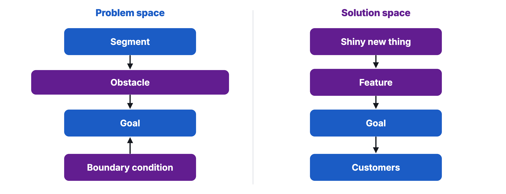
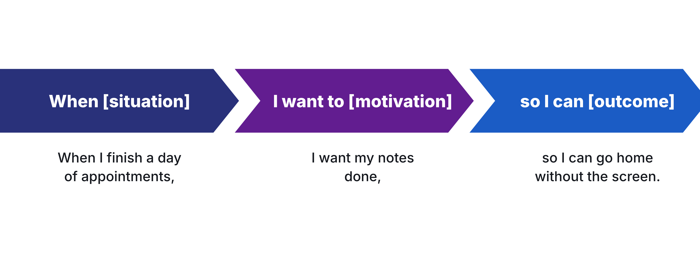
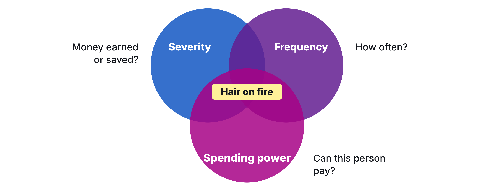
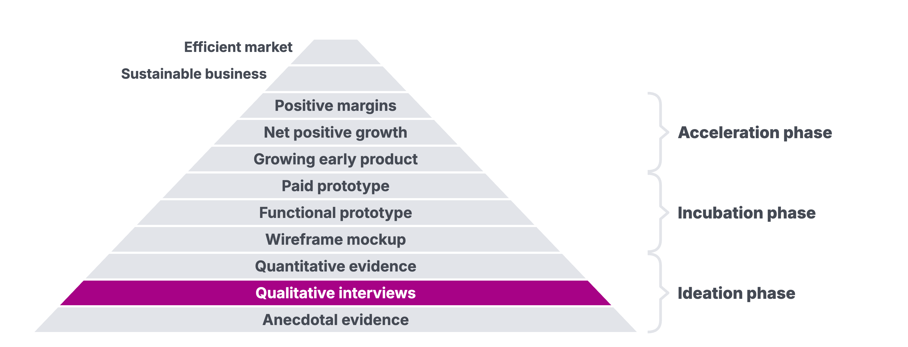

# Homework 03: The Problem Space

Updated: 2026-10-19.

**Hold 15 problem conversations per student in your hair-on-fire segment and come back with 5 named people per student who agreed to a next step.** The learning floor is 5 conversations and 2 next steps per student.

> Module 03 · The Problem Space · Homework · [Goals M03-LG1 to LG4](README.md)

## What you learned

|  |  |  |
|---|---|---|
| Start left, with who hurts. | Write their job, then price the workaround (made-up example). | Your segment hurts often, badly, and pays. |

## What you come back with

By the start of Module 04, your team knows whether your problem is expensive enough to fix and for whom, and has named people in that segment who agreed to a next step, your first prospects.

| | Good | Weak |
|---|---|---|
| Segment | Solo HR managers, 50 to 200 staff | "Companies" |
| Unprompted | 4 of 10 | Only when named |
| Workaround | 5 hours a week, €300 a month | "Annoying" |
| Next steps | 6 second calls booked | 20 LinkedIn likes |

A made-up example.

## The bar

| Per student | Floor | Full bar |
|---|---|---|
| Conversations held in your segment | 5 | 15 |
| With an agreed next step | 2 | 5 |

A conversation counts once held, with a named person and one exact quote in your log. It counts for whoever led it, each person once per team this week. Talks with a segment you compare or drop still count. Friends, family and classmates don't, but their intros do.

## Your kill line

A [kill line](../../frameworks/02_Validation_Hierarchy.md) is a result you count, a date, and what you do if you cross it, written down before the data comes in. No line yet? Use this one.

> If, by the start of Module 04, fewer than 3 in 10 people we had not asked about the problem before raise it before we name it, or nobody spends money on a workaround, we switch segment or problem.

Count it per segment and team, from the workshop on. The [rubric](../../resources/GRADING_RUBRIC.md) rewards a well-argued switch.

## How to do it

1. **Go where they complain.** AI deep research finds forums fast.
2. **Open on their day.** Let them raise the problem, then ask the [five questions](M03_Workshop_Pain-Mining.md) down to the root cause.
    - Watch out. Name the problem first, and it isn't unprompted.
3. **Never pitch.** They'd stop talking about their problem.
4. **Follow the money.** Get the euros or hours.
5. **End with an ask,** like a second call. Compliments don't count.
6. **Record with the consent sentence** in [Legal Basics](../../resources/LEGAL_BASICS.md).
7. **Get a blind second opinion.** Give an AI your raw notes, minus your hypothesis and personal data. Ask what people raised unprompted, and note where it disagrees.
    - Watch out. AI personas are rehearsal and never count.

## Midweek check

Behind your pace? Change the channel, the segment or your first message, not just the volume. Nobody raises it unprompted? Check your kill line.

## Keep your records

- **Interview Log** in your [Toolkit](../../resources/Student_Toolkit.xlsx). One row per talk, right after it, raw recording linked, n/a if you asked them before. Next-step rows are your prospects.
- **Pain Map.** One row per segment, each cell heard or assumed, like the [exemplar](../../resources/exemplars/Exemplar_Pain_Map.md), with job sentence, quotes and verdict below.
- **Kill Criteria Log.** Your result next to your line.
- **Read-out.** One slide from these, roles not names. Facts, Numbers, Quotes, Images, Verdict, Hypothesis (three likely first payers), then what you did, learned and need. It's your weekly update.

## By archetype

| [Archetype](../../resources/archetypes/README.md) | What changes |
|---|---|
| B2C | Named, quoted intercepts count, so the bar is 10 and 30. Next steps stay. |
| Marketplace | One Pain Map per side, supply first. The side that hurts most is your wedge. |
| Deep tech | Test demand for the outcome early, with people who could pay for a feasibility study. |

## What Module 04 needs

A landing page, built for your prospects in their words.

## Pre-read for Module 04: Fairphone

Read the [Fairphone case](../04-validating-problems/M04_Case_Fairphone.md) before Module 04 and prepare these questions.

1. **(M04-LG1)** On 13 May 2013, Fairphone had more than 14,000 newsletter sign-ups and no paid orders. What do those sign-ups prove about 5,000 people paying €325 upfront, and what can they not prove?
2. **(M04-LG3)** Write Fairphone's test as one line, with what is counted, by which date, and what happens on a pass and on a miss. Was 5,000 paid phones by 15 June a good line, and would you have opened the pre-sale on it on 13 May?
3. **(M04-LG4)** Where would 5,000 buyers come from in about a month? Work out what share of the subscribers would have to buy, and say what the team would need if they did not.
