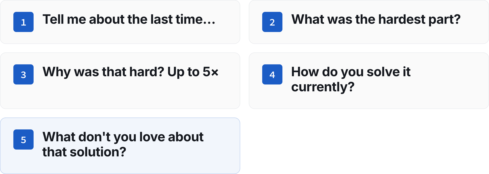

# Workshop 03: Pain Mining

Updated: 2026-10-19.

> Module 03 · The Problem Space · Workshop · [Goals M03-LG1 to LG4](README.md)

|  |  |
|---|---|
| Step 1 fills the left side only. | Step 2 asks these, in order. |

By the start of Module 04, your team knows whether your problem is expensive enough to fix and for whom, and has named people in that segment who agreed to a next step, your first prospects. The examples are made up.

## The 90 minutes

| Time | Step | You leave with |
|---|---|---|
| 30′ | 1 · Define the pain, not the solution | Pain Map, job sentence, hair-on-fire candidate, kill line |
| 35′ | 2 · The 5 golden questions, live | A script and one held conversation |
| 25′ | 3 · Use AI to move fast, then commit | Targets, first messages sent, pace |

### Step 1 · Define the pain, not the solution (30′)

**Goal.** Agree who hurts most and what it costs.

1. **Name the segment, trigger and fail state.** Who suffers most, when, at what cost in euros or hours? "Junior HR managers when a candidate ghosts them", not "companies".
2. **Fill the Pain Map** in the Toolkit like the [exemplar](../../resources/exemplars/Exemplar_Pain_Map.md), each cell heard or assumed. Star the worst segment, your hair-on-fire candidate.
3. **Write their job** below it. "When [situation], I want to [motivation], so I can [outcome]." Add the obstacle and the limits any fix must meet.
4. **Log a [kill line](../../frameworks/02_Validation_Hierarchy.md)** in the Kill Criteria Log before any talk. A kill line is a result you count, a date, and what you do if you cross it, written down before the data comes in. The homework has a default.

| Good | Weak |
|---|---|
| "When a finalist goes silent, I want to know within a day, so I can call the next one." | "HR teams want better recruiting software." A solution, no who. |

**Output.** Pain Map, job sentence, hair-on-fire candidate, kill line.

### Step 2 · The 5 golden questions, live (35′)

**Goal.** Find out if the problem is expensive enough to fix. Do NOT pitch your idea.

1. **Draft and rehearse (10′).** Open on their day. "What does your day look like when you deal with [area]?" Let them raise the problem. If they don't, name it and log a no. Then ask:
    1. "Tell me about the last time you encountered [problem]."
    2. "What was the hardest part about that?"
    3. "Why was that hard?" Ask up to five times, until you reach the root cause.
    4. "How do you solve it currently?"
    5. "What don't you love about that solution?"
2. **End with an ask,** like a second call. Rehearse on an AI persona, which never counts.
3. **Call (25′).** Hold one real conversation per team with someone in your segment and log it in the Interview Log. Try an earlier interviewee, another team's contact or someone nearby. Split up. Friends, family and classmates don't count. Their intros do.

| Good | Weak |
|---|---|
| "Two finalists ghosted me last Tuesday." Second call agreed. | "Sure, I'd use that." A compliment, no next step. |

**Output.** A script and one logged conversation.

### Step 3 · Use AI to move fast, then commit (25′)

**Goal.** Leave with a week already in motion.

1. **Find where they talk** with AI deep research. Pick named people.
2. **Send the first messages** before you leave.
3. **Commit to the bar.** "Hold 15 problem conversations per student in your hair-on-fire segment and come back with 5 named people per student who agreed to a next step. The learning floor is 5 conversations and 2 next steps per student." Pick floor or full bar, a midweek day and a pace.

| Good | Weak |
|---|---|
| 12 named HR managers, 5 messages out. | "We'll post on LinkedIn later." |

**Output.** Targets, sent messages, pace.

## Arrived empty-handed?

No interviews yet? Start with guesses and hold two conversations in Step 2.

## Bring and use

Bring the [Mom Test Cheatsheet](../../frameworks/01_Mom_Test_Cheatsheet.md) and the [Student Toolkit](../../resources/Student_Toolkit.xlsx). The [lecture](M03_Lecture_Problem-Space.pdf) and [case](M03_Case_Konux.md) are background.
