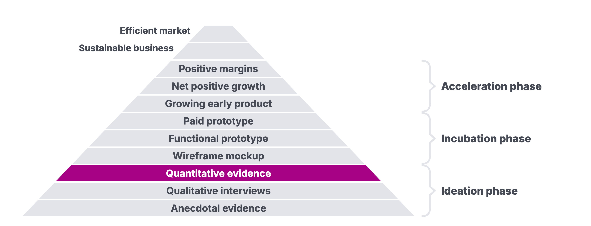
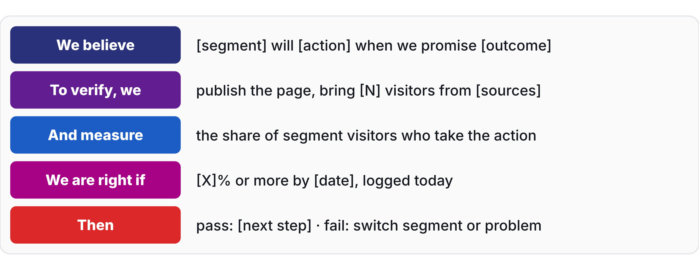
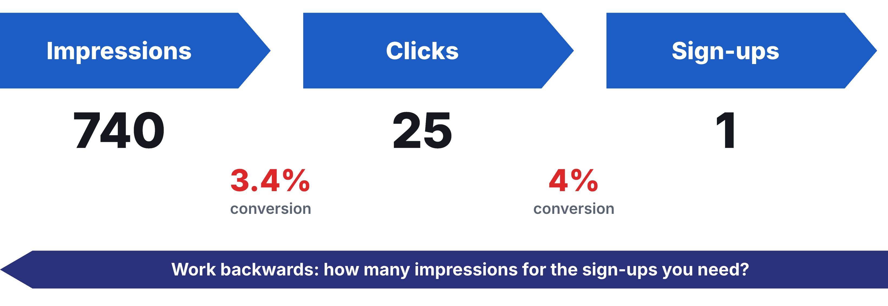

# Homework 04: Validating Problems

Updated: 2026-10-19.

**Publish one landing page per team, log its pass or fail line before the first visitor arrives, and bring 100 visitors per student from your segment to it.** The learning floor is the live page, the logged line and 30 visitors per student from your segment.

> Module 04 · Validating Problems · Homework · [Goals M04-LG1 to LG4](README.md)

## What you learned

## What you come back with

By the start of Module 05, your team knows whether people in your segment act on a promise to fix their problem, measured against a line drawn in advance, and holds their sign-ups, your first testers and buyers. Interviews told you what people say. This week counts what they do.

| | Good | Weak |
|---|---|---|
| Line | 10%, logged before launch | Written after the first numbers |
| Traffic | 140 tagged visitors from two recruiter groups | 400 visitors, mostly friends |
| Result | 9 of 140, under the line, segment switched | "Lots of interest!" |

Made up, as in the workshop.

## The bar

| Per student | Floor | Full bar |
|---|---|---|
| Visitors from your segment | 30 | 100 |

A visitor counts when your tagged (UTM) link brought them from people or places of your segment, for the student whose link it was. Ads, friends and classmates never count.

## Your kill line

A kill line is a result you count, a date, and what you do if you cross it, written down before the data comes in. No line yet? Log this one before sharing.

> If, by the start of Module 05, fewer than 10% of visitors from our segment take the page's one action, we switch segment or problem.

Count it across the team, on visitors from your tagged links. Ads and sign-ups outside your segment stay out.

## How to do it

1. **Start with your Module 03 prospects.** They get the link first, with a personal note.
2. **Go where your segment is.** Communities, groups, newsletters. AI search finds them, open every source. Ads are optional.
    - Watch out. Startup groups bring classmates, not your segment.
3. **Tag every link** per student and channel.
4. **Never move the line.** Log any copy change.
5. **Call three sign-ups each.** Why did they sign up? What do they use?
6. **Survey your sign-ups,** optionally. Closed questions about what they did, never about your idea.
7. **Get a blind second opinion.** Give an AI your traffic and sign-up answers, minus hypothesis and personal data. Ask what it shows. Note where it disagrees.

## Midweek check

Behind your pace? Change the channel or message, not the volume. Few sign-ups? Ask three visitors what they expected, then rewrite the promise once.

## Keep your records

It lives in your [Student Toolkit](../../resources/Student_Toolkit.xlsx).

- **Experiment Tracker.** One row, method "Landing Page", rung quantitative.
- **Kill Criteria Log.** Your dated line and the result next to it.
- **Traffic Sources.** One row per source and student, as in the [exemplar](../../resources/exemplars/Exemplar_Landing_Page_Test.md).
- **Sign-ups.** They stay in your form tool, under the rules of [Legal Basics](../../resources/LEGAL_BASICS.md).
- **Read-out.** One slide. Line next to your rate as a range, conversion per source, two quotes with roles, not names, screenshots. Then what you did, learned and need.

## By archetype

| [Archetype](../../resources/archetypes/README.md) | What changes |
|---|---|
| B2C | Put the line on waitlist sign-ups. |
| Marketplace | One page per side, or one for supply. Supply commitments count. |
| Deep tech | A technical one-pager and outcome video to 20 named industry contacts per student, floor 6. Count meeting requests. |
| Hardware | A pre-order button at the real price. Your guide's 2% replaces the 10%. |

## What Module 05 needs

Module 05 opens with your line next to your number. Bring your sources and sign-ups, your first testers.

## Pre-read for Module 05

Read the [Freeletics case](../05-solution-space/M05_Case_Freeletics.md) and prepare these questions.

1. **(M05-LG2)** At the end of 2012, 7.9 million people in Germany were gym members, and Freeletics promised bodyweight workouts of 5 to 45 minutes that work anywhere. On which one dimension could Freeletics claim to be 10 times better than what its segment used, and what in the case did the founders hear or measure rather than assume?
2. **(M05-LG3)** The founders aimed for a technically sophisticated, scalable app and, by Business Punk's account, none of them could program. Write the smallest offer someone in their segment could have paid for by the Monday after the founders' Thursday, with what it shows, what stays manual behind it, and its price.
3. **(M05-LG4)** At the end of March 2013, Freeletics had a free email package, a free app, a testimonial video viewed 226,160 times by 30 January 2013, people who had emailed asking for something to train with, and training guides on sale at €1.99 per weekly part. Which of these was signal, and which could validate? What could a sale by Monday prove that the others could not?
