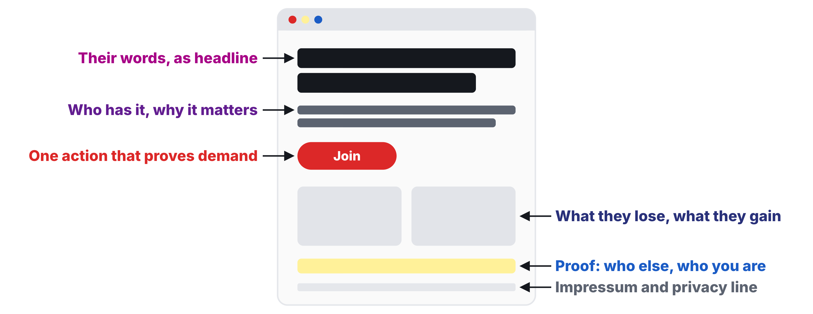

# Workshop 04: Landing Page Sprint

Updated: 2026-10-19.

> Module 04 · Validating Problems · Workshop · [Goals M04-LG2 to LG4](README.md)

By the start of Module 05, your team knows whether people in your segment act on a promise to fix their problem, measured against a line drawn in advance, and holds their sign-ups, your first testers and buyers. Today your page goes live. The examples are made up.

**Bring.** Builder, form and analytics accounts, and your raw interview notes.

## The 90 minutes

| Time | Step | You leave with |
|---|---|---|
| 30′ | 1 · Write the test, then the copy | Test card, kill line, hero section |
| 35′ | 2 · Launch in under an hour | A live page that counts visitors per source |
| 25′ | 3 · Bring your segment, then commit | Tagged links, first messages sent, targets |

### Step 1 · Write the test, then the copy (30′)

**Goal.** Decide what result would change your mind, then write the page in their words.

1. **Write the test (10′)** as one Experiment Tracker row. "We believe [segment] will [action] when we promise [outcome]." An email is the minimum action, a call or pre-order says more.
2. **Log the line** in the Kill Criteria Log, dated, before the page exists. A kill line is a result you count, a date, and what you do if you cross it, written down before the data comes in. The homework has a default.
3. **Draft with AI (20′).** Give it your raw notes, names removed. Ask for five hero sections with headline, subheadline and button.
4. **Pick the headline** closest to what someone said. Problem first, outcome promised, no features.

| Good | Weak |
|---|---|
| "Know within a day when a finalist goes silent." Line logged at 10%. | "AI-powered recruiting platform." Line written once the numbers are in. |

**Output.** Test card, dated kill line, hero section.

### Step 2 · Launch in under an hour (35′)

**Goal.** A live page that names their problem and asks for one action.

1. **Build top to bottom.** Their words, why it matters, what changes for them, one button.
2. **Add a short form.** Email plus one question that shows whether they are in your segment, such as role.
3. **Add an Impressum** and the privacy line from [Legal Basics](../../resources/LEGAL_BASICS.md). Without them the page stays offline.
4. **Connect analytics** with visitors and sign-ups per source, minding the consent rule in Legal Basics. Publish.
5. **Swap links** with a team. After five seconds, can they say problem and action?

| Good | Weak |
|---|---|
| Live on a free subdomain. One button. The form asks "Your role?" | Still choosing a domain at minute 35. Three buttons. |

**Output.** A public link and analytics that count.

### Step 3 · Bring your segment, then commit (25′)

**Goal.** Leave with visitors on their way.

1. **Work backwards.** Ten sign-ups at 10% need 100 visitors.
2. **List where your segment is,** prospects first, then communities, groups, newsletters. AI finds more. Open every source.
3. **Tag one link (UTM)** per student and channel.
4. **Message your prospects** before you leave.
5. **Commit to the bar.** "Publish one landing page per team, log its pass or fail line before the first visitor arrives, and bring 100 visitors per student from your segment to it. The learning floor is the live page, the logged line and 30 visitors per student from your segment." Each student picks floor or full bar. Set your midweek day and pace.

| Good | Weak |
|---|---|
| Six prospects messaged. Two recruiter groups named. Links tagged per student. | "We'll post on LinkedIn later." |

**Output.** Tagged links, sent messages, targets, pace.

## Arrived empty-handed?

No interview notes? Copy exact sentences from forums where your segment complains, and mark the promise assumed. Post your link there in Step 3.

## Bring and use

The [Validation Hierarchy](../../frameworks/02_Validation_Hierarchy.md), the [landing-page exemplar](../../resources/exemplars/Exemplar_Landing_Page_Test.md), [Legal Basics](../../resources/LEGAL_BASICS.md) and the [Student Toolkit](../../resources/Student_Toolkit.xlsx). The [lecture](M04_Lecture_Validating-Problems.pdf) and [case](M04_Case_Fairphone.md) are background.
