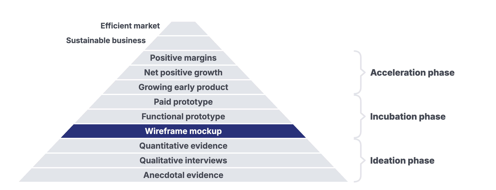

# Freeletics: Something to Sell by Monday?

Updated: 2026-10-19.

> Module 05 · The Solution Space · Case, read before class

Case for Module 05, The Solution Space, of Ambitious Entrepreneurship. Prepared by Bastian Burger from public sources as a basis for class discussion. The case does not judge whether any decision was right or wrong. Licensed under CC BY-NC-SA 4.0 except third-party material as marked.
{: .byline }

On a Thursday in April 2013, Andrej Matijczak, Mehmet Yilmaz and Joshua Cornelius, the three partners of Freeletics GbR, a civil-law partnership in Munich, found that their money had run out. "One Thursday evening we realised that we had no money left and had to start earning some on Monday," Matijczak recalled in 2015.[^gs2] [^day]

Freeletics offered high-intensity workouts with a person's own bodyweight, some without any equipment, others with a pull-up bar, a wall or a running track.[^about] At the end of March 2013 its online shop gave away a "Basic Package" of workouts in exchange for an email address, linked a free training app and offered three training guides in weekly parts at €1.99 each, as a "Special offer for a very limited time only!"[^home] [^guidecs] [^app] Whether anyone had bought a part was not disclosed. On 29 March the shop's jobs page asked mobile developers for iOS and Android to apply.[^jobs] By the account of the business magazine Business Punk, none of the three founders could program.[^bp2]

The founders, Matijczak recalled in 2015, had aimed for a technically sophisticated and scalable product.[^gs2] What they needed by Monday was money. They had to decide what to sell by then, in which form and at what price.

## Three Founders and a Whiteboard

The three founders had studied in Munich. Cornelius and Yilmaz met when both arrived late to enrol at university, at TU München according to Business Punk.[^bp1] [^gs1] Munich Startup, a news site, later wrote that the founders had met at the Center for Digital Technology and Management (CDTM), an institute of TU München and LMU München which, according to SZ Junge Leute, the youth pages of the Süddeutsche Zeitung, had supported them.[^mscdtm] [^sz] CDTM listed Cornelius (class of fall 2009) and Yilmaz (class of spring 2010) among the founders from its programme.[^cdtm] Matijczak and Cornelius had grown up in the same street.[^bp1] [^gs1] From the start of their studies, Business Punk wrote, they knew they wanted to found a company together, but not with what. "We only had ourselves," Cornelius said.[^bp1] Business Punk wrote that all three had studied at Columbia University in New York, held several scholarships and taken additional courses in entrepreneurship during their bachelor's degrees.[^bp1] Gründerszene, a start-up news site, wrote that Yilmaz and Matijczak had studied together in New York while abroad.[^gs1]

In 2014 Cornelius told SZ Junge Leute that the three had studied mathematics, business and chemical engineering, not sport. All three were keen on sport, he said, had gone to the gym now and then, and had looked for a way to take fitness further.[^sz] Gründerszene wrote in April 2015 that they had begun planning their company a little over three years earlier.[^planning]

Cornelius recalled in 2015 that in their first days the three sat in front of an empty whiteboard at the Strascheg Center for Entrepreneurship (SCE) at Hochschule München and collected criteria. Some were economic, such as market size, competitors and their own core competencies. Others were personal, such as what they cared about and whether they trusted themselves to succeed in a field.[^gs1] [^sce] According to Business Punk, they arrived at sport after a market analysis. Nutrition, theories of motivation and digital markets interested them, the magazine wrote, and they saw the greatest potential in products that were cheap to market and, once made, could be sold millions of times.[^bp1] Cornelius said that the three had played sport at a high level and felt they could create the most value in that segment, "because we know what people are missing there."[^gs1] Cornelius said that the three had committed two years of their lives to one another.[^gs1]

They had no money of their own. Business Punk wrote that their mothers or girlfriends fed them.[^bp2] "Our meetings were at table-tennis tables, and the biggest decision was whether to buy tuna or cottage cheese for one euro for lunch," Yilmaz recalled in 2015.[^gs1] Investors had shown interest, Matijczak said, "but we noticed at the first contact that they wanted to talk us out of our idea."[^gs2] Business Punk wrote that investors did not take them seriously.[^bp2] The sports market, Matijczak said, was still small for investors at the time, and "very few people believed in us." Former fellow students had asked, he recalled, "What is that, bodyweight exercises? That's nothing worthwhile!"[^gs1]

On 29 March 2013 the shop's imprint named Freeletics GbR, with Matijczak, Cornelius and Yilmaz as its partners, at Heßstraße 89 in Munich, the address of the SCE.[^imprint] [^sce]

## Fitness in Germany

At the end of 2012, 7.9 million people in Germany were registered with a gym, almost one in ten Germans, according to a study by the employers' association DSSV and the consultancy Deloitte published on 13 March 2013. They trained in 7,566 facilities. The number of members had grown by 4 percent in 2012, and the market by an average of 7 percent a year from 2007 to 2012. The average membership fee, including VAT, had fallen from €46.20 in 2011 to €45.42 in 2012 as demand for discount offers grew, and the industry's revenue held at €3.8 billion, up 0.1 percent. Independent gyms still had the most members, 3.6 million, while chains had grown to 3.5 million and held 47.2 percent of the market. An average facility of more than 200 square metres had 1,203 members. Customers expected more advice and supervision in every segment, and demand for personal and small-group training was rising. About 74 percent of operators expected their business to improve in 2013 (Exhibit 4).[^dssv]

In 2014 Cornelius described the gap the founders saw. "Many people no longer have the time to go to a sports club or gym twice a week," he told SZ Junge Leute. With the programme, he said, they could get the most out of little time, because the exercises were very effective and could be done anywhere. Asked what someone needed for Freeletics, he answered, "Space. We do without equipment. Especially when you train outside, a fitness mat is useful as well. And something you can do pull-ups on." The time-consuming trip to the gym fell away, he said, and excuses no longer counted.[^sz] "Since the Jane Fonda videos we have not seen any real innovation in fitness," he told Business Punk in 2015. The founders also conceded, Business Punk wrote, that bodyweight exercises were nothing new and had been used in the military since the 1920s.[^bp1]

The sources for this case give no figures for home workout programmes, workout videos or fitness apps in Germany at the time.

## From a Sports Field to a Newsletter

The founders first tested their workouts on a sports field in München-Großhadern, with Matijczak's sister and the girlfriends of Cornelius and Yilmaz. "It was cold and raining, nobody wanted to," Cornelius recalled. According to Business Punk, the founders then told everyone they knew about their programme and founded a first Facebook group. Of the first test groups, Matijczak said, "We promised them we would get them fit for the summer if they trained with us."[^bp1] "That became an offline group with which we developed and tested workouts," Matijczak recalled in 2015.[^gs1] According to Business Punk, the founders filmed their sessions to analyse how people of different fitness performed and how cleanly they did the exercises, and then saw that the recordings would also work as promotional videos.[^bp1] For a year, the magazine wrote, they worked on the concept, talked to sports scientists and analysed videos of their sessions, and the videos they spread through social media made Freeletics grow while it was still being tested.[^bp2]

Facebook groups followed, in which interested people could organise themselves, and then a first newsletter, with which the founders tried to grow online, Matijczak said.[^gs1] Business Punk described Facebook groups for different cities and links to the website, where people could sign up for the newsletter and a free six-week training plan, "zu Testzwecken" (for test purposes).[^bp2]

Videos spread the word. Business Punk wrote that the newsletters, the Facebook groups and "the first transformation videos" had built the founders a following online, and Yilmaz said, "In our videos we show people we train with and whom people can really identify with."[^bp2] One such video, titled "15 WEEKS BODY TRANSFORMATION - FREELETICS", was published on 20 November 2012 by a man who, by its description, had trained Freeletics for 15 weeks. On 30 January 2013 it had 226,160 views, 286 likes and 2 dislikes, and its description sent viewers to the Freeletics Facebook page and to freeletics.com.[^yt1] A second clip, "MY 100 DAYS BODY TRANSFORMATION with FREELETICS", appeared on 8 February 2013.[^yt2] How often it had been viewed by April 2013 was not archived. Who made the videos is not stated on their pages.

People responded. "They emailed us and begged, please give us something we can train with," Matijczak told Business Punk.[^bp2] At the time of the Thursday, he recalled for Gründerszene, "we already had traction, people who knew our product through the newsletter and wanted more."[^gs2]

The founders did not publish how many people had subscribed to the newsletter, joined the Facebook groups or followed the Facebook page by the spring of 2013.

## The Shop at the End of March

By 25 March 2013 the address freeletics.com forwarded visitors to an online shop built on Shopify, a standard service for online stores. Its pages showed PayPal, Maestro, Mastercard and Visa as ways to pay.[^redirect] [^shopall] Its menu read About, App, Training Guides and Apparel, and every page invited visitors to "Get your Freeletics Basic Package for FREE." The package, the shop said, "contains diverse workouts to get in shape quickly. Anywhere and anytime." The sign-up form passed the addresses to Mailchimp, an email marketing service.[^home]

The shop offered three training guides for different goals, each in German and in English (Exhibit 1). The Cardio&Strength guide was "particularly suited for you if you are overweight and want to get ripped". The Cardio guide was meant for those who wanted "to lose weight and tone your body without gaining a lot of muscle", and the Strength guide for those who wanted "to build muscle without gaining fat".[^guidecs] [^cardio] [^strength] Each guide came in consecutive parts. "Each part contains workouts and training schedules for one week," the shop explained, with every exercise described in text and pictures. A part cost €1.99, marked "Special offer for a very limited time only!" The shop promised a download link within 15 minutes of purchase, and the guides could be used "with or without the Freeletics Training App."[^guidecs]

The product data embedded in the shop's pages, which visitors did not see, dated the creation of the guides to 8 March (Cardio), 9 March (Strength) and 19 March 2013 (Cardio&Strength). The Cardio&Strength and Strength guides showed publication times of 20 and 21 March. The Cardio guide showed 28 March, although the shop had listed it on 23 March.[^guidecs] [^strength] [^cardio] [^shopall] On 24 March the Strength and Cardio&Strength guides offered part 1. On 28 and 29 March the Cardio guide offered parts 1 and 2.[^strength] [^guidecs] [^cardio] [^oembed] On 29 March the shop still listed all three guides at €1.99.[^vendors] Whether any part had been bought, and how many, was not disclosed.

The shop's about page described the workouts (Exhibit 2). They used only bodyweight and were done as fast as possible, and "They only take between 5 and 45min." Workout times measured progress and allowed comparison with other athletes around the world. Parks, sports fields and gyms suited the workouts, most could also be done at home, and they could be trained alone or in a group. Some needed no equipment, others a pull-up bar, a wall or a running track. The high intensity, the page said, "leads to impressive results despite significantly reduced workout times."[^about]

The shop's App page read "Download your free training app now!" and linked to a listing in Apple's App Store.[^app] What the app offered at the time was not archived. Business Punk, as noted, wrote that none of the founders could program.[^bp2]

## The Product They Aimed For

"Our aim was to develop a technically sophisticated and scalable product," Matijczak recalled in 2015. That, he said, had taken a long time.[^gs2] Cornelius said that the founders had never set out to build an offline product. "It was clear to us from the start that we wanted a strong digital product that scales well," he said. "But if you have nothing at the start, you simply have to work with what is available."[^gs1]

Business Punk described the free newsletter plan as preparation for "the perfect sports app that Cornelius, Yilmaz and Matijczak wanted to develop" and added that none of them could program.[^bp2] The shop's jobs page of 29 March read "Join the Freeletics team!" and asked "Mobile developers (IOS/Andriod)" to send in their applications.[^jobs] How far the founders had got with an app of their own, and what finishing it would cost, was not documented.

## A Thursday in April

In Matijczak's account of 2015, the product they aimed for had taken a long time, and at some point the founders realised that they simply had to earn money. "The product was not yet as far along as we would have liked. But since we are bootstrapped, we had no other choice," he said. Then came the Thursday evening on which they saw that the money was gone and that they had to start earning on Monday. "What could we bring to market quickly?" Matijczak recalled them asking. The option he named was "an e-book with our workouts."[^gs2]

Cornelius recalled that an e-book was not the option that felt best to the founders at the time.[^gs2] No source records who argued for which course that Thursday, or what else the three discussed. The founders' later accounts do not mention the weekly parts.

## What Could Be Sold by Monday

Three courses were open to the founders that Thursday. Matijczak named one of them in his account. The other two were plainly available, although no source says that the founders weighed them.

**An e-book with the workouts.** Matijczak named it as what the founders could bring to market quickly.[^gs2] The shop already showed payment options and promised a download link within 15 minutes of purchase, and its guides already held workouts and training schedules, each exercise described in text and pictures.[^guidecs] [^shopall] Against it stood what the founders had wanted to build, a technically sophisticated and scalable product, and Cornelius recalled that an e-book was not the option that felt best to them.[^gs2]

**The weekly parts as they stood.** On 29 March the shop offered all three guides in weekly parts at €1.99, as a special offer for a very limited time.[^vendors] [^guidecs] The parts were already on offer and asked for little money at a time. Each part covered one week of training, so a buyer who kept going would need a new part every week. Whether any had been bought was not disclosed.

**Holding off until the app.** The app was the product the founders aimed for, and on 29 March their jobs page sought mobile developers for iOS and Android.[^gs2] [^jobs] Against it stood an empty account and, by Business Punk's account, a team in which nobody could program.[^gs2] [^bp2] How long an app of their own would take to build was not documented.

## By Monday

That Thursday the founders had a shop that showed payment options and promised downloads within 15 minutes, three guides offered in weekly parts at €1.99 as a special offer, a free Basic Package and a free app, a video with more than 220,000 views by the end of January, and people who had emailed asking for something to train with. They had no money and, by Business Punk's account, nobody among them who could program the app they aimed for.

They had to decide what to sell by Monday, in which form and at what price, or whether to put anything new on sale before that app existed.

## Exhibit 1: What the Freeletics Shop Offered, 23 to 29 March 2013

| Page | Captured | What it offered | Price | In the shop's words |
|---|---|---|---|---|
| Home page | 24 March | A Basic Package of workouts for an email address. Menu About, App, Training Guides, Apparel | Free | "Get your Freeletics Basic Package for FREE." |
| Product list | 23 and 29 March | Cardio&Strength, Cardio and Strength Training Guide | €1.99 each | |
| Cardio&Strength Training Guide | 24 March | Part 1, in German or English. Workouts and training schedules for one week, download link within 15 minutes | €1.99 per part | "Special offer for a very limited time only!" "It can be used with or without the Freeletics Training App." |
| Strength Training Guide | 24 March | Part 1, in German or English | €1.99 per part | "particularly suited for you if you want to build muscle without gaining fat" |
| Cardio Training Guide | 28 and 29 March | Parts 1 and 2, each in German or English | €1.99 per part | "particularly suited for you if you want to lose weight and tone your body without gaining a lot of muscle" |
| App | 24 March | A free training app, linked to Apple's App Store | Free | "Download your free training app now!" |
| Jobs | 29 March | A call for mobile developers | | "Join the Freeletics team!" "Mobile developers (IOS/Andriod)" |
| Imprint | 29 March | Freeletics GbR, Andrej Matijczak, Joshua Cornelius and Mehmet Yilmaz, Heßstraße 89, Munich | | |

| Guide | Created | Publication time in the data | Listed in the archive |
|---|---|---|---|
| Cardio Training Guide | 8 March 2013, 20:25 | 28 March 2013, 02:41 | 23 March 2013 |
| Strength Training Guide | 9 March 2013, 15:56 | 21 March 2013, 21:37 | 23 March 2013 |
| Cardio&Strength Training Guide | 19 March 2013, 18:59 | 20 March 2013, 23:36 | 23 March 2013 |

The second table shows the product data embedded in the source of the product pages, in Central European Time. Visitors did not see it. That the Cardio guide's later publication time reflects a change made after its first listing is the case writer's reading.

Source: compiled by the case writer from Internet Archive captures of freeletics.myshopify.com, 23 to 29 March 2013, see notes [^home], [^shopall], [^guidecs], [^strength], [^cardio], [^oembed], [^vendors], [^app], [^jobs] and [^imprint].
{: .source }

## Exhibit 2: What the Shop Promised, 24 March 2013

| What the about page said | Words or summary |
|---|---|
| How long a workout takes | "They only take between 5 and 45min." |
| What a workout needs | Bodyweight only. Some workouts need no equipment, others a pull-up bar, a wall or a running track |
| How workouts are done | As fast as possible. "Workout times will be used to measure performances and progress and to compare to other athletes around the world." |
| Where and with whom | Parks, sports fields, gyms and the like, most workouts also at home. "Freeletics can be trained both alone and in a group." |
| Why Freeletics | "The high intensity leads to impressive results despite significantly reduced workout times." "you can work out efficiently anywhere and with little time" |
| What to do next | "Download the free training app and get your training guide today." |

Quoted words are verbatim from the page. The other entries summarise it.

Source: Freeletics shop, about page, Internet Archive capture of 24 March 2013, see note [^about].
{: .source }

## Exhibit 3: Freeletics, Early 2012 to April 2013

| Date | Event | Basis | Status |
|---|---|---|---|
| Early 2012 | Planning of the company begins, "a little over three years" before April 2015 | Gründerszene, 2015 | X |
| 2012 to early 2013, undated | First workouts tested on a sports field in München-Großhadern, then Facebook groups and a first newsletter | Founders' recollections, 2015 | R |
| 4 October 2012 | freeletics.com online, with the page title "Freeletics" | Internet Archive | V |
| 20 November 2012 | Testimonial video "15 WEEKS BODY TRANSFORMATION - FREELETICS" published | YouTube | V |
| 30 January 2013 | The video shows 226,160 views | Internet Archive | V |
| 8 February 2013 | Second testimonial video published | YouTube | V |
| 8 and 9 March 2013 | Cardio and Strength guides created in the shop | Shop product data | V |
| 13 March 2013 | DSSV and Deloitte publish German fitness market figures for 2012 | DSSV | V |
| 19 March 2013 | Cardio&Strength guide created | Shop product data | V |
| 20 and 21 March 2013 | Cardio&Strength and Strength guides published | Shop product data | V |
| 23 March 2013 | Three guides listed at €1.99 each | Internet Archive | V |
| 24 March 2013 | Basic Package and free training app on the shop | Internet Archive | V |
| 25 March 2013 | freeletics.com forwards to the shop | Internet Archive | V |
| 28 March 2013 | Cardio guide offers parts 1 and 2 | Internet Archive | V |
| 29 March 2013 | Jobs page asks for mobile developers. Imprint names Freeletics GbR | Internet Archive | V |
| A Thursday in April 2013 | The founders find they have no money left and must earn some from Monday | Founders' recollections, 2015, and Business Punk | R |

V marks a document from the time, R a recollection told later by a participant, and X a date on which the sources disagree (note [^planning]).

Source: compiled by the case writer from the sources in notes [^planning], [^gs1], [^bp1], [^site], [^yt1], [^yt2], [^cardio], [^strength], [^guidecs], [^dssv], [^shopall], [^home], [^app], [^redirect], [^oembed], [^jobs], [^imprint], [^gs2] and [^day].
{: .source }

## Exhibit 4: The German Fitness Market at the End of 2012

| Measure | 2011 | 2012 |
|---|---:|---:|
| Members of fitness facilities | | 7.9 million |
| Fitness facilities | | 7,566 |
| Growth in members on the previous year | | 4 percent |
| Average membership fee, gross including VAT | €46.20 | €45.42 |
| Industry revenue | | €3.8 billion, up 0.1 percent |
| Members of independent gyms | | 3.6 million |
| Members of chains | | 3.5 million |
| Market share of chains | | 47.2 percent |
| Average members per facility of more than 200 square metres | | 1,203, up 2.5 percent |

The market grew by an average of 7 percent a year from 2007 to 2012. Demand for personal and small-group training was growing, and about 74 percent of operators expected their situation to improve in 2013. The release does not state the period of the membership fee. By the case writer's calculation, €3.8 billion divided by 7.9 million members is about €481 per member a year, or about €40 a month, which is consistent with a monthly fee.

Source: DSSV and Deloitte, press release on the study "Der deutsche Fitnessmarkt 2013", 13 March 2013, see note [^dssv]. Translated from German by the case writer.
{: .source }

## The Course's Hierarchy of Evidence {: .exhibit }

[^gs2]: Christina Kyriasoglou, "„Es war schon schmerzhaft, schon ein Struggle“", interview with Andrej Matijczak, Mehmet Yilmaz and Joshua Cornelius, Gründerszene, 2 April 2015, page 2, Internet Archive capture of 4 April 2015, <https://web.archive.org/web/20150404213221/http://www.gruenderszene.de/allgemein/freeletics-interview-matijczak-yilmaz-cornelius/2>, accessed 2026-10-19. Translated from German by the case writer.
[^day]: The exact date was not published. Business Punk, page 2, dated the day to April 2013 and gave the time as a Thursday midday ("Donnerstagmittag"). Matijczak's account in Gründerszene, page 2, gives a Thursday evening. Both articles are cited in full in the notes on Business Punk and Gründerszene.
[^home]: Freeletics shop, home page, Internet Archive capture of 24 March 2013, <https://web.archive.org/web/20130324001409/http://freeletics.myshopify.com/>, accessed 2026-10-19.
[^guidecs]: Freeletics shop, "Cardio&Strength Training Guide", Internet Archive capture of 24 March 2013, <https://web.archive.org/web/20130324001424/http://freeletics.myshopify.com/products/cardio-strength-br-training-guide>, accessed 2026-10-19. The creation and publication times are in the product data in the page source.
[^app]: Freeletics shop, "Free Training App", Internet Archive capture of 24 March 2013, <https://web.archive.org/web/20130324001419/http://freeletics.myshopify.com/pages/app>, accessed 2026-10-19. The page links to App Store item 579309592, of which no archived copy was found.
[^jobs]: Freeletics shop, "Jobs", Internet Archive capture of 29 March 2013, <https://web.archive.org/web/20130329160000/http://freeletics.myshopify.com/pages/jobs>, accessed 2026-10-19. Spelling as on the page. The contact address on the page is left out.
[^bp2]: Sonja Salzburger, cover story on the Freeletics founders, Business Punk, issue 02/2015, online since 16 August 2018, updated 14 May 2025, page 2, <https://www.business-punk.com/work/freeletics/2/>, accessed 2026-10-19. Translated from German by the case writer.
[^bp1]: Sonja Salzburger, cover story on the Freeletics founders, Business Punk, issue 02/2015, online since 16 August 2018, updated 14 May 2025, page 1, <https://www.business-punk.com/work/freeletics/>, accessed 2026-10-19. Translated from German by the case writer.
[^gs1]: Christina Kyriasoglou, "„Es war schon schmerzhaft, schon ein Struggle“", Gründerszene, 2 April 2015, page 1, Internet Archive capture of 4 April 2015, <https://web.archive.org/web/20150404211609/http://www.gruenderszene.de/allgemein/freeletics-interview-matijczak-yilmaz-cornelius>, accessed 2026-10-19. Gründerszene writes that Cornelius and Yilmaz met because both came late to enrol "an der Uni". Translated from German by the case writer.
[^mscdtm]: "CDTM nachgefragt", Munich Startup, 13 November 2018, <https://www.munich-startup.de/41813/cdtm-nachgefragt/>, accessed 2026-10-19. Business Punk and Gründerszene, page 1, tell of the meeting at enrolment instead.
[^sz]: Marco Runge, "Fitness ohne Studio", interview with Joshua Cornelius, SZ Junge Leute (sz-jugendseite.de), week 14 of 2014, Internet Archive capture of 6 October 2014, <https://web.archive.org/web/20141006012346/http://www.sz-jugendseite.de:80/fitness-ohne-studio/>, accessed 2026-10-19. Translated from German by the case writer.
[^cdtm]: Center for Digital Technology and Management, "Freeletics", startup page, <https://cdtm.com/startups/freeletics>, accessed 2026-10-19.
[^planning]: Kyriasoglou, "„Es war schon schmerzhaft, schon ein Struggle“", Gründerszene, 2 April 2015, page 1. The article says the three began planning "direkt nach ihrem Studienabschluss", right after graduating. SZ Junge Leute still introduced Cornelius as a mathematics student in week 14 of 2014 (Runge, "Fitness ohne Studio").
[^sce]: Strascheg Center for Entrepreneurship, start-up page "Freeletics", <https://www.sce.de/en/startup-details/freeletics.html>, accessed 2026-10-19, which gives the centre's address as Heßstraße 89, 80797 München.
[^imprint]: Freeletics shop, "Imprint", Internet Archive capture of 29 March 2013, <https://web.archive.org/web/20130329155956/http://freeletics.myshopify.com/pages/imprint>, accessed 2026-10-19.
[^dssv]: DSSV and Deloitte, "Deutsche Fitnessbranche ist „topFit“", press release on the study "Der deutsche Fitnessmarkt 2013", Hamburg and Düsseldorf, 13 March 2013, <https://www.dssv.de/wp-content/uploads/2021/08/Pressemitteilung_Eckdaten_2013.pdf>, accessed 2026-10-19. Translated from German by the case writer.
[^yt1]: "15 WEEKS BODY TRANSFORMATION - FREELETICS", YouTube, published 20 November 2012, Internet Archive capture of the watch page of 30 January 2013, <https://web.archive.org/web/20130130062839/http://www.youtube.com/watch?v=vGnAQqlrKoE&gl=US&hl=en>, accessed 2026-10-19. The man shown is not named in this case.
[^yt2]: "MY 100 DAYS BODY TRANSFORMATION with FREELETICS", YouTube, published 8 February 2013, <https://www.youtube.com/watch?v=zuhzWKbRq6s>, accessed 2026-10-19. The man shown is not named in this case.
[^redirect]: Internet Archive, capture of www.freeletics.com of 25 March 2013, which forwards to freeletics.myshopify.com, <https://web.archive.org/web/20130325144100/http://www.freeletics.com/>, accessed 2026-10-19.
[^shopall]: Freeletics shop, product list, Internet Archive capture of 23 March 2013, <https://web.archive.org/web/20130323200757/http://freeletics.myshopify.com/collections/all>, accessed 2026-10-19. The footer reads "Ecommerce Software by Shopify" and shows PayPal, Maestro, Mastercard and Visa.
[^cardio]: Freeletics shop, "Cardio Training Guide", Internet Archive capture of 28 March 2013, <https://web.archive.org/web/20130328065248/http://freeletics.myshopify.com/products/cardio-advanced>, accessed 2026-10-19. The creation and publication times are in the product data in the page source.
[^strength]: Freeletics shop, "Strength Training Guide", Internet Archive capture of 24 March 2013, <https://web.archive.org/web/20130324001429/http://freeletics.myshopify.com/products/strength-advanced>, accessed 2026-10-19. The creation and publication times are in the product data in the page source.
[^oembed]: Freeletics shop, "Cardio Training Guide", product data, Internet Archive capture of 29 March 2013, <https://web.archive.org/web/20130329160006/http://freeletics.myshopify.com/products/cardio-advanced.oembed>, accessed 2026-10-19.
[^vendors]: Freeletics shop, product list "FREELETICS", Internet Archive capture of 29 March 2013, <https://web.archive.org/web/20130329155947/http://freeletics.myshopify.com/collections/vendors?q=FREELETICS>, accessed 2026-10-19.
[^about]: Freeletics shop, "About", Internet Archive capture of 24 March 2013, <https://web.archive.org/web/20130324001413/http://freeletics.myshopify.com/pages/about>, accessed 2026-10-19.
[^site]: freeletics.com, Internet Archive capture of 4 October 2012, <https://web.archive.org/web/20121004015808/http://freeletics.com/>, accessed 2026-10-19.
