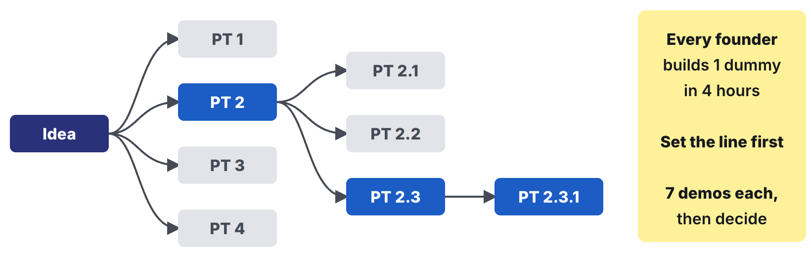
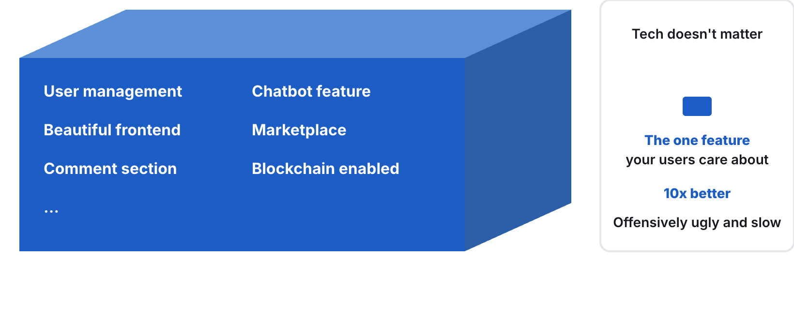

# Homework 05: The Solution Space

Updated: 2026-10-20.

**Build one click dummy per founder and show the dummies in 15 guided demos per student with people from your segment, at least 7 per dummy, each ending in an ask that costs them something.** The learning floor is one click dummy per team and 5 such demos per student.

> Module 05 · The Solution Space · Homework · [Goals M05-LG1 to LG4](README.md)

## What you learned

## What you come back with

By the start of Module 06, your team has seen people from your segment try your solution as a click dummy, knows it beats what they use today by far, and holds those who asked for it, your first buyers.

| | Good | Weak |
|---|---|---|
| 10x | "An hour, not a week", heard in 9 demos | "Faster", assumed |
| Demos | 45 guided, 3 dummies | 12 friends clicked |
| Asks | 8 trials booked, 1 deposit | "Keep me posted" |

Made up.

## The bar

| Per student | Floor | Full bar |
|---|---|---|
| Guided demos with your segment, each ending in an ask | 5 | 15 |

A demo counts for the student who led it, each person once per team but in every dummy they tried. Dropped dummies still count. Friends, classmates and AI testers never count.

## Your kill line

A kill line is a result you count, a date, and what you do if you cross it, written down before the data comes in. No line yet? Log this one first.

> If fewer than 2 of the first 7 people from our segment who try a dummy accept its ask, we drop it and test the next solution. If every dummy falls under the line by the start of Module 06, we go back to the problem space. A dummy with fewer than 7 demos by then has not passed.

Count it per dummy. A new solution is a type 1 pivot, a new problem a type 2.

## How to do it

1. **Build with your AI builder in 4 hours or less.** Rebuild, don't patch.
2. **Book sign-ups first,** then interviewees, then your segment's groups.
3. **Let them drive.** Share the link in a call. Watch, stay quiet.
    - Watch out. Explaining makes it a pitch.
4. **End with the ask,** a trial slot or a pre-order. Only a payment validates.
5. **Converge midweek.** Keep the dummy with the most accepted asks.
6. **Write your MVP.** One feature, what stays manual, the price.
7. **Put the winner behind your page's button** once your Module 04 result is logged. Those clicks are signal, not demos.
8. **Get a blind second opinion.** Give an AI your raw notes, minus hypothesis and names. Note where it disagrees.

## Midweek check

Seven demos per dummy? Read the line, converge. Behind? Change channel first. A new ask restarts the count.

## Keep your records

All in your [Student Toolkit](../../resources/Student_Toolkit.xlsx).

- **Experiment Tracker.** One row per dummy, method Click dummy, rung Wireframe mockup, status quo and 10x in the hypothesis. The winner's next action holds your MVP.
- **Interview Log.** One row per demo with name, quote and the ask's answer under "Agreed next step". Record only with consent that covers the course staff.
- **Kill Criteria Log.** Line and result per dummy.
- **KPI Tracker.** Demos under "Prototype Users".
- **Read-out.** Line next to asks accepted per dummy, the 10x with proof, two quotes, the winner's screens.

## By archetype

| [Archetype](../../resources/archetypes/README.md) | What changes |
|---|---|
| B2C | Short demos, 30 per student, floor 10. Ask for a pre-order. |
| Marketplace | Supply-side dummies first. Ask for a supply commitment. |
| Deep tech | Show the outcome. Ask for a paid feasibility study or a letter of intent with numbers and conditions. |
| Hardware | A render or 3D print that looks like it. Ask for a refundable €50 deposit. |

## What Module 06 needs

Module 06 builds your winner. Bring the dummy, your MVP and your first buyers.

## Pre-read for Module 06

Read the [Langfuse case](../06-prototyping/M06_Case_Langfuse.md) and prepare these questions.

1. **(M06-LG1)** Draw Langfuse's first working version on 29 August 2023 as interface, logic, database and external services. Which parts had to work for a team that never spoke to the founders, and which still needed a founder?
2. **(M06-LG2)** Looker Studio "got us to first analytics charts in half a day", and only users with a flag in the database, which no screen in the app could set, saw those charts. Was that the cheapest version that delivered the outcome, or a debt to pay before strangers arrived from Hacker News? What would you replace or build first, and why?
3. **(M06-LG4)** Between June and August 2023 the founders added a feedback button, self-sign-up next to a call with a founder, a support chat and a demo project. What evidence did they have that teams reached the outcome without help and came back, and what would you want to know before deciding what to build next?
