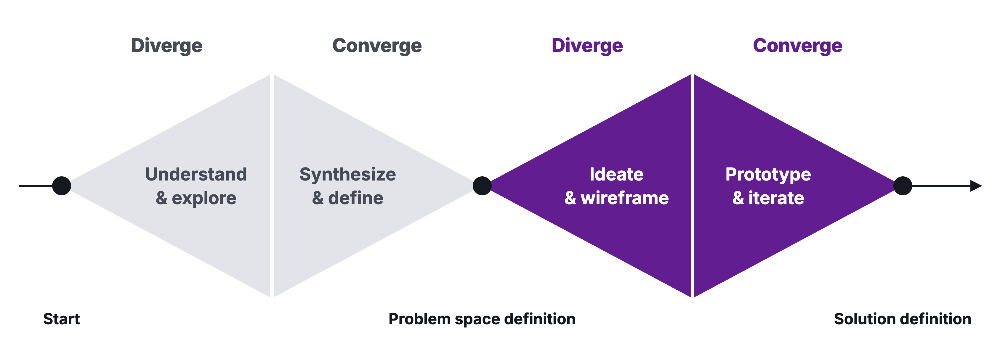
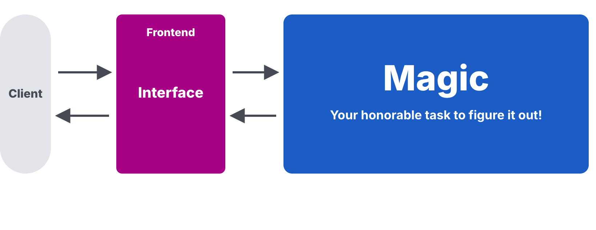

# Workshop 05: Click Dummy Sprint

Updated: 2026-10-19.

> Module 05 · The Solution Space · Workshop · [Goals M05-LG1 to LG4](README.md)

By the start of Module 06, your team has seen people from your segment try your solution as a click dummy, knows it beats what they use today by far, and holds those who asked for it, your first buyers. A click dummy is a clickable mock-up with nothing behind it. It collects signal, only a payment validates. Examples are made up.

**Bring.** A laptop per founder with an AI app builder (Lovable, Figma Make, Replit or Bolt) and your Module 04 result.

## The 90 minutes

| Time | Step | You leave with |
|---|---|---|
| 25′ | 1 · Go wide, then pick by 10x | One pick per founder, a dated line |
| 40′ | 2 · From text to interface | One click dummy per founder, ending in an ask |
| 25′ | 3 · First demos, then commit | Demos booked, targets, midweek day |

### Step 1 · Go wide, then pick by 10x (25′)

**Goal.** Real options, judged against what your segment uses today.

1. **Read your Module 04 line (3′)** next to your result. Crossed it? Then you made a type 2 pivot, back into the problem space. Work on the new segment or problem.
2. **Name the status quo (2′).** What does your segment use today, at what cost?
3. **Go wide (10′).** Three solutions per founder, one without software. Then ask an AI for three more.
4. **Pick by 10x (5′).** Each founder keeps one, in under 10 words, with the dimension where it is 10 times better. Proof heard or assumed?
5. **Log the line (5′)** in the Kill Criteria Log, dated, before anyone sees a dummy. A kill line is a result you count, a date, and what you do if you cross it, written down before the data comes in. Count accepted asks per dummy, or adopt the homework's default.

| Good | Weak |
|---|---|
| "Know within an hour that a finalist went quiet." Speed, heard from 4 recruiters. | "AI-powered recruiting platform." Better at everything, assumed. |

**Output.** One pick per founder, a dated line.

### Step 2 · From text to interface (40′)

**Goal.** A dummy that shows one feature and ends with an ask.

1. **Cut to one feature (5′).** The one your segment cares about. Ugly is fine.
2. **Split real from manual (5′).** The screen shows the outcome. Behind it, you.
3. **Prompt the builder (20′)** with segment, pain and value proposition. One path to the outcome, 1 to 5 prompts. Restart, don't patch.
4. **End with the ask (5′).** A trial slot, a letter of intent, a pre-order.
5. **Rehearse (5′)** with another team. Classmates never count.

| Good | Weak |
|---|---|
| Three screens. The alert lands. "Book a 2-week trial" opens a calendar. | Login, settings, twelve features, no ask. |

**Output.** One link per founder, ending in an ask.

### Step 3 · First demos, then commit (25′)

**Goal.** Leave with demos on the calendar.

1. **Message your sign-ups (10′),** then Module 03 interviewees, then your segment's groups. Ask for 20 minutes.
2. **Run a demo now (10′)** if someone answers. They click, you watch. Log it.
3. **Commit to the bar (5′).** "Build one click dummy per founder and show the dummies in 15 guided demos per student with people from your segment, at least 7 per dummy, each ending in an ask that costs them something. The learning floor is one click dummy per team and 5 such demos per student." Each student picks floor or full bar. Set your midweek day.

| Good | Weak |
|---|---|
| Seven recruiters from the new segment messaged, four demos booked, one held, ask accepted. | "We'll polish it and test next week." |

**Output.** Booked demos, targets, midweek day.

## Arrived empty-handed?

No sign-ups? Work from your interviews, proof assumed. Switched segment? Post your dummy in the new segment's groups.

## Bring and use

The [10x Value Prop Test](../../frameworks/07_10x_Value_Prop_Test.md), the [Validation Hierarchy](../../frameworks/02_Validation_Hierarchy.md), the [Student Toolkit](../../resources/Student_Toolkit.xlsx). The [lecture](M05_Lecture_Solution-Space.pdf) is background.
