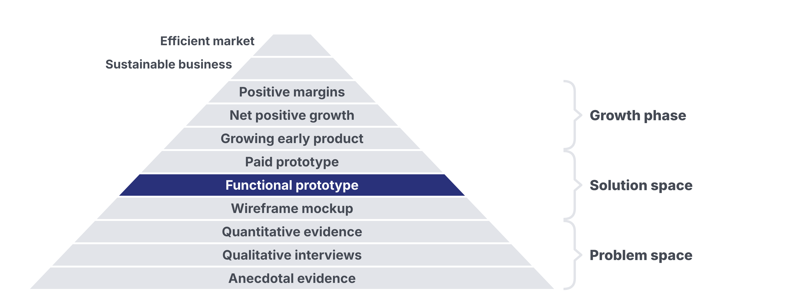

# Homework 06: Prototyping with AI

Updated: 2026-10-30.

**Put your MVP live, let 10 people per student from your segment use it without your help, and ship 2 fixes for what stopped them.** The learning floor is a live MVP per team, 5 such users per student and 1 fix.

> Module 06 · Prototyping with AI · Homework · [Goals M06-LG1 to LG4](README.md)

## What you learned

## What you come back with

By the start of Module 07, your team has its MVP live, has watched people from your segment use it without your help, knows whether it solves their problem, and holds your first users, the ones you ask to pay. A live MVP is signal until someone pays.

| | Good | Weak |
|---|---|---|
| MVP | One feature, real input to outcome, 23 versions | Five features, "almost works" |
| Users | 31 recruiters without help, 14 got their nudge, 6 came back | 12 friends clicked |
| Fixes | "Nobody found Add." Moved, 3 more reached it | Dark mode |

Made up.

## The bar

| | Floor | Full bar |
|---|---|---|
| Live MVP, per team | 1 | 1 |
| Segment users without your help, per student | 5 | 10 |
| Fixes for what stopped them, per team | 1 | 2 |

Used means with their own real input. A user counts once per team, for whoever brought them, rebuilds included. Test daily with co-founders, classmates and your segment. The bar counts only your segment and first buyers. Without help means nobody steers. Working behind the screen is fine.

## Your kill line

A kill line is a result you count, a date, and what you do if you cross it, written down before the data comes in. No line yet? Log this one.

> If fewer than 3 of our first 10 users reach the outcome by Module 07, we rebuild the one feature instead of patching. If none comes back unprompted, we bring a pivot to Module 07.

Per team. Unprompted means without your message. Under 10 users? Not passed.

## How to do it

1. **Split the work.** One leads the build, everyone brings users.
2. **Invite first buyers,** then sign-ups, then your segment's groups.
3. **Watch without steering.** Mute yourself or watch a recording.
    - Watch out. One hint makes it a guided demo.
4. **Ask four questions before each build.** Does it match the problem? For whom is it 10x better? Can you build it in 4 hours? How does it reach them?
5. **Fix what stopped them, cut what nobody used.** Two misses? Restart from your last version.
6. **Keep their data.** Never wipe it. Collect only what you need, and say where it goes, AI included ([Legal Basics](../../resources/LEGAL_BASICS.md)).
7. **Keep the ask.** Show your price. An early payment counts.
8. **Get a blind second opinion.** Give an AI your raw records, minus hypothesis and names. Note where it disagrees.

## Midweek check

Five users each? Read the line. Behind? Change where you find users, not how hard you push.

## Keep your records

In your [Student Toolkit](../../resources/Student_Toolkit.xlsx) and your builder's history.

- **Use Log.** One row per user: without help, outcome, came back, what stopped them.
- **Experiment Tracker.** The MVP, method Prototype, rung Functional prototype.
- **Kill Criteria Log.** Line and result.
- **KPI Tracker.** "Prototype Users", "Activated users (reached the outcome)", "Users who came back unprompted".
- **Versions.** Your build log, each named by its change.
- **Read-out.** Line next to outcomes and returns, two quotes, the outcome screen, a fix before and after.

Record only with consent covering the course staff.

## By archetype

| [Archetype](../../resources/archetypes/README.md) | What changes |
|---|---|
| B2C | 20 users per student, floor 10. |
| Marketplace | A sheet and WhatsApp, matched by hand, is your MVP. Supply first. |
| Deep tech | The smallest simulation or benchmark that proves the claim. |
| Hardware | A works-like build. A person faking the electronics is fine. |

## What Module 07 needs

Module 07 decides Go, Pivot or Kill. Bring your MVP and Use Log.

## Pre-read for Module 07

Read the [6Wunderkinder case](../07-rapid-validation/M07_Case_6Wunderkinder.md) and prepare these questions.

1. **(M07-LG1)** It is summer 2012. Imagine Wunderkit is dead one year later. Write three causes of death the case gives evidence for, each as an assumption about the customer, the solution or the business, and mark which evidence supports or weakens each.
2. **(M07-LG2)** It is summer 2012. Which assumption behind Wunderkit is critical and still unknown, and which evidence in the case only feels like progress? Describe the cheapest test the team could run within two weeks that could prove that assumption wrong, and the line you would write before its first result.
3. **(M07-LG3, M07-LG4)** It is summer 2012. The company says engagement did not meet its expectations, and no written line is documented. Write the line that should have been logged at launch, and say whether the case shows it crossed. Then decide Go, Pivot or Kill for Wunderkit on the artifacts the case shows, name the type if you pivot, and say what 6Wunderkinder's own records offered to restart from if it stopped.
