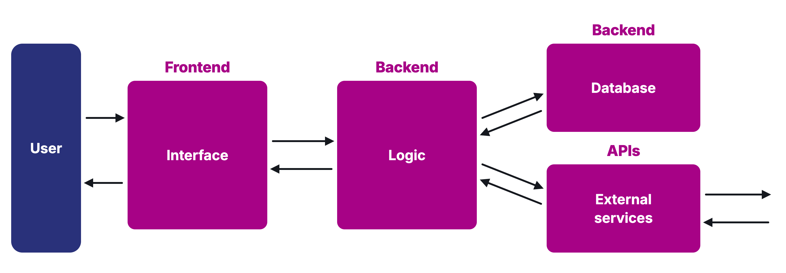
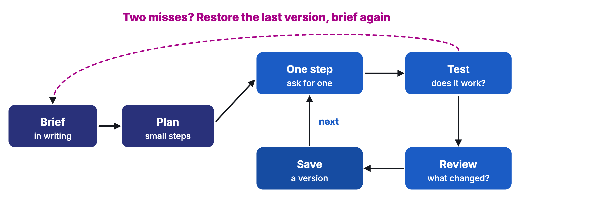

# Workshop 06: Show & Build

Updated: 2026-10-30.

> Module 06 · Prototyping with AI · Workshop · [Goals M06-LG1 to LG4](README.md)

By the start of Module 07, your team has its MVP live, has watched people from your segment use it without your help, knows whether it solves their problem, and holds your first users, the ones you ask to pay. Module 05 trials may fall due this week, so it must work when you leave. A live MVP is one feature, with its price, that takes a user's real input to the outcome. Examples are made up.

**Bring.** Laptops with an AI coding agent or app builder (Lovable or Claude Code, say), a spreadsheet, an API key with a spending limit, your Module 05 winner.

## The 90 minutes

| Time | Step | You leave with |
|---|---|---|
| 20′ | 1 · Map the parts | A map and a brief |
| 50′ | 2 · Build in small steps | A live link |
| 20′ | 3 · Happy path, then hand it over | A dated line, users invited, targets |

### Step 1 · Map the parts (20′)

**Goal.** Know what must work.

1. **Draw your MVP (5′)** as interface, logic, database, outside services. One feature.
2. **Mark each part (5′)** "must work" or "by hand". You behind the screen is fine.
3. **Pick the cheapest form (3′).** Would a form, a sheet or a step by hand deliver the outcome? Build only the part that must work.
4. **Write the brief (7′)** for your agent. User, feature, input, outcome, what stays manual, what not to build.

| Good | Weak |
|---|---|
| "A form fills a sheet. Every hour a workflow finds silent finalists and emails the recruiter an AI-drafted nudge. The inbox stays manual." | "A recruiting app with login, dashboard and AI scoring." |

**Output.** A map and a brief.

### Step 2 · Build in small steps (50′)

**Goal.** Real input runs through to the outcome.

1. **Load the brief (5′)** as project instructions. Ask for a plan in small steps, no code yet.
2. **Build one step at a time (30′).** Ask for one step, read what changed, test it, save a version.
    - Watch out. Two misses on one step? Restore the last version and brief again. Don't patch.
3. **Wire the one API call (5′),** for example to an AI model. Keep the key out of the interface.
4. **Publish (10′)** on your tool's hosting. Point your Module 04 page's button at it.

| Good | Weak |
|---|---|
| Nine saved versions, each tested, one restart. A real finalist goes in, the nudge arrives. | One long chat, nothing saved, "almost works". |

**Output.** A live link, versions saved.

### Step 3 · Happy path, then hand it over (20′)

**Goal.** First users today.

1. **Log your line (3′)** in the Kill Criteria Log, dated, before the first user. A kill line is a result you count, a date, and what you do if you cross it, written down before the data comes in. Or adopt the homework's default.
2. **Run the happy path (5′).** Real data in, watch it run, outcome out?
3. **Send the link (7′)** to your Module 05 first buyers. No tour. Watch, don't steer.
4. **Commit to the bar (5′).** "Put your MVP live, let 10 people per student from your segment use it without your help, and ship 2 fixes for what stopped them. The learning floor is a live MVP per team, 5 such users per student and 1 fix." Each student picks floor or full bar. Set a midweek day.

| Good | Weak |
|---|---|
| Line logged at 10:42. Five trial users got the link, two started. | "We'll send it once it looks nicer." |

**Output.** A dated line, users invited, targets, midweek day.

## Arrived empty-handed?

No winner? Build your best dummy's feature. Back at the problem? Build the smallest working slice, you behind the screen, and invite your interviewees.

## Bring and use

The [Validation Hierarchy](../../frameworks/02_Validation_Hierarchy.md), [Best Practices: Coding with AI](../../resources/Best_Practices_Coding_with_AI.pdf), the [Student Toolkit](../../resources/Student_Toolkit.xlsx). The [lecture](M06_Lecture_Prototyping.pdf) is background.
