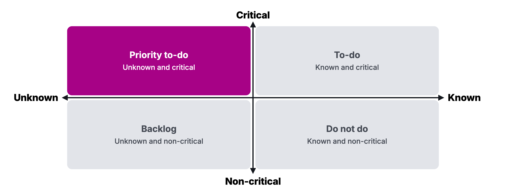

# Homework 07: The Kill Decision

Updated: 2026-10-26.

**Test your monkey with 10 people per student from your segment against a line logged first, decide Go, Pivot or Kill on your Kill Criteria Log and scorecard, and bring the verdict and your next offer to the Module 08 check-in.** The learning floor is the scored verdict and the offer per team and 5 such people per student.

> Module 07 · The Kill Decision · Homework · [Goals M07-LG1 to LG4](README.md)

## What you learned

## What you come back with

By the start of Module 08, your team has tested the riskiest assumption left in your venture, decided Go, Pivot or Kill on criteria committed in advance, and holds the offer you will sell next, even after a kill.

| | Good | Weak |
|---|---|---|
| Monkey test | 22 recruiters asked for a €49-a-month pre-order, 7 signed | 3 friends said they'd pay |
| Verdict | Go, confirmed against its line | "Still deciding" |
| Offer | €49 a month, 14 named recruiters | "Launch on Product Hunt" |

Made up.

## The bar

| Per student | Floor | Full bar |
|---|---|---|
| People from your segment tested | 5 | 10 |

| Per team | By the Module 08 check-in |
|---|---|
| Go | Scored on artifacts, crossed lines answered, priced offer, 10 names |
| Pivot | As Go, plus type, change, new line |
| Kill | Crossed line or score under 9, Kill Ritual page, priced concierge offer, 10 names |

Floor teams need their row. A person counts once, for the student who tested them. Friends, classmates and AI never count. A payment is never required.

## Your kill line

A kill line is a result you count, a date, and what you do if you cross it, written down before the data comes in. No line yet? Log this one.

> If fewer than 3 of the first 10 people from our segment do what our monkey assumes by the Module 08 check-in, it is false. A Go becomes a Pivot, a Pivot a Kill, and a restart picks a new offer.

Count across the team.

## How to do it

Workshop done? Start at 4.

1. **Write the obituary.** One year from now, your venture is dead. Each founder lists why, alone, beside your Weekly Reflection's riskiest assumptions. Each becomes an assumption about customer, solution or business.
2. **Find the monkey.** Map them on critical and known (an artifact shows it). The monkey is the critical unknown, never a pedestal that just feels like progress.
3. **Decide.** Crossed lines in your Kill Criteria Log decide, the [scorecard](../../frameworks/03_GPK_Decision_Framework.md) the rest. Pivot type 1 changes the solution, type 2 the problem.
4. **Run the cheapest test that could prove the monkey wrong,** people from your records first.
    - Watch out. "Would you pay?" is not a test. A signed pre-order is.
5. **Killing?** Write the [Kill Ritual](../../frameworks/03_GPK_Decision_Framework.md) page, like the made-up [A-grade autopsy](../../resources/exemplars/Exemplar_A_Kill_Autopsy.md). Restart from your records with a concierge offer, the outcome by hand.
6. **Ask AI twice,** for assumptions from raw notes and a blind read of results. Remove hypothesis and names.

## Midweek check

Five each? Read the line. Behind? Look elsewhere. Crossed? Step down now. Earlier tests count.

## Keep your records

In your [Student Toolkit](../../resources/Student_Toolkit.xlsx).

- **Interview Log.** One row per person tested, tester as Interviewer, one quote.
- **Kill Criteria Log.** The monkey line, date, result.
- **Assumptions.** One row per assumption, the monkey marked.
- **Verdict.** Scores with artifacts, verdict, offer, price, names, like the made-up [scorecard](../../resources/exemplars/Exemplar_GPK_Scorecard.md).
- **Read-out.** Line next to result, verdict kept or changed, two quotes, AI disagreements.

Record only with consent covering the course staff.

## By archetype

| [Archetype](../../resources/archetypes/README.md) | What changes |
|---|---|
| B2C | 20 people per student, floor 10. |
| Marketplace | Test supply first. Does supply return after one match? |
| Deep tech | A technical monkey? Test demand too, with a paid feasibility study. |
| Hardware | Ask for a deposit, a refundable €50 counts. |

## What Module 08 needs

Module 08 sells. Bring verdict, offer, names.

## Pre-read for Module 08

Read the [Tacto case](../08-first-users/M08_Case_Tacto.md) and prepare these questions.

1. **(M08-LG2)** In late September 2020 Tacto had funding and a website, and no customer on record. Whom should the founders ask first to become their first customers, firms and people they already knew, introductions through their investors, or heads of purchasing they had never spoken with? What would a yes from each tell them?
2. **(M08-LG4)** Should Tacto ask its first customers for time and feedback, or for money from the first conversation? Write the ask you would make, with its terms or its price. What would a paid yes prove that a free yes could not, and what might asking for money cost the founders at this stage?
3. **(M08-LG1)** Write the founders' first message to the person you chose in question 1, five lines at most, built on what the case tells you about that person's work, asking for one next step. What would the founders do by hand for that firm in its first month, before a product exists?
