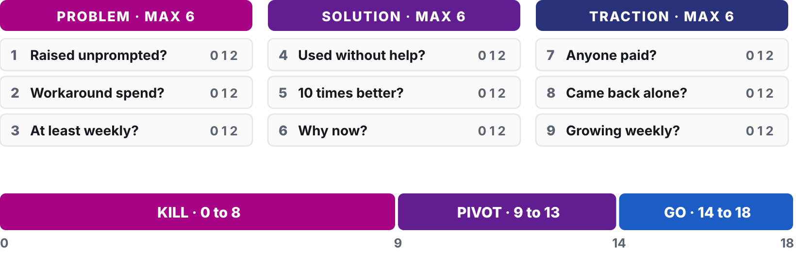

# Workshop 07: Kill Your Darlings

Updated: 2026-10-19.

> Module 07 · The Kill Decision · Workshop · [Goals M07-LG1 to LG4](README.md)

By the start of Module 08, your team has tested the riskiest assumption left in your venture, decided Go, Pivot or Kill on criteria committed in advance, and holds the offer you will sell next, even after a kill. Examples are made up. **Bring** your whole Student Toolkit and Use Log. Missing records score zero.

## The 90 minutes

| Time | Step | You leave with |
|---|---|---|
| 20′ | 1 · Write the obituary | Causes of death as assumptions, checked |
| 25′ | 2 · Find the monkey | The monkey, its test, the people |
| 45′ | 3 · Decide, then commit | A verdict, a kill page, a dated line, first asks sent |

### Step 1 · Write the obituary (20′)

**Goal.** Find what can still kill your venture.

1. **Imagine it dead (5′),** one year from now. Each founder lists why, alone.
2. **Add your old guesses (3′),** the Weekly Reflection's riskiest assumptions since Module 00.
3. **Turn each cause into an assumption (5′)** about the customer, the solution or the business.
4. **Check each against your records (7′).** Ruled out, or standing?

| Good | Weak |
|---|---|
| "Recruiters pay €49 a month." One deposit so far. Standing. | "Bad luck. Competition. The economy." |

**Output.** Standing assumptions, each with its evidence.

### Step 2 · Find the monkey (25′)

**Goal.** The assumption that kills you if false, and a cheap test.

1. **Map them (8′)** on critical and known. Known means an artifact shows it.
2. **Pick the monkey (5′),** the critical unknown, never a pedestal that only feels like progress.
3. **Pick the cheapest test (7′)** that could prove it wrong. A fake door (a button for nothing yet), the outcome by hand, a pre-order.
4. **Name the people (5′),** first buyers and Use Log first.

| Good | Weak |
|---|---|
| "Recruiters pay €49 a month." Each of us asks 10 users. | "They want a dashboard." We build it first. |

**Output.** The monkey, its test, the people.

### Step 3 · Decide, then commit (45′)

**Goal.** A verdict on criteria set before, and a week that tests it.

1. **Read your Kill Criteria Log (5′).** A kill line is a result you count, a date, and what you do if you cross it, written down before the data comes in. A crossed line decides. Override only with evidence, out loud.
2. **Score the rest (10′)** on the [scorecard](../../frameworks/03_GPK_Decision_Framework.md), 0 to 2 per question, each with its artifact.
3. **Get challenged (8′).** A team attacks your weakest score, or an AI reads your raw records, minus names.
4. **Announce, then kill something (10′).** Go, Pivot type 1 (new solution) or 2 (back to the problem), or Kill, provisional. Write the [Kill Ritual](../../frameworks/03_GPK_Decision_Framework.md) page for what it drops.
5. **Commit (7′).** Log the monkey line with its effect on your verdict, or take the homework's default. Then copy the bar. "Test your monkey with 10 people per student from your segment against a line logged first, decide Go, Pivot or Kill on your Kill Criteria Log and scorecard, and bring the verdict and your next offer to the Module 08 check-in. The learning floor is the scored verdict and the offer per team and 5 such people per student." Each student picks floor or full bar. Set your midweek day.
6. **Send the first asks (5′)** to two named people each.

| Good | Weak |
|---|---|
| No open line crossed. Score 14, a Go. Free plan killed. Line logged 11:20. | "Go. It feels right." No artifact. |

**Output.** A provisional verdict, a kill page, a dated line, first asks sent.

## Arrived empty-handed?

No MVP or Use Log? Score what you have, 4 and 8 score zero. Your monkey is use without help.

## Bring and use

The [GPK Decision Framework](../../frameworks/03_GPK_Decision_Framework.md) with its made-up [scorecard](../../resources/exemplars/Exemplar_GPK_Scorecard.md) and [A-grade autopsy](../../resources/exemplars/Exemplar_A_Kill_Autopsy.md), the [Validation Hierarchy](../../frameworks/02_Validation_Hierarchy.md), the [Student Toolkit](../../resources/Student_Toolkit.xlsx). The [lecture](M07_Lecture_Rapid-Validation.pdf) is background.
