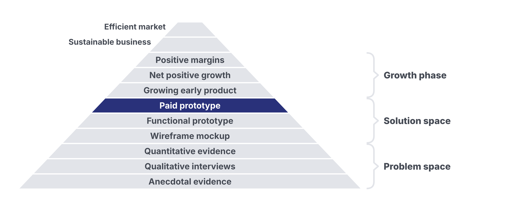
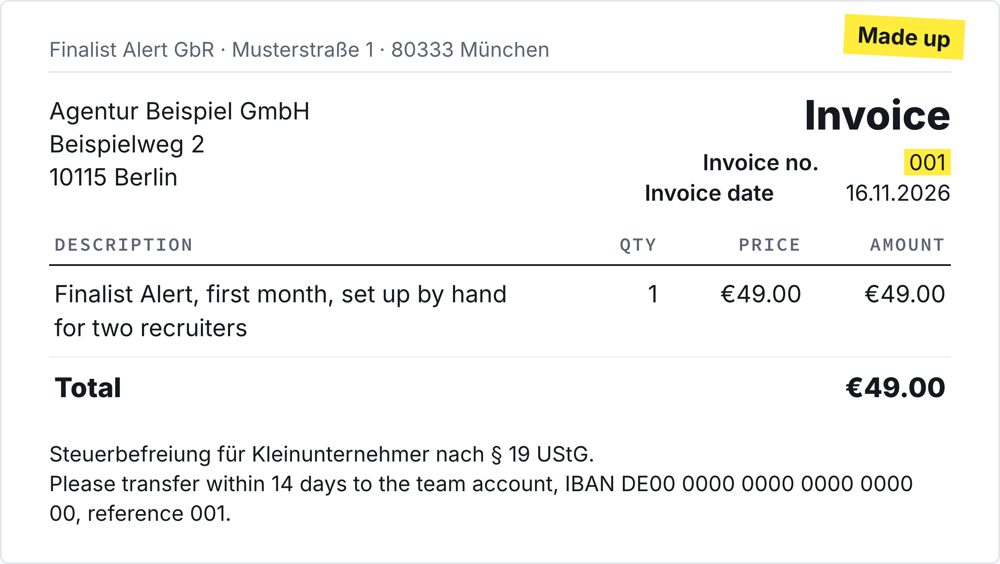

# Homework 08: Finding First Users

Updated: 2026-10-20.

**Ask named people from your segment to pay for your offer at its price, and win 3 paying users from outside your social graph, shown in your payment dashboard or on a numbered invoice.** The learning floor is your first € from outside your social graph.

> Module 08 · Finding First Users · Homework · [Goals M08-LG1 to LG4](README.md)

## What you learned

{: style="max-height: 65mm" }

{: style="max-height: 60mm" }

## What you come back with

By the start of Module 09, your team has asked named people from your segment to pay, holds your first customers from outside your social graph, and knows which channel and which ask bring the next ones.

| | Good | Weak |
|---|---|---|
| Asks | 18 recruiters asked on calls, €49 | 40 cold messages |
| Customers | 3 by link, 1 by invoice, all strangers | An aunt paid "to help" |
| Next | Demo users convert, cold LinkedIn doesn't | "Everyone loved it" |

Made up.

## The bar

| Per team | Floor | Full bar |
|---|---|---|
| Paying users from outside your social graph | 1, your first € | 3 |

Any amount counts, deposits and earlier payments too, one per company. People you met through this venture count. Anyone you knew before and course teams never do. An unpaid pilot is signal.

## Your kill line

A kill line is a result you count, a date, and what you do if you cross it, written down before the data comes in ([Validation Hierarchy](../../frameworks/02_Validation_Hierarchy.md)). No line yet? Log this one first, counted across the team.

> If none of the first 10 people from our segment we ask to pay says yes by [midweek date], we change the offer or the segment before the next ask. No yes from fewer than 10 asks crosses it too.

## How to do it

1. **Set up a way to get paid** first, a team payment link ([Team Stack](../../resources/TEAM_STACK.md), section 2) or an invoice from 001 ([Legal Basics](../../resources/LEGAL_BASICS.md), section 4).
2. **Start in your records,** Module 07's ten first. Ask every buyer and every no for names. Then your segment's groups, found by AI research.
3. **Write in their words.** Their quote, your offer, its price, one next step, never just a link.
4. **Get them on a call.** Listen 80% of the time. Record only with consent.
5. **Ask for the money there,** at your price. Send the link while you talk.
    - Watch out. "Would you pay?" is not an ask. A favour discount is not a sale.
6. **Set it up for them on the spot.** Do by hand what the product can't.
7. **Follow up until yes or no.** Date every open thread. Log objections word for word.
8. **Count your funnel per channel** twice a week. Double down where activated users come from.
9. **Get a blind second opinion.** Give an AI your objections, no names or pitch. Note where it disagrees.

## Midweek check

Midweek date? Read your line. Behind? Change channel or wording, not just effort.

## Keep your records

In your [Student Toolkit](../../resources/Student_Toolkit.xlsx).

- **Pipeline.** A row per person asked, objections word for word as in the [exemplar](../../resources/exemplars/Exemplar_Objection_Log.md) (made up).
- **KPI Tracker.** "Asks made", "Activated users", "Paying Customers" and "Revenue (€)" under M08.
- **Kill Criteria Log.** Line, date, result.
- **Proof.** A dashboard screenshot or the paid invoice, names and bank details cropped.
- **Read-out.** Line and result, funnel per channel, paying users with proof, two objections, price.

## By archetype

| [Archetype](../../resources/archetypes/README.md) | What changes |
|---|---|
| B2C | A €4.99 payment counts. Ask more people. |
| Marketplace | Match by hand. Only your cut counts. |
| Deep tech | A paid feasibility study counts, a letter of intent doesn't. |
| Hardware | Sell deposits, a refundable €50 counts. Deliver by hand. |

## What Module 09 needs

Module 09 tests your price and takes you out of the sale. Bring customers, objections, funnel, price.

## Pre-read for Module 09

Read the [tado° case](../09-prototype-to-product/M09_Case_tado.md) and prepare these questions.

1. **(M09-LG1)** What does a tado° customer actually pay for, the box, the service or the saving? Use Exhibits 1 and 3 to argue which unit of payment fits that value best.
2. **(M09-LG1)** tado° tested four offers on three pages in June 2013 (Exhibit 2). Which result, by which date, would you have committed to in advance as the line for choosing each one?
3. **(M09-LG2)** Which way of paying would let a hesitant visitor buy on the page without asking for the free call-back, and what in Exhibits 1 and 4 makes you think so?
