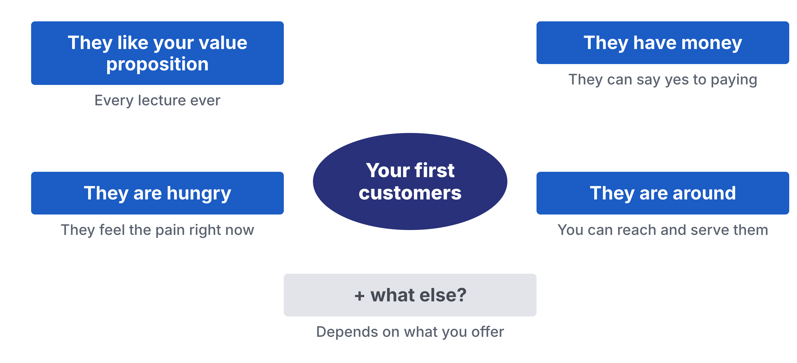
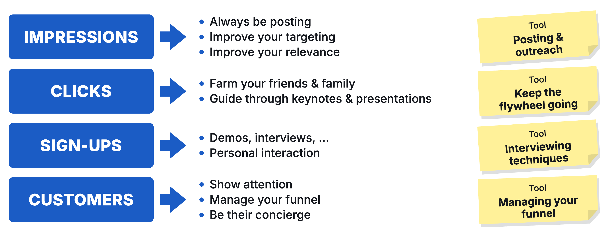

# Workshop 08: Sell by Hand

Updated: 2026-10-20.

> Module 08 · Finding First Users · Workshop · [Goals M08-LG1 to LG4](README.md)

By the start of Module 09, your team has asked named people from your segment to pay, holds your first customers from outside your social graph, and knows which channel and which ask bring the next ones. Today you ask for money. Examples are made up.

**Bring.** Laptop and phone, your Toolkit with your Module 07 verdict, offer and names, and a payment link, or at least an invoice template ([Legal Basics](../../resources/LEGAL_BASICS.md), section 4).

## The 90 minutes

| Time | Step | You leave with |
|---|---|---|
| 25′ | 1 · Name your ten, write the ask | Ten names and messages, a dated line |
| 40′ | 2 · Ask live, set it up on the spot | Asks made, answers and objections logged |
| 25′ | 3 · Count, then commit | A funnel per channel, follow-ups, targets |

### Step 1 · Name your ten, write the ask (25′)

**Goal.** Ten people who pass all four, a message each.

1. **Confirm your verdict (3′),** offer and price. Killed? Sell your concierge offer.
2. **Pull names from your records (7′),** Module 07's ten first, then buyers, users, sign-ups, interviewees. Keep those who like the offer, feel the pain now, can pay and can be reached.
3. **Log the line (3′)** in your Kill Criteria Log, dated with your midweek day, before the first ask. A kill line is a result you count, a date, and what you do if you cross it, written down before the data comes in. Or adopt ours.
4. **Write each message in their words (12′).** Their quote, your offer, its price, one next step. An AI cuts it to five lines, names out.

| Good | Weak |
|---|---|
| "Lena, you lose a finalist a month. We set it up in 20 minutes, €49 a month. Call at 10?" | "We're revolutionizing recruiting with AI. See our website!" |

**Output.** Ten names and messages, a dated line.

### Step 2 · Ask live, set it up on the spot (40′)

**Goal.** Every yes turned into use before the call ends.

1. **Rehearse the ask (5′)** with a co-founder, or an AI labelled as prep. Neither counts.
2. **Send, then call (15′)** whoever said yes to a demo or trial in Modules 05 to 07. No answer? Message the next name. Listen 80% of the time.
3. **Ask for the money (10′)** at your offer's price. Then stay quiet. No favour discounts.
4. **Turn a yes into use now (5′).** Set it up on a shared screen, link sent while you talk.
5. **Log every answer (5′),** objections word for word.

| Good | Weak |
|---|---|
| Six asked, two calls, Lena paid €49 by link. Her objection, "Who types in our candidates?" | Ten LinkedIn messages with a link. "We'll see." |

**Output.** Asks made, answers and objections logged.

### Step 3 · Count, then commit (25′)

**Goal.** Find the drop. Commit the week.

1. **Draw your funnel (8′)** per channel. Reached, replied, talked, activated, paid. Activated means they reached your promised outcome.
2. **Pick your channel (4′),** the one bringing activated users from your segment.
3. **Date every follow-up (5′).** Undated threads drop.
4. **Commit to the bar (8′).** "Ask named people from your segment to pay for your offer at its price, and win 3 paying users from outside your social graph, shown in your payment dashboard or on a numbered invoice. The learning floor is your first € from outside your social graph." Each founder names an ask count.

| Good | Weak |
|---|---|
| Demo users, 6 reached, 2 talked, 1 activated, 1 paid. Cold LinkedIn, 4 reached, 0 replies. Double down on demo users. | "1,200 impressions on our post!" |

**Output.** A funnel per channel, follow-ups, targets.

## Arrived empty-handed?

No offer or names? Price a concierge offer, what you'd do by hand for one person. Name ten from your interviews and your segment's groups. Ask.

## Bring and use

The [Objection Log exemplar](../../resources/exemplars/Exemplar_Objection_Log.md) (made up), [Team Stack](../../resources/TEAM_STACK.md), [Student Toolkit](../../resources/Student_Toolkit.xlsx). The [lecture](M08_Lecture_Finding-First-Users.pdf) is background.
