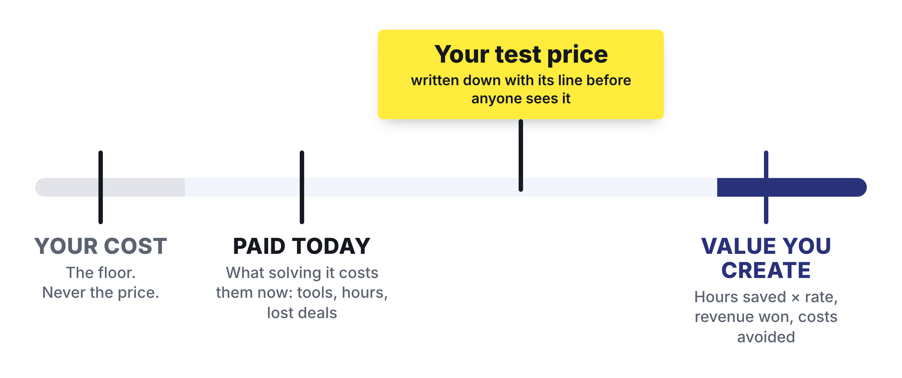
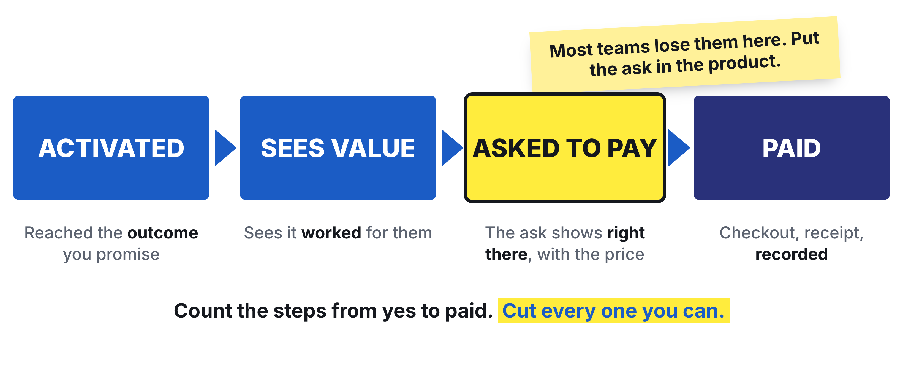
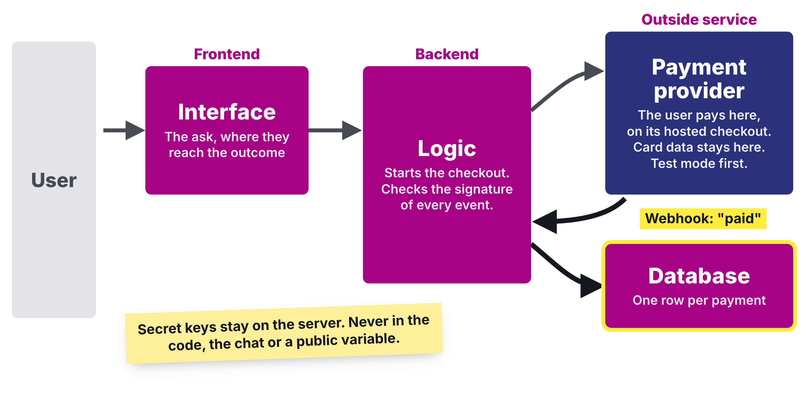

# Homework 09: From Prototype to Product

Updated: 2026-10-26.

**Run your price test, let customers pay inside your live product without a founder in the sale, and reach €1,000 cumulative revenue from outside your social graph, with the same offer bought by more than one customer.** The learning floor is €500 cumulative, with at least one payment made inside your product.

> Module 09 · From Prototype to Product · Homework · [Goals M09-LG1 to LG4](README.md)

## What you learned

{: style="max-height: 62mm" }

{: style="max-height: 62mm" }

{: style="max-height: 74mm" }

## What you come back with

By the start of Module 10, your team sells one offer at a price you tested, customers pay for it inside your live product without a founder in the sale, and the same offer sells again without custom work.

| | Good | Weak |
|---|---|---|
| Price | €99 a seat against a line | "Survey says €20" |
| Paying | 11 seats, €1,089, no sales calls | Every sale a call |
| Repeat | Same plan, 6 agencies | Two custom projects |

Made up, a tool nudging recruiters about quiet finalists.

## The bar

| Per team | Floor | Full bar |
|---|---|---|
| Revenue from outside your social graph, since Module 08 | €500 | €1,000 |
| Payments made inside your product | 1 | 1 or more |
| Customers who bought the same offer | | 2 or more |

Proof is your dashboard or a paid numbered invoice. An order form that issues the invoice counts as inside. A company counts once. Friends, family, classmates, course teams and test payments never count.

## Your kill line

A kill line is a result you count, a date, and what you do if you cross it, written down before the data comes in ([Kill Question](../../frameworks/02_Validation_Hierarchy.md)). No line yet? Log this one.

> If none of the first 10 named people from our segment we send to our price pays by [midweek date], we change the structure, not the amount, before the next 10.

Count across the team. Under 10 sent counts as none paid.

## How to do it

1. **Send people to the product, not to you.** Module 08's "not now" first, then your payers' channel and your segment's groups.
2. **Put the ask where they reach the outcome,** with the price.
3. **Cut a step to paid** every day.
4. **Let follow-ups run without you.**
5. **Hand one chore to an AI agent,** tested on 10 of your own cases first.
6. **Say no to custom work,** or price it apart.
7. **Set up the plumbing.** Register the trade, file the tax questionnaire within a month, tax number on invoices above €250, team bank account, receipts folder, code rights granted to the team in writing. Not legal advice ([Legal Basics](../../resources/LEGAL_BASICS.md)).
    - Watch out. GbR founders are liable with private money. Signing what your savings can't cover? A UG and a lawyer.
8. **Get a blind second opinion.** Give an AI your raw records, no names or hypothesis. Note where it disagrees.

## Midweek check

Behind your euros? Read your line, change the structure first. Paid by hand? Find the step.

## Keep your records

In your [Student Toolkit](../../resources/Student_Toolkit.xlsx) and your product.

- **Experiment Tracker.** Method Pricing Test.
- **Kill Criteria Log.** Line, date, result.
- **Pipeline.** Module 08's, or add one. A row per person sent and per payment, with offer, amount, in product or not, proof number, objections.
- **KPI Tracker.** "Paying Customers" and "Revenue (€)" under M09.
- **Read-out.** Facts, Numbers, Quotes, Images from these records.

## By archetype

| [Archetype](../../resources/archetypes/README.md) | What changes |
|---|---|
| B2C | Test annual against monthly. |
| Marketplace | Let your provider split payments. Only your cut counts. |
| Deep tech | A fixed-scope feasibility study at a list price, success criteria agreed, ordered by form. |
| Hardware | Pre-orders or deposits at the real price, a refundable €50 counts. Materials are your floor. |

## What Module 10 needs

Paying customers, your price test result, the path to paid, repeats or why not, unbuilt requests.

## Pre-read for Module 10

Read the [Tally case](../10-product-management/M10_Case_Tally.md) and prepare these questions.

1. **(M10-LG1)** Of 115 people who answered Tally's survey, 66 said they would be very disappointed without it. What does that tell Marie Martens and Filip Minev about whether Tally keeps its users, and what would you count before you called it product-market fit?
2. **(M10-LG3)** Pick one request category from Exhibit 3 that you would build next and one you would leave off the roadmap. What does the case tell you, and what does it not tell you, about who asked for each, and which number should move if your choice is right?
3. **(M10-LG4)** Two founders split their time about half and half between building and marketing. Should their next weeks go to building or to growing? Argue from what the case says about where users came from and about the founders' time, and from Exhibit 1.
