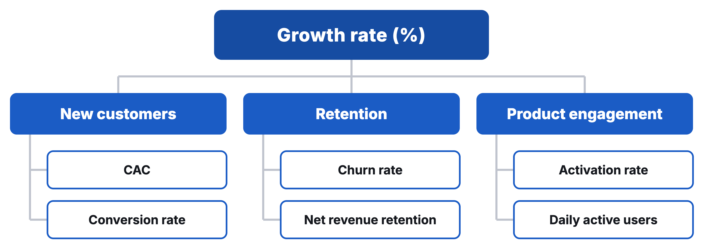

# Tally: Seven Requests, Two Founders

Updated: 2026-10-26.

> Module 10 · Product Management & Growth · Case, read before class

Case for Module 10, Product Management & Growth, of Ambitious Entrepreneurship. Prepared by Bastian Burger from public sources as a basis for class discussion. The case does not judge whether any decision was right or wrong. Licensed under CC BY-NC-SA 4.0 except third-party material as marked.
{: .byline }

In late July or early August 2021, Marie Martens and Filip Minev, the two founders of the Belgian form builder Tally, had more than 100 answers to a survey in front of them.[^moment] They had asked their users how they would feel if they could no longer use Tally. Like many founders, Martens wrote, they "were struggling with the million-dollar question: Does Tally have product-market fit?"[^pmf]

Tally was a year old. Its first version had gone live in September 2020. Minev had built it by himself, Martens wrote.[^ih70] [^ama] On 26 July 2021 Martens put Tally at 7,500 users and $30,000 in annual recurring revenue, with $2.4K in monthly recurring revenue (MRR). Tally sold one paid plan, Tally Pro, at $29 a month.[^ama] [^pricing] The rest of the product was free, and the founders meant to keep it that way.[^ama]

The survey had also asked how Tally could be improved, and Martens summarised the most requested improvements in seven groups. Most, Martens wrote, were not new, and many matched items on the public roadmap the founders kept.[^pmf] [^road0706] Minev was the only one of the two who built the product, and both founders wanted more time for marketing.[^ama] What should Tally build next, what should stay off the list, and how much of the next weeks belonged to building at all?

## A Crowded Market for Forms

"Every business needs a form at one point," Martens wrote, and at their core a lot of products were complex forms.[^pmf] In an interview recorded in late 2020, the founders described a market of two kinds of companies. Google Forms was entirely free, and everyone else charged from about $30 to $40 a month and up. They said they had looked for a business model in the space between the two.[^video]

Rivals that charged also offered free plans, with limits. Jotform's free Starter plan in July 2021 allowed 5 forms, 100 submissions and 1,000 form views a month, and carried Jotform's branding. Its Bronze plan cost $29 a month, or $24 a month billed annually, for 25 forms and 1,000 submissions a month.[^jotform] According to Tally's comparison page of July 2021, Typeform's free plan allowed 10 responses a month and 10 questions per form, and charged from $30 a month for logic, file uploads, payments and custom thank-you screens.[^vstypeform] Google Forms was free without limits on forms or responses, but lacked payments, a calculator and redirects, Tally's other comparison page said.[^vsgoogle] Exhibit 4 sets the plans side by side.

## Two Founders and a Form Builder

In a post of April 2021, edited in July, Martens wrote that she had been a marketing manager at a digital product studio in Belgium and that Minev had built Delta, a cryptocurrency portfolio app acquired by eToro.[^origin] Together they had started Hotspot, which connected hotels with travel influencers. When the pandemic stopped travel in 2020, customers began to cancel, and by July 2020 Hotspot had lost half of them. While organising a fundraiser that gave free hotel nights to healthcare workers, she wrote, they again needed a form and found none they liked.[^origin] In August 2020 they decided to build their own form builder.[^origin] [^year1]

Tally worked like a text document. A user typed and inserted blocks with keyboard shortcuts instead of dragging fields onto a canvas, and anyone could try the builder on the landing page without signing up.[^vstypeform] [^year1] Three weeks after the beta opened, on 30 September 2020, Martens reported that 70 users had created a form and shared it to collect responses.[^ih70] On 3 November she counted 300 users and 1,000 people who had filled in a Tally form.[^ih300]

On 8 March 2021 Tally launched on Product Hunt, a website where new products are voted on, with the tagline "The simplest way to create forms for free".[^ph] In her post of April 2021 Martens wrote that Tally had led the day's ranking for 23 hours, and in October 2021 that it ended the day fourth. Product Hunt's own record lists it fifth of the day and fourth of the week and of the month. Accounts of the votes and the new users differ by date and source (Exhibit 1).[^ph] [^origin] [^year1]

The founders built Tally with their own savings, Martens wrote, without outside investors, and had spent no money on marketing.[^savings] [^year1] Minev built and designed the product and Martens ran marketing. "So 50/50 at the moment," she wrote on 4 August 2021 about their time, adding that they would like to spend more of it on marketing and content but lacked the time and resources.[^ama]

## Free for Almost Everything

On 5 August 2021 Tally's pricing page said that "99% of Tally's features are available to all users for free and without limits". The free plan included unlimited forms and responses, payments, file uploads of up to 10 MB, conditional logic, a calculator, hidden fields and integrations with Notion, Airtable, Zapier, Integromat and Google Sheets. Tally took a 5% commission on payments collected through free forms, on top of the fee of Stripe, the payment provider. Forms made on the free plan carried a "powered by Tally" badge.[^pricing] [^users]

Tally Pro cost $29 a month or $290 a year. It added collaboration and workspaces for teams, removed the Tally branding, allowed custom domains, let customers add their own styles and scripts to forms on a custom domain, sent fully customised emails to the form owner or to respondents, removed the payment commission and lifted the upload limit.[^pricing] Pro had started in October 2020 at $24 a month or $240 a year. The price was still $24 on 2 March 2021 and had risen to $29 by 18 March.[^pro] [^home0302] [^price0318]

The founders explained the generous free plan as a choice. "We wanted Tally to be empowering instead of limiting," Martens wrote on 26 July 2021, which is why they did not use "the usual volume-based pricing with limits on the number of forms or responses". They considered the free plan one of their unique selling points and were not planning to change it. "Of course, this means that we need a lot more users to grow."[^ama]

What the founders counted changed over the first year. In late 2020 they said the things they watched most were how many people tried Tally, whether those people made a form, and whether the forms were shared and received responses. Revenue mattered too. With their freemium model they had expected 1 to 2% of registered users to pay, and said that so far the share was a bit higher.[^video] By July 2021 "Our primary metric at the moment is MRR," Martens wrote. Revenue was tracked in the Stripe dashboard and users in Mixpanel, an analytics tool.[^ama] She gave growth as "7% weekly and 15% monthly (MRR)" and user growth as around 4.5% a week. In another answer she wrote, "We have about 3% conversion from free to paid users right now." Tally was cash-flow positive, Minev added, but the founders did not pay themselves, and operating costs were about 15 to 20% of MRR.[^ama]

When Martens published the survey results on 5 August 2021, Tally had 8,000 users and 100 Tally Pro users, "which results in $2.4K MRR".[^pmf] The founders did not define a "user" in these posts. Exhibit 1 sets the figures of 26 July and 5 August side by side.

## Where Users Came From

Looking back in October 2021, Martens named the main channels for April 2021 as Product Hunt, Twitter, the "powered by" badge, no-code communities and Indie Hackers, and in her post of 29 July 2021 she had added newsletter features, reviews and users recommending Tally.[^year1] [^users] The badge brought in about 10% of new users, Martens wrote on 29 July 2021.[^users] An affiliate programme had recently started, paying partners 20% of the revenue from every new Pro user they brought, and was run by hand through a Tally form.[^users] The pricing page of 5 August linked to offers for startups, education and non-profits.[^pricing] Tally also kept comparison pages against Typeform, since November 2020, and against Google Forms, since June 2021.[^vstypeform] [^vsgoogle]

Asked about growth on 26 July 2021, Martens said the founders believed in talking to users and investing in communities, that the badge was bringing more referrals, and that "We also want to start focussing on user-generated content and SEO."[^ama] In October 2021 she wrote about the same summer. "During summer our growth started slowing down, which made us nervous," she wrote.[^year1] No figure for the slowdown was published.

## How Requests Reached the Roadmap

Feedback reached the founders through a Slack channel for users, feedback forms embedded on every blog post and help page, Twitter and email. "We receive dozens of feedback requests every day and religiously process all of them," Martens wrote on 29 July 2021.[^users] [^road1118]

The roadmap was a public Notion page.[^ama] "We tally up all requests to create our roadmap and make sure we're building the right things," it said.[^road0706] In November 2020 the page marked some items as part of the Pro plan, among them a pop-up form, custom domains and subscription payments. The copy archived on 6 July 2021 carried no such marks.[^road1118] [^road0706]

The changelog listed 27 releases from September 2020 to 22 July 2021, including Tally Pro in October, a template gallery in November, conditional logic in January, custom domains in February, an Airtable integration in March, a Notion integration from April, emails to respondents in July and an Integromat integration on 22 July (Exhibit 3).[^changelog] Where the roadmap gave dates, it scheduled each item for about a week, and some weeks held two.[^road0706]

The roadmap as archived on 6 July 2021 showed nine items done between April and June, two planned (emails to respondents for 28 June to 4 July, which shipped on 5 July, and Undo for 5 to 11 July, which had not shipped by 5 August) and 21 items without a date. The first unscheduled items were webhooks, which send each response automatically to another system, then access to an API (application programming interface), then subscriptions and recurring payments, then analytics.[^road0706] [^changelog] The page did not say whether the order of the unscheduled items was a priority. The Internet Archive holds no copy of the page between 6 July and 5 August 2021.

## The Survey

The founders took the method from Superhuman's process for measuring product-market fit, based on the question Sean Ellis had used. Ask users how they would feel if they could no longer use the product, and measure the share who answer "very disappointed". Ellis had set a benchmark of 40%, because, as Martens summarised it, companies that struggle to grow almost always had less than 40% of users give that answer.[^pmf]

They built the survey as a Tally form and "asked our users for feedback". When it reached 100 responses, they analysed the data.[^pmf] By the time Martens published the results on 5 August, 115 people had answered. Sixty-six, or 57%, said they would be very disappointed, 45 (39%) somewhat disappointed and 4 (3%) not disappointed (Exhibit 2). "We were extremely happy to see that we passed the 40% benchmark, but it's still just a number," Martens wrote.[^pmf] [^chart]

The other questions gave the founders more to read. From the answers on who would benefit most, they drew a profile of "SMB founders, Startups, and creators who value good design (UX/UI), and are looking for an easy way to create forms with a small budget".[^pmf] From a word cloud of the answers on the main benefit, the founders read free, simple and easy to use as the main reasons users liked Tally, and many respondents mentioned its likeness to Notion, a note-taking and workspace tool. For one respondent's company the similarities to the Notion interface "were a MAJOR selling point".[^pmf] Respondents had found Tally mostly through Twitter (25%), Product Hunt (22%) and colleagues or friends (18%). Asked what they would use if Tally disappeared, they named Google Forms and Typeform most often, and 10% saw no alternative with the same features at the same price.[^pmf]

The post did not say how the survey reached users, to whom it was sent, or how many of the respondents paid for Pro. The founders published no figure on how many users came back to Tally or cancelled Pro.[^pmf]

## Seven Kinds of Requests

"The most interesting part to us was how we can improve Tally for our users," Martens wrote. The founders received a lot of feedback, so "most suggestions were not new".[^pmf] They summarised the most requested improvements in seven groups.[^pmf]

- **Analytics and reporting.** A more visual presentation of form results, and analytics on open and response rates.
- **Customization.** A colour picker, custom fonts, colour themes, and columns and a grid inside a form.
- **Integrations.** Better Google Sheets and Notion integrations, webhooks and an open API.
- **More payment options,** such as PayPal. Payment forms worked only with Stripe.
- **Onboarding.** More templates and ways to see how others used Tally.
- **UX improvements.** Grouping blocks, and an Undo function.
- **Embed options.** Video inside forms and a form that opens in a window over a page.

The onboarding requests came from the builder's design, Martens explained. "This is a completely new way of form building for users who are used to the drag-and-drop method," Martens wrote. "It also makes the form builder very flexible but also confusing to some new users."[^pmf]

The post gave no count for any group and did not say which requests came from paying users. Four of the seven groups matched items that had stood on the roadmap since November 2020 (Exhibit 3). Webhooks and API access had been listed then, as had PayPal, custom fonts, a colour picker, a column layout, video embeds and a pop-up form. Analytics was on the roadmap by 13 April 2021 and Undo by 22 June 2021. Onboarding had no item on the roadmap. A template gallery had existed since November 2020, and users could share their own templates.[^road1118] [^road0413] [^road0622] [^changelog] [^users]

## Late July or Early August 2021

More than 100 users had told the founders how they would feel without Tally, who it was for and what it lacked. The roadmap as archived on 6 July 2021 held 21 items without a date, and the survey had added requests that the roadmap did not list. Where the roadmap gave dates, it had planned about one item a week, built by one founder, while both founders wanted more time for marketing and content.

Martens had asked whether Tally had product-market fit. She and Minev had to decide what Tally should build next, what should stay off the list, and whether the next weeks should go to building at all.

## Exhibits

## Exhibit 1: Tally users, paying users and revenue, September 2020 to August 2021

| Date | Users | Paying users | MRR | Told |
|---|---|---|---|---|
| 30 Sep 2020 | 70 who had created and shared a form | Not stated | Not stated | Same day |
| Oct 2020 | 184 | Not stated | $64 | Oct 2021 |
| 3 Nov 2020 | 300, and 1,000 people had filled in a form | Not stated | Not stated | Same day |
| Nov 2020 | 344 | Not stated | $119 | Oct 2021 |
| Early Dec 2020 | About 1,000 had tried it, about 500 registered | 20 (10 monthly, 10 lifetime deal) | Not stated | At the time |
| Dec 2020 | 750 | Not stated | $138 | Oct 2021 |
| Mar 2021 | 1,500 before the Product Hunt launch, 3,000 after | Not stated | $380 | Oct 2021 |
| Apr 2021 | 4,000 | Not stated | $1,156 | Oct 2021 |
| Jun 2021 | 5,800 | Not stated | €2,080 | Oct 2021 |
| 26 Jul 2021 | 7,500 | Not stated | $2.4K ($30K ARR) | Same day |
| 5 Aug 2021 | 8,000 | 100 Tally Pro users | $2.4K | Same day |

On 26 July 2021 Martens gave MRR growth as "7% weekly and 15% monthly" and user growth as about 4.5% a week. Other versions exist. In her post of April 2021, edited in July, Martens put the end of 2020 at 1,500 users, the launch at "more than 1.400 upvotes" and "+600 new users", and April 2021 at 3,500 users and $1k MRR. Product Hunt showed 1,255 upvotes on 18 March 2021. June 2021 is in euros, all other revenue in dollars.

Case writer's calculations. 100 of 8,000 users is 1.25%. Seven percent a week compounds to about 34% a month. From 7,500 users on 26 July to 8,000 on 5 August is about 4.6% a week. At 7% a week, $2.4K would have grown to about $2.64K in ten days. Both MRR figures are rounded, and the 5 August figures are dated by the post's publication. 100 Pro users at the list price of $29 would give $2,900 a month. The split between monthly, yearly, earlier $24 and lifetime plans was not published, and "users" was not defined.

Source: compiled by the case writer from the founders' posts on Indie Hackers of 30 September and 3 November 2020, a video interview recorded in late 2020, the founders' online Q&A of 26 July 2021, Martens's posts of April, 5 August and 11 October 2021 and Product Hunt's page as archived on 18 March 2021, see notes [^ih70], [^ih300], [^video], [^ama], [^origin], [^pmf], [^year1] and [^ph].
{: .source }

## Exhibit 2: The survey, July to August 2021

"How would you feel if you could no longer use Tally?" (115 answers when the results were published on 5 August 2021)

| Answer | Count | Share |
|---|---|---|
| Very disappointed | 66 | 57% |
| Somewhat disappointed | 45 | 39% |
| Not disappointed, "it isn't really that useful" | 4 | 3% |

Who would most benefit from Tally, in the order given. 1 SMB owners and startup founders, 2 entrepreneurs and makers, 3 students, 4 marketers, 5 non-profits, 6 educators and teachers, 7 indie hackers, 8 Notion users, 9 product managers, 10 no-code freelancers.

Main benefit, the larger words in the founders' word cloud of the answers (a selection by the case writer, no counts published). Free, Simple, Easy, Advanced Features, Notion, Integrations, Design, Mobile-Friendly, Completion rate, Customizable, Clean, Powerful, Flexible, Quick.

| How did you discover Tally? | Share |
|---|---|
| Twitter | 25% |
| Product Hunt | 22% |
| Other | 20% |
| Colleagues or friends | 18% |
| Google | 9% |
| Indie Hackers | 5% |
| Reddit | 1% |

What would you likely use if Tally were no longer available, in the order given. 1 Google Forms, 2 Typeform, 3 no alternative (10% of respondents), 4 Jotform, 5 Airtable forms, 6 Chilipepper, 7 Cognito Forms, 8 SurveyMonkey, 9 Tripetto, 10 a self-hosted solution.

The post did not state how many answered the discovery question. Whether respondents were free or paying users was not published. Case writer's calculation, at most 100 of the 115 respondents can have been among the 100 Pro users the founders reported on 5 August.

Source: Marie Martens, "How to measure your Product-Market Fit", Tally blog, 5 August 2021, and its charts, redrawn by the case writer, see notes [^pmf] and [^chart]. A later post by Martens (October 2021) gives the very disappointed share as 59%.
{: .source }

## Exhibit 3: The seven requests and the roadmap as archived on 6 July 2021

| Request group | What users asked for | Items on the roadmap, 6 July 2021 | On the roadmap since | Marked Pro on 18 Nov 2020 |
|---|---|---|---|---|
| Analytics and reporting | Visual results, open and response rates | Analytics, unscheduled, 4th of 21 | By 13 Apr 2021 | No |
| Customization | Colour picker, custom fonts, colour themes, columns and grid | Column layout 10th, custom fonts and colours 16th, text alignment 17th, image block grid 18th, divider block 19th, all unscheduled | November 2020 | No |
| Integrations | Better Google Sheets and Notion, webhooks, open API | Webhooks 1st, API access 2nd, unscheduled. Better Google Sheets and Notion not listed | November 2020 | No |
| More payment options | PayPal | PayPal and other payment methods 13th. Subscriptions and recurring payments 3rd, not in the survey summary | November 2020 | Subscriptions, yes (case writer's match) |
| Onboarding | More templates, examples of use | No item. Template gallery live since 18 Nov 2020 | Not listed | No |
| UX improvements | Grouping blocks, Undo | Undo planned for 5 to 11 July, not shipped by 5 August. Grouping not listed | By 22 Jun 2021 (Undo) | No |
| Embed options | Video in forms, a form in a window over the page | Embed video 15th, pop-up form 12th (case writer's match), unscheduled | November 2020 | Pop-up form, yes |

Releases in the changelog, 18 September 2020 to 22 July 2021. 2020, 18 Sep Google Sheets integration, 22 Sep question and answer combinations, 25 Sep customization options (cover image), 10 Oct Tally Pro, 19 Oct new dashboard, 21 Oct expand responses, 29 Oct answer piping, 9 Nov Zapier integration (beta), 18 Nov form templates, 22 Nov embedding and accessibility, 2 Dec full-page embed and CSV export. 2021, 20 Jan conditional logic and team collaboration, 4 Feb calculator and hidden fields, 22 Feb custom domains, 1 Mar form builder settings, 23 Mar Airtable and duplicating forms, 13 Apr Notion integration (beta), 21 Apr multiple languages, 27 Apr selecting form blocks, 13 May headings and public Notion integration, 25 May quality of life update, 2 Jun pass data to another form, 7 Jun pre-populate form fields, 25 Jun translations update, 5 Jul emails to the form owner and to respondents (respondent emails Pro), 16 Jul Czech language, 22 Jul Integromat integration.

Positions count the 21 unscheduled items in the order the page listed them. The page did not say whether the order was a priority. The November 2020 roadmap labelled "Enable subscriptions" and "Pop up form" as Pro. Matching them to the 2021 items is the case writer's reading. Later copies of the roadmap carried no Pro marks. Emails to respondents shipped as a Pro feature, emails to the form owner as a free one.

Source: Tally roadmap as archived by the Internet Archive on 18 November 2020, 13 April, 22 June and 6 July 2021, Tally changelog as archived on 15 August 2021, Tally pricing page of 5 August 2021, and Martens's post of 5 August 2021, see notes [^road1118], [^road0413], [^road0622], [^road0706], [^changelog], [^pricing] and [^pmf].
{: .source }

## Exhibit 4: Free and paid form-builder plans, mid-2021

| Plan, date | Price | Forms and responses | Features named | Branding |
|---|---|---|---|---|
| Tally Free, 5 Aug 2021 | Free | Unlimited forms and responses | Payments (5% commission plus Stripe fee), file upload up to 10 MB, logic, calculator, hidden fields, answer piping, redirects, integrations with Notion, Airtable, Zapier, Integromat, Google Sheets | "Powered by Tally" badge |
| Tally Pro, 5 Aug 2021 | $29 a month or $290 a year. $24 or $240 from October 2020 to at least 2 March 2021 | Unlimited | Adds collaboration, workspaces, custom domains, custom styles and scripts on a custom domain, customised emails to owner and respondents, no commission, unlimited uploads | None |
| Jotform Starter, 2 Jul 2021 | Free | 5 forms, 100 submissions and 1,000 form views a month, 500 stored submissions, 10 payment submissions | | Jotform branding |
| Jotform Bronze, 2 Jul 2021 | $29 a month, or $24 a month billed annually | 25 forms, 1,000 submissions a month | | None |
| Typeform Free, according to Tally, 14 Jul 2021 | Free | 10 responses a month, 10 questions per form | Logic, file upload, payments and custom thank-you screens from $30 a month, team collaboration at $108 a month for 5 users | Removal from $66 a month |
| Google Forms, according to Tally, 14 Jul 2021 | Free | Unlimited forms and responses | No payments, calculator, hidden fields, answer piping, redirects or Notion and Airtable integration | No removal offered |

Typeform's own pricing pages from 2021 are not in the Internet Archive, and Google's own pages were not consulted. Both rows repeat Tally's comparison pages, a competitor's description.

Source: Tally pricing page of 5 August 2021 and earlier captures, Jotform pricing page as archived on 2 July 2021, Tally's comparison pages against Typeform and Google Forms as archived on 27 July 2021, see notes [^pricing], [^pro], [^home0302], [^price0318], [^jotform], [^vstypeform] and [^vsgoogle].
{: .source }

## The KPI Tree from the Course {: .exhibit }

Source: course graphic after legacy slide 726. It holds no data about Tally.
{: .source }

[^moment]: The day is not documented. Martens wrote that the founders analysed the data when the survey reached 100 responses. An image in her post was uploaded in July 2021, and the chart of the answers is named for 3 August 2021. Figures given "when the results were published" come from her post of 5 August 2021, see note [^pmf].
[^pmf]: Marie Martens, "How to measure your Product-Market Fit", Tally blog, 5 August 2021, <https://blog.tally.so/how-to-measure-your-product-market-fit/>, Internet Archive capture of the publication day <https://web.archive.org/web/20210805095641/https://blog.tally.so/how-to-measure-your-product-market-fit/>, accessed 2026-10-20.
[^ih70]: Marie Martens, "Reached 70 users in 3 weeks", Indie Hackers, 30 September 2020, Internet Archive capture of 31 October 2020, <https://web.archive.org/web/20201031222708/https://www.indiehackers.com/product/tally-2/reached-70-users-in-3-weeks--MITA4EIDsUwcSC8qZnn>, accessed 2026-10-20.
[^ama]: Marie Martens and Filip Minev, "I co-founded Tally — a new type of form builder 1 year ago and bootstrapped it to $30k ARR with a team of 2. AMA!", Indie Hackers, posted 26 July 2021, answers of 26 July to 5 August 2021, Internet Archive capture of 16 September 2021, <https://web.archive.org/web/20210916224226/https://www.indiehackers.com/post/i-co-founded-tally-a-new-type-of-form-builder-1-year-ago-and-bootstrapped-it-to-30k-arr-with-a-team-of-2-ama-bb864f23ab>, accessed 2026-10-20. Answer times read from the capture. The 50/50 answer is of 4 August 2021, the growth, metric, conversion and free-plan answers are of 26 July 2021, the Stripe and Mixpanel answer of 29 July 2021.
[^pricing]: Tally, pricing page, Internet Archive capture of 5 August 2021, 07:16 UTC, <https://web.archive.org/web/20210805071625/https://tally.so/pricing>, accessed 2026-10-20.
[^road0706]: Tally, roadmap page, Internet Archive capture of 6 July 2021, <https://web.archive.org/web/20210706192812/https://help.tally.so/roadmap>, accessed 2026-10-20.
[^video]: "How To Bootstrap A Startup To Compete Against Giants Like Google, with Marie Martens Tally Forms", interview with Marie Martens and Filip Minev, YouTube, uploaded 20 December 2021, recorded in late 2020 (the founders refer to "a black friday deal last week"), 14:24 to 18:19, <https://www.youtube.com/watch?v=U7Do_uLZ1n4>, accessed 2026-10-26. Transcribed by the case writer from the audio and checked against the captions. The recording does not show which founder speaks, so the case paraphrases it.
[^jotform]: Jotform, pricing page, Internet Archive capture of 2 July 2021, <https://web.archive.org/web/20210702152520/https://www.jotform.com/pricing/>, accessed 2026-10-20.
[^vstypeform]: Tally, "Tally, a free Typeform alternative", Tally blog and help centre, published 13 November 2020, updated 14 July 2021, Internet Archive capture of 27 July 2021, <https://web.archive.org/web/20210727022349/https://blog.tally.so/tally-a-free-typeform-alternative/>, accessed 2026-10-20. Typeform's plans as Tally described them.
[^vsgoogle]: Tally, "Tally, a free and more powerful Google Forms alternative", Tally blog and help centre, published 25 June 2021, updated 14 July 2021, Internet Archive capture of 27 July 2021, <https://web.archive.org/web/20210727031734/https://blog.tally.so/tally-a-free-and-powerful-google-forms-alternative/>, accessed 2026-10-20.
[^origin]: Marie Martens, "How we quit our jobs to work on our startup, lost half of our clients, decided to pivot, and ended up building a no-code tool", Tally blog, 8 April 2021, edited 22 July 2021, Internet Archive capture of 27 July 2021, <https://web.archive.org/web/20210727011258/https://blog.tally.so/how-we-quit-our-jobs-to-work-on-our-startup-lost-half-of-our-clients-decided-to-pivot-and-ended-up-building-a-no-code-tool/>, accessed 2026-10-20.
[^year1]: Marie Martens, "Year 1: How we bootstrapped Tally to 11k users and $5k MRR", Tally blog, 11 October 2021, <https://blog.tally.so/year-1-how-we-bootstrapped-tally-to-11k-users-and-5k-mrr/>, accessed 2026-10-20. A recollection two months after the case moment. The case uses it for the months before August 2021 and for the summer slowdown.
[^ih300]: Marie Martens, "1.000 people filled in a Tally form", Indie Hackers, 3 November 2020, Internet Archive capture of 3 November 2020, <https://web.archive.org/web/20201103142034/https://www.indiehackers.com/product/tally-2/1-000-people-filled-in-a-tally-form--MLDSMxO6Fn6-8cZ0ntm>, accessed 2026-10-20.
[^ph]: Product Hunt, "Tally — The simplest way to create forms for free", featured 8 March 2021, Internet Archive captures of 9 and 18 March 2021, <https://web.archive.org/web/20210309064605/https://www.producthunt.com/posts/tally-6514ee79-0820-4e3e-bbb4-4429549bb16c> and <https://web.archive.org/web/20210318160924/https://www.producthunt.com/posts/tally-6514ee79-0820-4e3e-bbb4-4429549bb16c>, and the product page with its badges, <https://www.producthunt.com/products/tally?launch=tally-6514ee79-0820-4e3e-bbb4-4429549bb16c>, accessed 2026-10-20.
[^savings]: Marie Martens, answer in the Q&A of note [^ama], 5 August 2021, "we're building Tally with our own savings".
[^users]: Marie Martens, "How our users help Tally grow", Tally blog, 29 July 2021, Internet Archive capture of 29 July 2021, <https://web.archive.org/web/20210729094923/https://blog.tally.so/how-our-users-help-tally-grow/>, accessed 2026-10-20.
[^pro]: Marie Martens, "Introducing Tally Pro", Tally blog, 15 October 2020, Internet Archive capture of 1 November 2020, <https://web.archive.org/web/20201101064241/https://blog.tally.so/introducing-tally-pro/>, accessed 2026-10-20. The changelog dates Tally Pro to 10 October 2020, see note [^changelog].
[^home0302]: Tally, homepage, Internet Archive capture of 2 March 2021, <https://web.archive.org/web/20210302201352/https://tally.so/>, accessed 2026-10-20.
[^price0318]: Tally, pricing page, Internet Archive capture of 18 March 2021, <https://web.archive.org/web/20210318161113/https://tally.so/pricing>, accessed 2026-10-20.
[^road1118]: Tally, roadmap page, Internet Archive capture of 18 November 2020, <https://web.archive.org/web/20201118151103/https://help.tally.so/roadmap>, accessed 2026-10-20, "Send us an email with your request", "Tweet at @TallyForms with your suggestions", "Join our Slack channel to share suggestions". "Features labeled with PRO are part of our premium plan."
[^changelog]: Tally, changelog, Internet Archive capture of 15 August 2021, <https://web.archive.org/web/20210815162245/https://help.tally.so/changelog>, accessed 2026-10-20. The entries to 25 June 2021 match the capture of 6 July 2021, <https://web.archive.org/web/20210706192842/https://help.tally.so/changelog>.
[^chart]: Chart of the answers to "How would you feel if you could no longer use Tally?", image in the post of note [^pmf], file named "CleanShot-2021-08-03-at-08.49.06.png", <https://storage.ghost.io/c/9b/69/9b690678-5ade-4239-85b2-ce978138acae/content/images/2021/08/CleanShot-2021-08-03-at-08.49.06.png>, accessed 2026-10-20. Read by the case writer, redrawn as a table.
[^road0413]: Tally, roadmap page, Internet Archive capture of 13 April 2021, <https://web.archive.org/web/20210413182920/https://help.tally.so/roadmap>, accessed 2026-10-20.
[^road0622]: Tally, roadmap page, Internet Archive capture of 22 June 2021, <https://web.archive.org/web/20210622180344/https://help.tally.so/roadmap>, accessed 2026-10-20.
