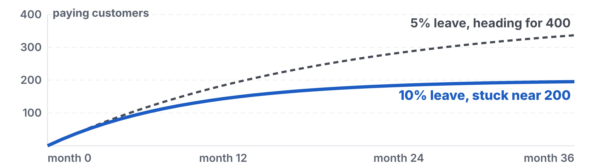
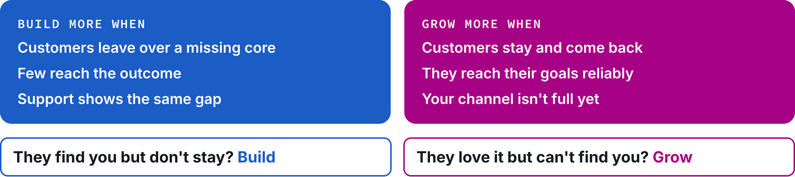

# Homework 10: Product Management & Growth

Updated: 2026-10-26.

**Reach €3,000 cumulative revenue from outside your social graph, shown in your payment dashboard or on paid numbered invoices.** The learning floor is €1,000 cumulative.

> Module 10 · Product Management & Growth · Homework · [Goals M10-LG1 to LG4](README.md)

## What you learned

{: style="max-height: 55mm" }

{: style="max-height: 60mm" }

{: style="max-height: 45mm" }

## What you come back with

By the start of Module 11, your team knows which customers your product keeps and why, has built only what they need to stay and pay again, and runs each week on one number your records feed.

| | Good | Weak |
|---|---|---|
| Staying | 5 of 7 back, 2 lost, reasons in their words | "Retention 71%" |
| Building | 2 bets shipped, 1 hit its effect | 6 features nobody asked for |
| Rhythm | 41 nudges replied, read every Monday | A dashboard nobody opens |

Made up, a recruiter tool.

## The bar

| Per team | Floor | Full bar |
|---|---|---|
| Revenue from outside your social graph, cumulative | €1,000 | €3,000 |

Modules 08 and 09 count toward it. A company counts once. Friends, family, classmates and course teams never count. Who stays is not a bar row. Your kill line counts it.

## Your kill line

A kill line is a result you count, a date, and what you do if you cross it, written down before the data comes in ([Kill Question](../../frameworks/02_Validation_Hierarchy.md)). No line yet? Log this one.

> If fewer than half of our paying customers who paid 14 or more days ago used the outcome or paid again by [the day before Module 11], we build no new feature next week and fix the core with the ones who left.

Back means your records show they used the outcome or paid again. Lost means they cancelled or did nothing for 14 days after paying. Log the line before you open your records. Answers to the question never count.

## How to do it

1. **Skipped the workshop?** Run its three steps as a team first ([Feature Graveyard](M10_Workshop_Feature-Graveyard.md)).
2. **Read your records, not your inbox.** Each paying customer once.
3. **Call those who left** within two days. Ask what happened last time.
4. **Read the [question](../../frameworks/06_PMF_Measurement_Engine.md)'s answers** next to who came back. The "very disappointed" who returned would miss you most.
    - Watch out. Under 20 answers, write counts. 2 of 7, not 29%.
5. **Ship Now bets in small, tested steps,** effect written first. Missed? No sequel.
6. **Say no in writing** to every customer whose request you buried.
7. **Keep one founder selling daily,** your Pipeline's "later" answers first.
8. **Read your tree together weekly.** Write down any chore done twice.
9. **Get a blind second opinion.** Give an AI your raw records, no names or hypothesis. Note where it disagrees.

## Midweek check

Behind the pace you set? Change channel or offer, not volume. Nobody back? Stop new features, call those who left.

## Keep your records

In your [Student Toolkit](../../resources/Student_Toolkit.xlsx).

- **Pipeline.** "Back on (used or paid, date)" and "Lost, reason in their words".
- **Bets.** One row per request, idea or fix, its expected effect written first, the result after.
- **KPI Tracker.** "North Star" and your drivers under M10, plus "Very disappointed, of n asked".
- **Kill Criteria Log.** Line, date, result.
- **Read-out.** Facts, Numbers, Quotes, Images from these.

## By archetype

| [Archetype](../../resources/archetypes/README.md) | What changes |
|---|---|
| B2C | Week-one return across two cohorts. App-store reviews are not retention. |
| Marketplace | Both sides. Supply that leaves after one deal is churn. |
| Deep tech | A paid pilot that becomes a follow-on order is "paid again". |
| Hardware | Use after purchase from the device's own data, and the second order. |

## What Module 11 needs

Your North Star and its numbers, who stays and why, build or grow, your pipeline founder.

## Pre-read for Module 11

Read the [Pitch case](../11-founder-health/M11_Case_Pitch.md) and prepare these questions.

1. From 2021 to 2023, what pressures on Reber does the case show? Sort them onto the six sources of the stressor map at the end of the case, and say which mattered most for his decision. (M11-LG2)
2. Stay as chief executive or step back? Decide as Reber at the end of 2023, and say what would still be his if he stepped back. (M11-LG3)
3. You are one of his co-founders. What could you have noticed or asked in September 2022 that would have made it easier for him to say it out loud, and what do you say to him now? (M11-LG4)
