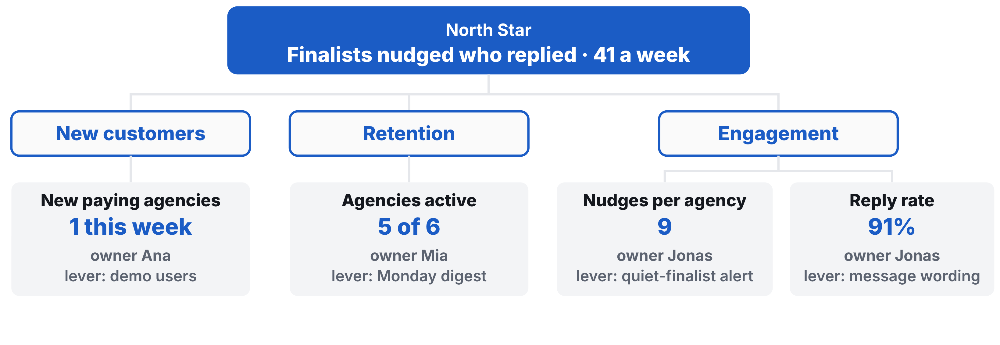

# Workshop 10: Feature Graveyard

Updated: 2026-10-20.

> Module 10 · Product Management & Growth · Workshop · [Goals M10-LG1 to LG4](README.md)

{: style="max-height: 52mm" }

By the start of Module 11, your team knows which customers your product keeps and why, has built only what they need to stay and pay again, and runs each week on one number your records feed. Today you count who stayed, pick the number and bury the rest. Examples are made up, a recruiter tool.

## The 90 minutes

| Time | Step | You leave with |
|---|---|---|
| 25′ | 1 · Count who stayed | A line, customers marked, question sent |
| 30′ | 2 · One number, every bet | North Star, tree, every request a bet |
| 35′ | 3 · Bury, choose, commit | No's sent, build or grow, Now list, targets |

### Step 1 · Count who stayed (25′)

**Goal.** Who came back, from your product's records.

1. **Log your line first (3′)** in the Kill Criteria Log, before you open your records. A kill line is a result you count, a date, and what you do if you cross it, written down before the data comes in. Or adopt the homework's.
2. **List every paying customer (7′)** with their first payment date. Add activated users who haven't paid.
3. **Mark who came back (10′)** from your database and payment rows, with dates. Used it again, paid again, or gone? Under 20, write counts.
4. **Send the question (5′)** to whoever used the core twice in the past two weeks. "How would you feel if you could no longer use [product]?" Very, somewhat or not disappointed. Add "What's the main benefit?" Answers are a compass, coming back is the verdict.

| Good | Weak |
|---|---|
| 6 agencies paid. 4 nudged again within 14 days, 1 gone, "we only hire in spring." | "Users love it. 83% retention." |

**Output.** A line, customers marked, question sent.

### Step 2 · One number, every bet (30′)

**Goal.** One number, and every idea as a bet.

1. **Pick your North Star (5′),** the weekly count of value paying customers get. Not revenue.
2. **Break it into 3 to 5 drivers (7′),** each with an owner, a baseline and a lever.
3. **Write every request, idea and fix as a bet (10′).** Who asked, do they pay, which driver, what effect. An AI drafts rows, names out.
4. **Keep two kinds (4′).** Asked by a payer and deepens their outcome, or fixes why someone left.
5. **Rank the keepers (4′)** by impact and effort, or [RICE](https://www.intercom.com/blog/rice-simple-prioritization-for-product-managers/).

| Good | Weak |
|---|---|
| North Star, finalists nudged who replied, 41 a week. Bet, an alert 3 paying agencies asked for, nudges 9 to 12. | North Star, revenue. Backlog, dark mode, AI chat. |

**Output.** North Star, tree, every request a bet.

### Step 3 · Bury, choose, commit (35′)

**Goal.** Say no, pick the stretch, commit.

1. **Bury the rest (7′),** one line each on why.
2. **Write the no (8′)** to each paying customer who asked, with a way around. Send one now.
3. **Choose build or grow (5′).** They stay but few find you? Grow. They find you but leave? Build.
4. **Set Now, Next, Later (5′)** against a date you can't move, like Demo Day. One Now bet per founder at most.
5. **Commit to the bar (10′).** "Reach €3,000 cumulative revenue from outside your social graph, shown in your payment dashboard or on paid numbered invoices. The learning floor is €1,000 cumulative." Name your pipeline founder, each founder's target and your midweek pace.

| Good | Weak |
|---|---|
| To Lena, "No ATS sync this month. Export the CSV instead." 5 of 6 stay, few find us. Grow. | "Great idea, it's on our roadmap!" Nine features in Now. |

**Output.** No's sent, build or grow, Now list, targets.

## Arrived empty-handed?

No paying customers yet? Use your activated users from the Use Log. No product records? Mark from your payment dashboard and add the outcome row this week.

## Bring and use

[PMF Measurement Engine](../../frameworks/06_PMF_Measurement_Engine.md), [Validation Hierarchy](../../frameworks/02_Validation_Hierarchy.md), [Student Toolkit](../../resources/Student_Toolkit.xlsx). The [lecture](M10_Lecture_Product-Management.pdf) is background.
