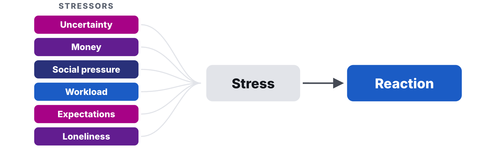

# Pitch: Stay as CEO or Step Back?

Updated: 2026-10-26.

> Module 11 · Founder Health · Case, read before class

Case for Module 11, Founder Health, of Ambitious Entrepreneurship. Prepared by Bastian Burger from public sources as a basis for class discussion. Students of the course met Christian Reber before, in the Module 07 case, set in 2012. The case reports a founder's health only in his own published words and in the dating Capital gave them. It does not judge whether any decision was right or wrong. If reading it brings up something of your own, see [where to get help](M11_Homework.md#where-to-get-help). Licensed under CC BY-NC-SA 4.0 except third-party material as marked.
{: .byline }

At the end of 2023, Christian Reber was co-founder and chief executive of Pitch, a Berlin company that made software for presentations.[^date] He had led it since he founded it in 2018.[^tc2018] [^t3n] Pitch had raised about $137 million from investors, and its last round, in May 2021, had valued the company at $500 million or $600 million, depending on the report (Exhibit 1).[^tc2021] [^capital] In September 2022 Reber had told his employees that the company's cash would last until the end of 2026.[^note2022]

Capital, a German business magazine, later dated Reber's collapse to the start of 2023. Reber recalled in 2024 that he had told his team he could not even sit at the dinner table with his children any more, and that he had decided for himself to go to a clinic.[^capital] Pitch's website, as archived in December 2023, still showed him as chief executive.[^launch] Should he stay in the role, or step back from it?

## A Better PowerPoint

Reber founded Pitch in Berlin in January 2018 "together with some of his Wunderlist co-founders and part of the old core team", as the technology magazine t3n put it.[^t3n] TechCrunch named eight founders, Reber as chief executive, Vanessa Stock, Marvin Labod, Adam Renklint, Charlette Prevot, Jan Martin, Eric Labod and Misha Karpenko.[^tc2019]

Pitch set out to compete with Microsoft's PowerPoint, which, TechCrunch wrote in 2018, had "over 1 billion installs, 500 million users, and some 95 percent market share".[^tc2018] Reber told TechCrunch in 2019, "We loved the idea of building a better version of PowerPoint, but my business brain told me it's a terrible idea."[^tc2019]

Investors backed the team early. In October 2018 Pitch announced a $19 million Series A, led by Index Ventures and BlueYard, which had also led its seed funding. The company had raised $22 million to date. The Slack Fund took part, as did angels such as Eric Yuan, the chief executive of Zoom, and Olivier Pomel, the chief executive of Datadog. Neil Rimer, a partner at Index, joined the board. At that point the team was the eight founders and 12 others, and the product was in a private beta with a few businesses.[^tc2018]

In October 2019 Pitch raised $30 million more, led by Thrive Capital, with Instagram's co-founders Kevin Systrom and Mike Krieger and Superhuman's founder Rahul Vohra, and opened an invite-only beta.[^tc2019] On 20 October 2020 Pitch opened to everyone, after "a year-long beta that included more than 25,000 teams". The basic plan was free, and Pitch Pro cost $10 per user per month. "Our team grew an incredible amount this year — from 60 to 90 while being fully remote," Reber wrote.[^launch]

## Going Big

On 20 May 2021 Pitch announced an $85 million Series B, led by Lakestar and Tiger Global, with Index and Thrive investing again. Since the launch, Reber wrote, "tens of thousands of new teams" had adopted Pitch, and "more than 125,000 workspaces have been created".[^seriesb] He told TechCrunch that Pro already had a "couple of thousand" subscribers, enough to show that "we definitely see our business model working." Stephen Nundy, a partner at Lakestar, joined the board.[^tc2021]

TechCrunch reported a valuation of $600 million, from "sources close to the company".[^tc2021] Capital later gave $600 million in one passage and $500 million in another.[^capital] Pitch did not publish its valuation.

Pitch kept hiring. In April 2022 it employed around 160 people, CNBC reported.[^cnbc] In May 2022 Reber wrote, "In the last four years, we scaled the Pitch team from 25 to 200-strong, and we planned to grow more" (Exhibit 2).[^may2022]

Reber was not only running Pitch. In 2021 he had launched Superlist, a productivity app, which announced a €10 million seed round led by EQT Ventures in April 2022.[^cnbc] In October 2022 the news site Startbase reported, citing Finance Forward, that he had set up a venture fund, Interface Capital, with Niklas Jansen.[^startbase] In CNBC's report of 12 April 2022 on Superlist's seed round, Reber was quoted as saying, "I think it's incredibly easy to raise funding for technology companies right now because it's like there's more money than companies on the market," and, "As a founder who is starting companies more frequently, I feel like it's never been better to raise."[^cnbc]

## The Turn

On 6 May 2022, less than four weeks after that report, Reber published "Our plan to navigate tech's 2022 market correction at Pitch" on LinkedIn. "Fundraising on similar terms between now and 2024 looks unlikely," he wrote.[^may2022] Pitch had "been well-capitalized for years", he wrote, with "a strong growth rate", but was "still taking this moment very seriously — and taking action". It paused hiring except for a few roles, cut all costs that did not serve growth "to zero", and extended its runway, the time its cash would last, "by a full year without letting anyone go".[^may2022]

The goals stayed. "We're not adjusting our growth targets," Reber wrote. "This is a chance for us to learn to accomplish more with less money, less time, and smaller, faster teams. Not by working harder, but smarter." Pitch had made a plan, he wrote, "while preserving our ambition to become a unicorn when we raise our next round."[^may2022] A unicorn is a start-up valued at $1 billion or more.

Four months later Reber brought his co-founders and leadership team together for a two-day offsite. Two weeks after it, on 14 September 2022, he wrote to all employees, "It's increasingly clear that we're heading into an extended recession, and that bringing Pitch into this new, difficult market environment in its current shape and at its current size is too risky." Pitch let 59 people go that day. Their salaries were paid until the end of 2022, and they kept earning their employee shares until then. The cuts extended the runway "by two more years until the end of 2026".[^note2022]

"In the midst of all this uncertainty, we're still working on our product-market fit and our go-to-market motion," Reber wrote.[^note2022] Product-market fit is the point at which a product meets strong demand in its market, and a go-to-market motion is the way a company finds, reaches and sells to its customers. "I take full responsibility for this decision," he wrote, and, "From my own perspective, I certainly didn't expect this at the start of the year. It's the most painful decision I've ever had to make as a founder." To those staying he wrote, "I'm aware that many of you will have concerns and doubts about our future." He announced a review of the roadmap "starting next week", to "begin finding our way forward".[^note2022]

Reber recalled the layoff in 2024. "I cried my eyes out," he told Capital. He recalled being asked afterwards, as the one who had decided to make the company a third smaller, how it would carry on.[^capital]

> "I should have answered, 'Shit, honestly, I don't know, this is too much for me.' But I didn't say it out loud."[^capital]

Instead, he recalled, he called a meeting on product strategy for the following week, sat at home already drained, tried to rethink the strategy and realised that he could not go on.[^capital] "When you're used to being in a leadership position and you realise it doesn't work any more, everything collapses at once. Like a house of cards."[^capital]

## A Break

Capital dated Reber's collapse to the start of 2023. Reber told the magazine,

> "I just told my team, I can't even sit at the dinner table with my children any more. I'm completely exhausted, I'm having panic attacks, I can't sleep any more … I need some time off. I then decided for myself to go to a clinic to have my burnout treated."[^capital]

In a podcast in March 2024, Reber placed the collapse at the end of 2022, during the layoffs. He said he spent five months in clinics in all and tried to manage the company from there, "with the energy I still somehow had in my body", going home every weekend.[^bp] The sources this case cites do not say who took on his work in that time. Capital reported that Reber moved with his family from Berlin to Mallorca in 2023. He told the magazine he had needed a change of scene.[^capital]

Pitch carried on. On 2 May 2023 the company wrote that "one million workspaces have been created in Pitch", two and a half years after its public launch.[^million] On 14 November 2023 it launched Pitch 2.0, with a free generator that drafted presentations with artificial intelligence, new ways to share and track decks, animations and new plans. "Since 2020, Pitch has been adopted by over one million teams of all sizes," said the announcement, signed by Renklint, by then the chief technology officer.[^pitch2] Pitch did not report its revenue or its number of paying customers in 2023, and no headcount for 2023 could be checked in a source from the time.

## Money in 2023

On 28 November 2023 the venture capital firm Atomico projected in its report *State of European Tech* that venture funding for European tech companies would reach $45 billion in 2023. That was 45% below the $82 billion of 2022, which had itself fallen from $100 billion in 2021.[^atomico] In July 2023 the consultancy EY reported that investment in German start-ups had halved in the first half of 2023, compared with the first half of 2022, to €3.1 billion (Exhibit 3).[^ey]

Neil Rimer of Index had joined the board in 2018, Stephen Nundy of Lakestar in 2021.[^tc2018] [^tc2021] The company's last public plan for its cash reached to the end of 2026.[^note2022] How much cash Pitch held at the end of 2023 was not disclosed.

## The End of 2023

By the end of 2023, Reber had led Pitch for almost six years. He had raised its money, grown its team from 20 people to 200 and taken responsibility for the cut of 2022 himself.[^tc2018] [^may2022] [^note2022] His plan of September 2022 had given the company cash until the end of 2026.[^note2022] The company had kept shipping, and Pitch 2.0 was weeks old.[^pitch2] How Reber felt at the end of 2023 is not documented.

Stepping back would hand the role to someone else after a year that Capital dated as beginning with his collapse, and in which, by his own account, he had panic attacks, could not sleep and decided to go to a clinic.[^capital] By his own later account, he had not said out loud in 2022 that it had become too much for him.[^capital] By 2022 he also had roles at Superlist, which he had launched in 2021, and at the fund he set up that year. Capital reported that in 2023 his family had moved with him to Mallorca.[^cnbc] [^startbase] [^capital]

The market bore on both choices. Venture funding in Europe had halved, and Reber himself had written in May 2022 that raising money on similar terms before 2024 looked unlikely.[^atomico] [^may2022]

The question before Reber at the end of 2023 was whether to stay as Pitch's chief executive or step back from the role. What should he do?

## Exhibits

## Exhibit 1: Pitch's funding, 2018 to 2021

| Announced | Amount | Led by | Others named | Joined the board | Reported valuation |
|---|---|---|---|---|---|
| Before 9 October 2018 | About $3 million (seed) | BlueYard | Not reported | Not reported | Not reported |
| 9 October 2018 | $19 million (Series A) | Index Ventures, BlueYard | Slack Fund. Angels including Eric Yuan (Zoom), Koen Bok (Framer), Simon Willnauer (Elastic), Olivier Pomel (Datadog), Frank Thelen, Andrew Wilkinson (Metalab) | Neil Rimer (Index Ventures) | Not reported |
| 1 October 2019 | $30 million | Thrive Capital | Kevin Systrom and Mike Krieger (Instagram), Rahul Vohra (Superhuman) | Not reported | Not reported |
| 20 May 2021 | $85 million (Series B) | Lakestar, Tiger Global | Index Ventures, Thrive Capital | Stephen Nundy (Lakestar) | $600 million (TechCrunch, "sources close to the company", 2021). $600 million and $500 million (Capital, 2024) |
| Total | About $137 million | | | | |

Source: compiled by the case writer from TechCrunch, 9 October 2018, 1 October 2019 and 20 May 2021, Pitch's blog, 20 May 2021, and Capital, 3 March 2024, see notes [^tc2018], [^tc2019], [^tc2021], [^seriesb] and [^capital]. The seed is the case writer's calculation, $22 million raised to date in October 2018 less the $19 million Series A. Its date was not reported. The total is the case writer's sum of $22 million, $30 million and $85 million. Pitch did not publish its valuation. A seed round is a start-up's first outside funding, Series A and Series B are the larger rounds that follow, and angels are private individuals who invest their own money.
{: .source }

## Exhibit 2: Pitch in dates and team size, 2018 to November 2023

| Date | Event | Team size, as reported | Reported by |
|---|---|---|---|
| January 2018 | Pitch founded in Berlin | | t3n, 2020 |
| 9 October 2018 | $19 million Series A, product in private beta | 8 founders and 12 others | TechCrunch |
| 1 October 2019 | $30 million, invite-only beta opens | | TechCrunch |
| 2020 | Team works fully remote | From 60 to 90 during the year | Reber, Pitch blog |
| 20 October 2020 | Public launch after a beta with more than 25,000 teams. Pro at $10 per user per month | | Reber, Pitch blog |
| 20 May 2021 | $85 million Series B. More than 125,000 workspaces created | | Reber, Pitch blog. TechCrunch |
| April 2022 | | Around 160 | CNBC |
| 6 May 2022 | Hiring paused, costs that do not serve growth cut, growth targets kept | 200, "from 25" in four years | Reber, LinkedIn |
| Two weeks before 14 September 2022 | Two-day offsite of co-founders and leadership team | | Reber, note to employees |
| 14 September 2022 | 59 people let go. Runway extended to the end of 2026 | 59 fewer | Reber, note to employees |
| End of 2022 or start of 2023 | Reber's collapse, at the end of 2022 by his account, at the start of 2023 as Capital dated it. Five months in clinics, by his account | | Reber, podcast, 2024. Capital, 2024 |
| 2 May 2023 | One million workspaces created | Not reported in the post | Pitch blog |
| 14 November 2023 | Pitch 2.0 launched, with an AI presentation generator | Not reported in the post | Pitch blog, signed by Renklint |

Source: compiled by the case writer from the sources in notes [^t3n], [^tc2018], [^tc2019], [^launch], [^seriesb], [^cnbc], [^may2022], [^note2022], [^capital], [^bp], [^million] and [^pitch2]. Team sizes come from different sources and are not one series. Hiring after September 2022 was not reported.
{: .source }

## Exhibit 3: Venture funding around Pitch, 2021 to 2023

| Year | Venture funding for European tech companies (Atomico) | Investment in German start-ups (EY) |
|---|---|---|
| 2021 | $100 billion | |
| 2022 | $82 billion | |
| 2023 | $45 billion, projected in November 2023, 45% below 2022 | €3.1 billion in the first half, half of the first half of 2022 |

| Date | What Reber said about raising money |
|---|---|
| Quoted by CNBC, 12 April 2022 | "As a founder who is starting companies more frequently, I feel like it's never been better to raise." |
| 6 May 2022 | "Fundraising on similar terms between now and 2024 looks unlikely." |

Source: CNBC on Atomico's *State of European Tech* report, 28 November 2023, EY Startup-Barometer, July 2023, CNBC, 12 April 2022, and Reber on LinkedIn, 6 May 2022, see notes [^atomico], [^ey], [^cnbc] and [^may2022]. Atomico's and EY's figures measure different things and are not comparable with each other.
{: .source }

## The Stressor Map from the Course {: .exhibit }

Source: course graphic. It holds no data about Pitch.
{: .source }

[^date]: The date of the decision is not public. The case describes the situation as it stood at the end of 2023.
[^tc2018]: Ingrid Lunden, "Pitch, from the founders of Wunderlist, raises $19M to take on PowerPoint in presentations", TechCrunch, 9 October 2018, <https://techcrunch.com/2018/10/09/pitch-from-the-founders-of-wunderlist-raises-19m-to-take-on-powerpoint-in-presentations/>, accessed 2026-10-26.
[^t3n]: Dieter Petereit, "Erste Einblicke: Präsentationstool Pitch startet 2020", t3n, 27 March 2020, <https://t3n.de/news/erste-einblicke-pitch-startet-1265610/>, accessed 2026-10-26. "gemeinsam mit einigen seiner Wunderlist-Mitgründer und einem Teil des alten Kern-Teams im Januar 2018 gegründet". Translated from German by the case writer.
[^tc2021]: Ingrid Lunden, "Pitch, a platform for making and sharing presentations, raises $85M on a $600M valuation", TechCrunch, 20 May 2021, <https://techcrunch.com/2021/05/20/pitch-a-platform-for-making-and-sharing-presentations-raises-85m-on-a-600m-valuation/>, accessed 2026-10-26.
[^capital]: Niklas Wirminghaus, "Burnout: Wie Stargründer Christian Reber am Druck zerbrach", Capital, 3 March 2024, also in the print issue 3/2024, <https://www.capital.de/wirtschaft-politik/burnout--wie-stargruender-christian-reber-am-druck-zerbrach-34504962.html>, accessed 2026-10-26, read up to the paywall. Reber's words are the magazine's rendering of its interview with him, told in 2024 about 2022 and 2023. The magazine gives "600 Mio. Dollar" as the valuation in one passage and "500 Mio. Dollar" in another, and dates his collapse in its own words, "2023 … beginnt mit seinem Zusammenbruch". Quotes translated from German by the case writer. "Ich habe geheult wie ein Schlosshund." "Ich hätte antworten müssen: ,Scheiße, ganz ehrlich, ich weiß es nicht, das überfordert mich.' Aber ich habe es nicht laut gesagt." "Wenn du gewohnt bist, in einer Führungsposition zu sein, und merkst, dass es nicht mehr geht, dann bricht alles mit einem Mal zusammen. Wie ein Kartenhaus." "Ich habe meinem Team nur gesagt, ich kann nicht mal mehr mit meinen Kindern am Esstisch sitzen. Ich bin völlig fertig, kriege Panikattacken, kann nicht mehr schlafen … Ich brauche mal eine Auszeit. Ich habe dann selbst für mich beschlossen, in eine Klinik zu gehen, um meinen Burn-out behandeln zu lassen." On the move to Mallorca, "Er sagt, er habe einen Tapetenwechsel gebraucht."
[^note2022]: Christian Reber, "Changes at Pitch", note to all employees of 14 September 2022, published on Pitch's Notion, <https://pitch.notion.site/Changes-at-Pitch-d4299519de7544378dddb6df2e55c506>, accessed 2026-10-26.
[^launch]: Christian Reber, "Don't just present. Pitch.", Pitch blog, 20 October 2020, byline "CEO & Founder", Internet Archive capture of 11 December 2023, <https://web.archive.org/web/20231211230913/https://pitch.com/blog/pitch-launches>, accessed 2026-10-26.
[^tc2019]: Ingrid Lunden, "Pitch, a presentation startup from Wunderlist's founders, raises $30M more to take on PowerPoint", TechCrunch, 1 October 2019, <https://techcrunch.com/2019/10/01/pitch-a-presentation-startup-from-wunderlists-founders-raises-30m-more-to-take-on-powerpoint/>, accessed 2026-10-26.
[^seriesb]: Christian Reber, "Pitch's $85M Series B and what's next", Pitch blog, 20 May 2021, Internet Archive capture of 17 December 2023, <https://web.archive.org/web/20231217140434/https://pitch.com/blog/pitch-series-b-funding>, accessed 2026-10-26.
[^cnbc]: Sam Shead, "Wunderlist co-founder Christian Reber raises funding for Superlist", CNBC, 12 April 2022, <https://www.cnbc.com/2022/04/12/wunderlist-co-founder-christian-reber-raises-funding-for-superlist.html>, accessed 2026-10-26. The article does not say when Reber made the statements it quotes.
[^may2022]: Christian Reber, "Our plan to navigate tech's 2022 market correction at Pitch", LinkedIn, 6 May 2022, <https://www.linkedin.com/pulse/our-plan-navigate-techs-2022-market-correction-pitch-christian-reber>, accessed 2026-10-26.
[^startbase]: Janina Gerhardt, "Christian Reber launches his own fund", Startbase, 4 October 2022, citing Finance Forward, <https://www.startbase.com/news/christian-reber-startet-eigenen-fonds>, accessed 2026-10-26.
[^bp]: Content note. Between the two passages cited here, the episode contains his account of suicidal thoughts in 2022, which this case does not use. If that is hard to hear, see [where to get help](M11_Homework.md#where-to-get-help). Later in the episode he also speaks about events after the end of 2023. Business Punk, "Erst „voll abgestürzt“, dann das wertvollste Unternehmen der Welt angreifen – mit Seriengründer Christian Reber", *How to Hack* (podcast), 28 March 2024, <https://www.business-punk.com/podcast/podcast-erst-voll-abgestuerzt-dann-das-wertvollste-unternehmen-der-welt-angreifen-mit-seriengruender-christian-reber/>, accessed 2026-10-26. Audio as published in the Acast feed, downloaded on 2026-10-26, transcribed with Whisper and translated from German by the case writer. The file begins with an advertisement of about 33 seconds, and the times refer to the file. 0:15:23 to 0:16:51 "Ende 2022, so ein richtiger Burnout", "während dieser Kündigungswelle". 0:18:11 to 0:18:36 "ich war insgesamt fünf Monate in Kliniken … Habe von dort aus meine Company weiter gemanagt oder zumindest versucht zu managen, so mit der Energie, die ich noch irgendwie im Körper hatte. Bin jedes Wochenende nach Hause gefahren".
[^million]: Ariane Phipps-Morgan, "Celebrating one million teams in Pitch", Pitch blog, 2 May 2023, Internet Archive capture of 1 December 2023, <https://web.archive.org/web/20231201193939/https://pitch.com/blog/one-million-teams>, accessed 2026-10-26.
[^pitch2]: Adam Renklint, "Introducing Pitch 2.0: The future of visual business", Pitch blog, 14 November 2023, byline "CTO & Co-Founder", Internet Archive capture of 1 December 2023, <https://web.archive.org/web/20231201170419/https://pitch.com/blog/introducing-pitch-2-0>, accessed 2026-10-26.
[^atomico]: Ryan Browne, "European tech funding halves to $45 billion, back to pre-Covid levels — but AI is a bright spot", CNBC, 28 November 2023, <https://www.cnbc.com/2023/11/28/europe-tech-industry-funding-halves-in-2023-ai-a-bright-spot-atomico.html>, accessed 2026-10-26.
[^ey]: EY, "EY Startup-Barometer Deutschland – Juli 2023", summary on EY's start-up page, <https://www.ey.com/de_de/services/start-ups>, accessed 2026-10-26. "Im Vergleich zum ersten Halbjahr 2022 halbierte sich das Gesamtvolumen der Investitionen in den ersten sechs Monaten dieses Jahres auf 3,1 Mrd. €." Translated from German by the case writer.
