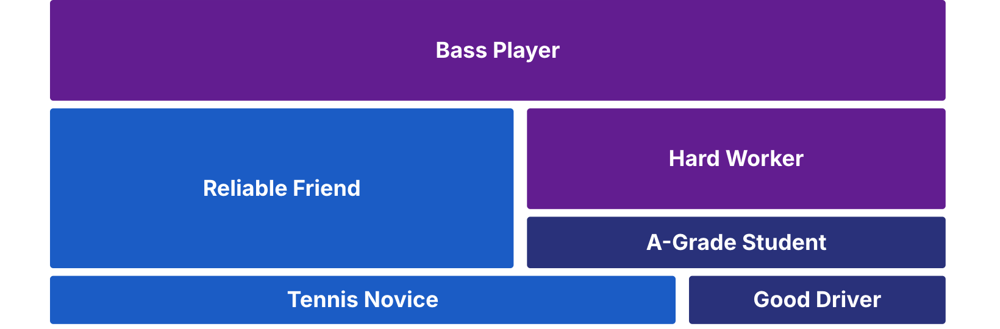

# Homework 11: Founder Health

Updated: 2026-10-26.

**Reach €5,000 cumulative revenue from outside your social graph, keep the private maps you chose, of what drains and energises you, for seven days, and hold one honest co-founder conversation that ends in one agreed change in your Team sheet, with a revisit date.** The learning floor is €2,000 cumulative and the conversation with its written change.

> Module 11 · Founder Health · Homework · [Goals M11-LG2 to LG4](README.md)

## What you learned

{: style="max-height: 53mm" }

.")

## What you come back with

By the start of Module 12, each of you knows what drains you and what gives you energy, and your team has said how everyone is really doing, agreed on a pace it can hold and kept selling. Founders who stay standing keep selling.

| | Good | Weak |
|---|---|---|
| Map | Seven days. Late payers drain, customer calls energise | Dropped on day two |
| Talk | Both said how they are. Sunday off, revisit in four weeks | "All good?" "All good." |
| Pace | Scary bits first. €2,600 so far | Selling paused "for now" |

Made up.

## The bar

| Per team | Floor | Full bar |
|---|---|---|
| Revenue from outside your social graph, cumulative | €2,000 | €5,000 |
| One honest talk, one change in your Team sheet, revisit date | Yes | Yes |
| Founders who chose a map and kept it seven days | | All of them |

Revenue counts by the [rubric's rules](../../resources/GRADING_RUBRIC.md#the-revenue-ladder), with proof. The map is an offer. Skip it without a reason. It never counts against your team. Kept means its founder tells the team "yes, seven days". Nobody reads it. Solo? Talk with a peer founder or a mentor.

## Your stop lines

A stop line is a kill line for you. A sign others could notice ("I go silent"), how often, and what you then do, written first. Or take ours.

> If I catch myself [my sign] twice this week, I tell my co-founder and take the next evening off.

Your team writes one too.

> If one of us says the pace cannot be held, we cut next week's plan before we add work.

## Where to get help

A bad week is normal. More? Talk to someone outside the team. Your doctor, university counselling or a founder you trust. To talk now in Germany, call TelefonSeelsorge on 0800 111 0 111 or 0800 111 0 222, free, day and night. Austria 142, Switzerland 143, emergencies 112. Elsewhere, see [findahelpline.com](https://findahelpline.com).

## How to do it

1. **Start or continue your map today,** on paper or in a note only you see. Each stressful moment and its source, then what energises you.
2. **Keep one practice** that research backs. Sleep, exercise, an evening note or gratitude. Not all four.
3. **Pack the scary bits first,** what must happen before Demo Day. Your pipeline founder from Module 10 keeps selling every day.
4. **Ask AI for a blind read of your pipeline,** raw notes without names or your hypothesis. Say where it disagrees.
    - Watch out. Your map never goes into an AI tool or a shared file.
5. **Read your map on day seven.** Your three strongest drains, and why? Tell your team "yes, seven days" or "no".
6. **Draft your pitch, ugly.** Ten slides in [Sequoia's order](../../resources/READING_LIST.md#fundraising--pitch).

## Midweek check

Read your stop lines. Crossed one? Do what you wrote, today. Behind the pace you set? Change channel or offer, not your hours.

## Keep your records

In your [Student Toolkit](../../resources/Student_Toolkit.xlsx), except your map.

- **Team sheet.** New Agreement row "How we look after each other". The change, your team line, the Revisit by date, each founder's dated yes.
- **Pipeline and Revenue Ladder.** Each payment with its proof.
- **Read-out.** Your venture's Facts, Numbers, Quotes, Images. Not how you are.

## What Module 12 needs

Your revenue with proof, your pace and the ugly pitch.

## Pre-read for Module 12

Read the [Personio case](../12-fundraising-demo-day/M12_Case_Personio.md) and prepare these questions.

1. In spring 2016 Personio's founders paid themselves nothing and had financed the company on revenue and annual prepayments. From the evidence in the case, was the company default alive, and what would you need to know to be sure? (M12-LG2)
2. Raise a seed round now, or grow on customers' money for another year? Take one side, argue it with the evidence in the case and say from whom you would take the money. (M12-LG2)
3. Renner recalled that early in 2016 the founders set out to build the leading solution for small and mid-sized companies in Europe. Using the company counts in the case, how big could Personio get from Germany alone, and what would outside money have to buy to go further? (M12-LG1)
