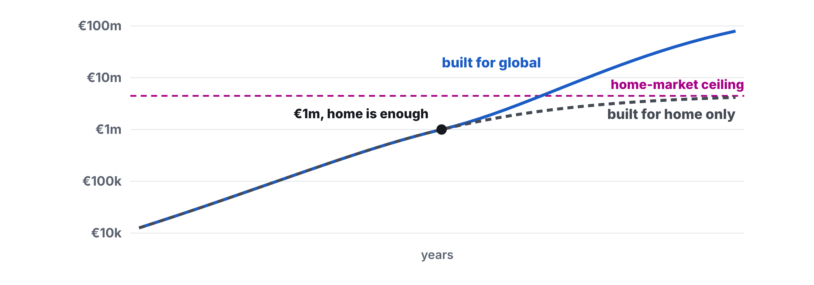
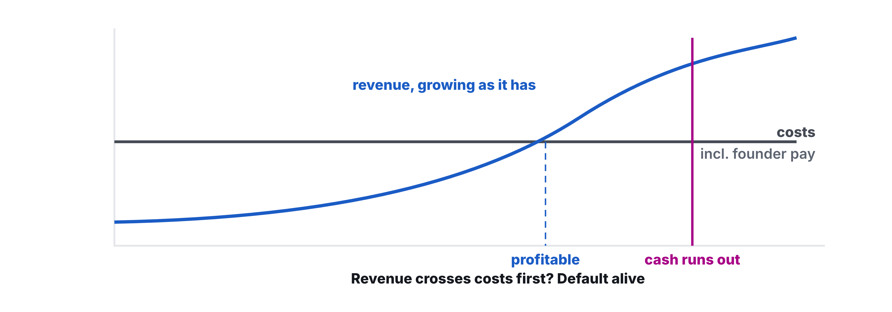
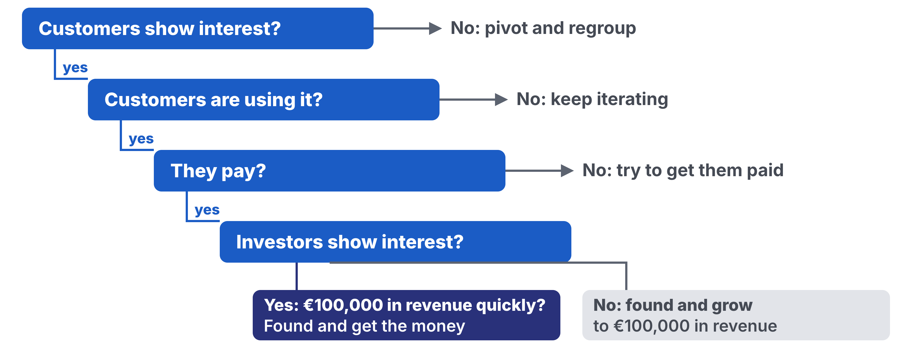

# Homework 12: Fundraising & Demo Day

Updated: 2026-10-26.

**Reach €10,000 cumulative revenue from outside your social graph by Demo Day, rehearse your pitch with three outsiders who can repeat your problem and your one number, and within seven days of Demo Day write your verdict on the company with what it needs.** The learning floor is the Demo Day minimum of €2,000 verified with your evidence pack, one such outsider and your written verdict.

> Module 12 · Fundraising & Demo Day · Homework · [Goals M12-LG1 to LG4](README.md)

## What you learned

{: style="max-height: 51mm" }

{: style="max-height: 51mm" }

{: style="max-height: 57mm" }

## What you come back with

By Demo Day, your team pitches its venture on proof, not promises, knows how big it can get and which money fits, and leaves with a decision on the company, a plan and a group that keeps you selling. Customers and investors ask for proof first.

| | Good | Weak |
|---|---|---|
| Revenue | €11,400 from 52 practices, on the dashboard | €9,000, €4,000 of it a favour |
| Pitch | Three outsiders said "call-backs" and "50 of 52 stay" | Rehearsed with each other |
| Company | Go on, plan, angel call, group on the 14th | "We'll decide after the exams" |

Made-up examples, a booking tool for physio practices.

## The bar

| Per team | Floor | Full bar |
|---|---|---|
| Revenue from outside your social graph, cumulative, verified with your evidence pack | €2,000 | €10,000 |
| Outsiders who repeat your problem and your one number | 1 | 3 |
| Verdict "go on" or "pivot", within seven days | Verdict row | Plus plan, meeting, group date |
| Verdict "stop", within seven days | Verdict row | Plus the close begun in the order of [Founder Health (M11)](../11-founder-health/) |

Revenue counts by the [rubric's rules](../../resources/GRADING_RUBRIC.md#the-revenue-ladder), and an argued kill can still earn an [A](../../resources/GRADING_RUBRIC.md#the-a-kill-yes-really). Your evidence pack is your Toolkit, with each payment's proof. Outsiders are not in your team or course. Each counts once per team. Your one number shows people want this.

## Your company line

A kill line is a count, a date and an action, written before the data comes in. Write the company's in your Kill Criteria Log before Demo Day, or take ours.

> If on Demo Day we are default dead and our revenue of the last four weeks is no higher than the four weeks before, we stop and close the company well.

Default alive means revenue, growing as it has, covers costs before the cash runs out ([Graham, 2015](https://paulgraham.com/aord.html)). Add the pay each founder needs to go full time.

## How to do it

1. **Write your company line today.**
2. **Sell every day.** Ask customers for referrals.
3. **Check default alive** with the [calculator](../../frameworks/04_Default_Alive_Calculator.md).
4. **Pick the money that fits.** Customers first. A grant buys time, not proof. Investors only if you could get very big, raised from strength. A patent counts as a moat once customers exist.
5. **Name your second market,** where your problem costs most. Find five people there, book one call.
6. **Rehearse with outsiders.** Five minutes in [Sequoia's order](../../resources/READING_LIST.md#fundraising--pitch), then ask them for your problem and your one number. Wrong? Rewrite your opening.
    - Watch out. Friends nod. Pick people who could pay.
7. **Ask AI for a blind read** of your pipeline notes, names removed. Fix the pitch where it disagrees.
8. **Decide within seven days.** Your line first, then the [GPK framework](../../frameworks/03_GPK_Decision_Framework.md).

## Midweek check

Three days before Demo Day, check your revenue pace. Behind? Change channel or offer, not hours.

## Keep your records

In your [Student Toolkit](../../resources/Student_Toolkit.xlsx).

- **Kill Criteria Log.** Your company line.
- **Interview Log.** One row per outsider, answer in Notable Quote.
- **KPI Tracker.** New rows for burn, cash and runway.
- **Verdict.** Go, Pivot or Kill, provisional on Demo Day, confirmed within seven days.
- **Team sheet.** Money row, plan, meeting and group date.

## After the course

Keep your group. Meet every two weeks with the [group tracker](../../resources/Accountability_Group_Tracker.xlsx).
