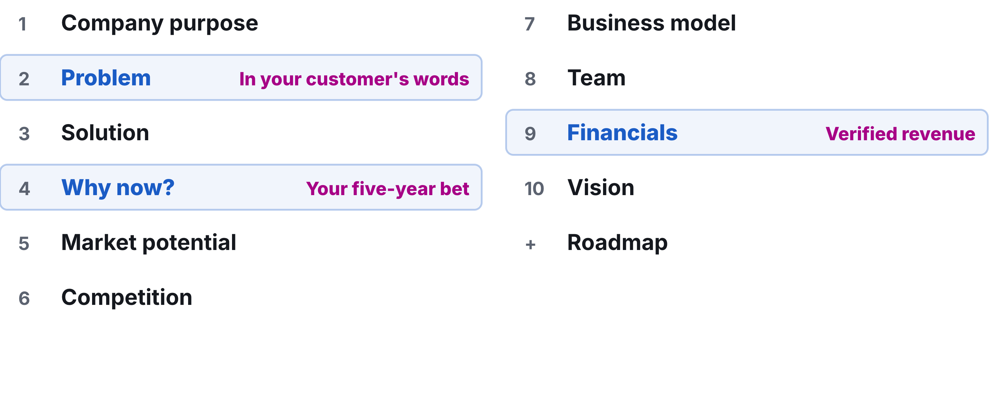

# Workshop 12: Demo Day

Updated: 2026-10-26.

> Module 12 · Fundraising & Demo Day · Workshop · [Goals M12-LG3 and LG4](README.md)

{: style="max-height: 59mm" }

By Demo Day, your team pitches its venture on proof, not promises, knows how big it can get and which money fits, and leaves with a decision on the company, a plan and a group that keeps you selling. Today you pitch and start deciding. Examples are made up.

**Bring** your pitch, proof and [Student Toolkit](../../resources/Student_Toolkit.xlsx). The jury looks for the [rubric's](../../resources/GRADING_RUBRIC.md) four things, evidence, decisions, verified revenue and a story that survives questions.

## The 90 minutes

| Time | Step | You leave with |
|---|---|---|
| 10′ | 1 · Put your proof on screen | Deck, proof, one number |
| 50′ | 2 · Pitch on proof | Pitch given, open questions noted |
| 30′ | 3 · Decide what comes next | Verdict drafted, meeting booked, group date |

### Step 1 · Put your proof on screen (10′)

**Goal.** Every claim can be checked.

1. **Load your deck,** ten slides in Sequoia's order or fewer.
2. **Open your proof** next to it, the payment dashboard or numbered invoices. Hide customer names.
3. **Write your one number** on a card, the one that shows people want this.
4. **Show the jury your Toolkit,** your evidence pack, on request.

| Good | Weak |
|---|---|
| €11,400 from 52 practices, dashboard open. Card: "50 of 52 still pay after month one." | "The screenshot is on my phone somewhere." |

**Output.** Deck, proof, one number.

### Step 2 · Pitch on proof (50′)

**Goal.** Five minutes a stranger can repeat, then honest answers. Ten minutes per team.

1. **Open with the problem** in a customer's own words.
2. **Say why now,** your bet on the world in five years.
3. **Show the proof,** then your one number.
4. **Stop at five minutes.**
5. **Answer for five minutes.** "We don't know yet" beats a guess. Note what you could not answer.
6. **While others pitch, write one note** a team can act on.

| Good | Weak |
|---|---|
| "I spend two evenings a week calling patients back." Proof on screen. "Churn? Two of 52, both closed." | Features first, then "a €4 billion market." "Churn? Very low." |

**Output.** Pitch given, open questions noted.

### Step 3 · Decide what comes next (30′)

**Goal.** The course ends. Your company decides whether it does.

1. **Read your company line,** the company's kill line. A kill line is a count, a date and an action, written before the data comes in. Crossed? Act on it, or argue the override.
2. **Draft your verdict** in the Verdict sheet. Go, Pivot or Kill, with the evidence, confirmed within seven days.
3. **Going on? Write the plan** in your Team sheet. Who does what with how much time, the next revenue target and kill line, who owns the code, the brand and the money.
4. **Book your next outside meeting** now.
5. **Set your group's next date** in the [group tracker](../../resources/Accountability_Group_Tracker.xlsx). Your bar, verdict still open. "Reach €10,000 cumulative revenue from outside your social graph by Demo Day, rehearse your pitch with three outsiders who can repeat your problem and your one number, and within seven days of Demo Day write your verdict on the company with what it needs. The learning floor is the Demo Day minimum of €2,000 verified with your evidence pack, one such outsider and your written verdict."

| Good | Weak |
|---|---|
| Go on. Lena sells, Tom builds, both full time until March, code and brand in the company. €20,000 by 1 March, or we stop. Angel call Tuesday, group on the 14th. | "Let's see after the exams." |

**Output.** Verdict drafted, meeting booked, group date set.

## Arrived empty-handed?

No revenue? Pitch what you tested and killed. A well-argued kill can earn an A ([rubric](../../resources/GRADING_RUBRIC.md#the-a-kill-yes-really)). No company line? Write one now, then read it. No deck? Use [Sequoia's order](../../resources/READING_LIST.md#fundraising--pitch) on paper. Solo? Hold Step 3 with a mentor.

## Bring and use

The [Default Alive Calculator](../../frameworks/04_Default_Alive_Calculator.md) and the [GPK framework](../../frameworks/03_GPK_Decision_Framework.md).
